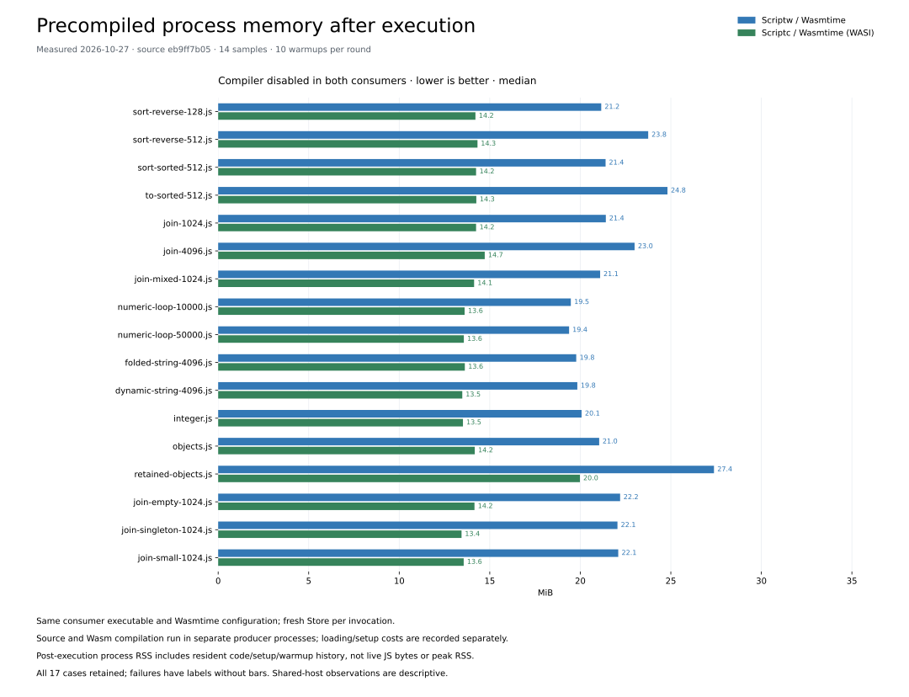
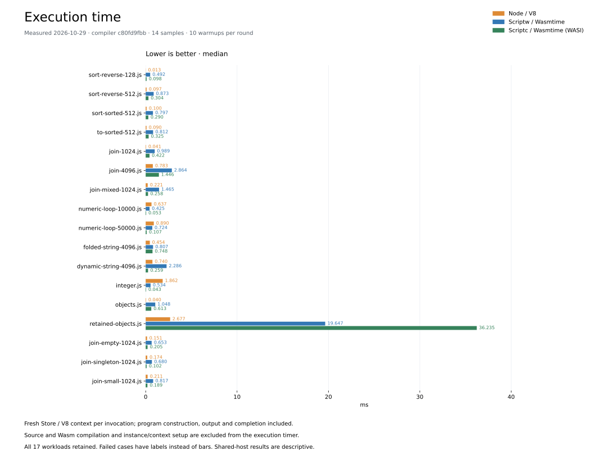
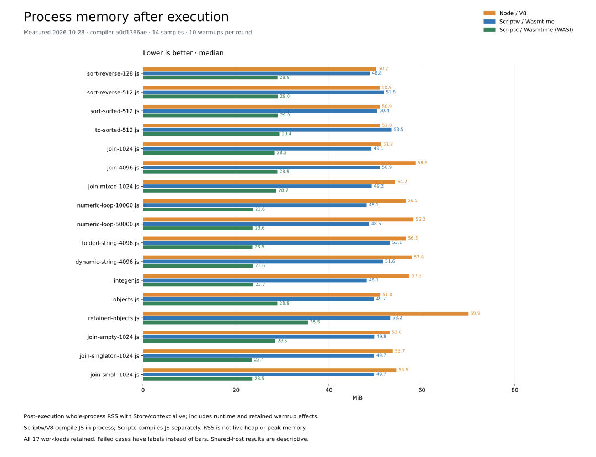

# scriptw

Scriptw is an experimental JavaScript-to-WebAssembly compiler written in Rust.
Compile JavaScript and its builtins to Wasm, run it through Wasmtime, or embed
it in a Rust application. WebAssembly is the sole output target.

Rust embedders can declare numeric, lossless UTF-16 string and byte foreign
functions, retain and call JavaScript exports, and settle async host operations
through their own Wasmtime `Store` and `Linker`. ABI requirements persist in
source-free Portable bundles. See the [embedding contract and runnable examples](docs/rust-rewrite/contracts/foreign-modules.md).

Trusted Wasmtime native program images also support fresh-process execution
with the native compiler disabled; the contract records their host-specific
format and explicit native-code admission boundary.
On Linux, Cargo native runtime loading streams through bounded buffers into
private disk backing. It reads linked image data through the executable file
when its exact inode and mapped range can be established; see the
[runtime ownership contract](docs/rust-rewrite/contracts/runtime-byte-ownership.md).

## Precompiled comparison



**Measured 2026-10-26 on one GitHub Actions runner**, compiler `fc714e607`.
The [precompiled benchmark workflow](docs/rust-rewrite/contracts/precompiled-comparison.md)
compares Scriptw and Scriptc in the same Wasmtime executable, with JavaScript
and Wasm compilation in separate producer processes. Both measured consumers
disable compilation and use identical native optimization and runtime settings.
Both passed the original checksums on **17/17 workloads** across two rounds.
Scriptw's median post-execution process RSS remains **4.1–5.6× Scriptc's**:

| Workload | Scriptw RSS | Scriptc RSS |
| --- | ---: | ---: |
| Integer | 57.1 MiB | 13.3 MiB |
| Objects | 65.1 MiB | 14.0 MiB |
| Retained objects | 81.2 MiB | 19.8 MiB |

These are medians of 14 samples per runtime and workload, after ten checked
warmups per round, with each Store still alive. Process memory is sampled at
loading, setup, execution and Store-drop boundaries; RSS is neither live JS
heap nor peak memory. The gap remains with compilation disabled, but this does
not isolate its cause. This cohort stays separate from the ordinary V8 comparison below.
The matched Scriptc footprint is the execution-memory target; improvements
must retain the same workloads, checksums and measurement boundaries.

[All measurements and complete evidence](docs/rust-rewrite/precompiled-comparison.md) ·
[Precompiled execution-time graph](docs/rust-rewrite/assets/precompiled-execution.svg) ·
[CI run](https://github.com/mewhhaha/scriptw/actions/runs/40380484042).

## Benchmarks





**Measured 2026-10-26 on GitHub Actions**, compiler `8517b2046`.
All three runtimes were measured together: **Scriptw / Wasmtime**, **Scriptc / Wasmtime (WASI)**
and **Node / V8**. Scriptc passed the original checksums on **17/17 workloads**;
the remaining cases retain explicit failure labels and diagnostics.

Bars show median execution time and post-execution process RSS, with compilation
and instance/context setup outside the execution timer. RSS includes the host/runtime,
compilation and retained warmup effects; it is neither live JavaScript heap nor peak memory.
Shared-runner observations are descriptive. The existing pinned Test262 status below is separate.

[Measurements and complete evidence](docs/rust-rewrite/compiler-comparison.md) ·
[Run or verify the benchmark workflow](docs/rust-rewrite/contracts/compiler-comparison.md).

**Separate local memory checkpoint, 2026-10-26:** compiler `736f0f120`,
compared with `25909ef75` in a paired rerun. Ordinary post-execution process RSS
was mostly flat: it fell in **10 of 17 workloads** and increased in **7**.
Integer execution used **81.62 → 82.06 MiB**; retained objects used
**99.57 → 100.08 MiB**. Fresh-Realm timing medians fell in all 17 workloads,
while separate existing-Realm calls regressed **30.3% for retained objects**
and **26.4% for small joins**. These local observations are separate from the
GitHub Actions comparison above.

The candidate-only compiler-disabled precompiled diagnostic measured
**49.31 MiB for integer execution** and **66.09 MiB for retained objects**.
Native loading reached a **111.93 MiB sampled RSS maximum**, which may miss
shorter transients. There is no older API baseline; loading/decode costs remain
recorded and these samples do not enter the comparison above. RSS includes
host/runtime, code residency, setup and warmup history; it is neither live
JavaScript heap usage nor whole-child peak memory.
[Local measurements and evidence](docs/rust-rewrite/execution-memory-packed-records-20261026.md) ·
[Memory ownership contract](docs/rust-rewrite/contracts/runtime-byte-ownership.md).

## Tests

**Full verification, 2026-10-23:** **102,990 passed / 4 failed / 0 crashed /
0 unimplemented** across all 102,994 pinned Test262 executions, using compiler
`b9ecfe64b`. The 12 repaired failures stay fixed; no new failures appeared.
These four failures remain open (upstream status checked 2026-10-21):

| Remaining case | Failed executions | Why it fails | Upstream tracking |
| --- | ---: | --- | --- |
| Implicit `arguments` binding | 1 | The test expects the arguments object to survive; the current specification replaces it with the block function. | [Test262 #5113](https://github.com/tc39/test262/issues/5113), [fix PR #5112](https://github.com/tc39/test262/pull/5112): open, unmerged |
| Johnston/Honolulu timezone identity | 2 | The test expects Johnston (UM) and Honolulu (US) to share an identity; country-preserving rules and historical-zone handling disagree. | [ECMA-402 #806](https://github.com/tc39/ecma402/issues/806): open, blocked; related Johnston discussion |
| Labelled block functions | 1 | Function visibility under block labels differs between the pinned specification and deployed engines. | No exact issue found; related [Annex B tracker #1595](https://github.com/tc39/ecma262/issues/1595) is open |

**All four remain counted as failures.** Upstream tracking does not change their results.
[Exact cases and verification](docs/rust-rewrite/failed-case-replay-20261021.md#remaining-four-recheck)
· [Upstream status and related issues](test262/errata/proposals/upstream-status-20261021.md).
The earlier `97036e5a8` checkpoint passed **4,083 native tests** across twelve
affected targets and eighteen compiled semantic families. Its **13,104-case
Test262 replay** has **13,100 passes and the same four failures**; the full chart
below remains bound to `b9ecfe64b`. Native acceptance includes two complete
target reruns after test-only fixture/trace repairs.
[Full-run evidence](docs/rust-rewrite/test262-current.md) ·
[Latest checkpoint](docs/rust-rewrite/v8-baseline.md#cached-string-hash-checkpoint--published-2026-10-23).
The [performance checkpoint](docs/rust-rewrite/performance-six-workstreams-20261024.md)
reports its own native checks and selected original-case replay. The full
chart below remains bound to `b9ecfe64b`.

The [retained-embedding checkpoint](docs/rust-rewrite/embedding-bridge-20261024.md),
refreshed 2026-10-25, passed **5,700 affected native checks** and both standalone
embedding examples. Its complete module-code and Function apply/bind/call
subsets plus known-failure controls passed **980 / 984 executions**, with the
same four failures and zero crashes, unsupported cases or timeouts. Verification
used one CPU and a 4-GiB memory cap. The linked record retains refresh commands
and exact inventories; this checkpoint does not refresh the full Test262 chart.

The [packed-record memory checkpoint](docs/rust-rewrite/execution-memory-packed-records-20261026.md),
refreshed 2026-10-26 at `736f0f120`, records **7,118 affected native
checks across 32 targets**. This combines 31 unchanged targets executed at
`e36a4f029` with the complete repaired structural target at `736f0f120`;
the exact test-only source comparison and original execution identities are
retained. It is not a fresh full native sweep on the later merged compiler.
The measured `736f0f120` compiler's selected Test262 replay passed **20,264 / 20,268 executions**,
with **4 failures, 0 crashes, 0 unsupported cases and
0 timeouts**. Verification used one CPU, a 4-GiB memory cap and no swap.
Existing source-tooling failures remain recorded; refresh commands and exact
inventories are linked. The full pinned Test262 chart is unchanged.

<!-- scriptw-test-graph:start -->


**Fresh full run, 2026-10-23:** 102,994 mode-specific
executions at pin `6a4268a93`, compiler `b9ecfe64b`.
All executions belong to this compiler; no earlier failure replay is mixed in.

Blue is the unchanged audited **429-execution subset** focused
on dynamic `eval` / Function source compilation outside the standalone Wasm promise.
These cases passed through the native host in this run. Ordinary API properties
and `call` / `apply` / `bind` stay in the measured categories.
The four bars partition all 102,994 executions; scope cannot hide a failure.
[Portable native snapshots and exact scope inventory](docs/rust-rewrite/test262-chart-full-20261022.json) ·
[Complete published result](test262/snapshots/published-status-wasm-aot-857165c90f0fb4ac3ec0493a3b4470977007808c5b1c10ecf5512840edc80f46.json) ·
[Scope policy](docs/rust-rewrite/runtime-requirements.md#out-of-scope-tests).
<!-- scriptw-test-graph:end -->

## Caveats

- **Wasm is the sole compilation target.** C/native output and a REPL are outside scope.
- **Conformance is incomplete.** The chart identifies its measured compiler
  and complete pinned suite. [Current verification and remaining work](docs/rust-rewrite/current-inventory.md).
  [Verified repairs and original-test conflicts](docs/rust-rewrite/failed-case-replay-20261021.md).
- **Dynamic code generation is limited.** Prepared `eval` / `new Function`
  sources can run; the native host can compile additional supported sources.
  Standalone Wasm does not contain a parser or provide general runtime `eval`.
  Cases requiring a parser or VM inside emitted Wasm are outside product scope.
- **Host APIs are limited.** Scriptw is not a Node.js or browser replacement.
  Three synchronous React SSR cases work; the public browser/streaming entry
  fails. [React probe and limitations](docs/rust-rewrite/react-ssr.md).

## Wasm requirements and support

The backend requires:

- Wasm GC structs and arrays;
- reference types and typed function references;
- exception handling and tail calls;
- multi-memory and threads/shared memory.

The host must also provide the matching Scriptw runtime, `scriptw_host` imports
and Intl data. The native integration selects Wasmtime's copying collector.

| Runtime / host | Scriptw support |
| --- | --- |
| Vendored Wasmtime 47.0.0 through the Scriptw CLI or Rust API | Tested execution path |
| Browsers, Node's Wasm API and other engines | Integration and compatibility unverified; feature support alone is insufficient |
| A bare WASI host | Does not supply Scriptw's JavaScript runtime or host bindings |

[Runtime requirements and dynamic-source details](docs/rust-rewrite/runtime-requirements.md).

## Try it

Requires Rust 1.94 or newer. From a checkout:

```sh
cargo build --locked --release -p scriptw-cli --bin scriptw
printf 'print("Hello Wasm");\n' > hello.js
./target/release/scriptw run hello.js
SCRIPTW_WASM_DUMP=hello.wasm ./target/release/scriptw build wasm hello.js
```

<details>
<summary>Detailed published conformance record</summary>

## Current Status
<!-- scriptw-status:start -->
Rust rewrite status must be read in layers, not one vanity number:
- Fake wasm-safe Test262 subset: `187/187` green
- Fake full Rust rewrite suite: `191/191` green
- Pinned real Test262 baseline (`wasm-aot`, refreshed `2026-10-23`): `102990/102994` not green (`100.0%`)
- Real Test262 goal: Success=102990/102994 (100.0%); burn down NotImplemented=0, Crash=0, Bug=4 to zero
- Pinned revisions: `ecma262=5345883164f463e87f8b40aca4956157ecba8783` `test262=6a4268a9354a545d41c3b62efebc478ed8c521f4`
- Compiler build fingerprint: `7337ccbc2834d0d17902382431789227b6dddf8fda40842bf19c4243161d56f9`; executing image SHA-256: `32ee09a9a33daaf7d27fcb1b649db7223fcbd3ce00f0943cf19cce5ef886101b`
- Current real outcomes: `Success=102990`, `NotImplemented=0`, `Crash=0`, `Bug=4`
- Biggest current real failing kinds: `Runtime=4`
- Biggest current real failing origins: `unknown=4`
- Worst current real matrix targets: `intl402/Temporal/ZonedDateTime: 248/250 passed`, `annexB: 1376/1377 passed`, `staging/sm/lexical-environment: 38/39 passed`
- Published status artifacts: `/workspace/scriptw-full-suite-20261022/test262/snapshots/scriptw-hot-reads-b9ecfe64b-20261022-aggregate-13327628081868727304.json` and `/workspace/scriptw-full-suite-20261022/test262/snapshots/scriptw-hot-reads-b9ecfe64b-20261022-aggregate-13327628081868727304.txt`

As of `2026-10-23`, Rust Wasm-AOT path is at 100% of repo fake coverage, not 100% ECMAScript. Project is still off literal 100% until full pinned real Test262 run is green for Rust path.

Status refresh commands:
- `cargo test -p scriptw-engine --quiet`
- `cargo test -p scriptw-cli --quiet`
- `./target/debug/scriptw test262 run language/wasm/pass --suite-root crates/scriptw-test262/tests/fixtures/fake_test262/vendor/test262 --execution-backend wasm`
- `./target/debug/scriptw test262 run --suite-root crates/scriptw-test262/tests/fixtures/fake_test262/vendor/test262`
- `./scripts/publish-real-status-low-ram.sh wasm-aot codex-published-real`

When counts move, update this block in same change. Do not claim full Test262 `100%` from fake-suite numbers.
<!-- scriptw-status:end -->

</details>

## Documentation

[Project inventory](docs/rust-rewrite/current-inventory.md) ·
[Rust architecture and development](docs/rust-rewrite/README.md) ·
[Runtime memory ownership and profiling](docs/rust-rewrite/contracts/runtime-byte-ownership.md) ·
[Conformance commands and shard syntax](docs/rust-rewrite/batch-workflow.md#full-test262-measurement-and-publication) ·
[Contributing](CONTRIBUTING.md) ·
[Development history](DEVELOPMENT_HISTORY.md).
