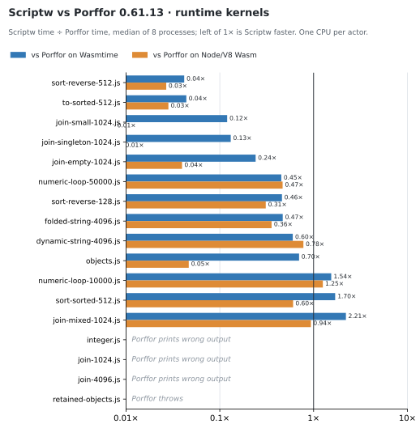

# scriptw

Scriptw is an experimental JavaScript-to-WebAssembly compiler written in Rust.
The goal is ECMAScript correctness with competitive compilation and execution.
Programs and builtins compile to real Wasm; WebAssembly is the sole output target.

## Try it

Requires Rust 1.94 or newer and the repository's experimental Wasmtime 47 backend.

```sh
cargo build --locked --release -p scriptw-cli --bin scriptw
printf 'print("Hello Wasm");\n' > hello.js
./target/release/scriptw run hello.js
SCRIPTW_WASM_DUMP=hello.wasm ./target/release/scriptw build wasm hello.js
```

Rust applications can [embed Scriptw](docs/rust-rewrite/contracts/foreign-modules.md)
in their own Wasmtime Engine, Store and Linker, with synchronous and async host functions.
They compile on a bounded pool of `CompilationJobs`, two by default, which nearly
halves native preparation for about 110–160 MiB more peak memory on the RSC bundle.
For production, precompile first: `scriptw precompile app.mjs -o app.swep` writes the
native image once, and servers load it without a compiler; it needs the same Scriptw
build and CPU features ([flow](docs/rust-rewrite/contracts/foreign-modules.md#precompiled-execution)).

Local benchmark compilers come from `scripts/build-dist.sh pgo` (fat LTO, jemalloc, Rust
PGO; Linux x86_64). On 2026-11-20 a hand-built equivalent, trained with the RSC and edge
fixtures (`SCRIPTW_DIST_PGO_APPLICATION_FIXTURES`), precompiled the held-out React client
bundle 22% faster than release, and the RSC bundle 25% faster. CI releases and
Test262 publication still use `--release`
([recipe and limits](CONTRIBUTING.md#dist-compiler-binary), [notices](THIRD-PARTY-NOTICES.md)).

## Benchmarks

All panels except [Porffor](#porffor) and [process density](#process-density) were measured on **2026-11-17** at source `d2948d619` (compiler fingerprint `697c47c22eb0`), on a
shared four-vCPU cloud machine (Intel Xeon, 2.30 GHz) with Node 24.22.1. Every
engine gets the same two CPUs, so V8's compiler and collector threads do not
preempt its main thread. They are not requalified on every commit.
[Benchmark details](docs/rust-rewrite/benchmarks.md) hold the full tables,
methods and limits.

### React Server Components

**React 19.3.1 RSC · 2026-11-17**, compiler fingerprint `697c47c22eb0`; exact Flight output on every call.

| Retained request | Scriptw Fast | Scriptw Speed | Node 24 / V8 |
| --- | ---: | ---: | ---: |
| Sync | 0.675 ms | 0.269 ms | 0.166 ms |
| Async | 0.777 ms | 0.294 ms | 0.178 ms |


Medians of eight fresh processes per engine and case, 100 warmups and 101 timed
requests each. Fast and Speed are Scriptw's two native compilation policies (Speed is the
embedding API's default, Fast what `scriptw run` uses);
Node runs with its JIT. Speed takes 1.6× Node's time, sync and async.
[Means, tails, warmup curves and limits](docs/rust-rewrite/benchmarks.md#react-server-components) ·
[data](docs/rust-rewrite/rsc-current.json).

### Runtime kernels

<!-- runtime-comparison:start -->
**Runtime kernels · 2026-11-17**, compiler `697c47c22eb0`; Node **24.22.1**, V8 **13.6.233.17-node.58**.
Scriptw is faster than Scriptc in **15/17 workloads** in both blocks; block execution geometric means are **0.465–0.471× Scriptc**.
Scriptw is faster than V8 in **7/17 workloads** in both blocks; block execution geometric means are **0.778–0.787× V8**.
Wasm is compiled before timing; Scriptw entry includes Realm bootstrap. V8 creates a fresh context before timing; entry checks outputs.
See [measurement details and charts](docs/rust-rewrite/benchmarks.md#runtime-comparison), [data and identities](docs/rust-rewrite/execution-current.json), and [workflow](CONTRIBUTING.md#benchmark-charts).
<!-- runtime-comparison:end -->


`join-mixed-1024.js` is the middle of the 17 workloads by Scriptw's ratio to V8 (1.23×); the range is 0.04× to 3.35×.
Each entry starts a fresh Realm inside the timer: Scriptw's shortest entries take 0.05 ms, most of it that bootstrap,
against 0.03 ms for Scriptc and 0.02 ms for V8, and fifteen of the seventeen workloads finish within 0.11 ms.

### Compilation

**JavaScript → portable Wasm · 2026-11-17:** Scriptw is faster than Scriptc in
**17/17 workloads**, taking **0.516× Scriptc time** by geometric mean.
Both compilers run on one CPU here.
Includes CLI startup and output I/O; native compilation and execution are separate.
[Data](docs/rust-rewrite/compilation-current.json).


### Edge kernels and focused situations

<!-- application-benchmarks:start -->
**Edge kernels · 2026-11-17**, compiler `697c47c22eb0`, Intel(R) Xeon(R) Processor @ 2.30GHz (4 vCPUs), two pinned CPUs for every actor, inherited 13.4 GiB cloud memory cap:
Scriptw takes **0.9–2.6× Scriptc time** across 5 completed comparisons.
These use plain request/response records; networking and Web APIs are outside the workload.
[Application charts and failed attempts](docs/rust-rewrite/benchmarks.md#application-workloads) ·
[Data](docs/rust-rewrite/applications-current.json).
<!-- application-benchmarks:end -->


Each timed entry is a whole batch of requests in a fresh Realm, after three warmups; Scriptw's 0.05 ms entry floor is
3 to 15% of its batch times. Against V8, Scriptw takes 2.2 to 2.5× on the six kernels. It completes the React
SSR render at 7.3 ms against V8's 0.63 ms; Scriptc fails to build it.

**Focused performance situations · 2026-11-17**, compiler fingerprint `697c47c22eb0`: 21 standalone programs compare Fast, Speed and V8
on a retained call after 100 warmups. Speed is ahead of V8 in 9 of them and behind in 12, by up to 29×.
[Scores and workload bounds](docs/rust-rewrite/benchmarks.md#focused-performance-situations) · [Situation data](docs/rust-rewrite/situations-current.json).


### Porffor

**Porffor 0.61.13 · 2026-11-23**, a separate panel. It compares a local Scriptw build of
`6d6e0c5d4` on the 17 runtime kernels, with every actor on one CPU. Porffor prints wrong output
for 3 kernels and throws on 1. On the 13 it runs correctly, Scriptw takes **0.394×** Porffor's time
when both run on Wasmtime (geometric mean; Scriptw is faster in 10/13 in both blocks), and
**0.163×** with Porffor on Node's WebAssembly engine. Scriptw compiles all 17 faster, at
**0.644×** Porffor's time. [Tables, engines and failures](docs/rust-rewrite/benchmarks.md#2026-11-23-comparison-with-porffor) ·
[data](docs/rust-rewrite/wasm-peer-current.json).



### Process density

**Process density · 2026-11-23**, local build `1edd6d329`, in the shape of [Porffor's](https://porffor.dev)
"apps per GB": N = 1–32 concurrent processes held after a print-only program, summed PSS.

| Print-only program | Memory per added process | Processes in 16 GiB | Process wall |
| --- | ---: | ---: | ---: |
| Scriptw, precompiled image (benchmark host) | 4.9 MiB | 3,372 | 306 ms |
| Node 24.22.1 | 8.4 MiB | 1,946 | 42 ms |
| Node 22.23.4 | 6.7 MiB | 2,444 | 46 ms |
| Porffor 0.61.13 native | 0.3 MiB | 58,545 | 5 ms |

Scriptw fits 1.7× as many processes as Node 24, but Node 22 fits more on a kernel that keeps 8,192
objects live. Scriptw's startup is its weak point: hashing its own executable and loading the runtime
image take about 290 ms before a 1 ms program. Timings ran under heavy machine load. Since this
run both costs have left the product path: caches are keyed by the linker build ID, and the runtime
image is mapped from the executable instead of being decoded and hashed in every process. On the
same loaded machine a warm `scriptw run` went from 114 to 27 ms and the host takes 13 ms, against
32 ms for Node 24 in the same rounds; the panel has not been rerun. Since 2026-11-24 a warm start maps
its cached program module and lists no cache directory: in separate rounds on one pinned CPU it went
from 10.5 to 6.5 ms, and from 23.3 to 6.5 ms with a cache of 9,000 entries.
[Method, kernels and limits](docs/rust-rewrite/benchmarks.md#process-density) ·
[data](docs/rust-rewrite/process-density-current.json).

## Current Status
<!-- scriptw-status:start -->
Published Test262 (`wasm-aot`, `2026-11-18`): `102990/102994` passed; `4` failed.
Native-host conformance includes cases unsupported by standalone Wasm; it does not establish current HEAD coverage.
Pinned revisions: `ecma262=5345883164f463e87f8b40aca4956157ecba8783` `test262=6a4268a9354a545d41c3b62efebc478ed8c521f4`
Compiler build fingerprint: `9c84626c7197122eb63b94f1a4f15e465337e2534cdf5445a6a4e45ac8db9129`; executing image SHA-256: `c9abd4d4d8bafc77c94c3856d849d19eba07699ce0814a01cb2bed9bae41f50c`
Published status artifacts: `test262/snapshots/cloud-41983e248-reuse-20261117-aggregate-13327628081868727304.json` and `test262/snapshots/cloud-41983e248-reuse-20261117-aggregate-13327628081868727304.txt`
[Full test details](docs/rust-rewrite/test262-current.md) · [Refresh workflow](CONTRIBUTING.md#test262).
<!-- scriptw-status:end -->

<!-- scriptw-test-graph:start -->


**Published full run, 2026-11-18:** 102,994 mode-specific
executions at pin `6a4268a93`, compiler `41983e248`.
The **429 out-of-scope executions** passed through the native host;
standalone Wasm excludes their dynamic source compilation. All four categories
retain the full denominator, including every failure.
[Scope inventory](docs/rust-rewrite/test262-chart-full-20261022.json) · [Published result](test262/snapshots/published-status-wasm-aot-3416bca62d18a38665345d3dcfb41da025087a4df11e5361b3df5e12f4e11902.json) ·
[Scope policy](docs/rust-rewrite/runtime-requirements.md#out-of-scope-tests).
<!-- scriptw-test-graph:end -->

Latest full engine suite (**2026-11-17**, source `2957071d1`): 4,266 tests and the doctest pass; one runtime cache test failed on the cloud machine only. The published Test262 run above measured `41983e248`; later changes ran their affected suites and Test262 subtrees; [current work](docs/rust-rewrite/current-inventory.md) lists what is open.

## Caveats

- **Experimental backend:** Wasm GC, typed function references, exception handling
  and related features are required. Browser/other-engine integration is unverified.
  A bare WASI host does not provide Scriptw's runtime or host imports.
- **Incomplete conformance:** failures remain counted. The published run belongs
  to its recorded compiler; selected checks do not establish full ECMAScript coverage.
- **Dynamic source compilation:** standalone Wasm has no parser or general runtime
  `eval`/`new Function`. Supported prepared sources and native-host behavior have
  [separate limits](docs/rust-rewrite/runtime-requirements.md).
- **Bounded Web APIs:** UTF-8 codecs, byte streams with default readers, events,
  abort signals and tasks support the tested RSC fixtures. Fetch/Request/URL,
  DOM nodes and full WHATWG conformance remain unsupported or unverified.
- **Deadlines:** compiled code has no deadline checks. An execution timeout
  removes access to the Store's GC heap and private linear memory, and the fault
  stops the code; this needs Unix signal handling and is exercised on Linux
  x86-64 ([contract](docs/rust-rewrite/contracts/execution-deadlines.md)).
- **Pooled panel hosts:** from 2026-11-19 the precompiled panel consumers reuse
  one kept-resident GC heap across fresh Stores, which cut those entries by
  26–48%; the Scriptc actor's linear memory gets the same pool (11–53% shorter
  entries), and publication refuses actors that differ. Panels dated earlier
  mapped fresh Store memory for both
  ([measurements](docs/rust-rewrite/benchmarks.md#pooled-gc-heaps-2026-11-19)).
  Embedders opt in with `PooledStores::engine`.
- **Profile-guided builds (experimental, off by default):** a build can collect
  an execution profile and a later build of the same program can apply it
  through `CompileOptions::execution_profile` (the CLI's `scriptw precompile
  --profile` needs the non-default `profile-experiments` feature). Its first
  specialisation saved 1.3% of the RSC request's instructions, short of its go
  threshold, so no benchmark uses it
  ([contract](docs/rust-rewrite/contracts/profile-guided-compilation.md)).
- **Implementation limits:** Strings of more than 2^27 - 6 * 2^20 code units,
  BigInts beyond that many bits, bound-function chains deeper than 4,096,
  helper recursion deeper than 4,096 calls, source nested deeper than 1,000
  levels (about 1,500 `else if` branches, 500 property access or call links,
  1,000 chained method calls, a module body eight levels less; operator chains
  such as `a + b + ...` may have about two million terms, or 2,000 in a
  generator or async function, or at a module's top level, when an operand
  suspends with `await` or `yield`, though one of 10,000 terms at a module's
  top level took 493 s and 2.9 GB to compile with the Fast policy), functions
  of more than 65,535 parameters and regular
  expressions nested deeper than 1,000 groups throw RangeError (SyntaxError
  for source), as the 1 GiB Store heap and the stacks require
  ([limits](docs/rust-rewrite/runtime-requirements.md#implementation-limits)).
- **Compile memory and time:** compilation has no memory budget or deadline,
  and native compilation memory grows with each function body (2,700 method
  calls in one function took 1.5 GB with the Speed policy and one compilation
  job, `SCRIPTW_JOBS=1`; more jobs compile separate functions concurrently, so
  their peaks add up); compile untrusted source under an OS memory limit and a
  deadline
  ([details](docs/rust-rewrite/runtime-requirements.md#compile-memory)).
- **Runtime ABI 89:** rebuild Portable bundles and native images built under an
  earlier ABI ([details](docs/rust-rewrite/runtime-requirements.md#runtime-abi)).

[Development and verification](CONTRIBUTING.md) ·
[Current work](docs/rust-rewrite/current-inventory.md) ·
[Compiler/runtime contracts](docs/rust-rewrite/contracts/README.md).
