# scriptw

Scriptw is an experimental JavaScript-to-WebAssembly compiler written in Rust.
Compile JavaScript and its builtins to Wasm, run it through Wasmtime, or embed
it in a Rust application. WebAssembly is the sole output target.

Rust embedders can declare numeric, lossless UTF-16 string and byte foreign
functions, retain and call JavaScript exports, and settle async host operations
through their own Wasmtime `Store` and `Linker`. ABI requirements persist in
source-free Portable bundles. See the [embedding contract and runnable examples](docs/rust-rewrite/contracts/foreign-modules.md).

Trusted Wasmtime native program images support fresh-process execution with
the native compiler disabled. Their format is host-specific and requires
explicit admission of native code. Process RSS includes the host, runtime,
code and execution history; it is not a measurement of the live JavaScript heap.
See [runtime memory ownership](docs/rust-rewrite/contracts/runtime-byte-ownership.md)
and [compact object storage](docs/rust-rewrite/contracts/compact-ordinary-data-storage.md).

An experimental [precompiled consumer](docs/rust-rewrite/contracts/precompiled-comparison.md#consumer-capability-experiment)
can exclude dynamic-source compilation callbacks from its host. The existing
Portable embedding API remains available; static compiler dependencies remain.

Runtime initialization uses compact intrinsic-installation tables and defers
the Temporal, Intl and binary-data intrinsic graphs until their first observable or internal use.
Each Realm retains its own canonical constructors, prototypes and descriptors.
Runtime admission avoids re-serializing validated receipts. Embedded calls reuse
host execution stacks; callers own Store and Realm lifetimes. Runtime ABI 39
requires rebuilding older Portable bundles and native images. Native images use
binary execution facts (`SCRWEP03`).
Actual Number tags admit direct Wasm addition, comparisons and numeric updates;
other values retain the full coercion path. Closed scalar loops retain proven
32-bit integers in integer locals while preserving Number values at their exits.
Guarded Number loops and packed Array
push/join kernels avoid repeated conversion, dispatch and allocation when their
semantic checks pass. Primitive string-length
reads and guarded constant-return calls eliminate temporary objects and call
setup. Pure numeric sort callbacks have typed entries; packed sort snapshots
and writeback retain ordinary mutation checks. The benchmark sections below
identify each measurement's source and configuration.

The [matched local execution-parity checkpoint](docs/rust-rewrite/execution-parity-20261029.json)
records **27.4% lower execution time and
4.3% lower post-execution RSS** across 17 workloads
against `afe83e312`, using geometric means of per-workload ratios. These results retain
their own producer identity and are separate from the CI cohorts below.
Closing Scriptc execution and memory parity remains open.

[Current work](docs/rust-rewrite/current-inventory.md) tracks unresolved goals
and the latest verification. [CONTRIBUTING.md](CONTRIBUTING.md) covers the
build, debug and verification loop.

## Precompiled comparison

**Measured 2026-10-29 on one GitHub Actions runner**, compiler `54a28246e`.
The [precompiled workflow](docs/rust-rewrite/contracts/precompiled-comparison.md)
compares Scriptw and Scriptc in the same Wasmtime executable. Compilation runs
in separate producers; consumers disable compilation and share native optimization
and runtime settings. Both passed the original checksums on **17/17 workloads**.
Across those workloads, Scriptw's median post-execution RSS is **1.245–1.450× Scriptc's**.

| Workload | Scriptw RSS | Scriptc RSS |
| --- | ---: | ---: |
| Integer | 17.5 MiB | 12.2 MiB |
| Objects | 18.2 MiB | 13.1 MiB |
| Retained objects | 23.5 MiB | 18.9 MiB |

Medians pool fourteen measured fresh Stores after ten checked warmups per round.
RSS includes host, code, runtime and allocator history; it is neither live JS
heap nor peak memory. This cohort uses size-optimized/backtracking native code,
a generic ISA and a 16 MiB initial copying-GC heap. Ordinary execution below
uses its own Fast configuration and includes in-process Scriptw/V8 compilation
history. Cross-cohort RSS differences do not establish causal savings.

[Per-benchmark charts and complete evidence](docs/rust-rewrite/precompiled-comparison.md) ·
[CI run](https://github.com/mewhhaha/scriptw/actions/runs/40948863776) ·
[Refresh provenance](docs/rust-rewrite/benchmark-refresh-20261028.md).

## Benchmarks

**Measured 2026-10-29**, compiler `54a28246e`.
Scriptw / Wasmtime, Scriptc / Wasmtime (WASI), and Node / V8; **17/17 Scriptc checksums passed**.

Each image has its own zero-based scales. Bars show median execution time and
post-execution process RSS. Compilation and instance/context setup are outside
the timer; RSS includes compilation and warmup history, not live heap or peak memory.

<table>
<tr>
<td>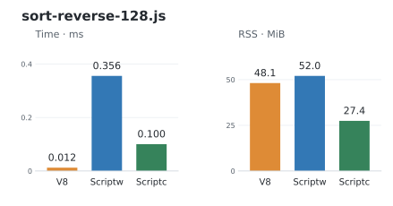</td>
<td>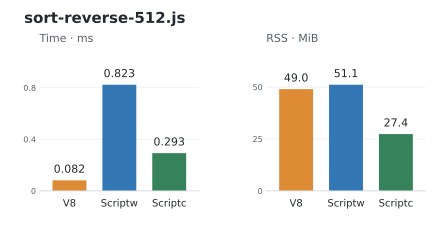</td>
</tr>
<tr>
<td>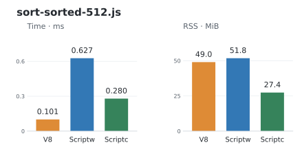</td>
<td>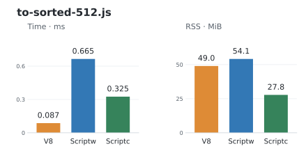</td>
</tr>
<tr>
<td>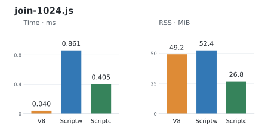</td>
<td>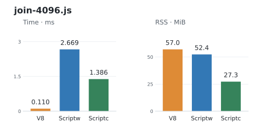</td>
</tr>
<tr>
<td>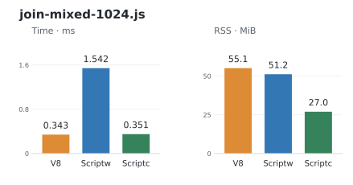</td>
<td>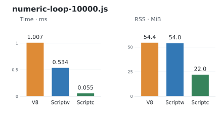</td>
</tr>
<tr>
<td>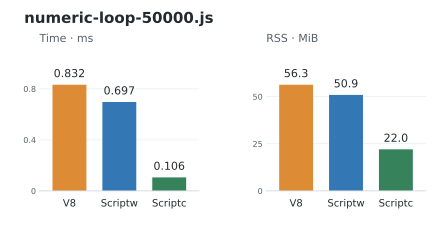</td>
<td>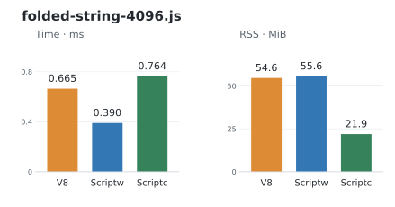</td>
</tr>
<tr>
<td>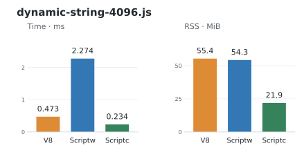</td>
<td>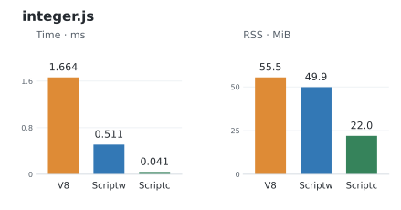</td>
</tr>
<tr>
<td>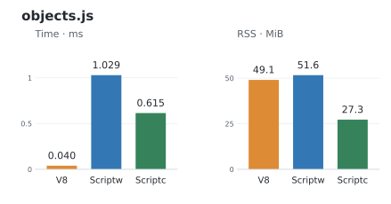</td>
<td>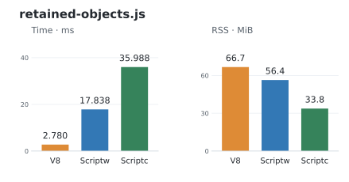</td>
</tr>
<tr>
<td>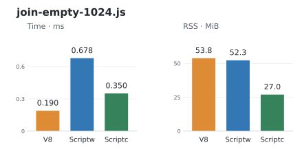</td>
<td>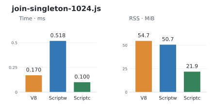</td>
</tr>
<tr>
<td>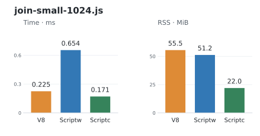</td>
<td></td>
</tr>
</table>

[Measurements and complete evidence](docs/rust-rewrite/compiler-comparison.md) ·
[Workflow and reproduction](docs/rust-rewrite/contracts/compiler-comparison.md) ·
[CI run](https://github.com/mewhhaha/scriptw/actions/runs/40948858641) ·
[Toolchains and refresh provenance](docs/rust-rewrite/benchmark-refresh-20261028.md).

## Tests

**Full verification, 2026-10-23:** **102,990 passed / 4 failed / 0 crashed /
0 unimplemented** across all 102,994 pinned Test262 executions, using compiler
`b9ecfe64b`. The 12 repaired failures stay fixed; no new failures appeared.
These four failures remain open (upstream status checked 2026-10-21):

| Remaining case | Failed executions | Why it fails | Upstream tracking |
| --- | ---: | --- | --- |
| Implicit `arguments` binding | 1 | The test expects the arguments object to survive; the current specification replaces it with the block function. | [Test262 #5113](https://github.com/tc39/test262/issues/5113), [fix PR #5112](https://github.com/tc39/test262/pull/5112): open, unmerged |
| Johnston/Honolulu timezone identity | 2 | The test expects Johnston (UM) and Honolulu (US) to share an identity; country-preserving rules and historical-zone handling disagree. | [ECMA-402 #806](https://github.com/tc39/ecma402/issues/806): open, blocked; related Johnston discussion |
| Labelled block functions | 1 | Function visibility under block labels differs between the pinned specification and deployed engines. | No exact issue found; related [Annex B tracker #1595](https://github.com/tc39/ecma262/issues/1595) is open |

**All four remain counted as failures.** Upstream tracking does not change their results.
[Exact cases and verification](docs/rust-rewrite/failed-case-replay-20261021.md#remaining-four-recheck)
· [Upstream status and related issues](test262/errata/proposals/upstream-status-20261021.md).
[Latest development verification](docs/rust-rewrite/current-inventory.md) is separate
from this published full-suite result.

<!-- scriptw-test-graph:start -->


**Fresh full run, 2026-10-23:** 102,994 mode-specific
executions at pin `6a4268a93`, compiler `b9ecfe64b`.
All executions belong to this compiler; no earlier failure replay is mixed in.

Blue is the unchanged audited **429-execution subset** focused
on dynamic `eval` / Function source compilation outside the standalone Wasm promise.
These cases passed through the native host in this run. Ordinary API properties
and `call` / `apply` / `bind` stay in the measured categories.
The four bars partition all 102,994 executions; scope cannot hide a failure.
[Portable native snapshots and exact scope inventory](docs/rust-rewrite/test262-chart-full-20261022.json) ·
[Complete published result](test262/snapshots/published-status-wasm-aot-857165c90f0fb4ac3ec0493a3b4470977007808c5b1c10ecf5512840edc80f46.json) ·
[Scope policy](docs/rust-rewrite/runtime-requirements.md#out-of-scope-tests).
<!-- scriptw-test-graph:end -->

## Caveats

- **Wasm is the sole compilation target.** C/native output and a REPL are outside scope.
- **Conformance is incomplete.** The chart identifies its measured compiler
  and complete pinned suite. [Current verification and remaining work](docs/rust-rewrite/current-inventory.md).
  [Verified repairs and original-test conflicts](docs/rust-rewrite/failed-case-replay-20261021.md).
- **Dynamic code generation is limited.** Prepared `eval` / `new Function`
  sources can run; the native host can compile additional supported sources.
  Standalone Wasm does not contain a parser or provide general runtime `eval`.
  Cases requiring a parser or VM inside emitted Wasm are outside product scope.
- **Host APIs are limited.** Scriptw is not a Node.js or browser replacement.
  Three synchronous React SSR cases work; the public browser/streaming entry
  fails. [React probe and limitations](docs/rust-rewrite/react-ssr.md).

## Wasm requirements and support

The backend requires:

- Wasm GC structs and arrays;
- reference types and typed function references;
- exception handling and tail calls;
- multi-memory and threads/shared memory.

The host must also provide the matching Scriptw runtime, `scriptw_host` imports
and Intl data. The native integration selects Wasmtime's copying collector.

| Runtime / host | Scriptw support |
| --- | --- |
| Vendored Wasmtime 47.0.0 through the Scriptw CLI or Rust API | Tested execution path |
| Browsers, Node's Wasm API and other engines | Integration and compatibility unverified; feature support alone is insufficient |
| A bare WASI host | Does not supply Scriptw's JavaScript runtime or host bindings |

[Runtime requirements and dynamic-source details](docs/rust-rewrite/runtime-requirements.md).

## Try it

Requires Rust 1.94 or newer. From a checkout:

```sh
cargo build --locked --release -p scriptw-cli --bin scriptw
printf 'print("Hello Wasm");\n' > hello.js
./target/release/scriptw run hello.js
SCRIPTW_WASM_DUMP=hello.wasm ./target/release/scriptw build wasm hello.js
```

<details>
<summary>Detailed published conformance record</summary>

## Current Status
<!-- scriptw-status:start -->
Rust rewrite status must be read in layers, not one vanity number:
- Fake wasm-safe Test262 subset: `187/187` green
- Fake full Rust rewrite suite: `191/191` green
- Pinned real Test262 baseline (`wasm-aot`, refreshed `2026-10-23`): `102990/102994` not green (`100.0%`)
- Real Test262 goal: Success=102990/102994 (100.0%); burn down NotImplemented=0, Crash=0, Bug=4 to zero
- Pinned revisions: `ecma262=5345883164f463e87f8b40aca4956157ecba8783` `test262=6a4268a9354a545d41c3b62efebc478ed8c521f4`
- Compiler build fingerprint: `7337ccbc2834d0d17902382431789227b6dddf8fda40842bf19c4243161d56f9`; executing image SHA-256: `32ee09a9a33daaf7d27fcb1b649db7223fcbd3ce00f0943cf19cce5ef886101b`
- Current real outcomes: `Success=102990`, `NotImplemented=0`, `Crash=0`, `Bug=4`
- Biggest current real failing kinds: `Runtime=4`
- Biggest current real failing origins: `unknown=4`
- Worst current real matrix targets: `intl402/Temporal/ZonedDateTime: 248/250 passed`, `annexB: 1376/1377 passed`, `staging/sm/lexical-environment: 38/39 passed`
- Published status artifacts: `/workspace/scriptw-full-suite-20261022/test262/snapshots/scriptw-hot-reads-b9ecfe64b-20261022-aggregate-13327628081868727304.json` and `/workspace/scriptw-full-suite-20261022/test262/snapshots/scriptw-hot-reads-b9ecfe64b-20261022-aggregate-13327628081868727304.txt`

As of `2026-10-23`, Rust Wasm-AOT path is at 100% of repo fake coverage, not 100% ECMAScript. Project is still off literal 100% until full pinned real Test262 run is green for Rust path.

Status refresh commands:
- `cargo test -p scriptw-engine --quiet`
- `cargo test -p scriptw-cli --quiet`
- `./target/debug/scriptw test262 run language/wasm/pass --suite-root crates/scriptw-test262/tests/fixtures/fake_test262/vendor/test262 --execution-backend wasm`
- `./target/debug/scriptw test262 run --suite-root crates/scriptw-test262/tests/fixtures/fake_test262/vendor/test262`
- `./scripts/publish-real-status-low-ram.sh wasm-aot codex-published-real`

When counts move, update this block in same change. Do not claim full Test262 `100%` from fake-suite numbers.
<!-- scriptw-status:end -->

</details>

## Documentation

[Current work](docs/rust-rewrite/current-inventory.md) ·
[Development and verification](CONTRIBUTING.md) ·
[Runtime memory ownership and profiling](docs/rust-rewrite/contracts/runtime-byte-ownership.md) ·
[Conformance commands](CONTRIBUTING.md#test262) ·
[Compiler contracts](docs/rust-rewrite/contracts/README.md).
