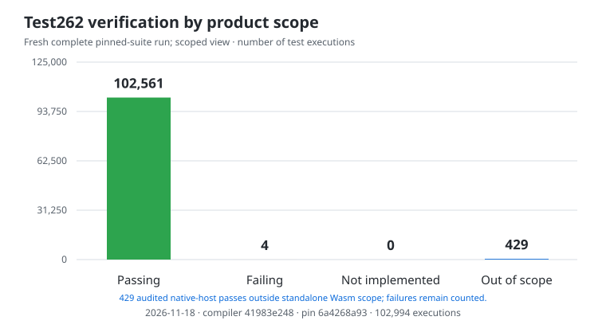

# scriptw

Scriptw is an experimental JavaScript-to-WebAssembly compiler written in Rust.
The goal is ECMAScript correctness with competitive compilation and execution.
Programs and builtins compile to real Wasm; WebAssembly is the sole output target.

## Try it

Requires Rust 1.94 or newer and the repository's experimental Wasmtime 47 backend.

```sh
cargo build --locked --release -p scriptw-cli --bin scriptw
printf 'print("Hello Wasm");\n' > hello.js
./target/release/scriptw run hello.js
SCRIPTW_WASM_DUMP=hello.wasm ./target/release/scriptw build wasm hello.js
```

Rust applications can [embed Scriptw](docs/rust-rewrite/contracts/foreign-modules.md)
in their own Wasmtime Engine, Store and Linker with synchronous and async host
functions (two `CompilationJobs` by default). For production servers, precompile
once with `scriptw precompile app.mjs -o app.swep` and load the native image
without a compiler on the same Scriptw build and CPU features
([flow](docs/rust-rewrite/contracts/foreign-modules.md#precompiled-execution)).
Optional fat-LTO + jemalloc + PGO builds are available via `scripts/build-dist.sh pgo`
([recipe and limits](CONTRIBUTING.md#dist-compiler-binary), [notices](THIRD-PARTY-NOTICES.md));
CI releases and Test262 publication use `--release`.

## Benchmarks

Compare engines within one cohort only. Full tables, charts, methods and limits
live in [benchmark details](docs/rust-rewrite/benchmarks.md).

### Latest local benchmarks (2026-11-26)

Local `--release` build (compiler `ed27e234152d`, **Runtime ABI 92**) vs **Node 24.19.0**
(`V8 13.6.233.17-node.51`) and **Porffor 0.61.13** on an AMD Ryzen 7 7800X3D
(pinned CPUs 0–1, 4 GiB / 0 swap cap, warmups excluded, exact stdout verified).

| Suite | Scriptw vs Node 24 / V8 | Scriptw vs Porffor 0.61.13 |
| --- | --- | --- |
| **CLI cold start** (`scriptw run`, warm cache, 5 fixtures) | **5/5 faster**, **0.227×** geomean (**4.41× faster**; 2.90–4.29 ms vs 15.37–17.67 ms) | — |
| **Fresh-Realm startup floor** (`startup.js`, precompiled) | **8.28 µs** exec (**−28.6%** vs ABI 91's 11.59 µs; 191.86 µs total) | — |
| **Edge kernels** (precompiled fresh Realm, 6 fixtures) | **6/6 faster** vs 80w (**0.745×**, **1.34× faster**); **5/6** vs 5w (**0.725×**, **1.38× faster**) | Porffor fails **6/6** edge fixtures |
| **Runtime kernels** (`original17`, precompiled fresh Realm) | **16/17 faster** vs 5w (**0.257×**, **3.89× faster**); **15/17** vs 80w (**0.157×**, **6.36× faster**) | **13/13 faster** on Node/V8 Wasm (**0.078×**, **12.8× faster**); **12/13** on Wasmtime (**0.157×**, **6.38× faster**)\*; Porffor fails **4/17** |
| **JS → Wasm compilation** (`original17`, 4 fresh runs each) | — | **17/17 faster**, **0.543×** geomean (**1.84× faster**; 53.3–73.2 ms vs 94.5–155.7 ms) |

\* A 31-sample re-check of `join-mixed-1024` measured **30.37 µs** vs Porffor's **33.13 µs** on Wasmtime (**1.09× faster**, **13/13** wins, ~**6.6×** geomean).
See [full 2026-11-26 tables and measurement boundaries](docs/rust-rewrite/benchmarks.md#2026-11-26-local-benchmarks-edge-cold-start-and-porffor).

### Process density (2026-11-25)

Local release build `5ed84a21a`, N = 1–32 concurrent processes held after a print-only program, summed PSS ([method and limits](docs/rust-rewrite/benchmarks.md#process-density) · [data](docs/rust-rewrite/process-density-current.json)):

| Print-only program | Memory per added process | Processes in 16 GiB | Process wall |
| --- | ---: | ---: | ---: |
| Scriptw, precompiled image (benchmark host) | 1.7 MiB | 9,796 | 10 ms |
| Node 24.22.1 | 8.6 MiB | 1,895 | 27 ms |
| Node 22.23.4 | 6.7 MiB | 2,444 | 27 ms |
| Porffor 0.61.13 native | 0.3 MiB | 58,996 | 3 ms |

Scriptw fits **5.2×** as many processes as Node 24 (and more than Node 22/24 on all six measured programs, including an 8,192-retained-object kernel).

### React Server Components (2026-11-17)

**React 19.3.1 RSC**, compiler `697c47c22eb0`, four-vCPU Xeon cloud host, medians of 8 fresh processes (100 warmups, 101 timed requests, exact Flight output; [details](docs/rust-rewrite/benchmarks.md#react-server-components) · [data](docs/rust-rewrite/rsc-current.json)):

| Retained request | Scriptw Fast | Scriptw Speed | Node 24 / V8 |
| --- | ---: | ---: | ---: |
| Sync | 0.675 ms | 0.269 ms | 0.166 ms |
| Async | 0.777 ms | 0.294 ms | 0.178 ms |


<details>
<summary>Earlier cloud comparison panels (2026-11-17, Xeon 4-vCPU)</summary>

<!-- runtime-comparison:start -->
**Runtime kernels · 2026-11-17**, compiler `697c47c22eb0`; Node **24.22.1**, V8 **13.6.233.17-node.58**.
Scriptw is faster than Scriptc in **15/17 workloads** in both blocks; block execution geometric means are **0.465–0.471× Scriptc**.
Scriptw is faster than V8 in **7/17 workloads** in both blocks; block execution geometric means are **0.778–0.787× V8**.
Wasm is compiled before timing; Scriptw entry includes Realm bootstrap. V8 creates a fresh context before timing; entry checks outputs.
See [measurement details and charts](docs/rust-rewrite/benchmarks.md#runtime-comparison), [data and identities](docs/rust-rewrite/execution-current.json), and [workflow](CONTRIBUTING.md#benchmark-charts).
<!-- runtime-comparison:end -->

<!-- application-benchmarks:start -->
**Edge kernels · 2026-11-17**, compiler `697c47c22eb0`, Intel(R) Xeon(R) Processor @ 2.30GHz (4 vCPUs), two pinned CPUs for every actor, inherited 13.4 GiB cloud memory cap:
Scriptw takes **0.9–2.6× Scriptc time** across 5 completed comparisons.
These use plain request/response records; networking and Web APIs are outside the workload.
[Application charts and failed attempts](docs/rust-rewrite/benchmarks.md#application-workloads) ·
[Data](docs/rust-rewrite/applications-current.json).
<!-- application-benchmarks:end -->

Compilation vs Scriptc ([data](docs/rust-rewrite/compilation-current.json)),
focused performance situations ([details](docs/rust-rewrite/benchmarks.md#focused-performance-situations) · [data](docs/rust-rewrite/situations-current.json)),
and the earlier 2026-11-25 Porffor panel ([details](docs/rust-rewrite/benchmarks.md#2026-11-25-comparison-with-porffor) · [data](docs/rust-rewrite/wasm-peer-current.json))
are archived in [benchmark details](docs/rust-rewrite/benchmarks.md).

</details>

## Current Status
<!-- scriptw-status:start -->
Published Test262 (`wasm-aot`, `2026-11-18`): `102990/102994` passed; `4` failed.
Native-host conformance includes cases unsupported by standalone Wasm; it does not establish current HEAD coverage.
Pinned revisions: `ecma262=5345883164f463e87f8b40aca4956157ecba8783` `test262=6a4268a9354a545d41c3b62efebc478ed8c521f4`
Compiler build fingerprint: `9c84626c7197122eb63b94f1a4f15e465337e2534cdf5445a6a4e45ac8db9129`; executing image SHA-256: `c9abd4d4d8bafc77c94c3856d849d19eba07699ce0814a01cb2bed9bae41f50c`
Published status artifacts: `test262/snapshots/cloud-41983e248-reuse-20261117-aggregate-13327628081868727304.json` and `test262/snapshots/cloud-41983e248-reuse-20261117-aggregate-13327628081868727304.txt`
[Full test details](docs/rust-rewrite/test262-current.md) · [Refresh workflow](CONTRIBUTING.md#test262).
<!-- scriptw-status:end -->

<!-- scriptw-test-graph:start -->


**Published full run, 2026-11-18:** 102,994 mode-specific
executions at pin `6a4268a93`, compiler `41983e248`.
The **429 out-of-scope executions** passed through the native host;
standalone Wasm excludes their dynamic source compilation. All four categories
retain the full denominator, including every failure.
[Scope inventory](docs/rust-rewrite/test262-chart-full-20261022.json) · [Published result](test262/snapshots/published-status-wasm-aot-3416bca62d18a38665345d3dcfb41da025087a4df11e5361b3df5e12f4e11902.json) ·
[Scope policy](docs/rust-rewrite/runtime-requirements.md#out-of-scope-tests).
<!-- scriptw-test-graph:end -->

The published full Test262 run measured `41983e248`; subsequent changes ran their
affected Rust suites and pinned Test262 subtrees ([current work](docs/rust-rewrite/current-inventory.md)).

## Caveats

- **Experimental backend:** Requires Wasm GC, typed function references, exception
  handling, tail calls, multi-memory and threads via vendored Wasmtime 47. Browser,
  bare WASI and other Wasm engines are unverified.
- **Incomplete conformance:** Remaining failures stay counted. Published full-suite
  numbers belong to their recorded compiler; targeted subtrees do not replace a
  full Test262 publication.
- **Dynamic source compilation:** Standalone Wasm has no parser or general runtime
  `eval`/`new Function`; prepared-source and native-host limits are documented in
  [runtime requirements](docs/rust-rewrite/runtime-requirements.md).
- **Bounded Web APIs:** UTF-8 codecs, byte streams with default readers, events,
  abort signals and tasks support the tested RSC fixtures; Fetch/Request/URL, DOM
  and full WHATWG APIs are unsupported.
- **Deadlines:** Execution timeouts revoke access to the Store's GC heap and
  private linear memory via Unix signals (exercised on Linux x86-64;
  [contract](docs/rust-rewrite/contracts/execution-deadlines.md)).
- **Pooled stores & PGO (opt-in):** Precompiled embedders can reuse kept-resident
  GC heaps via `PooledStores::engine`
  ([measurements](docs/rust-rewrite/benchmarks.md#pooled-gc-heaps-2026-11-19)).
  Profile-guided compilation is experimental and off by default
  ([contract](docs/rust-rewrite/contracts/profile-guided-compilation.md)).
- **Implementation & compile limits:** Strings/BigInts (> `2^27 - 6 * 2^20`
  units/bits), nesting (> 1,000 levels; 8 less in modules), recursion (> 4,096
  frames), and > 65,535 parameters throw `RangeError`/`SyntaxError`. Compilation
  itself has no internal memory limit or deadline — compile untrusted input under
  an OS memory cap and timeout
  ([limits](docs/rust-rewrite/runtime-requirements.md#implementation-limits)).
- **Runtime ABI 92:** Rebuild Portable bundles and native images built under an
  earlier ABI ([details](docs/rust-rewrite/runtime-requirements.md#runtime-abi)).

[Development and verification](CONTRIBUTING.md) ·
[Current work](docs/rust-rewrite/current-inventory.md) ·
[Compiler/runtime contracts](docs/rust-rewrite/contracts/README.md) ·
[Benchmark details](docs/rust-rewrite/benchmarks.md).
