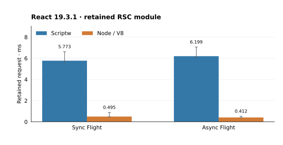
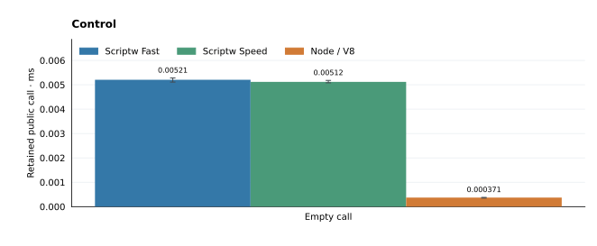
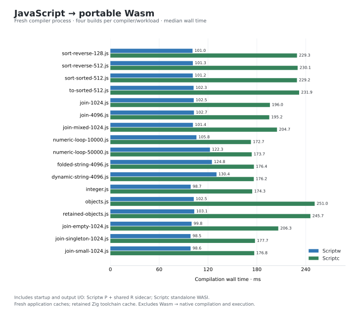

# Benchmark details

These are the latest published cohorts for each workload family. They use
separate recorded compiler builds and timing boundaries. Reproduction commands
live in [CONTRIBUTING](../../CONTRIBUTING.md#benchmark-charts);
older implementation notes live in the [README archive](benchmark-history.md).

## React Server Components

Measured **2026-11-05**, React **19.3.1**, compiler `21ad728e4380`
(base `cff119329` plus the archived source patch).
Both sync and async Flight outputs match Node exactly.

| Engine | Sync · ms | Async · ms |
| --- | ---: | ---: |
| Scriptw | 5.773 | 6.199 |
| Node 24.12.0 / V8 | 0.495 | 0.412 |

Each engine uses eight fresh processes across two balanced blocks, with three
checked warmups and seven measured requests per mode. A process retains one
Module/Realm and runs sync then async. Requests include full Flight serialization
and consumption; JSON encoding and exact-output checks follow timing. Values
are medians of process medians. The frozen prior-build control stays in the
receipts; chart bars show the latest compiler and V8. Scriptc's React build
remains unqualified; client React/DOM is a separate open scope.
Program and runtime Wasm are byte-identical to the control; this checkpoint establishes no React execution improvement.

Cold Scriptw setup is **3.252 s JavaScript → Wasm**,
**5.656 s native preparation**, and
**2.281 ms module initialization**.
Program Wasm is **4,231,662 B** (3,683,242 B code; 490,228 B data);
shared runtime Wasm is **38,816,202 B**. All setup precedes request timing.
Child peak RSS includes compilation and process history; it is not live guest heap.

Scriptw compiles P with Wasmtime 47 **Fast / OptLevel::None / SinglePass**.
Shared R is built with **SpeedAndSize / Backtracking**. Its successful native
bundle admission is silent; absence of a hit trace does not establish fallback. The cohort uses
a generic target, one CPU, 16-MiB copying GC and the recorded stack/deadline/cache settings.
The [hardware-counter diagnostic](react-attribution-current.json) records
100 checked requests after three warmups in each of three fresh processes per
engine/mode. Scriptw retires **50.19 million sync /
54.08 million async user instructions per request**;
Node retires **2.51 / 2.70 million**.
Counters run without multiplexing. They count Scriptw's execution worker and
Node's main thread, including Node barrier/Promise-return edges; background
compilation/GC threads are excluded. These are unscored counts, not causal shares.

The emitted program shares immutable birth layouts and cached-read code in the
existing runtime. Strict arguments elision walks complete ordinary operands;
eval, capture and resumable refusals remain. Literal typeof and strict
null/undefined comparisons use runtime predicates while preserving operand work
and Throws. Visited-key extension copies existing immutable snapshots and boxes only the new key.
Closed numeric row loops can borrow authenticated captured arrays, use masked
indices and read own Number fields and primitive String lengths. Complete live
guards retain the original loop and completed-prefix fallback; no calls or
allocations enter the admitted loop.
Function own-data probes use the current ordinary dictionary without the
former storage gate. The seven infallible Boolean operations publish directly.
Retained private operands use initialized compiler storage; source lexical TDZ
and suspended reference owners retain their protocols.
Cached literal reads retain their original twelve-input/five-result boundary.
Closed row loops can borrow current dictionary data after checking live
extent, current key/descriptor/value and complete field guards. For repeated
low-bit masked rows with Number/string-length leaves, canonical own-data
reads validate a complete read-only period before any source body and copy its
leaves to one existing numeric array. A second authenticated dense array may
supply primitive String keys; both masks define one combined period. Unsupported
keys, holes, accessors and Proxies decline before source work. A miss resumes the whole original loop; a successful preflight uses
numeric-only loads with the original arithmetic and row identity. Other admitted
rows retain compact/dictionary guarded backedges and completed-prefix fallback.
Recipes, accessors, Proxies and incomplete regions keep their original semantics.
Scratch roots clear before the generic continuation. Projection allocates one
numeric array. Canonical recipe reads can also allocate or normalize intrinsic metadata without invoking JavaScript; rejected preflight
work remains an explicit cost.
Closed numeric branches can borrow one or two current dense Number arrays with
a proven bounded masked index. Entry validates the phase and both backings;
the body preserves each original comparison, branch and arithmetic operation.
Unsupported values and effects retain the original loop.
Local argument entries retain their two-formal bound. Runtime value,
environment, descriptor and call-transport costs remain; V8 parity is open.

Fresh user-cycle sampling attributes **25.68% sync /
23.83% async** to six property/enumeration helpers' disjoint
own samples. The `vn`/`ft` page-touch loops account for
**2.35% /
2.05%**. Each mode has one
sampled process and 200 checked requests after three warmups. Frame-pointer
chains can truncate; inclusive caller shares overlap. These observations do not
partition wall time or predict a change's gain. The linked diagnostic retains
raw samples, source identities and same-process prefixes.

Older allocator controls, source screens and rejected experiments retain their
own source/binary identities in the inert archive. The allocator census found
most SinglePass spill capacity in cross-block/edge homes; strictly block-local
reuse was rejected as the main hill. Entry stack budgets are distinct from spill
capacity, executed spill traffic and allocation counts. Total executed guest
allocation remains unmeasured.

Runtime ABI 51 supplies bounded UTF-8 codecs, byte streams with default readers,
events, abort signals and tasks for these fixtures. Fetch/Request/URL, DOM nodes
and full WHATWG conformance remain unsupported or unverified.

[Current report and process receipts](rsc-current.json) ·
[Size accounting](rsc-wasm-size-current.json) ·
[Inert evidence](situations-evidence-2026-11-05.tar.xz).

## Focused performance situations

Measured **2026-11-05**: **21** standalone Module programs, compiler `21ad728e4380`,
Node **24.12.0 / V8 13.6.233.17-node.37**, Rust **1.97.1**.
Each program has its own score; no aggregate combines arbitrary operation counts.

| Program · retained call | Scriptw Fast · ms | Scriptw Speed · ms | V8 · ms |
| --- | ---: | ---: | ---: |
| `control-empty.js` | 0.010 | 0.010 | 0.002 |
| `global-shallow.js` | 2.240 | 1.799 | 1.000 |
| `global-deep8.js` | 2.791 | 2.004 | 0.995 |
| `global-bound-deep.js` | 0.715 | 0.243 | 0.074 |
| `global-getter-deep.js` | 3.147 | 2.338 | 1.023 |
| `frame-compact.js` | 8.145 | 5.783 | 0.068 |
| `frame-branches32.js` | 8.259 | 5.991 | 0.094 |
| `frame-branches128.js` | 8.686 | 5.985 | 0.140 |
| `frame-branches512.js` | 13.699 | 6.145 | 0.191 |
| `args-unused.js` | 0.727 | 0.517 | 0.101 |
| `args-observed.js` | 2.501 | 2.032 | 0.137 |
| `property-stable.js` | 0.155 | 0.075 | 0.075 |
| `property-mutated.js` | 0.154 | 0.078 | 0.067 |
| `metadata-ordinary.js` | 0.208 | 0.086 | 0.020 |
| `metadata-function.js` | 0.203 | 0.085 | 0.207 |
| `metadata-intrinsic.js` | 0.212 | 0.088 | 0.231 |
| `typeof-dispatch.js` | 0.947 | 0.364 | 0.024 |
| `singleton-dispatch.js` | 0.907 | 0.354 | 0.013 |
| `strict-equality-numbers.js` | 0.120 | 0.062 | 0.021 |
| `strict-equality-mixed.js` | 2.614 | 1.346 | 0.069 |
| `for-in-wide.js` | 2.087 | 1.981 | 0.068 |

Each value is the median of eight fresh-process medians across two balanced
blocks. Every process initializes one Module/Realm, then runs three checked
warmups and seven measured calls. Four inputs rotate identically in every actor;
every call checks an independent integer checksum. Bars show current configurations;
whiskers span process medians. Block medians and process summaries remain in the
[data](situations-current.json).

**Fast = None / SinglePass**, **Speed = Speed / Backtracking**. Both use Wasmtime
47, a generic target, one CPU, 16-MiB copying GC, a 4-GiB cap and no swap.
The labels select P compilation; shared R is built with SpeedAndSize /
Backtracking and uses its recorded native-image admission path.
Compilation, initialization and `prepare(input)` precede the public `run()` clock.
Wasmtime consumers have their compiler disabled. Node uses the same source in
`vm.SourceTextModule`, with normal JIT and natural GC; three warmups do not prove
optimized steady state. Timings include the public bridge and print conversion;
output draining and validation follow timing. Setup can influence timed GC/JIT.
The empty control is shown without subtraction. Benchmark scratch and prepared
images used tmpfs after Btrfs exhausted metadata reservations; completed raw files
were copied byte-for-byte into the evidence tree. File preparation remains untimed.

### Global lookup

Six constructor values are read over 1,024 passes. Deep lookup retains eight
padding captures; bound aliases sit beside the worker. Shallow/deep also differ
in padding arithmetic, and V8 may hoist aliases or global reads. Getter controls
include calls and counter increments. These differences are not isolated lookup costs.

### Control-flow and call-site scaling

All programs make 8,192 entries and exercise every selected site with matching
checksums. Compact dispatch uses one polymorphic site and a dynamic key; switch
arms use constant keys and separate sites. This does not isolate stack-probe cost.
The 512-site native P image is **5.43 MiB Fast /
2.30 MiB Speed**;
portable P is **0.72 MiB**.
Native serialized sizes include metadata and data.

### Arguments observation

Both programs make 1,024 strict calls, reassign a formal and compute the same
result. The observed case additionally reads the original arguments and length.
The difference includes that timed work and is not an allocation count.

### Property mutation history

Both programs make 8,192 variable-key reads over 64 records. Untimed mutation
adds an accessor, deletes properties and restores values. Reads retain live
storage guards and complete conversion/accessor/prototype/Proxy fallback.
Indexing, key production and record reads all contribute to the score.

### Function property reads

Each program reads own length, own name and the name string's length over 8,192
passes and eight targets. Ordinary records, JavaScript functions and native
constructors have matching values/checksums. Array indexing, object-kind dispatch,
string reads and V8 feedback remain part of these scores.

### Type classification

The typeof program performs 18,432 literal comparisons across 4,096 mixed-value
passes. The strict singleton program performs 16,384 null/undefined comparisons.
Inputs cover primitive and object values, bound functions and revoked callable
Proxies. Array access, branches and loop arithmetic remain timed. All earlier
program sources and checksums are unchanged. Independent semantic controls also
cover operand Throws/TDZ and HTMLDDA, outside these timed programs.

### Dynamic strict equality

Both programs execute 8,192 strict comparisons over prepared pairs. Number pairs
include NaN, signed zero and infinities. Mixed pairs cover String/BigInt content,
Symbol and object identity, boxed values, functions and revoked Proxies. Operand
coercion must not run. Preparation precedes timing; pair indexing, branches and
checksum arithmetic remain timed. Independent models check every input.

### Enumeration

Sixteen for-in loops visit all 64 own enumerable properties of a prepared ordinary
record, checking 1,024 yielded keys and numeric value reads. Inherited nonenumerable
processing is included. Immutable visited-key snapshots are copied without
reboxing; prefix reference copying and membership comparisons remain quadratic.
Mutation, Proxy and suspension controls run separately as semantic regressions.

### Public-call control and verification

All **504** situation processes and **5,040** calls passed exact checks.
The balanced RSC campaign adds 24 processes and 480 exact Flight checks.
Fresh scoped verification passes **1,770 Engine**, **65 emission**,
**637 structural** and **380 source-guard** checks. The **769 IR** cases
reuse their original passing binary/receipts with unchanged IR/front-end inputs.
AOT units pass **653** cases; four known bootstrap assertions remain failures.
Full workspace CI and pinned Test262 were not rerun. Eleven unchanged workspace
formatting failures and fourteen stale Intl recipes remain [owned](current-inventory.md).

[Generate/run a hill](../../CONTRIBUTING.md#focused-performance-situations) with
`--case <file.js>` and optional `--policies fast` or `speed`. Scriptc has no matched
retained-Module consumer here. These scores are separate from RSC and the older
fresh-entry kernels; they do not partition each mechanism's share of RSC cost.

<!-- runtime-comparison-details:start -->
## Runtime comparison

**Measured 2026-11-02 locally**, compiler fingerprint `87385fff34d1`.
V8 **13.6.233.17-node.37**, Node **24.12.0**.
Scriptw is faster than Scriptc in **17/17 workloads** in both blocks; block execution geometric means are **0.455–0.458× Scriptc**. Scriptw is faster than V8 in **6/17 workloads** in both blocks; block execution geometric means are **1.098–1.106× V8**.

This compares Wasm public entry with V8 `runInContext`. Scriptw and Scriptc compile
Wasm before the measured processes and share a Wasmtime host with compilation disabled.
Wasmtime 47.0.0 uses size-optimized/backtracking
native code and a generic target.
Timed Wasm entry includes Scriptw Realm/intrinsic bootstrap. V8 parses one `vm.Script`
per process and creates a fresh `vm.Context` before each invocation outside entry timing;
lazy compilation, JIT tiering and natural GC may occur inside. Every entry checks output.

Each bar shows the median of eight process medians: four processes per balanced
block, each with 21 measured entries after ten checked warmups. Memory bars show
median GNU-time whole-child **peak RSS** for all three runtimes, including host,
code, runtime and warmup history. Warmups do not establish optimized steady state.
Each panel uses its own zero-based scale. Chart data also retains V8 context-creation
time as a supplemental measurement, excluded from bars and ratios.

<table>
<tr>
<td></td>
<td></td>
</tr>
<tr>
<td></td>
<td></td>
</tr>
<tr>
<td></td>
<td></td>
</tr>
<tr>
<td></td>
<td></td>
</tr>
<tr>
<td></td>
<td></td>
</tr>
<tr>
<td></td>
<td></td>
</tr>
<tr>
<td></td>
<td></td>
</tr>
<tr>
<td></td>
<td></td>
</tr>
<tr>
<td></td>
<td></td>
</tr>
</table>

[Chart data and runtime identities](execution-current.json) ·
[Complete evidence](performance-gaps-20261101.json) ·
[Workflow](../../CONTRIBUTING.md#benchmark-charts).
<!-- runtime-comparison-details:end -->

<!-- application-benchmarks-details:start -->
## Application workloads

Measured **2026-11-02**, compiler `87385fff34d1`.
Six synchronous request/response kernels use plain records, without networking or
Web APIs. The seventh case bundles real React 19.3.1
legacy `renderToString` with hooks/context and 32 escaped rows.
Times cover complete batches: 64 requests for JSON/routing/query/middleware,
32 HTML requests, 48 nested-result requests, or one 32-row SSR render.

Two balanced blocks, eight fresh processes per available actor/case; each process
has seven measured entries after three checked warmups. Cards show the median of
process entry medians and median whole-child peak RSS. Wasm compilation/loading
and V8 source/context setup stay outside entry timing; Scriptw Realm bootstrap
stays inside. Failed actors have no timing or memory bar.

Across the **5 completed Scriptc comparisons**, Scriptw batch medians
are **3.8–9.3× Scriptc**. Failed cases receive no speed score.

<table>
<tr>
<td></td>
<td></td>
</tr>
<tr>
<td></td>
<td></td>
</tr>
<tr>
<td></td>
<td></td>
</tr>
<tr>
<td></td>
<td></td>
</tr>
</table>

Real Server Components separately serialize and consume Flight streams in Node,
including an async component. Web references use Node's Request/Response/URL APIs.
The browser cases use real React DOM in Chromium: mount, state update and hydration,
with commit plus forced layout timed in the page. RSC renders 32 rows, Web API
cases process 32 requests, and client cases render 64 rows. Setup and golden-output comparisons are
outside these timers. These host references have different timing boundaries;
they establish no engine parity. Browser RSS covers all three cases in one process
and is not assigned to individual cases.

| Reference | Entry median · ms |
| --- | ---: |
| RSC Flight · sync | 0.505 |
| RSC Flight · async | 0.571 |
| URL / Request | 2.016 |
| JSON / Request | 3.797 |
| React mount | 1.137 |
| React update | 1.347 |
| React hydration | 1.945 |

Actual standalone build/execution attempts remain visible, including failures:

| Capability attempt | Scriptw | Scriptc | V8 host reference |
| --- | --- | --- | --- |
| RSC Flight · sync | Execution failed | Build failed | Node checked |
| RSC Flight · async | Execution failed | Build failed | Node checked |
| URL / Request | Execution failed | Build failed | Node checked |
| JSON / Request | Execution failed | Build failed | Node checked |
| React client mount | Timed out (60 s) | Build failed | Chromium checked |

Standalone run timeouts include compilation and startup; they do not isolate
rendering time. Scriptw's portable build and ordinary NativeHost run are
separate probes; the run recompiles source instead of loading the dumped pair.
At this frozen benchmark revision, Scriptw lacked DOM, encoding, Web Streams,
Fetch and URL APIs, as recorded by its capability probe. Current-source RSC
measurements are reported in the [README](../../README.md#benchmarks).

The frozen [failure diagnosis](applications-current.json) records
missing `TextEncoder` during RSC initialization. Corrected Scriptc Web probes
reach `SC3002` (WASI API admission), and its nested-result case reports `SC2020`
(dynamic `Array.slice` end unsupported). React bundles retain type-check errors.
Scriptw's SSR output has a 2-MB function, triggering size-optimized native
compilation; a debugger sample finds Cranelift optimization active at 20 seconds.

[Data, identities and diagnostics](applications-current.json) ·
[Inert raw evidence](application-benchmarks-20261102-inert.tar.xz) ·
[Workflow](../../CONTRIBUTING.md#react-and-edge-benchmarks).
<!-- application-benchmarks-details:end -->

## Compilation time

**JavaScript → portable Wasm**, measured 2026-11-02 with the same compiler
fingerprint as the runtime charts. Scriptw is faster in **17/17 workloads**,
taking **0.524x Scriptc's time** by geometric mean of workload medians.

Four fresh CLI builds per compiler/workload across two balanced blocks
(**136 processes**). Includes startup and output I/O: Scriptw P plus its shared R
sidecar; Scriptc standalone WASI. Application caches are fresh; OS and Zig toolchain
caches remain. Runtime production, Wasm-to-native compilation and execution are
excluded. [Data and tool identities](compilation-current.json) ·
[Reproduce](../../CONTRIBUTING.md#benchmark-charts).
