# Benchmark details

These are the latest published cohorts for each workload family. They use
separate recorded compiler builds and timing boundaries. Reproduction commands
live in [CONTRIBUTING](../../CONTRIBUTING.md#benchmark-charts);
older implementation notes live in the [README archive](benchmark-history.md).

## React Server Components

Measured **2026-11-09**, React **19.3.1**, source fingerprint `9f2788b4af9f51a77dcd3d62e3a8c717367af9c9a0eee65170af66cc8823016b`. Scriptw Fast takes about **16.9× V8 request time**; Speed takes about **13.9×**. The measured descriptor optimization reduces request medians by **2.7–2.9%**. Current CPU counters and profiles place the remaining gap in instruction volume, object operations and generated JavaScript code; the experiments below do not assign an exclusive cause to the whole gap.

### Requests and measurement boundaries

The campaign checked **16,080 exact outputs across 80 fresh processes**: eight processes per engine and case, 100 warmups and 101 timed calls per process, in two mirrored blocks with rotating engine/case order. Sync and async use separate processes. Timed calls within a process are dependent; the independent summaries are process medians. Baseline and candidate Cargo feature sets match across 248 shared packages. Exact executable, source, P/R, toolchain and input identities are in the [current report](rsc-current.json).

| Policy / source | Sync median / typical mean / typical p95 · ms | Async median / typical mean / typical p95 · ms |
| --- | ---: | ---: |
| Fast baseline · `453a9074` | 4.425 / 4.777 / 6.106 | 4.858 / 5.248 / 6.548 |
| Fast candidate · `9f2788b4` | 4.304 / 4.677 / 6.010 | 4.719 / 5.131 / 6.374 |
| Speed baseline · `453a9074` | 3.640 / 3.991 / 5.318 | 3.989 / 4.367 / 5.649 |
| Speed candidate · `9f2788b4` | 3.537 / 3.887 / 5.195 | 3.876 / 4.291 / 5.551 |
| Node 24 / V8 | 0.255 / 0.329 / 0.445 | 0.280 / 0.357 / 0.603 |

Median is the median of eight process medians. Typical mean and p95 are the medians of eight within-process means and nearest-rank p95s; they are descriptive statistics, without confidence intervals. Candidate Fast improves 2.72% sync / 2.86% async; Speed improves 2.81% / 2.82%. Both blocks improve in all four comparisons. Chart whiskers show the minimum and maximum process medians.

The 32-row catalog produces 2,059-byte sync and 2,140-byte async Flight streams, each with one root record, ID `0`. The async form adds a resolved Promise and markup; neither performs I/O. The timed `applicationRun` includes React Flight rendering, UTF-8 encoding, complete stream consumption/decoding and the fixture's `trimEnd`/split/map/search sanity scan. Render, consume and scan do not have separate clocks. Outer JSON encoding, host copying and exact-output comparison follow the clock, but their allocations can affect subsequent GC/JIT state. The bounded Web API fixture does not establish full WHATWG or engine parity.

### Warmup and case-order control

The old shared-process, three-warmup method made Node async appear faster. A separate control holds seven measured calls fixed and uses eight fresh processes per cell, in two balanced blocks:

| Warmups | Process shape | Sync median · ms | Async median · ms |
| ---: | --- | ---: | ---: |
| 3 | Shared, sync then async | 0.501 | 0.401 |
| 3 | Isolated case | 0.486 | 0.521 |
| 100 | Shared, sync then async | 0.279 | 0.271 |
| 100 | Isolated case | 0.273 | 0.274 |

Case isolation and longer warmup remove that reversal in this control. These seven-call cells are separate from the primary 101-call campaign. The primary campaign retains every warmup and timed observation; curves show the pointwise median across eight processes, with a logarithmic time axis. One hundred warmups do not prove fully optimized steady state.

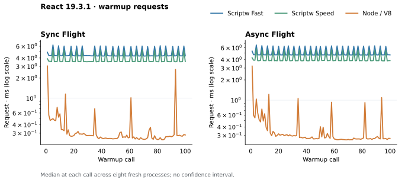

### Current-source instruction and caller attribution

Thirty unscored PMU processes use three fresh repetitions per engine/case, 100 warmups and 100 request windows. The table gives the median of three within-process instruction medians, in millions of retired user instructions:

| Policy | Sync · million instructions | Async · million instructions |
| --- | ---: | ---: |
| Fast baseline | 39.480 | 42.999 |
| Fast candidate | 38.771 | 42.290 |
| Speed baseline | 36.571 | 39.933 |
| Speed candidate | 35.862 | 39.224 |
| V8 | 2.477 | 2.616 |

Fast therefore retires about 15.7× / 16.2× V8's caller-window instructions; Speed about 14.5× / 15.0×. Counters do not multiplex. They cover the actual calling thread and include the ready/done and Promise-return edges; background JIT/GC threads and kernel work are excluded. Six additional Node controls perform 100 checked Flight warmups followed by 100 checked literal-null windows. Pooling 300 windows per case, that control is 13.62% / 13.20% of the full Node instruction window, and 16.06% / 15.54% of cycles. Counts remain raw; no control subtraction or workload-only claim is made.

Twelve frame-pointer profiles cover current Fast/Speed, three repetitions per case. Sample periods are pooled per policy/case. Disjoint own samples place **51.44% / 50.70%** of Fast periods in runtime helpers and **26.45% / 25.55%** in generated JavaScript functions; Speed has **61.73% / 60.35%** helper periods and **12.13% / 12.00%** JavaScript periods. Host/unresolved leaves retain **16.57% / 18.63%** Fast and **19.67% / 21.79%** Speed; these are not silently assigned to Wasm. These are sampled caller-thread periods, not exclusive wall-clock shares or fractions of the V8 gap.

For Fast sync, `object_read` owns 7.73% of periods and appears in 16.91% of call chains; its sampled callers include cached reads, recursive reads and `has_instance`. `function_call` appears in 23.21%, `has_instance` in 7.82%, and the descriptor-query union in 4.85%. These inclusive families overlap: `has_instance`/`object_read` alone overlap in 5.27% of periods. They must not be added or treated as removable dispatch overhead. Source paths preserve observable `@@hasInstance` lookup, calls and prototype traversal. The generated `vn` and `ft` functions own 10.18% and 5.58% of Fast sync periods. Speed reduces the JavaScript share while leaving R's native policy fixed; higher helper percentages do not show that helpers became slower.

StoredValue loads are emitted inline by `StoredValue.read_into`; there is no separately named `StoredValueDecode` owner in these profiles. Its exclusive cost remains unmeasured. [Full own lists, overlapping caller families and raw identities](react-attribution-current.json).

An excluded **2026-11-10** diagnostic on later source `16418b790879`
counts original P/R function entries and successful `StoredValue` constructions.
Two fresh processes check 484 exact outputs, with 100 warmups and 21 samples per
case. Both processes produce identical request vectors: **84,271 / 89,842**
function entries and **8,181 / 8,947** logical constructions, sync/async.
`value_to_object` accounts for 9,521 / 10,105 entries, header projection
6,563 / 6,978, string equality 5,076 / 5,349, and property-key conversion
2,186 / 2,285. These counts motivated a caller-identity experiment; they do not
measure time saved. The hot `ft` and `vn` bodies already receive local arguments;
their argv
adapters have zero observed entries. Counters preserve original types, indices,
locals and opcode bytes, with independently verified stack-neutral increments
and zero-reset readbacks. Instrumentation can inhibit native elimination;
logical constructions exclude host and constant-initializer allocations and
are not comparable to the older physical census below. This diagnostic does
not refresh the published timing panel or establish the sub-1-ms target.

A separate 20-process screen checks 2,420 exact outputs with two processes per
actor/case, 100 warmups and 21 measurements. Source `2525cdc5d252` adds caller
identity guards for conversions, string equality, ordinary headers and actual
functions. Fast moves **3.610/3.931 → 3.605/3.948 ms** and Speed
**2.860/3.187 → 2.784/3.164 ms**, sync/async. This is effectively flat for Fast
and a small Speed change, without final eight-process qualification. The
experiment is retired. A separate 484-output counter campaign confirms entries
fall **84,271/89,842 → 65,415/69,864** (about 22%), while logical StoredValue
constructions remain **8,181/8,947**. Removing these dispatches leaves almost
the same request time; entry counts are a poor proxy for the remaining cost.
Its 123 focused checks pass after two fixture/structural test
corrections; full CI and Test262 were not rerun.

Source `ce4bc97f96f0` separately reuses immutable descriptor getter/setter
edges and directly reads authenticated cells for strict identifier calls.
Another 20-process, 2,420-output screen moves Fast
**3.477/3.851 → 3.470/3.849 ms** and Speed
**2.848/3.151 → 2.739/3.058 ms**. Its separate 484-output census records
**83,132/88,640** entries and **7,345/8,063** logical StoredValue
constructions, about 10% fewer constructions than source `16418b790879`.
Fast remains effectively flat; these are screens rather than final
eight-process qualification. The batch passes 207 focused checks and all 380
source guards, with full CI and Test262 unverified.

An excluded four-slot census on that same source checks another 484 exact
outputs. Both process medians agree: sync/async construct **2,859/3,396
StringValues** and **2,946/3,494 CodeUnitArrays**. All these request constructions
are in R. `json_stringify_value` owns 1,424/1,900 strings and 1,510/1,997 arrays;
`integer_decimal_string` owns 663/690 of each. These are logical constructors,
not byte/copy counts or physical reservations. Reaggregating the twelve pinned
older `9f2788b4` profiles puts the exact JSON helper's deduplicated inclusive
share at 4.23%/4.63% Fast and 5.16%/5.65% Speed. Those older cycle samples do not
measure current-source savings; the high construction share alone does not
justify assigning the request gap to JSON.

An excluded function-body optimization screen on the same `ce4bc97f96f0`
artifacts checks 2,420 exact outputs across 20 fresh processes, including V8
controls. Binaryen 133 local simplification, propagation and common-expression
passes preserve every original non-Code section byte, including types, globals,
imports and exports. Custom descriptors and exact references remain disabled.
Both actors use one frozen diagnostic host and identical explicit R
`SpeedAndSize`/`Backtracking` compilation. Fast moves
**3.435/3.821 → 3.298/3.673 ms**; Speed moves
**2.733/3.105 → 2.714/3.014 ms**. These median-of-process-medians use only two
processes per actor/case, 100 warmups and 21 measurements; the transform is not
adopted or qualified beyond RSC. Smaller Wasm does not establish a large request
gain: P shrinks 4.12→2.49 MB, while Fast improves about 4%.

A separate current-source Fast sync FP process checks 200 exact outputs and
samples 100 request windows. Its 6,114 samples total 1,528,500,000 cycle periods:
helper labels own 45.58%, JavaScript labels 30.50%, and host/unresolved labels
18.14%. `object_read` owns 8.98% and appears in 18.89% of sampled call chains;
its cached-read, recursive-read and `has_instance` callers overlap. This single
process refreshes attribution only, not the published timing panel or a savings
estimate.

A further excluded 16-process screen checks 1,936 exact outputs with the same
warmup/sample counts. It compares linked P/R, raw Binaryen fusion, optimized
fusion and V8. All Wasm code uses `Speed`/`Backtracking`, including the linked R
control; this differs from canonical R's `SpeedAndSize` policy. Sync/async
medians are **2.728/3.053 ms** linked, **2.720/3.020 ms** fused, and
**2.846/3.134 ms** after local cleanup and bounded inlining. Raw fusion is nearly
flat; that optimized recipe regresses and is rejected. Each fused process has
one module and one actual private-memory provider for both memory imports.
All exports required by the embedding host and complete Flight outputs pass;
general conformance remains unverified. Raw Wasm size falls mainly through
custom-section removal, while fusion initially grows executable Code about 9%.
The optimized `ft`/`vn` bodies retain their key conversion, cached-read and call
edges; their size is consistent with exclusion by the 32 KiB combined inlining
cap, though exact pre-inlining AST sizes were not captured.

A selective fusion experiment then removes all six chosen conversion,
lookup and cached-read edges from `ft`/`vn`, but native compilation exhausts
4 GiB before producing a request. Coalescing locals down to 175/194 still
exhausts that limit. Neither attempt has a candidate timing; both are rejected.

An eight-process V8 control checks 968 exact outputs with the same 100 warmups
and 21 measurements. JIT/JITless sync medians are **0.251/0.503 ms** and async
medians **0.288/0.539 ms**. Disabling V8's JIT accounts for only part of this
comparison; this does not isolate a cause inside Scriptw.

Source `3d5416134359` gives only the default `@@hasInstance` builtin one
canonical typed local-argument body, retaining its ordinary argv adapter and
observable method lookup, native caller boundary and Realm. Another 20-process,
2,420-output matched screen moves Fast **3.536/3.952 → 3.435/3.786 ms** and
Speed **2.776/3.078 → 2.710/3.036 ms**, sync/async. Both blocks improve, with
only two fresh processes per actor/case; this is not final qualification and
neither case reaches 1 ms. Runtime ABI is 55; natural GC and the complete
request clock remain unchanged. All 2,673 adjacent native checks and 16 selected
private call-entry checks pass, alongside 380 source guards. Full CI, Test262
and the remaining private units were not rerun. Aggregate p95 improves slightly,
but Speed async p95 rises 0.99% in the first block; this screen does not establish
a tail-latency win.

A separate value-kind census on `3d5416134359` checks 484 exact outputs
across two fresh retained processes, each running both cases with 100 warmups
and 21 measured requests. Only measured calls retain counter vectors; request
and outer validation windows remain separate. Every measured vector agrees
within and across processes.

| Repeated payload reads per request | Sync | Async |
| --- | ---: | ---: |
| StoredValue | 13,703 | 14,996 |
| BindingCell | 3,449 | 3,637 |
| Existing GC references | 15,807 | 17,193 |
| Undefined, null or booleans | 492 | 542 |
| Numbers eligible for the proposed immediate encoding | 853 | 898 |
| Other Numbers | 0 | 0 |

This makes a single-reference value ABI a candidate for a complete prototype:
the observed values fit existing GC references or immediates. It does not
establish a timing or allocation gain. The census covers successful SCALAR
field reads from those two types, excluding compact SoA storage, host reads
and unboxed temporaries; reads are not unique values. Dynamic floating-point
results elsewhere may require boxes. The proposed signed-i31 interval is
−1,073,741,824 through 1,073,741,819, reserving four codes for other primitives
and excluding negative zero. The same emitted classifier and independent
edit verifier pass 19 boundary/NaN/infinity cases on each actual GC type,
with all 38 original-bit round trips and exact counter windows checked.
Original instructions, local indices and unrelated sections are preserved;
four scratch locals are appended only where needed. The transform is diagnostic
and remains outside the product and scored cohorts.

### Single-reference value experiment (2026-11-10)

A complete isolated prototype replaces StoredValue wrappers and BindingCell
payload triples with direct GC references, i31 immediates and immutable boxes
for other Number bits. Generic JavaScript values cross calls in one eqref;
Completions have three results. This is experimental ABI 56, not the product ABI.
The first source, `3677c166d0d8`, packs local copies into that representation;
a second, `86536fe46f9b`, instead copies the available decoded/encoded cache
state without conversion. Both regress retained RSC requests.

Each version has its own matched 20-process, 2,420-output screen against frozen
source `3d5416134359` and V8: 100 warmups, 21 measurements, two reversed blocks,
two fresh processes per actor/case, natural GC and the unchanged complete request
clock. The first version moves Fast sync/async **3.456/3.970 → 6.217/6.868 ms**
and Speed **2.831/3.118 → 4.321/4.810 ms**. The local-copy refinement gives:

| Policy and case | Current compiler | Single-reference prototype |
| --- | ---: | ---: |
| Fast sync | 3.409 ms | 5.639 ms |
| Fast async | 3.804 ms | 6.053 ms |
| Speed sync | 2.689 ms | 4.197 ms |
| Speed async | 3.016 ms | 4.576 ms |

These are medians of fresh-process request medians, not final qualification.
All outputs match exactly. The refinement still regresses every case in both
blocks. Removing wrappers does not establish lower total allocation or faster
execution: this implementation adds reference classification and local cache
bookkeeping. One exact scalar-loop fixture grows from 193 to 383 Wasm operators,
including 13 pure decoder calls. The first inline-codec build also saturates
4 GiB and is terminated without an OOM kill; shared codecs allow the subsequent
builds to complete under the same cap. Native preparation remains outside the
request clock and also regresses in the matched screens.

The final prototype passes 83 distinct compiler emission checks and an embedding
regression for numeric boundaries, signed zero, NaN payloads, heap storage,
closures, throws and explicit GC. Test-only corrections retain unchanged passing
scopes and rerun affected checks. Full CI, private units and Test262 were not
rerun. The prototype is rejected and remains outside the product; canonical
compiler inputs stay at `3d5416134359`, ABI 55. Raw campaigns and source/binary
witnesses are retained under `target/rsc-single-value-proposal/`, with the
consolidated result in `summary.json`. Neither attempt approaches 1 ms.

### Host-boundary screen (2026-11-11)

The earlier profiles left 16–22% of sampled request cycles in host or
unresolved leaves. On source `3d5416134359` those leaves divide into four
families: Wasmtime's subtype query, per-element initialization of host-allocated
byte arrays, copying collection, and typed funcref reads from GC structs.
Source `a97d0d600965` removes the first two without changing ABI 55:

- Wasmtime compiles a test or cast against a sealed GC type to an inline header
  comparison, and calls the host subtype query whenever the reference's type is
  not the tested type itself. The open `CompactDataStorage` base is never
  allocated, so every test and cast against it made that call; object reads,
  sets, for-in and own-key helpers did both per operation. Compiled code now
  reaches an open layout with at most four sealed descendants through those
  descendants.
- ArrayBuffer backing allocation keeps its host import, which preserves the
  collector's out-of-memory result, but Wasmtime's `ArrayRef::new` now fills a
  packed `i8` body at once instead of checking and writing one `Val` per byte.

A 16-process screen checks 3,216 exact outputs: two fresh processes per actor
and case in reversed order, 100 warmups and 101 measured requests each. Values
are medians of process medians, in milliseconds:

| Policy and case | `3d5416134359` | `a97d0d600965` | Change |
| --- | ---: | ---: | ---: |
| Fast sync | 3.668 | 3.353 | −8.6% |
| Fast async | 3.982 | 3.623 | −9.0% |
| Speed sync | 2.887 | 2.629 | −9.0% |
| Speed async | 3.214 | 2.853 | −11.2% |

Process means move −7.9% to −10.4%. A repeat screen on later source
`aebbfdab3f38`, whose P and R are byte-identical to these, measures −6.5%/−6.1%
Fast and −10.7%/−11.1% Speed, so two-process screens place the Fast change
only within about 2.5 points. These are screens without V8 controls or
eight-process qualification, and they do not refresh the published panel. P
grows 4,216,405→4,222,594 B and R 38,866,927→38,867,541 B. One Fast sync
frame-pointer process (100 warmups, 100 windows) samples 13.80M cycles per
window against 15.29M before; host-or-unresolved own share falls 18.1%→11.5%,
with host GC-API leaves 2.96%→0.14% and subtype-query leaves 3.79%→about 0.2%.

The scalar-row loop made the same open-base cast once per iteration, before
its sealed inline cast; it now casts to the sealed layout directly. A matched
run of the 21 [focused situations](#focused-performance-situations) uses two
hosts that differ only in this emission, with the default eight processes per
case, actor and policy. Fast/Speed medians move −11.3%/−12.2% on
`for-in-wide.js`, −7.2 to −10.3% / −8.4 to −10.1% on the three
`frame-branches` cases, −4.5%/−11.4% on `frame-compact.js`, −3.3 to −5.8% /
−3.3 to −7.6% on the three walked global lookups, −3.5%/−5.9% and −3.7%/−6.7%
on `args-unused.js` and `args-observed.js`, and −2.3%/−3.5% on
`property-stable.js`. The other ten cases move between −2.8% and +1.4%. This
run does not replace the published situation panel.

The same profiles place 4.3% Fast / 5.9% Speed of request-window cycles in
copying collection, about 2.1% / 3.0% in the typed funcref read
(`get_interned_func_ref`, `FuncRefTable::get_typed`, `engine_type_index`) and
2.5% / 3.4% in libc copies. Every sixth request on the unchanged 16-MiB heap
contains one collection of about 1.85 ms; that is roughly 0.3 ms of mean request
time and is absent from medians.

An excluded diagnostic host, source `2a35735267da`, differs only in disabling
Wasmtime epoch interruption for P and R. A second 16-process screen of the same
shape moves Fast sync/async **3.510/3.980 → 2.834/3.092 ms** and Speed
**2.548/2.862 → 2.189/2.420 ms**: 19–22% and 14–15%. Epoch checks ran at every
function entry and loop header. The diagnostic has no execution deadlines and
is not a product configuration; it measured what epoch interruption cost on
this workload.

### Fault-driven deadlines (2026-11-11)

Source `89a934d06891`, ABI 57, compiles P and R without epoch checks and keeps
execution deadlines: a deadline removes access to the Store's GC heap and
private linear memory, and the fault stops compiled code
([contract](contracts/execution-deadlines.md)). Source functions and loops
store one byte to linear memory instead of checking an epoch. One 64-process
screen interleaves four hosts, four fresh processes per host, policy and case,
101 warmups and 100 timed requests each, with natural collection and exact
output checks. Values are the median of the four process medians, in ms.

| Policy and case | `3d5416134359` | `a97d0d600965` | No deadlines `2a35735267da` | `89a934d06891` | Change from first |
| --- | ---: | ---: | ---: | ---: | ---: |
| Fast sync | 3.863 | 3.661 | 2.904 | 2.871 | −25.7% |
| Fast async | 4.287 | 3.907 | 3.407 | 3.349 | −21.9% |
| Speed sync | 2.889 | 2.637 | 2.254 | 2.298 | −20.4% |
| Speed async | 3.390 | 2.994 | 2.571 | 2.486 | −26.7% |

The new host is within −3.3% to +2.0% of the diagnostic without deadlines, so
the stores have no measured cost on this workload. An earlier screen of the
same four hosts measured −22.2%, −25.8%, −21.9% and −27.5% from the first
column, with two baseline processes per case instead of four. These are
screens without V8 controls or eight-process qualification, and they do not
refresh the published panel. P grows 4,222,594→4,228,988 B for the stores; R is
38,867,304 B after one uncalled helper leaves it.

A matched run of the 21 [focused situations](#focused-performance-situations)
compares `a97d0d600965` with `89a934d06891`, both run back to back with the
default eight processes per case, actor and policy. Fast/Speed medians move
−45.0 to −48.0% / −39.8 to −49.4% on `property-stable.js`,
`property-mutated.js` and the three `metadata` cases; −25.6%/−48.4% and
−30.5%/−46.5% on the two `strict-equality` cases; −22.4 to −26.5% / −17.0 to
−21.9% on the four global lookups, except `global-bound-deep.js` Speed at
+0.1%; −25.4%/−19.3% on `frame-compact.js`; −25.8%/−8.9% on `args-unused.js`;
−20.2%/−17.6% on `for-in-wide.js`; −5.3 to −19.1% / −6.8 to −9.9% on the three
`frame-branches` cases; and −8.5 to −9.8% / −12.7 to −13.9% on
`args-observed.js`, `typeof-dispatch.js` and `singleton-dispatch.js`, except
`singleton-dispatch.js` Speed at +1.2%. `control-empty.js` moves −2.6%/−3.7%.
A scalar loop now pays one store per iteration where it paid an epoch load,
compare and branch. This run does not replace the published situation panel.

### Read records and per-operation costs (2026-11-11)

Sources `7c6998ed91b4` (ABI 58) and `6a1d8259f6ad`. These are diagnostics from
one retained Speed process per case on a machine running other builds, counted
in user instructions per request (deterministic) and cycles per request (not).
They do not refresh the published panel.

| State | Sync instructions | Async instructions |
| --- | ---: | ---: |
| Fault-driven deadlines, `89a934d06891` | 20.12M | 21.65M |
| Direct `instanceof`, global reads and own data | 17.13M | 18.50M |
| Read records and the closed-chain Set, `7c6998ed91b4` | 15.53M | 16.79M |
| Binding-name checks and `string[number]`, `6a1d8259f6ad` | 15.15M | 16.39M |
| Integrated: position hints, shape transitions, call entries, builtin bodies, `0475e1a8ce97` | 11.20M | 12.05M |
| Static assignment write records (ABI 63) | 11.05M | 11.89M |
| [Record hit entries](#record-hit-entries-2026-11-12) (ABI 64) | 10.47M | 11.28M |
| `instanceof` front, direct global and named-binding reads (ABI 65) | 10.21M | 11.01M |
| Both of the two rows above together (ABI 65) | 9.62M | 10.39M |
| Globals resolved at run time, remembered global entries read at the site (ABI 65) | 9.58M | 10.35M |
| [Chain walks and computed keys](#chain-walks-and-computed-keys-2026-11-13) (ABI 67), on the row above | 7.88M | 8.61M |
| Call-free `instanceof` entry and one-cast global entry check (ABI 68) | 7.56M | 8.27M |
| [Host-side](#host-side-costs-2026-11-13) weak lookups, funcref reads, root scopes and collector copies (ABI 68) | 7.26M | 7.88M |
| [Site records in P](#site-records-in-p-2026-11-13) (ABI 69), on the row above | 6.72M | 7.32M |
| Inline interned funcref reads, plain references and cached embedding bridges (ABI 69), on the row above | 6.61M | 7.20M |
| [Identifier cells, truncation and single casts](#identifier-cells-truncation-and-single-casts-2026-11-13) (ABI 69), on the row above | 6.44M | 7.02M |
| [GC access code](#gc-access-code-2026-11-14): implicit null checks, wrapping element offsets (ABI 69), on the row above | 5.11M | 5.59M |
| [Captured cells without import links](#request-census-and-import-free-cells-2026-11-14) (ABI 69), on the row above | 5.09M | 5.57M |
| [`instanceof` site records in P](#instanceof-site-records-2026-11-14) (ABI 70), on the row above | 5.01M | 5.49M |
| Node 24 `--jitless` | 4.38M | — |
| Node 24 with its JIT | 2.62M | — |

Sync cycles per request are about 7.0M for `7c6998ed91b4`, 4.7M to 5.1M for
the integrated source (ABI 62) and 2.68M for Node 24 `--jitless`. The Fast
policy runs the integrated source in 13.30M instructions and about 8.5M
cycles.

The integrated source adds, on top of the read records: a self-validating
dictionary position on each String (a lookup first tries the entry position
last found for that very String object); `instanceof` without the
`@@hasInstance` dictionary probe while that Symbol has never been hashed;
outlined key and object coercions skipped for keys and objects; compact shape
transitions for plain data adds
([contract](contracts/compact-ordinary-data-storage.md)); plain callees
entered directly from the call owner, local builtin entries and call
forwarding; and JSON serialization into one buffer with cheaper codecs,
conversions and String operations. Static-key assignments then keep a
per-site write record for an existing own slot and for an add by shape
transition, which brings `u = {}; u.a = i; u.b = 2` to 1,980 instructions per
iteration, `u = new P()` to 3,906 and `lit.b = i` to 691.

`instanceof` then decides a plain function constructor without its state
machine: the default `@@hasInstance` reached through at most three function
objects without an own one, the constructor's own `"prototype"` read through
a per-site record (a dictionary position or an intrinsic row group), and the
candidate's chain walked through ordinary, Array and function headers; any
other case restarts in the unchanged kernel. A dynamic identifier read
returns an initialized binding found by name and the global object's own data
property (through the String's position hint) without a Reference, a
`typeof` operand that no ordinary header on the global object's chain has
reads as undefined, a named-binding scan rejects names by cached hash before
comparing code units, and `typeof x == "literal"` on an identifier compares
the type without a String. Instructions per iteration (Speed, loop included)
move from the ABI 63 source to ABI 65 as follows: `plain instanceof Map`
2,113 to 1,270, `plain instanceof Int8Array` 1,985 to 1,451, `inst instanceof C`
1,250 to 887, `u = Map` 626 to 485, `typeof NoSuchGlobal == "function"` 2,419
to 1,089 and `typeof Map == "function"` 986 to 572. The first two include the
global read of the constructor.

An `instanceof` source site then calls a call-free entry before the complete
helper (ABI 68). The entry takes only the candidate's tag and reference, the
constructor's reference and the site, reads the constructor's storage once
for both facts the front proves there (no own `@@hasInstance`, and its own
`"prototype"` at the recorded dictionary position or intrinsic value group),
proves the default method on the rest of the constructor's chain and walks the
candidate's chain. It answers true, false or nothing; only nothing makes the
site call the complete helper, whose front still records the site. Every
step only reads, so a declined answer has observed nothing. From `393716e0c`,
`inst instanceof C` goes from 861 to 528 instructions per iteration (Speed,
loop included). The entry's own time is about 3.3% of request cycles, where
`helper::has_instance` was 4.7%: most of what remains is Wasmtime's code for
the GC reads themselves (about 18 instructions per checked array element,
about 12 per sealed type test, and a null check per field read).

The inline check of a global's remembered dictionary entry now identifies the
global object and its dictionary by one cast test each, checks each proved
reference for null once, and leaves a value still held as a recipe to the
shared read, which resolves it in place: `u = Map` 388 to 318 and `typeof Map
== "function"` 473 to 404. With the entry, `plain instanceof Map` and `plain
instanceof Int8Array`, which include the global read, go from 1,156 to 703 and
from 1,337 to 820, and the retained request runs in 9.26M (sync) and 10.00M
(async) instructions instead of 9.58M and 10.35M. On top of the chain walks
(ABI 67, 7.88M and 8.61M) the two changes measure 7.56M and 8.27M.

A static read site keeps one record that holds only its key, shapes and
integers. It answers an own compact slot, an own dictionary entry (a position
confirmed by the entry's key), an own row of an intrinsic layout (the layout
address and value group), and a data property or proven absence on the
receiver's direct prototype. Every use re-proves the record against live
storage; nothing invalidates it from outside. A Set on an ordinary object
whose chain is closed skips the prototype walk. A named-binding scan compares
identity and length before code units, and `string[number]` reads its code
unit without the wrapper object.

Single operations, each as the body of a `for` loop in a strict function whose
objects are captured from the enclosing function. Values are user instructions
per loop iteration, loop included. The integrated column is the merged
source before its last size trim; Fast is the CLI default policy at
`7c6998ed91b4`, whose native code is not optimized.

| Loop body | Speed, integrated | Speed `6a1d8259f6ad` | Fast | Node 24 `--jitless` |
| --- | ---: | ---: | ---: | ---: |
| empty | 3 | 3 | 5 | 130 |
| `if (i > 5) t = i` | 81 | 81 | 176 | 197 |
| `t += id(i)` | 246 | 246 | 492 | 412 |
| `t += lit.b` (own property) | 655 | 654 | 852 | 258 |
| `lit.b = i` | 780 | 984 | 1,165 | 232 |
| `u = made.m` (prototype method of a `new P()` object) | 1,231 | 1,948 | 2,114 | 230 |
| `t += made.m(i)` | 1,694 | 2,408 | 2,870 | 492 |
| `t += text.indexOf(":")` | 1,714 | 2,967 | 3,467 | 561 |
| `t += map.get(mk)` | 1,698 | 2,501 | 2,952 | 471 |
| `if (plain instanceof Int8Array) t++` | 1,963 | 2,721 | 2,920 | 483 |
| `u = Map` (global) | 617 | 709 | 757 | 156 |
| `if (typeof NoSuchGlobal == "function") t++` | 2,376 | 2,336 | 2,589 | 239 |
| `u = { a: i, b: 2 }` | 815 | 816 | 1,025 | 356 |
| `u = {}; u.a = i; u.b = 2` | 4,516 | 5,529 | 5,836 | 433 |
| `u = new P()` (two fields) | 7,845 | 9,097 | 9,602 | 648 |
| `u = function () { return i; }` | 8,185 | 8,212 | 8,679 | 300 |
| `u = Object.keys(lit)` | 7,693 | 9,110 | 9,713 | 445 |
| `u = JSON.stringify(lit)` | 11,629 | 19,250 | 19,655 | 2,342 |
| `s += i` (captured accumulator) | 414 | 413 | 416 | 312 |

Compiled statements on locals and plain source calls are already cheaper than
V8's interpreter. The gap is in operations that enter runtime helpers: in the
integrated source 2.5 to 5 times V8 for reads, writes, `instanceof`, globals
and builtin calls, and 10 to 27 times for property adds, construction,
closures and `Object.keys`. Profiles of the same loops attribute a property add to the
dictionary definition path, a builtin call to the argument-vector call, the
funcref and subtype host calls and receiver coercion, a closure to eager
`length`/`name`/`prototype` definition, and a compound assignment to a
captured variable to two runtime helpers even when the binding cell is proven.
An own-property hit executed several hundred instructions in
`helper::cached_property_read`: parameter transfer, the paged site lookup, a
chain of layout tests for the header, and tag, scalar and reference array
reads; [record hit entries](#record-hit-entries-2026-11-12) cut that to about
170. A traced retained Realm keeps 1.67 MB live in a 16 MB heap, allocates
about 1.0 MB per request and collects every sixth request, so the collector's
growth rule is not the cost; allocation volume is.

`rsc_baseline` writes `program.cwasm` and `runtime.cwasm` beside the Wasm
modules when `SCRIPTW_RSC_ARTIFACT_DIR` is set, so the native code of either
policy can be disassembled with `objdump`.

### Record hit entries (2026-11-12)

ABI 64, measured as above (one retained Speed process per case; user
instructions per request and per loop iteration are deterministic, cycles are
not). Both Flight outputs stay exact.

A static read or assignment now calls a small hit entry in front of the
complete kernel. The entry reads the site's record from one flat per-program
table (one checked array read instead of the paged directory), identifies the
receiver and its storage by one inline cast test each (an ordinary object, a
function, an Array, a String or a Number; array, inline, dictionary or
intrinsic storage), answers what the record proves and otherwise tail-calls
`helper::cached_property_read_miss` or `helper::cached_property_write_miss`
with the same operands. The entries make no other call: a call is a safepoint,
and an earlier cut that called the storage extension from the write entry (or
kept the host subtype query of a cast to the open compact layout) spilled every
reference parameter and cost a plain store 34 instructions. An add that the
record proves now tail-calls `helper::cached_property_add`, which only extends
the storage; proving adds in the entry still costs an existing-slot store 23
instructions against a store-only entry (462) and saves more on each add. A
static read passes its base once and its key as a String.

| Loop body | Speed, ABI 63 | Speed, ABI 64 | Node 24 `--jitless` |
| --- | ---: | ---: | ---: |
| `t += lit.b` (own property) | 659 | 405 | 258 |
| `t += made.b` (own property of a `new P()` object) | 657 | 394 | — |
| `lit.b = i` | 691 | 485 | 232 |
| `u = made.m` (prototype method) | 1,233 | 537 | 230 |
| `t += made.m(i)` | 1,696 | 1,002 | 492 |
| `u = lit.zz` (absent) | 652 | 425 | — |
| `u = text.indexOf` (String receiver) | 802 | 498 | — |
| `u = Array.isArray` (global read plus own intrinsic row) | 1,167 | 960 | — |
| `u = {}; u.a = i; u.b = 2` | 1,980 | 1,771 | 433 |
| `u = new P()` (two fields) | 3,906 | 3,657 | 648 |

The rest of an own hit is the Wasmtime code for its GC operations: each
sealed-type test is about 13 instructions, each array element read about 14
(the tag, scalar and reference reads of array storage are three), and every
load of a non-null GC local repeats a null check. In request profiles,
`helper::cached_property_read` drops from 10.5% to about 4.9% of samples own
time and the miss kernel adds about 2.7%; most of the remaining miss time is
the general Get for dictionary receivers that lack the key and for getters.

### Chain walks and computed keys (2026-11-13)

ABI 67, measured as above against the ABI 65 source `a4c9dfc22` (one retained
Speed process per case; instructions are deterministic, cycles are not). Both
Flight outputs stay exact. On `a4c9dfc22` alone the change measures 7.92M sync
and 8.65M async; with the run-time global resolution underneath it, 7.88M and
8.61M.

A request profile of the ABI 65 source, with each helper call attributed to
its source site through the native return address and the site number it
passes, located what the records did not cover (shares are of sampled
cycles, inclusive):

- `helper::ordinary_set`, 7.0%: the walker's Array appends `c[f] = ...` (4.2%),
  its object adds `f[c] = r` (1.1%) and the property copy `o[i] = t[i]` in
  `createElement` (1.0%). A computed key went through ToPropertyKey, which
  writes an index as a decimal String, and the complete Set probed the
  receiver twice and searched %Object.prototype%'s layout by a call.
- `helper::cached_property_read_miss`, 5.6%: `arguments.length` in
  `createElement` (1.4%; the entry knew no arguments object), the function
  component's `r.$$typeof` twice in `et` (1.1%) and `n.defaultProps` (0.7%;
  a function's dictionary lacking the key), WeakMap `get`, `set` and `has`
  reads in `vn` (0.8%; the entry knew no Map or WeakMap header), and getters
  that records do not cover (`byteLength`, `size`, module getters).
- `helper::object_read` called from compiled code: absent Symbol keys
  (`o[Symbol.asyncIterator]` in `vn` 1.4%, `n[Symbol.iterator]` in `rr` 0.6%,
  `i[X]` in `Wi`) walked to %Object.prototype% by the general Get, and
  `o[o.length - 1]` on a String in `vn` boxed the String first (1.1% under
  `value_to_object`).

What changed ([contract](contracts/compact-ordinary-data-storage.md#chain-walks-and-computed-keys)):
a call-free walk of the live prototype chain (compact shapes by identity and
prepared hash, dictionaries by their key index, intrinsic layouts by their
static String index or the absence of Symbol rows) answers a static read
that its record does not, and every general Get, before any other work; the
static entry recognises Map, WeakMap, Set, WeakSet, Promise and primitive
wrapper headers by the absence rule it applied to Arrays, and arguments
objects through the walk; a plain computed-key assignment calls one R kernel
with the raw key, which stores or appends an Array element and adds a String
key by shape transition once the walk proves the chain lacks it; the layout
probe precedes every complete intrinsic search in registration and in the
ordinary Get probe; a computed GetV reads a String's index without the
wrapper; and every static read base that may be an object or primitive
(except an arguments object) takes a record site, so a Number reads its
methods through Number.prototype without a wrapper.

| Loop body | Speed, ABI 65 | Speed, ABI 67 | Node 24 `--jitless` |
| --- | ---: | ---: | ---: |
| `t += lit[key]` | 604 | 616 | 323 |
| `lit[key] = i` | 811 | 674 | 261 |
| `arr[i & 63] = i` | 1,358 | 715 | 296 |
| `u = {}; u[key] = i` | 2,545 | 1,384 | 357 |
| `u = []; u[0] = i; u[1] = i` | 7,141 | 2,137 | 669 |
| `u = {}; for (var k in two) u[k] = two[k]` (two keys) | 6,783 | 4,424 | 1,247 |
| `u = lit.zz` (absent, compact receiver) | 425 | 424 | 229 |
| `u = fnobj.zz` (absent, function receiver) | 2,780 | 884 | 228 |
| `u = dictobj.zz` (absent, dictionary receiver) | 2,021 | 693 | 233 |
| `u = (i & 1 ? lit : two).c` (own, then absent, at one site) | 1,271 | 780 | 276 |
| `u = weak.get` (WeakMap method) | 965 | 558 | 229 |
| `u = lit[symI]` (absent Symbol) | 2,016 | 822 | 301 |
| `u = lit[strk]` (absent computed String) | 1,445 | 1,038 | 303 |
| `u = i.toString(16)` (Number-typed receiver) | 5,091 | 1,785 | 556 |
| `t += lit.b` (own, record hit) | 405 | 404 | — |
| `u = made.m` (prototype method, record hit) | 537 | 534 | — |

Node's loop alone costs 197 instructions per iteration against Scriptw's 81.
In the request profile `helper::ordinary_set` falls from 7.0% to 0.9%,
`helper::cached_property_read_miss` from 5.6% to 1.4% (now getters, typed
array accessors and a TextEncoder receiver) and `helper::object_read` from
8.6% to 4.4%; the new `helper::computed_property_write` takes 3.2%, mostly
Array element publication and the new storage record each add allocates.

### Host-side costs (2026-11-13)

Source `b9bbc012b` (ABI 68). Frame-pointer profiles stop at the first host
frame, so earlier tables report host costs as leaves only. This profile
unwinds with DWARF instead: 200 retained Speed sync windows after 100 warmups,
one `cycles:u` sample per 50,000 cycles with a 16 KiB user-stack copy, `perf`
on the second CPU. The host binary is linked by lld, whose text segment's
virtual address differs from its file offset by one page; this `perf`'s libdw
unwinder computes the module base from the file offset and reads the wrong
unwind entries. The capture corrects the recorded text mapping and moves the
two JIT mappings out of the way, so libdw follows host frames by their unwind
tables and compiled frames by frame pointers; addresses are then resolved
against the host's symbol table and the process's `perf` map. Sampling copies
the stack and inflates cycles per window to 4.36M (3.64M unsampled); the
shares are of sampled cycles, each sample charged to the host entry it runs
under.

| Family | Share | Where it goes |
| --- | ---: | --- |
| Compiled Wasm (P and R) | 77.9% | |
| Copying collection | 6.9% | `forward` 3.6% own, of which about three quarters is the ephemeron marking's binary search over sorted dependencies on every first copy; object bytes through `memmove` 1.6%; field scan 0.6%; worklist 0.6%; dependency sort 0.2%; roots 0.2% |
| WeakMap and WeakSet host imports | 6.5% | `get` 3.1%, `set` 2.8%, `has` 0.5%: SipHash of three words per lookup and two lookups per `get`, rehashing on growth (0.5%), three no-GC scopes per call, a cloned `Arc` and `Mutex` per call, and the typed host-call boundary (rooted parameters, results, scope exit, about 1.3%) |
| `get_interned_func_ref` (typed funcref field read) | 2.4% | module-to-engine type lookup through the module 0.8%, side-table lookup and type check 0.6%, no-GC scope 0.3%; called from `vn` 0.9%, `helper::proxy_call` 0.7%, `createElement` 0.2%, `ft` 0.1% |
| Embedding (host calls into the instance) | 2.1% | `call_inner` 0.7%, `execute` 0.4%, completion field reads 0.2%, fiber entry, export lookup |
| `memory.fill` libcall | 0.8% | short `array.new_default` fills from `helper::coercive_add`, `ordinary_property_prepare`, `TextDecoder.decode`, `JSON.stringify` |
| `ref.func` libcall | 0.6% | the `VMFuncRef` is recomputed on every `ref.func` (`func_loc`, store code lookup); closure creation and stream builtins |
| `intern_func_ref_for_gc_heap` | 0.6% | SipHash of the `VMFuncRef` address |
| Subtype query | 0.5% | `helper::ordinary_object_allocate`, `compact_literal_allocate`, `compact_object_allocate` |
| Other | 1.4% | TextEncoder byte array 0.4%, measurement barrier 0.3%, float rounding 0.2%, clock 0.1%, `memory.copy` 0.1% |

`memcpy` is almost entirely the collector's object copy; the allocator is
under 0.2% (WeakMap table growth). The unresolved leaves of the
frame-pointer profiles are libc's internal copy routines, the Wasm-to-host
trampolines and this embedding layer.

Source `2e2cbe732` removes host work without changing ABI 68, emitted P or R,
or collection timing (vendored changes:
[Wasmtime](../../vendor/wasmtime-47.0.0/PATCHES.md#per-operation-host-costs),
[translator](../../vendor/wasmtime-internal-cranelift-47.0.0/PATCHES.md#funcref-reads-and-short-array-fills)):

- Weak collections look a key up under a shared Store borrow, which cannot
  collect: no no-GC scopes, one hash of the heap index (murmur3 finalizer
  instead of SipHash), one table probe per operation, a hit's key checked
  against the lookup's own token, and `get`/`has` borrow the resource instead
  of cloning its `Arc`. A copying-heap root scope releases its roots at once
  instead of calling a no-op drop barrier per root.
- A typed funcref read passes the engine type its `VMContext` already holds,
  so the libcall no longer translates the module type through the module; it
  still checks the interned function's type. Funcref interning no longer uses
  SipHash, an instance returns a `VMFuncRef` it has already written for a
  repeated `ref.func`, and GC array fills of up to 64 equal bytes are stored
  inline instead of calling `memory.fill`.
- The copying collector tests a granule bitmap of ephemeron dependencies
  before its binary search on each first copy, and copies survivors of up to
  128 bytes with constant-size moves instead of `memmove`.

| Speed, user instructions per request | `b9bbc012b` | `2e2cbe732` | Change |
| --- | ---: | ---: | ---: |
| Sync, median | 7,559,000 | 7,255,000 | −4.0% |
| Sync, mean (includes collections) | 8,224,000 | 7,775,000 | −5.5% |
| Async, median | 8,270,000 | 7,882,000 | −4.7% |
| Async, mean | 9,030,000 | 8,478,000 | −6.1% |

Medians are of 100 measured requests after 100 warmups; about one request in
six collects, so medians exclude almost all collector work and the means
carry it. On a quiet machine the source before the last two changes measured
3.15M/3.35M sync cycles (median/mean) against 3.28M/3.58M, and 3.45M/3.66M
async against 3.69M/4.00M. Three interleaved rounds of the final source were
taken while other workloads loaded the machine and vary by up to 25% between
rounds of one host; they are not used.

| Loop body, Speed instructions per iteration | `b9bbc012b` | `2e2cbe732` |
| --- | ---: | ---: |
| `t += add1(i)` (closure call) | 645 | 566 |
| `t += made.m(i)` | 999 | 921 |
| `t += map.get(mk)` | 1,373 | 1,295 |
| `if (weak.has(mk)) t++` | 2,430 | 1,920 |
| `u = weak.get(mk)` | 3,183 | 2,356 |
| `weak.set(mk, i)` (existing key) | 3,001 | 2,200 |
| `u = function () { return i; }` | 8,201 | 5,121 |

Every call through a function object reads its code funcref, which still
costs one host call (about 80 instructions fewer than before). Of
`weak.has`'s 1,920 instructions, about 920 are the method call and the
property read of `weak.has`; the host import is most of the rest, dominated by
Wasmtime's typed host-call boundary (call hooks, rooting each reference
parameter, the kind assertions in its loaders).

The same DWARF profile on the final source, taken under that load, charges
17.0% of sampled cycles to host entries against 22.1%: collection 4.3%
(`forward` 2.0% own, the copy now inline), weak collections 4.6%, funcref
reads 1.7% (now mostly the side-table entry and its type check), `memory.fill`
0.6% (string concatenations past 64 bytes), funcref interning 0.3% and
`ref.func` 0.2%. The embedding's own work per host call (export lookup by
name, `Func::ty`, `StructRefPre`/`ArrayRefPre`, dynamic argument checks,
Realm field reads) is about 2% and unchanged.

A second host-side step (still ABI 68 when measured, P and R unchanged)
removes the remaining funcref host call and part of the embedding's per-call
work
([Wasmtime](../../vendor/wasmtime-47.0.0/PATCHES.md#inline-funcref-reads-and-plain-references),
[translator](../../vendor/wasmtime-internal-cranelift-47.0.0/PATCHES.md#funcref-reads-and-short-array-fills)):

- The interned funcref table is a dense vector whose base and length the
  runtime publishes in the copying heap's JIT-visible data whenever it grows.
  A typed funcref field read returns the entry inline when it is null or its
  registered type equals the expected engine type, exactly the cases the
  libcall answers without a subtype query, and calls the libcall otherwise.
- The copying collector's references are plain copies, so `GcStore` no
  longer makes virtual clone, drop and expose calls for them, and the
  externref parameter loader checks its kind with one header read.
- `EmbeddedInstance` keeps the call and Promise bridges, their result counts,
  the call bridge's argument allocators, the entry Realm global and the
  module status export from instantiation instead of looking them up per
  call. One retained request makes two host-to-Wasm entries in its window
  (the call of `run` and one Promise query; the harness's `encode` call
  follows outside it).

| Speed, user instructions per request, on ABI 68 | before | after | Change |
| --- | ---: | ---: | ---: |
| Sync, median | 7,255,000 | 7,147,000 | −1.5% |
| Sync, mean | 7,775,000 | 7,667,000 | −1.4% |
| Async, median | 7,882,000 | 7,767,000 | −1.5% |
| Async, mean | 8,478,000 | 8,363,000 | −1.4% |

| Loop body, Speed instructions per iteration, on ABI 68 | before | after |
| --- | ---: | ---: |
| `t += add1(i)` (closure call) | 566 | 473 |
| `t += made.m(i)` | 921 | 827 |
| `t += map.get(mk)` | 1,295 | 1,202 |
| `if (weak.has(mk)) t++` | 1,920 | 1,831 |
| `u = weak.get(mk)` | 2,356 | 2,241 |
| `weak.set(mk, i)` (existing key) | 2,200 | 2,115 |

Each call through a function object saves about 93 instructions. Closure
allocation (5,121 and 5,177 in two runs of the earlier host, 5,289 now) is
dominated by collections inside the loop and varies by about 60 between runs.
`get_interned_func_ref` no longer appears in the request profile.

Rebased onto ABI 69 the step measures as the state table shows.

### Site records in P (2026-11-13)

ABI 69 (one retained Speed process per case; instructions are
deterministic, cycles are not). Both Flight outputs stay exact. The code-size
comparison and the per-operation rows below were measured on top of the ABI
68 source `b9bbc012b`; rebased onto the [host-side
reductions](#host-side-costs-2026-11-13) (`b848e28b7`, still ABI 68 and
7.26M/7.88M) the change measures 6.720M sync and 7.317M async
instructions per request, with P 4,755,827 bytes against 4,537,470.

Where a record hit went. On `d11274eb4` (ABI 67) the loop `t += lit.b` (an
own data property of a three-key literal, so array compact storage) executes
404 instructions per iteration, 81 of them the loop and about 15 the
addition. Counted along the executed path of the native code:

| Part | Instructions |
| --- | ---: |
| Reading the captured `lit` (environment chain, binding cell, TDZ check) | 56 |
| P: the key String from the pooled-string table, its cast to `StringValue` | 50 |
| P: argument setup, the call, the five-word completion and its throw check | 19 |
| R entry prologue and stack arguments | 28 |
| Record fetch: the ProgramInstance table, two bounds checks, the record and its key | 39 |
| Receiver: primitive tag tests, sealed OrdinaryObject test, PROPERTIES, sealed array-storage test | 40 |
| Shape proof and slot sign | 14 |
| Value: tag, scalar and reference array reads, each with its own null and bounds checks | 70 |
| Result packing, epilogue and return | 25 |

An earlier in-place read did not pay because it kept the record behind the
paged and then flat ProgramInstance table (a struct read, a nullable array,
a bounds-checked element read and a key check: about 40 instructions before
any proof) and kept the key String as an operand; the call it saved was only
a third of the hit.

What changed ([contract](contracts/compact-ordinary-data-storage.md#static-site-records-in-p)):

- Each static read and assignment site keeps its record in a global of the
  module that compiles it, read with one load. R's new record helper makes
  it on the site's first use; R alone fills it.
- A read site whose base may be an object answers inline an own data value
  of an actual OrdinaryObject whose array-layout compact storage has the
  record's shape. A plain assignment stores inline into an existing writable
  own slot of such storage when the storage already has every backing the
  value needs. Everything else calls the hit entry with the base and the
  record: no site number, no key operand and no table.
- Compound, logical and update assignments read through a static read site,
  and a literal-key GetV evaluates only its base before its site.
- Array compact value loads and stores read each backing once without a
  temporary local, and GC field and array accesses on locals no longer
  repeat the access's own null check with a separate `ref.as_non_null`, which
  Wasmtime compiled as a second test and branch on every access.

Code size. A read site that proved an own slot of either compact layout and
an absence inline was about 350 Wasm operators, and P grew by a fifth. With
the site code holding no temporary copies, one build compared which sites
answer inline through switches removed afterwards. "Computed cache" is a
computed `o[k]` site keeping the last String key, shape and slot its probe
found in three P globals:

| Reads inline | Writes inline | Computed cache | Sync | Async | P bytes | Native preparation |
| --- | --- | --- | ---: | ---: | ---: | ---: |
| ABI 68, `b9bbc012b` | | | 7.559M | 8.270M | 4,537,470 | 7.58 s |
| both layouts | both layouts | yes | 7.010M | 7.700M | 5,002,344 | 8.91 s |
| both layouts | both layouts | no | 7.014M | 7.695M | 4,976,618 | 9.14 s |
| array layout | array layout | yes | 7.002M | 7.681M | 4,788,874 | 8.76 s |
| array layout | both layouts | yes | 7.019M | 7.700M | 4,838,871 | 8.79 s |
| array layout | array layout | no | 7.017M | 7.698M | 4,763,902 | 8.63 s |
| array layout | none | no | 7.073M | 7.757M | 4,697,907 | 8.36 s |
| none | array layout | no | 7.034M | 7.707M | 4,491,662 | 7.04 s |
| none | none | yes | 7.077M | 7.753M | 4,449,713 | 7.32 s |

The inline layout (one or two keys) and the computed cache do not pay for
their code here: the cache takes `t += lit[key]` from 616 to 387
instructions per iteration but moves the request by at most 15K. The
shipped source answers the array layout inline at reads and writes: 7.054M
sync and 7.736M async instructions per request, P 4,755,827 bytes (4.8% over
`b9bbc012b`, 4.5% over `d11274eb4`'s 4,550,856) and 8.27 s of native
preparation. That is about 37K instructions above the same configuration
behind the switches, with 8 KB less P (one block fewer per site), so it is
not more work per site; differences of that order also separate
configurations of the same intent in the table and were not traced further.
On this request the inline read alone is worth about 17K instructions (0.2%)
for 272 KB of P and 1.6 s of preparation against inline writes only; the
per-operation rows are where it pays.

| Loop body | Speed, ABI 68 | Speed, ABI 69 | Node 24 `--jitless` |
| --- | ---: | ---: | ---: |
| `t += lit.b` (own, three-key literal) | 404 | 260 | 258 |
| `t += made.b` (own, two-field `new P()`) | 393 | 341 | — |
| `lit.b = i` | 485 | 277 | 232 |
| `u = made.m` (prototype method) | 534 | 454 | 230 |
| `u = lit.zz` (absent) | 424 | 355 | 229 |
| `t += lit[key]` | 616 | 603 | 323 |
| `if (tagged.$$typeof === SYM) t++` | 476 | 340 | — |

`made.b` has two fields, so its storage has the inline layout, which the
site leaves to the entry: answered at the site it measured 246; through the
entry it gains from the record global and the removed key operand alone. A
`t += lit.b` iteration now executes as many instructions as under V8's
interpreter (260 against 258), whose loop alone costs 197 against 81.

### Identifier cells, truncation and single casts (2026-11-13)

Still ABI 69 (no layout or helper signature changes), measured as above
against `8f96ffedf` (6.72M sync, 7.32M async). Both Flight outputs stay
exact. Rebased onto the host-side round (`83b634089`, 6.61M and 7.20M), the
change measures 6,438,519 sync and 7,017,781 async instructions per request
(3.04M and 3.76M cycles on a quiet machine), with P 4,793,590 bytes.

- A compound, update, logical or plain assignment to an identifier whose
  binding the compiler proves to be one cell reads and writes that cell
  inline: GetBindingValue and SetMutableBinding's checks run on the cell's
  own initialization, mutability and strict-immutability words, where they
  built a by-name Reference and called `environment_identifier_get_strict`
  and `environment_identifier_put_strict`.
- Wasmtime compiles `f64.floor`, `f64.trunc`, `f64.ceil` and `f64.nearest` as
  host calls on the baseline x86-64 target. ToInt32 and ToUint32 (every
  bitwise operator) take the low 32 bits of the saturating i64 truncation
  below 2^63 in magnitude; the integrality tests of array, computed and
  remainder operands, the Ryū integer path, `Array(n)`, ToLength,
  ToIntegerOrInfinity, string position clamps, `apply` lengths and the integer
  part of `Number#toString(radix)` use the saturating truncation (converted
  back where a Number is needed) inside the ranges those paths already prove.
- One `br_on_cast` proves a layout where a `ref.test` was followed by a
  `ref.cast` of the same value: ToBoolean's test of the HTMLDDA slot (2,125
  of the 3,177 such pairs in the program's own functions), the OrdinaryObject
  header projection, Array `.length` and the Array arm of ObjectRead.
- A source body memoizes the root of its environment chain (its global
  environment) on first use in each invocation, instead of walking the chain
  at every global read and every read of its execution Realm.

| Speed, user instructions per request | Sync | Async | P bytes |
| --- | ---: | ---: | ---: |
| `8f96ffedf` | 6,719,594 | 7,316,792 | 4,755,827 |
| Cells, truncation, IsHTMLDDA and header casts | 6,594,210 | 7,183,772 | 4,775,239 |
| With the memoized root and the Array casts | 6,555,543 | 7,142,936 | 4,793,590 |

| Loop body | `8f96ffedf` | now | Node 24 `--jitless` |
| --- | ---: | ---: | ---: |
| `s += i` (captured `var`) | 406 | 191 | 312 |
| `t += arr[i & 63]` | 558 | 354 | 329 |
| `arr[i & 63] = i` | 704 | 501 | 296 |
| `u = Map` | 311 | 258 | 156 |
| `u = Array.isArray` | 578 | 526 | 212 |
| `if (plain instanceof Map) t++` | 685 | 633 | 433 |
| `u = { a: i, b: 2 }` | 770 | 721 | 356 |
| `u = "k" + ":" + i` | 1,223 | 1,189 | 658 |
| `t += arr.length` | 237 | 221 | 257 |

Not done in this round: a captured read still follows its cell's import
TARGET even in a program without import bindings (the compiler has no such
summary yet); a global read still loads its key String and re-proves its
remembered entry with several dependent loads; the remaining test-and-cast
pairs (StoredValue, two record kinds, scalar-loop entry guards) and the
cached-read entry's arms on the request are uncounted.

### GC access code (2026-11-14)

On the [site-record row](#site-records-in-p-2026-11-13) with inline funcref
reads (ABI 69, no layout change; 6.61M sync, 7.20M async), Wasmtime's own code for GC accesses carried a
fifth of the request: an explicit null trap before every struct field and
array length access, a 64-bit object-size computation with three overflow
traps and a backwards offset behind every array element, and an `i31` test
in casts of struct-typed references. The vendored translator and runtime now
emit ([translator](../../vendor/wasmtime-internal-cranelift-47.0.0/PATCHES.md),
[runtime](../../vendor/wasmtime-47.0.0/PATCHES.md)):

- no null check where the operand's validated type is non-nullable;
- otherwise the field access or length load itself as the null check, through
  reference 0 faulting in a 4 KiB null guard the copying heap keeps
  inaccessible and never allocates. The guard comes out of the heap before the
  semi-space split, so each 8 MiB semi-space has 2,032 fewer bytes and
  collections start that much (0.02%) earlier;
- array element addresses as `ref + base_size + index * elem_size` in wrapping
  32-bit arithmetic after the `index < length` check, which keeps any address
  a corrupt length allows inside the 4 GiB reservation plus guard;
- `i31` tests only for operands typed `anyref`, `eqref` or `i31ref`.

The first table bounds each part with unsound variants of the translator
(temporary switches, not committed), the second measures the sound ones; one
measurement build, P and R compiled at run time, Speed user instructions per
request (median of 100 after 100 warmups), exact Flight output checked.

| Unsound bound, from the old code (6.613M / 7.203M) | Sync | Async |
| --- | ---: | ---: |
| No null trap on struct fields and array lengths | 6.259M | 6.823M |
| Element address without size arithmetic or heap check | 5.724M | 6.253M |
| Both | 5.381M | 5.882M |
| No `i31` tests in casts | 6.424M | 6.992M |
| 4 GiB linear-memory reservation (no linear bounds checks) | 6.587M | 7.168M |
| All of these | 5.155M | 5.624M |

| Sound, each alone | Sync | Async |
| --- | ---: | ---: |
| Static non-null elision | 6.567M | 7.155M |
| Static elision and implicit null checks | 6.259M | 6.823M |
| Element offset as a checked 64-bit sum | 5.906M | 6.447M |
| Element offset in wrapping 32-bit arithmetic | 5.713M | 6.241M |
| `i31` tests by operand type | 6.529M | 7.110M |
| All, final tree (R from its build image) | 5.270M | 5.761M |

Implicit null checks reach the bound of removing the checks outright, and the
wrapping offset is cheaper than both the checked sum and the unsound direct
address. The linear-memory checks (0.4%) do not pay for a 4 GiB reservation
per memory. Native code shrinks with the checks: P from 11.6 MB to 9.6 MB of
text, R from 42.7 MB to 33.9 MB. Cycles could not be settled: the machine ran other
projects' builds throughout, and the per-run cycle medians of four interleaved
rounds (old, new) were 5.63/2.92, 3.56/3.40, 3.42/3.19 and 5.84/5.23M for sync
and 3.72/3.89, 4.16/3.39, 4.11/3.83 and 6.46/6.25M for async: lower in seven
of eight pairs (by 4–7% in the two quietest sync pairs), but no figure.

| Loop body, Speed instructions per iteration | before | after |
| --- | ---: | ---: |
| `u = Map` (global read) | 311 | 243 |
| `t += arr[i & 63]` | 558 | 492 |
| `u = made.m` (prototype method) | 454 | 372 |
| `if (plain instanceof Map) t++` (miss) | 685 | 505 |
| `t += add1(i)` (closure call) | 454 | 392 |

What remains of an array element access is the length load, which is also
the null check, the source's own bounds branch, the Wasm `index < length`
trap on the same two values, one `lea` and the load.

On the [identifier-cell row](#identifier-cells-truncation-and-single-casts-2026-11-13)
the two rounds together measure 5.11M sync and 5.59M async instructions per
request (medians; means 5.60M and 6.24M, the difference being collections),
with exact Flight output. Median cycles on the same loaded machine were 2.57M
sync and 3.01M async.

### Request census and import-free cells (2026-11-14)

Counted on the combined source `62b358212` (ABI 69) with a frame-pointer
profile of 200 retained sync requests, one `cycles:u` sample per 25,000
cycles (40,140 samples; the shares match the coarser profile).

The three largest JavaScript bodies, by the kind of native instruction their
leaf samples land on (cycle-weighted, so a stalled load's cost often shows on
the instruction after it):

| Body (own share) | Stack reloads | Spills | Compares | Register moves | Heap loads | Heap stores | Branches | ALU |
| --- | ---: | ---: | ---: | ---: | ---: | ---: | ---: | ---: |
| `vn` (12.1%) | 26% | 9% | 21% | 12% | 10% | 2% | 8% | 8% |
| `ft` (6.2%) | 25% | 16% | 22% | 11% | 6% | 2% | 8% | 5% |
| `f42` (4.3%) | 18% | 8% | 21% | 9% | 15% | 12% | 7% | 5% |

A third of `vn`'s and four tenths of `ft`'s own cycles move values between
registers and the stack: these bodies keep many values live across helper
calls. Their native code is 543 KB (`vn`), 176 KB (`ft`) and 75 KB (`f42`).

Read and `instanceof` helpers by calling site (the caller's return address):

| Helper | Samples | Calling sites | Top sites |
| --- | ---: | ---: | --- |
| `cached_property_read` | 2,098 | 79 | two `f42` (createElement) sites 19%, `vn` six sites 23%, `jn`, `et`, `ft` one each 13% |
| `cached_property_read_miss` | 149 | 15 | four `f304` sites 60%, `Ln` 21%, `C` 8% |
| `object_read` | 2,020 | 71 | `f304`, `json_stringify_value`, `ft`, `or`, `rr`, `C`, `Array.prototype.splice` twice, `Ln` (each 3-8%) |
| `instanceof_entry` | 1,277 | 37 | all in `vn`, 52 to 102 samples each |

`vn` tests each value against 21 builtin constructors (`Date` twice, `Map`,
`Set`, `FormData`, `Error`, `ArrayBuffer`, eleven typed arrays, `DataView`,
`Blob`, `ReadableStream`); for a plain object or Array every test is false.
P reads a cell's import TARGET 1,368 times statically (68 in `vn`).

Module linking sets a cell's TARGET only for an import binding, so a source
body of a program whose IR declares no import binding now reads its captured
cells without that indirection (the RSC bundle exports but imports nothing).
Instructions per request: sync 5.111M to 5.089M (median) and 5.597M to
5.575M (mean), async 5.593M to 5.569M and 6.238M to 6.215M; P 4,793,590 to
4,738,997 bytes. Cycles were not comparable (load average 24 during the run).
Not counted yet: which property each read site names, and allocations per
site.

### `instanceof` site records (2026-11-14)

Each source `instanceof` site now keeps a record in a P global (ABI 70),
made by the new R helper `instanceof_record` the first time the site runs,
for the right-hand side C it meets then. A usable record names a function
whose own "prototype" is a non-writable, non-configurable data property
holding an object (every builtin constructor and class), and whose
[[Prototype]] was a Realm's %Function.prototype% or one function object
whose [[Prototype]] was (%TypedArray% for the typed array constructors, or a
parent class). At each use the site checks that C is the record's function,
that those [[Prototype]] edges are unchanged and that @@hasInstance has never
been hashed, so no dictionary holds it; it then answers a primitive V false
and walks an ordinary, function or Array V's chain inline. Everything else
goes on to the call-free entry and the HasInstance helper as before, having
observed nothing: another right-hand side, a writable "prototype" (an
ordinary `function`), a deeper chain, a Proxy candidate, a bound,
Proxy or non-callable C. A site whose first right-hand side is declined
keeps a declined record.

On the retained request, `vn` tests each value against 21 builtin
constructors; eleven of them are typed arrays, which a record of the direct
edge alone declined (sync 5.073M then).

| Retained RSC, Speed, user instructions per request | median | mean |
| --- | ---: | ---: |
| sync, before (`f72b39596`) | 5.089M | 5.575M |
| sync, after | 5.010M | 5.497M |
| async, before | 5.569M | 6.215M |
| async, after | 5.486M | 6.132M |

Sync cycles median 2.533M (mean 2.748M) on the after build. P grows from
4,738,997 to 4,763,949 bytes and R by 1,099 bytes. `instanceof_entry`'s own
share of sync cycles falls from 3.2% to 1.6% with the direct edge alone, and
out of the top forty own entries (under 0.3%) once one function object between
C and %Function.prototype% is proved; `vn`'s own share rises from 12.1% to
14.6%, where the answers now run.
### Descriptor work and physical allocation

Compiler-created, already validated descriptors now call canonical ordinary/Array definition directly when admitted, retaining the exotic Reflect fallback. Known source accessor descriptors bypass the inline Array algorithm to control code growth. Public descriptor conversion and validation remain intact.

The unscored breakpoint census uses 100 warmups and 21 measured requests per window. Entries count attempts; breakpoint instrumentation perturbs execution.

| Entry | Baseline sync / async | Candidate sync / async |
| --- | ---: | ---: |
| `Reflect.defineProperty` | 35 / 38 | 0 / 3 |
| `ordinary_own_descriptor` | 4,074 / 4,360 | 3,864 / 4,150 |
| `ordinary_property_find` | 6,799 / 7,231 | 6,449 / 6,881 |
| `ordinary_set_data_on_receiver` | 390 / 420 | 390 / 420 |
| Cached read helper | 2,548 / 2,698 | 2,548 / 2,698 |
| Generic fallback callsite | 1,275 / 1,362 | 1,275 / 1,362 |

The change removes 35 Reflect entries per request in both cases; three remain in async. Cached-entry minus fallback is not a cache-hit count. The first measured `object_read` self-call site counts 2,521 / 2,674 entries, the second zero; a third is unmeasured. There is no prototype-versus-Proxy cause attribution.

Per request, the candidate has one embedding Promise, **zero external checkpoints**, four internal `promise_drain_jobs` entries and two reader reads. Internal drain entries are not a count of jobs or external pumps. Codec/stream counts are one TextEncoder `encode`, zero `encodeInto`, two TextDecoder `decode` and one `getReader`. An external pending-job pump is not explaining these successful requests.

A separate physical allocation census uses exact source-matched P/R, canonical native runtime policy, natural GC and off/on/on/off controls: eight processes, 100 warmups and 21 timed requests per case. All 1,936 outputs pass; 968 enabled allocation epochs are admitted. Counts include dead allocated objects and exclude copied survivors; post-request validation increments are recorded separately.

| Physical request allocations | Baseline | Candidate | Reduction |
| --- | ---: | ---: | ---: |
| Sync objects | 36,052 | 34,897 | 1,155 · 3.20% |
| Sync aligned bytes | 1,546,160 | 1,499,120 | 47,040 · 3.04% |
| Async objects | 39,087 | 37,932 | 1,155 · 2.96% |
| Async aligned bytes | 1,723,232 | 1,676,192 | 47,040 · 2.73% |

Candidate sync still allocates 12,625 physical StoredValue records and 3,728 PropertyDescriptor records, down from 4,008 descriptors. Async descriptors fall 4,292→4,012. Physical GC types can alias and do not identify JavaScript object origins or allocating semantic operations. No V8 physical census is available. [Allocation controls, type rows and limitations](react-allocation-current.json).

### Spill-home experiment

An isolated regalloc2 prototype reuses homes only for eligible block-local values. It preserves explicit GC root slots and excludes block parameters, boundary values and other unsupported lifetimes. Checker tests and eight valid fixed fuzz seeds pass for control and prototype; this is not full backend qualification. P and R remain byte-identical to the product.

| Fast function | Product fixed frame / probes | Prototype fixed frame / probes |
| --- | ---: | ---: |
| `js::vn#f133` | 213,856 B / 53 | 200,864 B / 50 |
| `js::ft#f123` | 85,664 B / 21 | 81,696 B / 20 |

Frames exclude saved RBP and return words; stack-limit guards additionally reserve 16 bytes. Native code extents are unchanged. The anonymous static census records 27,840 reuses, but does not attribute them to a named function/module or dynamic execution frequency. Precompiled Backtracking R is outside that census.

The separate 48-process comparison checks 9,648 exact outputs, with 100 warmups, 101 measured calls and eight processes per actor/case. Prototype medians shift **−0.35% sync / −0.97% async**; mean native preparation is 5.171 s product versus 5.178 s prototype. Frame reductions of 6.08% / 4.63% accompany small descriptive request changes; the experiment does not isolate frame or probe costs. **The allocator fork remains outside the product.** [Architecture and isolated experiment](react-architecture-current.json).

### Cold setup and artifact expansion

Fast compiles P with Cranelift `None` / `SinglePass`; Speed uses `Speed` / `Backtracking`. Both load the same precompiled R, whose fixed policy is `SpeedAndSize` / `Backtracking`.

| Candidate cold phase · median | Fast | Speed |
| --- | ---: | ---: |
| Front end and lowering · s | 2.668 | 2.670 |
| Wasm emission · s | 0.419 | 0.419 |
| Native preparation · s | 5.101 | 7.084 |
| Source to Wasm · s | 3.086 | 3.089 |
| Realm and instantiation · ms | 0.564 | 0.597 |
| Module initialization · ms | 2.021 | 1.683 |

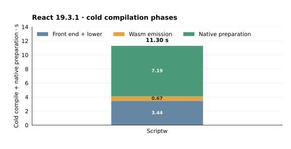

Front end, emission and native preparation total about 8.19 s Fast / 10.17 s Speed, before retained calls. R production is prebuilt and excluded. V8's separately measured cold medians are 16.706 ms Realm creation, 1.468 ms module parse and 2.353 ms link/init; later JIT work is not fully accounted for by those phases.

P is byte-identical across sources at **4,169,697 B**. R grows **38,769,947→38,872,804 B** (+102,857 B, about 0.27%), all in encoded code bodies. P has 541 defined functions and 3,618,661 code-body bytes; R has 1,149 functions and 14,269,752 code-body bytes. These are encoded artifact measurements; reachability and unused work were not measured. Whole-child peak RSS medians are 251.54 MiB Fast, 296.56 MiB Speed and 75.79 MiB V8, including compilation/setup/warmup. They are neither request-only memory nor live heap sizes.

### Verification and retained evidence

Seven affected native scopes pass **1,611 tests**; five source-guard groups pass **380 checks**, with owner and product-graph checks also passing. Proxy/Realm/accessor/Array semantics and the unchanged 128-KiB Array.from size guard are covered. Full CI, pinned Test262 and private units were not rerun. Existing unrelated formatting and Intl identity gates remain owned.

[Raw campaign, controls, profiles, sources, failed attempts and verification receipts](rsc-analysis-evidence-2026-11-09.tar.xz) · [Request report](rsc-current.json) · [Attribution](react-attribution-current.json) · [Architecture](react-architecture-current.json) · [Physical allocations](react-allocation-current.json).

## Focused performance situations

Measured **2026-11-08** on source `453a9074fcac`. All 21 programs use two balanced blocks and eight fresh processes per actor. Each program compares Fast, Speed and V8.

| Program · retained call | Fast · ms (median; min–max) | Speed · ms (median; min–max) | V8 · ms (median; min–max) |
| --- | ---: | ---: | ---: |
| `control-empty.js` | 0.005135 (0.005049–0.00519) | 0.0050795 (0.004969–0.00511) | 0.000351 (0.000281–0.000361) |
| `global-shallow.js` | 2.15892 (2.15098–2.18126) | 1.75727 (1.74812–2.04566) | 0.970546 (0.940678–1.03143) |
| `global-deep8.js` | 2.74284 (2.72885–2.92174) | 1.94218 (1.9237–2.01476) | 1.00055 (0.970535–1.0487) |
| `global-bound-deep.js` | 0.650219 (0.64179–0.950012) | 0.209287 (0.208817–0.275623) | 0.004238 (0.002334–0.004268) |
| `global-getter-deep.js` | 2.93196 (2.89787–3.02188) | 2.14701 (2.12884–2.22942) | 0.958326 (0.945037–0.984638) |
| `frame-compact.js` | 1.91435 (1.89905–1.98996) | 0.946457 (0.942151–0.987764) | 0.057239 (0.057008–0.07401) |
| `frame-branches32.js` | 7.87876 (7.78232–8.0048) | 5.78901 (5.77248–5.84046) | 0.0819705 (0.078679–0.087987) |
| `frame-branches128.js` | 8.15025 (8.06496–8.39231) | 5.72321 (5.70344–5.82869) | 0.112624 (0.111522–0.114667) |
| `frame-branches512.js` | 10.3622 (9.78221–11.2168) | 5.94032 (5.87943–5.98716) | 0.180257 (0.171055–0.184701) |
| `args-unused.js` | 0.0998545 (0.099239–0.107864) | 0.0552095 (0.055064–0.056267) | 0.003116 (0.003066–0.003416) |
| `args-observed.js` | 1.04514 (1.03264–1.11379) | 0.737263 (0.729382–0.768438) | 0.003051 (0.003005–0.047811) |
| `property-stable.js` | 0.141032 (0.140727–0.141939) | 0.0677185 (0.067518–0.06837) | 0.0711295 (0.06827–0.071556) |
| `property-mutated.js` | 0.140146 (0.139124–0.140868) | 0.0699925 (0.069662–0.070403) | 0.062052 (0.061667–0.062749) |
| `metadata-ordinary.js` | 0.19525 (0.19484–0.197044) | 0.080022 (0.079551–0.080523) | 0.012123 (0.012062–0.014177) |
| `metadata-function.js` | 0.193001 (0.191653–0.196132) | 0.0802325 (0.079501–0.081545) | 0.204027 (0.202523–0.213895) |
| `metadata-intrinsic.js` | 0.19756 (0.192776–0.206421) | 0.0809185 (0.080433–0.082066) | 0.228404 (0.223133–0.288137) |
| `typeof-dispatch.js` | 0.883671 (0.879608–0.893415) | 0.371901 (0.364902–0.38966) | 0.0137865 (0.013606–0.024857) |
| `singleton-dispatch.js` | 0.851495 (0.850242–0.865823) | 0.356111 (0.352128–0.376815) | 0.010465 (0.006302–0.01615) |
| `strict-equality-numbers.js` | 0.082521 (0.082096–0.082587) | 0.030197 (0.030047–0.030368) | 0.014838 (0.011091–0.014919) |
| `strict-equality-mixed.js` | 0.087501 (0.087316–0.087727) | 0.0334085 (0.033253–0.033624) | 0.033624 (0.033243–0.034986) |
| `for-in-wide.js` | 0.635239 (0.631468–0.754462) | 0.54836 (0.545264–0.626258) | 0.037556 (0.03709–0.039946) |

All scores time the public retained call after preparation; each program keeps its own workload and exact-output checks. No workload ratio or blended score is reported. [Full identities and observations](situations-current.json).

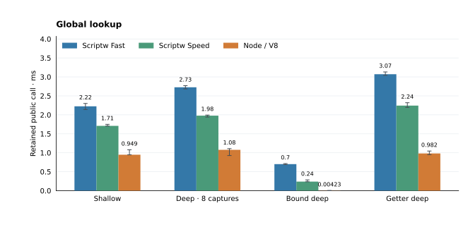

### Native program image sizes

| Retained program | Fast native P · KiB | Speed native P · KiB | Portable Wasm P · KiB |
| --- | ---: | ---: | ---: |
| `frame-compact.js` | 2240.2 | 964.1 | 192.3 |
| `frame-branches32.js` | 2167.2 | 963.2 | 207.3 |
| `frame-branches128.js` | 2758.1 | 1221.4 | 302.6 |
| `frame-branches512.js` | 5130.8 | 2278.2 | 689.8 |

Native serialized sizes include code metadata and data; they do not measure peak RSS or runtime heap.

### Global lookup

Six constructor values are read over 1,024 passes. Deep lookup retains eight
padding captures; bound aliases sit beside the worker. Shallow/deep also differ
in padding arithmetic, and V8 may hoist aliases or global reads. Getter controls
include calls and counter increments. These differences are not isolated lookup costs.

### Control-flow and call-site scaling

These programs execute 8,192 logical source applications across selected sites with matching checksums. Fast and Speed may fuse admitted calls into the loop body, so logical applications are not a direct-call count. Compact dispatch uses one polymorphic site and a dynamic key; switch arms use constant keys and separate sites. This does not isolate stack-probe cost.
The current 512-site native P image is **5.01 MiB Fast / 2.22 MiB Speed**; portable P is **0.67 MiB**. Native serialized sizes include metadata and data.

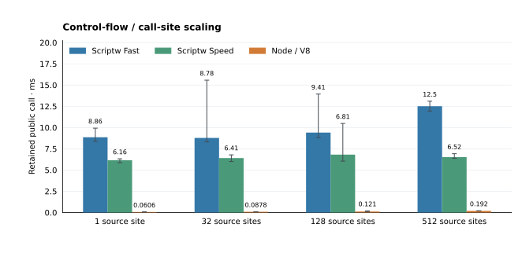

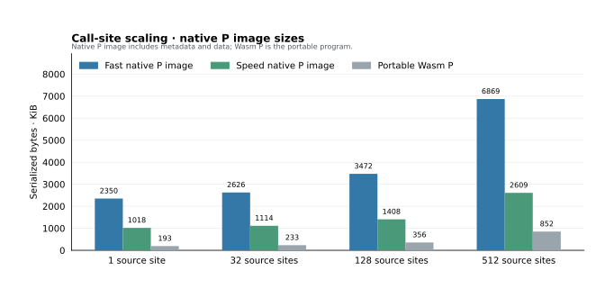

### Arguments observation

Both programs evaluate 1,024 logical strict calls, reassign a formal and compute the same
result. The observed case additionally reads the original arguments and length.
Admitted calls may be fused. The difference includes the observed case's timed work and is not an allocation count.

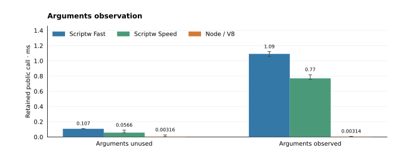

### Property mutation history

Both programs make 8,192 variable-key reads over 64 records. Untimed mutation
adds an accessor, deletes properties and restores values. Reads retain live
storage guards and complete conversion/accessor/prototype/Proxy fallback.
Indexing, key production and record reads all contribute to the score.

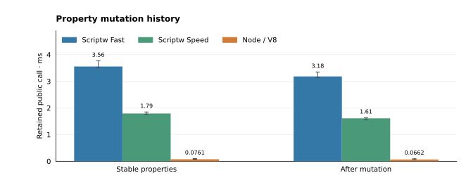

### Packed-array descriptor reads

An additional three-program diagnostic times one indexed descriptor snapshot,
its value read and checksum output. Fresh array construction is untimed. These
recorded packed-array results (compiler `92d17baf84cb`) use eight processes per
engine, 100 warmups and 21 samples:

| Array elements | Scriptw Speed · µs | V8 · µs |
| --- | ---: | ---: |
| 64 | 10.78 | 0.706 |
| 1,024 | 11.77 | 0.692 |
| 4,096 | 12.43 | 0.721 |

All 5,808 calls in that cohort passed. Raw programs, timings and the separate
prior-build control are in the [evidence archive](situations-evidence-2026-11-05.tar.xz).
This descriptor cohort was not rerun for caller-thread entry; its original
source and producer identities remain in that archive.

### Function property reads

Each program reads own length, own name and the name string's length over 8,192
passes and eight targets. Ordinary records, JavaScript functions and native
constructors have matching values/checksums. Array indexing, object-kind dispatch,
string reads and V8 feedback remain part of these scores.

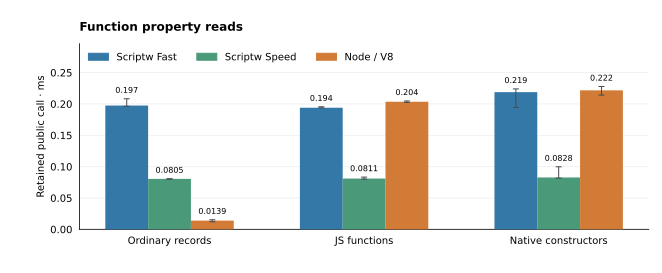

### Type classification

The typeof program performs 18,432 literal comparisons across 4,096 mixed-value
passes. The strict singleton program performs 16,384 null/undefined comparisons.
Inputs cover primitive and object values, bound functions and revoked callable
Proxies. Array access, branches and loop arithmetic remain timed. All earlier
program sources and checksums are unchanged. Independent semantic controls also
cover operand Throws/TDZ and HTMLDDA, outside these timed programs.

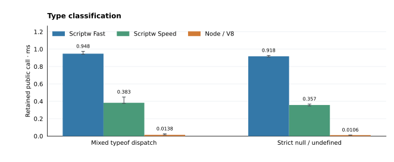

### Dynamic strict equality

Both programs execute 8,192 strict comparisons over prepared pairs. Number pairs
include NaN, signed zero and infinities. Mixed pairs cover String/BigInt content,
Symbol and object identity, boxed values, functions and revoked Proxies. Operand
coercion must not run. Preparation precedes timing; pair indexing, branches and
checksum arithmetic remain timed. Independent models check every input.

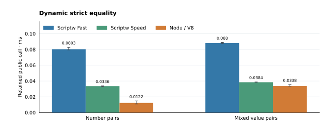

### Enumeration

Sixteen for-in loops visit 64 own enumerable properties, checking 1,024
yielded keys and numeric value reads. Private hashed String Set storage removes
visited-prefix copying. Live descriptor checks, nonenumerable shadowing,
deleted-key prototype behavior, Proxy ordering and suspended cursors retain
the compiled Wasm object model. Ordinary scalar reads observe existence and
enumerability without a full descriptor clone; other descriptor-query paths
retain their own work.
Hash collisions still require exact String equality.

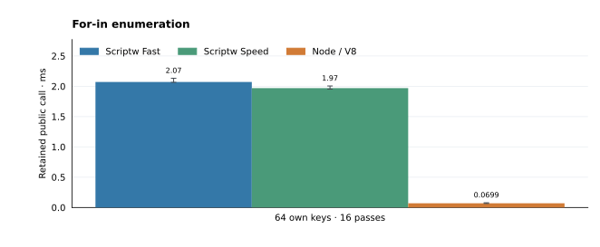

The **historical, unscored width diagnostic** fixes 1,024 yields per call over
null-prototype records: counting keys and summing values are separate programs.
It retains compiler `0ca455c47636`, its original evidence archive and its
original SVG assets; its table and charts do not describe the current source.

| Own keys | Body | Scriptw Fast · ms | Scriptw Speed · ms | V8 · ms |
| ---: | --- | ---: | ---: | ---: |
| 8 | count | 0.471 | 0.438 | 0.0358 |
| 8 | value | 0.624 | 0.523 | 0.0478 |
| 32 | count | 0.442 | 0.42 | 0.0293 |
| 32 | value | 0.591 | 0.509 | 0.0387 |
| 64 | count | 0.46 | 0.427 | 0.0272 |
| 64 | value | 0.629 | 0.55 | 0.0411 |
| 256 | count | 0.447 | 0.423 | 0.0285 |
| 256 | value | 0.583 | 0.51 | 0.0416 |

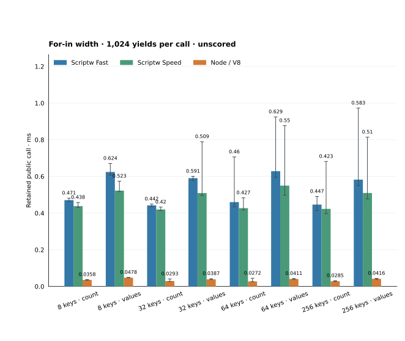

All 360 balanced width processes and 43,560 calls
pass exact checks. [Width data and paired image receipts](for-in-width-current.json).
This diagnostic does not isolate OwnKeys, hashing, property reads or GC costs.
Its baseline is the separately qualified set-only build. One wide-value Speed
block is 2% slower, despite an improved overall median; block variation remains
part of the result.

### Public-call control and verification

The 2026-11-08 situation cohort has 504 process observations and 60,984 exact calls. Its earlier RSC companion used 40 processes and 800 exact calls; the separately source-qualified 2026-11-09 RSC campaign above supersedes that RSC panel.

Scoped verification (**2026-11-08**, source `453a9074fcac`): 2,832 broad checks, 380 source guards, and 9 CLI smokes pass. Full CI, Test262, and private units were not rerun. Existing formatting and Intl issues remain owned; four AOT unit failures remain a historical owned gate.

**Broad native scopes:** emission, structure_builtins, structure_language, structure_async, runtime_link, modules_realms, intl_temporal, structure, aot_builtins, aot_language, aot_async, aot_realm_modules, aot_gc_entries.

<!-- runtime-comparison-details:start -->
## Runtime comparison

**Measured 2026-11-02 locally**, compiler fingerprint `87385fff34d1`.
V8 **13.6.233.17-node.37**, Node **24.12.0**.
Scriptw is faster than Scriptc in **17/17 workloads** in both blocks; block execution geometric means are **0.455–0.458× Scriptc**. Scriptw is faster than V8 in **6/17 workloads** in both blocks; block execution geometric means are **1.098–1.106× V8**.

This compares Wasm public entry with V8 `runInContext`. Scriptw and Scriptc compile
Wasm before the measured processes and share a Wasmtime host with compilation disabled.
Wasmtime 47.0.0 uses size-optimized/backtracking
native code and a generic target.
Timed Wasm entry includes Scriptw Realm/intrinsic bootstrap. V8 parses one `vm.Script`
per process and creates a fresh `vm.Context` before each invocation outside entry timing;
lazy compilation, JIT tiering and natural GC may occur inside. Every entry checks output.

Each bar shows the median of eight process medians: four processes per balanced
block, each with 21 measured entries after ten checked warmups. Memory bars show
median GNU-time whole-child **peak RSS** for all three runtimes, including host,
code, runtime and warmup history. Warmups do not establish optimized steady state.
Each panel uses its own zero-based scale. Chart data also retains V8 context-creation
time as a supplemental measurement, excluded from bars and ratios.

<table>
<tr>
<td>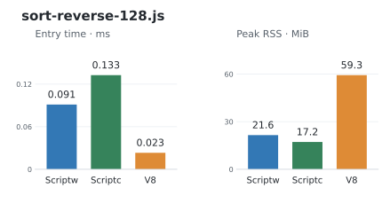</td>
<td>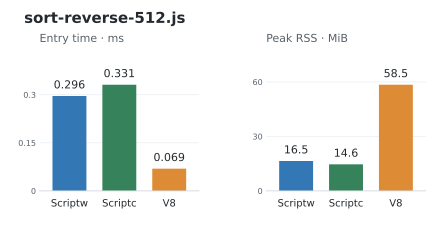</td>
</tr>
<tr>
<td>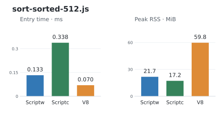</td>
<td>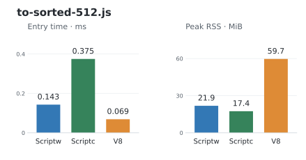</td>
</tr>
<tr>
<td>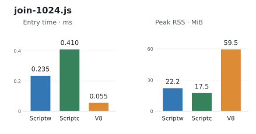</td>
<td>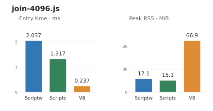</td>
</tr>
<tr>
<td>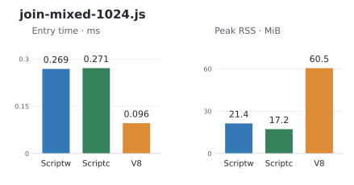</td>
<td>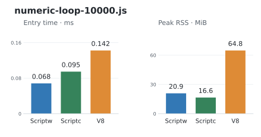</td>
</tr>
<tr>
<td>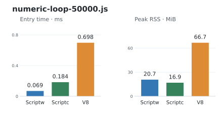</td>
<td>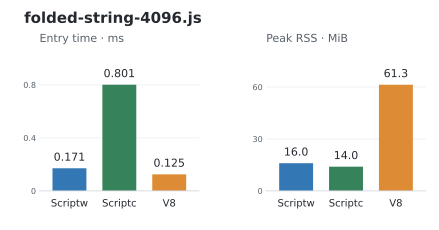</td>
</tr>
<tr>
<td>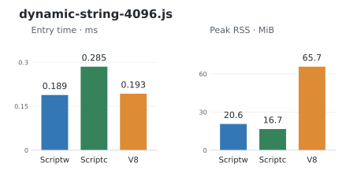</td>
<td>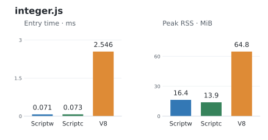</td>
</tr>
<tr>
<td>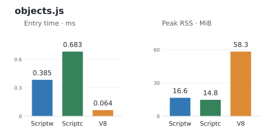</td>
<td>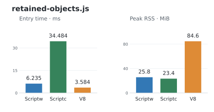</td>
</tr>
<tr>
<td>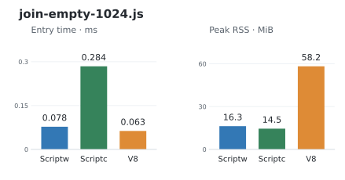</td>
<td>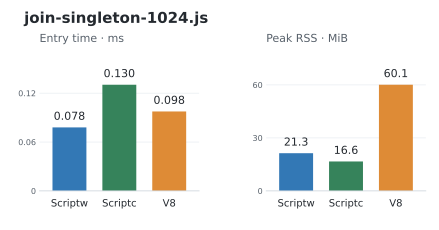</td>
</tr>
<tr>
<td>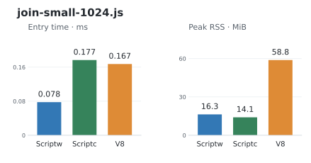</td>
<td></td>
</tr>
</table>

[Chart data and runtime identities](execution-current.json) ·
[Complete evidence](performance-gaps-20261101.json) ·
[Workflow](../../CONTRIBUTING.md#benchmark-charts).
<!-- runtime-comparison-details:end -->

<!-- application-benchmarks-details:start -->
## Application workloads

Measured **2026-11-02**, compiler `87385fff34d1`.
Six synchronous request/response kernels use plain records, without networking or
Web APIs. The seventh case bundles real React 19.3.1
legacy `renderToString` with hooks/context and 32 escaped rows.
Times cover complete batches: 64 requests for JSON/routing/query/middleware,
32 HTML requests, 48 nested-result requests, or one 32-row SSR render.

Two balanced blocks, eight fresh processes per available actor/case; each process
has seven measured entries after three checked warmups. Cards show the median of
process entry medians and median whole-child peak RSS. Wasm compilation/loading
and V8 source/context setup stay outside entry timing; Scriptw Realm bootstrap
stays inside. Failed actors have no timing or memory bar.

Across the **5 completed Scriptc comparisons**, Scriptw batch medians
are **3.8–9.3× Scriptc**. Failed cases receive no speed score.

<table>
<tr>
<td>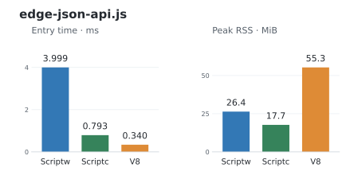</td>
<td>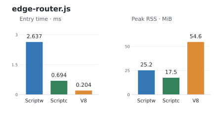</td>
</tr>
<tr>
<td>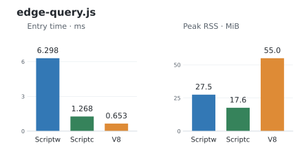</td>
<td>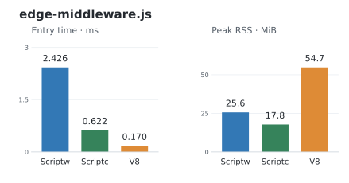</td>
</tr>
<tr>
<td>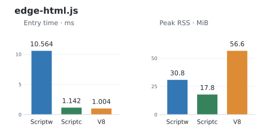</td>
<td>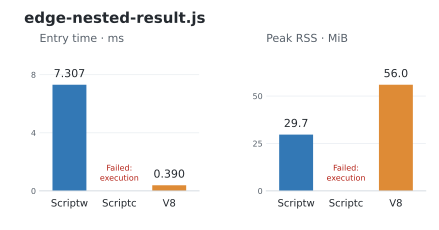</td>
</tr>
<tr>
<td>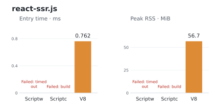</td>
<td></td>
</tr>
</table>

Real Server Components separately serialize and consume Flight streams in Node,
including an async component. Web references use Node's Request/Response/URL APIs.
The browser cases use real React DOM in Chromium: mount, state update and hydration,
with commit plus forced layout timed in the page. RSC renders 32 rows, Web API
cases process 32 requests, and client cases render 64 rows. Setup and golden-output comparisons are
outside these timers. These host references have different timing boundaries;
they establish no engine parity. Browser RSS covers all three cases in one process
and is not assigned to individual cases.

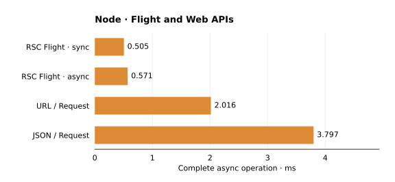
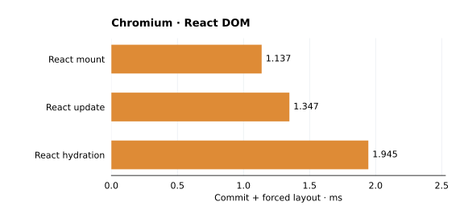

| Reference | Entry median · ms |
| --- | ---: |
| RSC Flight · sync | 0.505 |
| RSC Flight · async | 0.571 |
| URL / Request | 2.016 |
| JSON / Request | 3.797 |
| React mount | 1.137 |
| React update | 1.347 |
| React hydration | 1.945 |

Actual standalone build/execution attempts remain visible, including failures:

| Capability attempt | Scriptw | Scriptc | V8 host reference |
| --- | --- | --- | --- |
| RSC Flight · sync | Execution failed | Build failed | Node checked |
| RSC Flight · async | Execution failed | Build failed | Node checked |
| URL / Request | Execution failed | Build failed | Node checked |
| JSON / Request | Execution failed | Build failed | Node checked |
| React client mount | Timed out (60 s) | Build failed | Chromium checked |

Standalone run timeouts include compilation and startup; they do not isolate
rendering time. Scriptw's portable build and ordinary NativeHost run are
separate probes; the run recompiles source instead of loading the dumped pair.
At this frozen benchmark revision, Scriptw lacked DOM, encoding, Web Streams,
Fetch and URL APIs, as recorded by its capability probe. Current-source RSC
measurements are reported in the [README](../../README.md#benchmarks).

The frozen [failure diagnosis](applications-current.json) records
missing `TextEncoder` during RSC initialization. Corrected Scriptc Web probes
reach `SC3002` (WASI API admission), and its nested-result case reports `SC2020`
(dynamic `Array.slice` end unsupported). React bundles retain type-check errors.
Scriptw's SSR output has a 2-MB function, triggering size-optimized native
compilation; a debugger sample finds Cranelift optimization active at 20 seconds.

[Data, identities and diagnostics](applications-current.json) ·
[Inert raw evidence](application-benchmarks-20261102-inert.tar.xz) ·
[Workflow](../../CONTRIBUTING.md#react-and-edge-benchmarks).
<!-- application-benchmarks-details:end -->

## Compilation time

**JavaScript → portable Wasm**, measured 2026-11-02 with the same compiler
fingerprint as the runtime charts. Scriptw is faster in **17/17 workloads**,
taking **0.524x Scriptc's time** by geometric mean of workload medians.

Four fresh CLI builds per compiler/workload across two balanced blocks
(**136 processes**). Includes startup and output I/O: Scriptw P plus its shared R
sidecar; Scriptc standalone WASI. Application caches are fresh; OS and Zig toolchain
caches remain. Runtime production, Wasm-to-native compilation and execution are
excluded. [Data and tool identities](compilation-current.json) ·
[Reproduce](../../CONTRIBUTING.md#benchmark-charts).
