# Benchmark details

These are the latest published cohorts for each workload family. They use
separate recorded compiler builds and timing boundaries. Reproduction commands
live in [CONTRIBUTING](../../CONTRIBUTING.md#benchmark-charts);
older implementation notes live in the [README archive](benchmark-history.md).

## React Server Components

Measured **2026-11-17**, React **19.3.1**, source `d2948d619` (fingerprint `697c47c22eb0`), Node **24.22.1** with V8 **13.6.233.17-node.58**. Scriptw Speed takes about **1.6× V8 request time**, sync and async; Fast takes about **4.2×**. The 2026-11-16 source, measured in the same campaign under Fast, takes 0.713 and 0.811 ms. The machine ran this campaign a few percent slower than the 2026-11-16 one: Node took 0.166 and 0.178 ms against 0.153 and 0.171 ms then, and the 2026-11-16 Scriptw host under Speed measured 0.266 to 0.304 ms in a calibration probe against its published 0.270 ms. Compare engines within one campaign, not across them.

### Requests and measurement boundaries

The campaign checked **12,864 exact outputs across 64 fresh processes**: eight processes per engine and case, 100 warmups and 101 timed calls per process, in two mirrored blocks with rotating engine/case order. Sync and async use separate processes. Timed calls within a process are dependent; the independent summaries are process medians. It ran with `benchmark-rsc.py --cloud` on two virtual CPUs of a shared four-vCPU cloud machine (Intel Xeon at 2.30 GHz), the same two for every engine: no CPU isolation, no hardware counters and no compared Cargo feature graphs, so a spread of several percent between processes is machine noise as much as engine behaviour. Exact executable, source, P/R, toolchain and input identities are in the [current report](rsc-current.json); every call's time is in the [raw campaign report](rsc-campaign-20261117-report.json.xz) ([2026-11-16](rsc-campaign-20261116-2cpu-report.json.xz)).

| Policy / source | Sync median / typical mean / typical p95 · ms | Async median / typical mean / typical p95 · ms |
| --- | ---: | ---: |
| Fast · `875fb7647` (2026-11-16) | 0.713 / 0.740 / 0.876 | 0.811 / 0.835 / 0.970 |
| Fast · `d2948d619` | 0.675 / 0.692 / 0.812 | 0.777 / 0.809 / 0.933 |
| Speed · `d2948d619` | 0.269 / 0.284 / 0.376 | 0.294 / 0.317 / 0.428 |
| Node 24 / V8 | 0.166 / 0.238 / 0.275 | 0.178 / 0.225 / 0.286 |

Median is the median of eight process medians. Typical mean and p95 are the medians of eight within-process means and nearest-rank p95s; they are descriptive statistics, without confidence intervals. Chart whiskers show the minimum and maximum process medians; Speed's processes range from 0.252 to 0.278 ms sync and from 0.285 to 0.633 ms async; two async processes took about 0.63 ms.

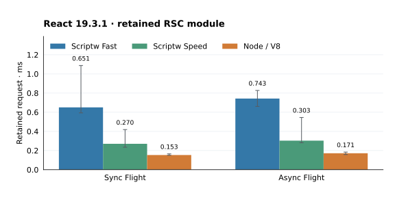

**Two CPUs, and why.** V8 runs its compiler and collector on helper threads. With the whole process pinned to one CPU on this machine, those threads preempt the main thread inside timed calls. A first campaign the same day on one CPU has the same medians within noise (Speed 0.271 and 0.341 ms, Node 0.164 and 0.177 ms) but Node means of 0.274 and 0.328 ms against 0.189 and 0.214 ms here; its [raw report](rsc-campaign-20261116-report.json.xz) is retained. The effect is far larger where each timed entry is a fresh context after few warmups: the kernel workload `numeric-loop-10000.js` takes V8 0.87 ms per entry on one CPU and 0.16 ms on two. Every cloud campaign on this page therefore gives all actors the same two CPUs; the Wasm actors run one thread and gain nothing from the second.

On 2026-11-16, with V8's JIT off (`node --jitless`), `scripts/rsc_wall_clock_compare.py` compared Speed and Node in twelve fresh processes each, outside this campaign. Three runs on 2026-11-16, the first two on source `34a5e56df` and the third on `875fb7647`, give Scriptw 279, 286 and 268 µs against Node's 309, 308 and 308 µs sync, and 309, 315 and 333 µs against 335, 329 and 329 µs async: 7 to 13% ahead sync, and between 8% ahead and 1% behind async.

Cold setup per process, as medians of sixteen processes: source to Wasm takes 0.83 s (2.9 s for the 2026-11-16 source), and native preparation takes 4.2 s under Fast and 6.7 s under Speed (6.2 s Fast for the 2026-11-16 source). Whole-process peak RSS, which includes that compilation, is 247 to 263 MiB for Scriptw and 85 MiB for Node.

From 2026-11-20 the host also splits its memory (`memory` in each process report; `memory_bytes` per engine and case in the published report). It reads `/proc/self/status` and `smaps_rollup` at four points outside every request clock: VmHWM after emission with the source compiler dropped (`front_and_emit_high_water`), VmHWM after native preparation (`compile_high_water`), VmRSS after the first case's warmups (`post_compile`) and VmRSS after the last request (`steady`). The high-water mark is never reset: writing `5` to `/proc/self/clear_refs` would also lower `ru_maxrss`, and GNU time's whole-child peak would then be understated. `benchmark-rsc.py` requires `compile_high_water` to be at most that peak; later stages are not bounded by it, because VmHWM and `ru_maxrss` read the kernel's counters through different paths and can differ by tens of KiB. Resident memory in a compiling process includes compiler memory the allocator keeps. One unscored Fast process on 2026-11-20 read 83, 247, 258 and 258 MiB for a 258 MiB peak; the same program loaded from a `scriptw precompile` image peaked at 74 MiB and held 56 MiB after its last request. The panel above predates the split and has no such numbers.

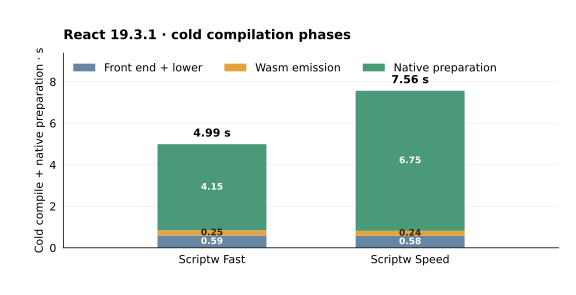

#### Previous campaign (2026-11-09)

Measured on a different machine with Node 24.12.0, source fingerprint `9f2788b4af9f51a77dcd3d62e3a8c717367af9c9a0eee65170af66cc8823016b`: Fast took about 16.9× V8 request time and Speed about 13.9×. The campaign checked 16,080 exact outputs across 80 fresh processes; its identities are in the [2026-11-09 report](rsc-campaign-20261109.json).

| Policy / source | Sync median / typical mean / typical p95 · ms | Async median / typical mean / typical p95 · ms |
| --- | ---: | ---: |
| Fast baseline · `453a9074` | 4.425 / 4.777 / 6.106 | 4.858 / 5.248 / 6.548 |
| Fast candidate · `9f2788b4` | 4.304 / 4.677 / 6.010 | 4.719 / 5.131 / 6.374 |
| Speed baseline · `453a9074` | 3.640 / 3.991 / 5.318 | 3.989 / 4.367 / 5.649 |
| Speed candidate · `9f2788b4` | 3.537 / 3.887 / 5.195 | 3.876 / 4.291 / 5.551 |
| Node 24 / V8 | 0.255 / 0.329 / 0.445 | 0.280 / 0.357 / 0.603 |

The 32-row catalog produces 2,059-byte sync and 2,140-byte async Flight streams, each with one root record, ID `0`. The async form adds a resolved Promise and markup; neither performs I/O. The timed `applicationRun` includes React Flight rendering, UTF-8 encoding, complete stream consumption/decoding and the fixture's `trimEnd`/split/map/search sanity scan. Render, consume and scan do not have separate clocks. Outer JSON encoding, host copying and exact-output comparison follow the clock, but their allocations can affect subsequent GC/JIT state. The bounded Web API fixture does not establish full WHATWG or engine parity.

### Warmup and case-order control

The old shared-process, three-warmup method made Node async appear faster. A separate control from the 2026-11-09 campaign holds seven measured calls fixed and uses eight fresh processes per cell, in two balanced blocks:

| Warmups | Process shape | Sync median · ms | Async median · ms |
| ---: | --- | ---: | ---: |
| 3 | Shared, sync then async | 0.501 | 0.401 |
| 3 | Isolated case | 0.486 | 0.521 |
| 100 | Shared, sync then async | 0.279 | 0.271 |
| 100 | Isolated case | 0.273 | 0.274 |

Case isolation and longer warmup remove that reversal in this control. These seven-call cells are separate from the primary 101-call campaigns. The current campaign retains every warmup and timed observation; curves show the pointwise median across eight processes, with a logarithmic time axis. One hundred warmups do not prove fully optimized steady state.

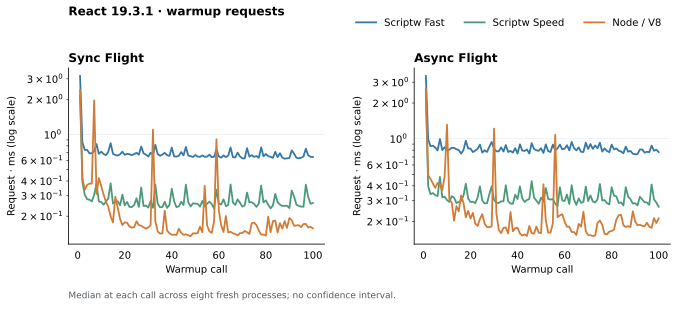

### Current-source instruction and caller attribution

Thirty unscored PMU processes use three fresh repetitions per engine/case, 100 warmups and 100 request windows. The table gives the median of three within-process instruction medians, in millions of retired user instructions:

| Policy | Sync · million instructions | Async · million instructions |
| --- | ---: | ---: |
| Fast baseline | 39.480 | 42.999 |
| Fast candidate | 38.771 | 42.290 |
| Speed baseline | 36.571 | 39.933 |
| Speed candidate | 35.862 | 39.224 |
| V8 | 2.477 | 2.616 |

Fast therefore retires about 15.7× / 16.2× V8's caller-window instructions; Speed about 14.5× / 15.0×. Counters do not multiplex. They cover the actual calling thread and include the ready/done and Promise-return edges; background JIT/GC threads and kernel work are excluded. Six additional Node controls perform 100 checked Flight warmups followed by 100 checked literal-null windows. Pooling 300 windows per case, that control is 13.62% / 13.20% of the full Node instruction window, and 16.06% / 15.54% of cycles. Counts remain raw; no control subtraction or workload-only claim is made.

Twelve frame-pointer profiles cover current Fast/Speed, three repetitions per case. Sample periods are pooled per policy/case. Disjoint own samples place **51.44% / 50.70%** of Fast periods in runtime helpers and **26.45% / 25.55%** in generated JavaScript functions; Speed has **61.73% / 60.35%** helper periods and **12.13% / 12.00%** JavaScript periods. Host/unresolved leaves retain **16.57% / 18.63%** Fast and **19.67% / 21.79%** Speed; these are not silently assigned to Wasm. These are sampled caller-thread periods, not exclusive wall-clock shares or fractions of the V8 gap.

For Fast sync, `object_read` owns 7.73% of periods and appears in 16.91% of call chains; its sampled callers include cached reads, recursive reads and `has_instance`. `function_call` appears in 23.21%, `has_instance` in 7.82%, and the descriptor-query union in 4.85%. These inclusive families overlap: `has_instance`/`object_read` alone overlap in 5.27% of periods. They must not be added or treated as removable dispatch overhead. Source paths preserve observable `@@hasInstance` lookup, calls and prototype traversal. The generated `vn` and `ft` functions own 10.18% and 5.58% of Fast sync periods. Speed reduces the JavaScript share while leaving R's native policy fixed; higher helper percentages do not show that helpers became slower.

StoredValue loads are emitted inline by `StoredValue.read_into`; there is no separately named `StoredValueDecode` owner in these profiles. Its exclusive cost remains unmeasured. [Full own lists, overlapping caller families and raw identities](react-attribution-current.json).

An excluded **2026-11-10** diagnostic on later source `16418b790879`
counts original P/R function entries and successful `StoredValue` constructions.
Two fresh processes check 484 exact outputs, with 100 warmups and 21 samples per
case. Both processes produce identical request vectors: **84,271 / 89,842**
function entries and **8,181 / 8,947** logical constructions, sync/async.
`value_to_object` accounts for 9,521 / 10,105 entries, header projection
6,563 / 6,978, string equality 5,076 / 5,349, and property-key conversion
2,186 / 2,285. These counts motivated a caller-identity experiment; they do not
measure time saved. The hot `ft` and `vn` bodies already receive local arguments;
their argv
adapters have zero observed entries. Counters preserve original types, indices,
locals and opcode bytes, with independently verified stack-neutral increments
and zero-reset readbacks. Instrumentation can inhibit native elimination;
logical constructions exclude host and constant-initializer allocations and
are not comparable to the older physical census below. This diagnostic does
not refresh the published timing panel or establish the sub-1-ms target.

A separate 20-process screen checks 2,420 exact outputs with two processes per
actor/case, 100 warmups and 21 measurements. Source `2525cdc5d252` adds caller
identity guards for conversions, string equality, ordinary headers and actual
functions. Fast moves **3.610/3.931 → 3.605/3.948 ms** and Speed
**2.860/3.187 → 2.784/3.164 ms**, sync/async. This is effectively flat for Fast
and a small Speed change, without final eight-process qualification. The
experiment is retired. A separate 484-output counter campaign confirms entries
fall **84,271/89,842 → 65,415/69,864** (about 22%), while logical StoredValue
constructions remain **8,181/8,947**. Removing these dispatches leaves almost
the same request time; entry counts are a poor proxy for the remaining cost.
Its 123 focused checks pass after two fixture/structural test
corrections; full CI and Test262 were not rerun.

Source `ce4bc97f96f0` separately reuses immutable descriptor getter/setter
edges and directly reads authenticated cells for strict identifier calls.
Another 20-process, 2,420-output screen moves Fast
**3.477/3.851 → 3.470/3.849 ms** and Speed
**2.848/3.151 → 2.739/3.058 ms**. Its separate 484-output census records
**83,132/88,640** entries and **7,345/8,063** logical StoredValue
constructions, about 10% fewer constructions than source `16418b790879`.
Fast remains effectively flat; these are screens rather than final
eight-process qualification. The batch passes 207 focused checks and all 380
source guards, with full CI and Test262 unverified.

An excluded four-slot census on that same source checks another 484 exact
outputs. Both process medians agree: sync/async construct **2,859/3,396
StringValues** and **2,946/3,494 CodeUnitArrays**. All these request constructions
are in R. `json_stringify_value` owns 1,424/1,900 strings and 1,510/1,997 arrays;
`integer_decimal_string` owns 663/690 of each. These are logical constructors,
not byte/copy counts or physical reservations. Reaggregating the twelve pinned
older `9f2788b4` profiles puts the exact JSON helper's deduplicated inclusive
share at 4.23%/4.63% Fast and 5.16%/5.65% Speed. Those older cycle samples do not
measure current-source savings; the high construction share alone does not
justify assigning the request gap to JSON.

An excluded function-body optimization screen on the same `ce4bc97f96f0`
artifacts checks 2,420 exact outputs across 20 fresh processes, including V8
controls. Binaryen 133 local simplification, propagation and common-expression
passes preserve every original non-Code section byte, including types, globals,
imports and exports. Custom descriptors and exact references remain disabled.
Both actors use one frozen diagnostic host and identical explicit R
`SpeedAndSize`/`Backtracking` compilation. Fast moves
**3.435/3.821 → 3.298/3.673 ms**; Speed moves
**2.733/3.105 → 2.714/3.014 ms**. These median-of-process-medians use only two
processes per actor/case, 100 warmups and 21 measurements; the transform is not
adopted or qualified beyond RSC. Smaller Wasm does not establish a large request
gain: P shrinks 4.12→2.49 MB, while Fast improves about 4%.

A separate current-source Fast sync FP process checks 200 exact outputs and
samples 100 request windows. Its 6,114 samples total 1,528,500,000 cycle periods:
helper labels own 45.58%, JavaScript labels 30.50%, and host/unresolved labels
18.14%. `object_read` owns 8.98% and appears in 18.89% of sampled call chains;
its cached-read, recursive-read and `has_instance` callers overlap. This single
process refreshes attribution only, not the published timing panel or a savings
estimate.

A further excluded 16-process screen checks 1,936 exact outputs with the same
warmup/sample counts. It compares linked P/R, raw Binaryen fusion, optimized
fusion and V8. All Wasm code uses `Speed`/`Backtracking`, including the linked R
control; this differs from canonical R's `SpeedAndSize` policy. Sync/async
medians are **2.728/3.053 ms** linked, **2.720/3.020 ms** fused, and
**2.846/3.134 ms** after local cleanup and bounded inlining. Raw fusion is nearly
flat; that optimized recipe regresses and is rejected. Each fused process has
one module and one actual private-memory provider for both memory imports.
All exports required by the embedding host and complete Flight outputs pass;
general conformance remains unverified. Raw Wasm size falls mainly through
custom-section removal, while fusion initially grows executable Code about 9%.
The optimized `ft`/`vn` bodies retain their key conversion, cached-read and call
edges; their size is consistent with exclusion by the 32 KiB combined inlining
cap, though exact pre-inlining AST sizes were not captured.

A selective fusion experiment then removes all six chosen conversion,
lookup and cached-read edges from `ft`/`vn`, but native compilation exhausts
4 GiB before producing a request. Coalescing locals down to 175/194 still
exhausts that limit. Neither attempt has a candidate timing; both are rejected.

An eight-process V8 control checks 968 exact outputs with the same 100 warmups
and 21 measurements. JIT/JITless sync medians are **0.251/0.503 ms** and async
medians **0.288/0.539 ms**. Disabling V8's JIT accounts for only part of this
comparison; this does not isolate a cause inside Scriptw.

Source `3d5416134359` gives only the default `@@hasInstance` builtin one
canonical typed local-argument body, retaining its ordinary argv adapter and
observable method lookup, native caller boundary and Realm. Another 20-process,
2,420-output matched screen moves Fast **3.536/3.952 → 3.435/3.786 ms** and
Speed **2.776/3.078 → 2.710/3.036 ms**, sync/async. Both blocks improve, with
only two fresh processes per actor/case; this is not final qualification and
neither case reaches 1 ms. Runtime ABI is 55; natural GC and the complete
request clock remain unchanged. All 2,673 adjacent native checks and 16 selected
private call-entry checks pass, alongside 380 source guards. Full CI, Test262
and the remaining private units were not rerun. Aggregate p95 improves slightly,
but Speed async p95 rises 0.99% in the first block; this screen does not establish
a tail-latency win.

A separate value-kind census on `3d5416134359` checks 484 exact outputs
across two fresh retained processes, each running both cases with 100 warmups
and 21 measured requests. Only measured calls retain counter vectors; request
and outer validation windows remain separate. Every measured vector agrees
within and across processes.

| Repeated payload reads per request | Sync | Async |
| --- | ---: | ---: |
| StoredValue | 13,703 | 14,996 |
| BindingCell | 3,449 | 3,637 |
| Existing GC references | 15,807 | 17,193 |
| Undefined, null or booleans | 492 | 542 |
| Numbers eligible for the proposed immediate encoding | 853 | 898 |
| Other Numbers | 0 | 0 |

This makes a single-reference value ABI a candidate for a complete prototype:
the observed values fit existing GC references or immediates. It does not
establish a timing or allocation gain. The census covers successful SCALAR
field reads from those two types, excluding compact SoA storage, host reads
and unboxed temporaries; reads are not unique values. Dynamic floating-point
results elsewhere may require boxes. The proposed signed-i31 interval is
−1,073,741,824 through 1,073,741,819, reserving four codes for other primitives
and excluding negative zero. The same emitted classifier and independent
edit verifier pass 19 boundary/NaN/infinity cases on each actual GC type,
with all 38 original-bit round trips and exact counter windows checked.
Original instructions, local indices and unrelated sections are preserved;
four scratch locals are appended only where needed. The transform is diagnostic
and remains outside the product and scored cohorts.

### Single-reference value experiment (2026-11-10)

A complete isolated prototype replaces StoredValue wrappers and BindingCell
payload triples with direct GC references, i31 immediates and immutable boxes
for other Number bits. Generic JavaScript values cross calls in one eqref;
Completions have three results. This is experimental ABI 56, not the product ABI.
The first source, `3677c166d0d8`, packs local copies into that representation;
a second, `86536fe46f9b`, instead copies the available decoded/encoded cache
state without conversion. Both regress retained RSC requests.

Each version has its own matched 20-process, 2,420-output screen against frozen
source `3d5416134359` and V8: 100 warmups, 21 measurements, two reversed blocks,
two fresh processes per actor/case, natural GC and the unchanged complete request
clock. The first version moves Fast sync/async **3.456/3.970 → 6.217/6.868 ms**
and Speed **2.831/3.118 → 4.321/4.810 ms**. The local-copy refinement gives:

| Policy and case | Current compiler | Single-reference prototype |
| --- | ---: | ---: |
| Fast sync | 3.409 ms | 5.639 ms |
| Fast async | 3.804 ms | 6.053 ms |
| Speed sync | 2.689 ms | 4.197 ms |
| Speed async | 3.016 ms | 4.576 ms |

These are medians of fresh-process request medians, not final qualification.
All outputs match exactly. The refinement still regresses every case in both
blocks. Removing wrappers does not establish lower total allocation or faster
execution: this implementation adds reference classification and local cache
bookkeeping. One exact scalar-loop fixture grows from 193 to 383 Wasm operators,
including 13 pure decoder calls. The first inline-codec build also saturates
4 GiB and is terminated without an OOM kill; shared codecs allow the subsequent
builds to complete under the same cap. Native preparation remains outside the
request clock and also regresses in the matched screens.

The final prototype passes 83 distinct compiler emission checks and an embedding
regression for numeric boundaries, signed zero, NaN payloads, heap storage,
closures, throws and explicit GC. Test-only corrections retain unchanged passing
scopes and rerun affected checks. Full CI, private units and Test262 were not
rerun. The prototype is rejected and remains outside the product; canonical
compiler inputs stay at `3d5416134359`, ABI 55. Raw campaigns and source/binary
witnesses are retained under `target/rsc-single-value-proposal/`, with the
consolidated result in `summary.json`. Neither attempt approaches 1 ms.

### Host-boundary screen (2026-11-11)

The earlier profiles left 16–22% of sampled request cycles in host or
unresolved leaves. On source `3d5416134359` those leaves divide into four
families: Wasmtime's subtype query, per-element initialization of host-allocated
byte arrays, copying collection, and typed funcref reads from GC structs.
Source `a97d0d600965` removes the first two without changing ABI 55:

- Wasmtime compiles a test or cast against a sealed GC type to an inline header
  comparison, and calls the host subtype query whenever the reference's type is
  not the tested type itself. The open `CompactDataStorage` base is never
  allocated, so every test and cast against it made that call; object reads,
  sets, for-in and own-key helpers did both per operation. Compiled code now
  reaches an open layout with at most four sealed descendants through those
  descendants.
- ArrayBuffer backing allocation keeps its host import, which preserves the
  collector's out-of-memory result, but Wasmtime's `ArrayRef::new` now fills a
  packed `i8` body at once instead of checking and writing one `Val` per byte.

A 16-process screen checks 3,216 exact outputs: two fresh processes per actor
and case in reversed order, 100 warmups and 101 measured requests each. Values
are medians of process medians, in milliseconds:

| Policy and case | `3d5416134359` | `a97d0d600965` | Change |
| --- | ---: | ---: | ---: |
| Fast sync | 3.668 | 3.353 | −8.6% |
| Fast async | 3.982 | 3.623 | −9.0% |
| Speed sync | 2.887 | 2.629 | −9.0% |
| Speed async | 3.214 | 2.853 | −11.2% |

Process means move −7.9% to −10.4%. A repeat screen on later source
`aebbfdab3f38`, whose P and R are byte-identical to these, measures −6.5%/−6.1%
Fast and −10.7%/−11.1% Speed, so two-process screens place the Fast change
only within about 2.5 points. These are screens without V8 controls or
eight-process qualification, and they do not refresh the published panel. P
grows 4,216,405→4,222,594 B and R 38,866,927→38,867,541 B. One Fast sync
frame-pointer process (100 warmups, 100 windows) samples 13.80M cycles per
window against 15.29M before; host-or-unresolved own share falls 18.1%→11.5%,
with host GC-API leaves 2.96%→0.14% and subtype-query leaves 3.79%→about 0.2%.

The scalar-row loop made the same open-base cast once per iteration, before
its sealed inline cast; it now casts to the sealed layout directly. A matched
run of the 21 [focused situations](#focused-performance-situations) uses two
hosts that differ only in this emission, with the default eight processes per
case, actor and policy. Fast/Speed medians move −11.3%/−12.2% on
`for-in-wide.js`, −7.2 to −10.3% / −8.4 to −10.1% on the three
`frame-branches` cases, −4.5%/−11.4% on `frame-compact.js`, −3.3 to −5.8% /
−3.3 to −7.6% on the three walked global lookups, −3.5%/−5.9% and −3.7%/−6.7%
on `args-unused.js` and `args-observed.js`, and −2.3%/−3.5% on
`property-stable.js`. The other ten cases move between −2.8% and +1.4%. This
run does not replace the published situation panel.

The same profiles place 4.3% Fast / 5.9% Speed of request-window cycles in
copying collection, about 2.1% / 3.0% in the typed funcref read
(`get_interned_func_ref`, `FuncRefTable::get_typed`, `engine_type_index`) and
2.5% / 3.4% in libc copies. Every sixth request on the unchanged 16-MiB heap
contains one collection of about 1.85 ms; that is roughly 0.3 ms of mean request
time and is absent from medians.

An excluded diagnostic host, source `2a35735267da`, differs only in disabling
Wasmtime epoch interruption for P and R. A second 16-process screen of the same
shape moves Fast sync/async **3.510/3.980 → 2.834/3.092 ms** and Speed
**2.548/2.862 → 2.189/2.420 ms**: 19–22% and 14–15%. Epoch checks ran at every
function entry and loop header. The diagnostic has no execution deadlines and
is not a product configuration; it measured what epoch interruption cost on
this workload.

### Fault-driven deadlines (2026-11-11)

Source `89a934d06891`, ABI 57, compiles P and R without epoch checks and keeps
execution deadlines: a deadline removes access to the Store's GC heap and
private linear memory, and the fault stops compiled code
([contract](contracts/execution-deadlines.md)). Source functions and loops
store one byte to linear memory instead of checking an epoch. One 64-process
screen interleaves four hosts, four fresh processes per host, policy and case,
101 warmups and 100 timed requests each, with natural collection and exact
output checks. Values are the median of the four process medians, in ms.

| Policy and case | `3d5416134359` | `a97d0d600965` | No deadlines `2a35735267da` | `89a934d06891` | Change from first |
| --- | ---: | ---: | ---: | ---: | ---: |
| Fast sync | 3.863 | 3.661 | 2.904 | 2.871 | −25.7% |
| Fast async | 4.287 | 3.907 | 3.407 | 3.349 | −21.9% |
| Speed sync | 2.889 | 2.637 | 2.254 | 2.298 | −20.4% |
| Speed async | 3.390 | 2.994 | 2.571 | 2.486 | −26.7% |

The new host is within −3.3% to +2.0% of the diagnostic without deadlines, so
the stores have no measured cost on this workload. An earlier screen of the
same four hosts measured −22.2%, −25.8%, −21.9% and −27.5% from the first
column, with two baseline processes per case instead of four. These are
screens without V8 controls or eight-process qualification, and they do not
refresh the published panel. P grows 4,222,594→4,228,988 B for the stores; R is
38,867,304 B after one uncalled helper leaves it.

A matched run of the 21 [focused situations](#focused-performance-situations)
compares `a97d0d600965` with `89a934d06891`, both run back to back with the
default eight processes per case, actor and policy. Fast/Speed medians move
−45.0 to −48.0% / −39.8 to −49.4% on `property-stable.js`,
`property-mutated.js` and the three `metadata` cases; −25.6%/−48.4% and
−30.5%/−46.5% on the two `strict-equality` cases; −22.4 to −26.5% / −17.0 to
−21.9% on the four global lookups, except `global-bound-deep.js` Speed at
+0.1%; −25.4%/−19.3% on `frame-compact.js`; −25.8%/−8.9% on `args-unused.js`;
−20.2%/−17.6% on `for-in-wide.js`; −5.3 to −19.1% / −6.8 to −9.9% on the three
`frame-branches` cases; and −8.5 to −9.8% / −12.7 to −13.9% on
`args-observed.js`, `typeof-dispatch.js` and `singleton-dispatch.js`, except
`singleton-dispatch.js` Speed at +1.2%. `control-empty.js` moves −2.6%/−3.7%.
A scalar loop now pays one store per iteration where it paid an epoch load,
compare and branch. This run does not replace the published situation panel.

### Read records and per-operation costs (2026-11-11)

Sources `7c6998ed91b4` (ABI 58) and `6a1d8259f6ad`. These are diagnostics from
one retained Speed process per case on a machine running other builds, counted
in user instructions per request (deterministic) and cycles per request (not).
They do not refresh the published panel.

| State | Sync instructions | Async instructions |
| --- | ---: | ---: |
| Fault-driven deadlines, `89a934d06891` | 20.12M | 21.65M |
| Direct `instanceof`, global reads and own data | 17.13M | 18.50M |
| Read records and the closed-chain Set, `7c6998ed91b4` | 15.53M | 16.79M |
| Binding-name checks and `string[number]`, `6a1d8259f6ad` | 15.15M | 16.39M |
| Integrated: position hints, shape transitions, call entries, builtin bodies, `0475e1a8ce97` | 11.20M | 12.05M |
| Static assignment write records (ABI 63) | 11.05M | 11.89M |
| [Record hit entries](#record-hit-entries-2026-11-12) (ABI 64) | 10.47M | 11.28M |
| `instanceof` front, direct global and named-binding reads (ABI 65) | 10.21M | 11.01M |
| Both of the two rows above together (ABI 65) | 9.62M | 10.39M |
| Globals resolved at run time, remembered global entries read at the site (ABI 65) | 9.58M | 10.35M |
| [Chain walks and computed keys](#chain-walks-and-computed-keys-2026-11-13) (ABI 67), on the row above | 7.88M | 8.61M |
| Call-free `instanceof` entry and one-cast global entry check (ABI 68) | 7.56M | 8.27M |
| [Host-side](#host-side-costs-2026-11-13) weak lookups, funcref reads, root scopes and collector copies (ABI 68) | 7.26M | 7.88M |
| [Site records in P](#site-records-in-p-2026-11-13) (ABI 69), on the row above | 6.72M | 7.32M |
| Inline interned funcref reads, plain references and cached embedding bridges (ABI 69), on the row above | 6.61M | 7.20M |
| [Identifier cells, truncation and single casts](#identifier-cells-truncation-and-single-casts-2026-11-13) (ABI 69), on the row above | 6.44M | 7.02M |
| [GC access code](#gc-access-code-2026-11-14): implicit null checks, wrapping element offsets (ABI 69), on the row above | 5.11M | 5.59M |
| [Captured cells without import links](#request-census-and-import-free-cells-2026-11-14) (ABI 69), on the row above | 5.09M | 5.57M |
| [`instanceof` site records in P](#instanceof-site-records-2026-11-14) (ABI 70), on the row above | 5.01M | 5.49M |
| [Young generation](#young-generation-2026-11-14): 2 MiB nursery, direct global-root tracing, on the row above; means over 900 requests 5.17M and 5.66M (over 100, 5.15M and 5.64M, were 5.50M and 6.13M) | 5.05M | 5.53M |
| [Arguments reads without the object](#arguments-reads-without-the-object-2026-11-15), strict functions, on the row above | 4.87M | 5.34M |
| Node 24 `--jitless` | 4.38M | — |
| Node 24 with its JIT | 2.62M | — |

Sync cycles per request are about 7.0M for `7c6998ed91b4`, 4.7M to 5.1M for
the integrated source (ABI 62) and 2.68M for Node 24 `--jitless`. The Fast
policy runs the integrated source in 13.30M instructions and about 8.5M
cycles.

The integrated source adds, on top of the read records: a self-validating
dictionary position on each String (a lookup first tries the entry position
last found for that very String object); `instanceof` without the
`@@hasInstance` dictionary probe while that Symbol has never been hashed;
outlined key and object coercions skipped for keys and objects; compact shape
transitions for plain data adds
([contract](contracts/compact-ordinary-data-storage.md)); plain callees
entered directly from the call owner, local builtin entries and call
forwarding; and JSON serialization into one buffer with cheaper codecs,
conversions and String operations. Static-key assignments then keep a
per-site write record for an existing own slot and for an add by shape
transition, which brings `u = {}; u.a = i; u.b = 2` to 1,980 instructions per
iteration, `u = new P()` to 3,906 and `lit.b = i` to 691.

`instanceof` then decides a plain function constructor without its state
machine: the default `@@hasInstance` reached through at most three function
objects without an own one, the constructor's own `"prototype"` read through
a per-site record (a dictionary position or an intrinsic row group), and the
candidate's chain walked through ordinary, Array and function headers; any
other case restarts in the unchanged kernel. A dynamic identifier read
returns an initialized binding found by name and the global object's own data
property (through the String's position hint) without a Reference, a
`typeof` operand that no ordinary header on the global object's chain has
reads as undefined, a named-binding scan rejects names by cached hash before
comparing code units, and `typeof x == "literal"` on an identifier compares
the type without a String. Instructions per iteration (Speed, loop included)
move from the ABI 63 source to ABI 65 as follows: `plain instanceof Map`
2,113 to 1,270, `plain instanceof Int8Array` 1,985 to 1,451, `inst instanceof C`
1,250 to 887, `u = Map` 626 to 485, `typeof NoSuchGlobal == "function"` 2,419
to 1,089 and `typeof Map == "function"` 986 to 572. The first two include the
global read of the constructor.

An `instanceof` source site then calls a call-free entry before the complete
helper (ABI 68). The entry takes only the candidate's tag and reference, the
constructor's reference and the site, reads the constructor's storage once
for both facts the front proves there (no own `@@hasInstance`, and its own
`"prototype"` at the recorded dictionary position or intrinsic value group),
proves the default method on the rest of the constructor's chain and walks the
candidate's chain. It answers true, false or nothing; only nothing makes the
site call the complete helper, whose front still records the site. Every
step only reads, so a declined answer has observed nothing. From `393716e0c`,
`inst instanceof C` goes from 861 to 528 instructions per iteration (Speed,
loop included). The entry's own time is about 3.3% of request cycles, where
`helper::has_instance` was 4.7%: most of what remains is Wasmtime's code for
the GC reads themselves (about 18 instructions per checked array element,
about 12 per sealed type test, and a null check per field read).

The inline check of a global's remembered dictionary entry now identifies the
global object and its dictionary by one cast test each, checks each proved
reference for null once, and leaves a value still held as a recipe to the
shared read, which resolves it in place: `u = Map` 388 to 318 and `typeof Map
== "function"` 473 to 404. With the entry, `plain instanceof Map` and `plain
instanceof Int8Array`, which include the global read, go from 1,156 to 703 and
from 1,337 to 820, and the retained request runs in 9.26M (sync) and 10.00M
(async) instructions instead of 9.58M and 10.35M. On top of the chain walks
(ABI 67, 7.88M and 8.61M) the two changes measure 7.56M and 8.27M.

A static read site keeps one record that holds only its key, shapes and
integers. It answers an own compact slot, an own dictionary entry (a position
confirmed by the entry's key), an own row of an intrinsic layout (the layout
address and value group), and a data property or proven absence on the
receiver's direct prototype. Every use re-proves the record against live
storage; nothing invalidates it from outside. A Set on an ordinary object
whose chain is closed skips the prototype walk. A named-binding scan compares
identity and length before code units, and `string[number]` reads its code
unit without the wrapper object.

Single operations, each as the body of a `for` loop in a strict function whose
objects are captured from the enclosing function. Values are user instructions
per loop iteration, loop included. The integrated column is the merged
source before its last size trim; Fast is the CLI default policy at
`7c6998ed91b4`, whose native code is not optimized.

| Loop body | Speed, integrated | Speed `6a1d8259f6ad` | Fast | Node 24 `--jitless` |
| --- | ---: | ---: | ---: | ---: |
| empty | 3 | 3 | 5 | 130 |
| `if (i > 5) t = i` | 81 | 81 | 176 | 197 |
| `t += id(i)` | 246 | 246 | 492 | 412 |
| `t += lit.b` (own property) | 655 | 654 | 852 | 258 |
| `lit.b = i` | 780 | 984 | 1,165 | 232 |
| `u = made.m` (prototype method of a `new P()` object) | 1,231 | 1,948 | 2,114 | 230 |
| `t += made.m(i)` | 1,694 | 2,408 | 2,870 | 492 |
| `t += text.indexOf(":")` | 1,714 | 2,967 | 3,467 | 561 |
| `t += map.get(mk)` | 1,698 | 2,501 | 2,952 | 471 |
| `if (plain instanceof Int8Array) t++` | 1,963 | 2,721 | 2,920 | 483 |
| `u = Map` (global) | 617 | 709 | 757 | 156 |
| `if (typeof NoSuchGlobal == "function") t++` | 2,376 | 2,336 | 2,589 | 239 |
| `u = { a: i, b: 2 }` | 815 | 816 | 1,025 | 356 |
| `u = {}; u.a = i; u.b = 2` | 4,516 | 5,529 | 5,836 | 433 |
| `u = new P()` (two fields) | 7,845 | 9,097 | 9,602 | 648 |
| `u = function () { return i; }` | 8,185 | 8,212 | 8,679 | 300 |
| `u = Object.keys(lit)` | 7,693 | 9,110 | 9,713 | 445 |
| `u = JSON.stringify(lit)` | 11,629 | 19,250 | 19,655 | 2,342 |
| `s += i` (captured accumulator) | 414 | 413 | 416 | 312 |

Compiled statements on locals and plain source calls are already cheaper than
V8's interpreter. The gap is in operations that enter runtime helpers: in the
integrated source 2.5 to 5 times V8 for reads, writes, `instanceof`, globals
and builtin calls, and 10 to 27 times for property adds, construction,
closures and `Object.keys`. Profiles of the same loops attribute a property add to the
dictionary definition path, a builtin call to the argument-vector call, the
funcref and subtype host calls and receiver coercion, a closure to eager
`length`/`name`/`prototype` definition, and a compound assignment to a
captured variable to two runtime helpers even when the binding cell is proven.
An own-property hit executed several hundred instructions in
`helper::cached_property_read`: parameter transfer, the paged site lookup, a
chain of layout tests for the header, and tag, scalar and reference array
reads; [record hit entries](#record-hit-entries-2026-11-12) cut that to about
170. A traced retained Realm keeps 1.67 MB live in a 16 MB heap, allocates
about 1.0 MB per request and collects every sixth request, so the collector's
growth rule is not the cost; allocation volume is.

`rsc_baseline` writes `program.cwasm` and `runtime.cwasm` beside the Wasm
modules when `SCRIPTW_RSC_ARTIFACT_DIR` is set, so the native code of either
policy can be disassembled with `objdump`.

### Record hit entries (2026-11-12)

ABI 64, measured as above (one retained Speed process per case; user
instructions per request and per loop iteration are deterministic, cycles are
not). Both Flight outputs stay exact.

A static read or assignment now calls a small hit entry in front of the
complete kernel. The entry reads the site's record from one flat per-program
table (one checked array read instead of the paged directory), identifies the
receiver and its storage by one inline cast test each (an ordinary object, a
function, an Array, a String or a Number; array, inline, dictionary or
intrinsic storage), answers what the record proves and otherwise tail-calls
`helper::cached_property_read_miss` or `helper::cached_property_write_miss`
with the same operands. The entries make no other call: a call is a safepoint,
and an earlier cut that called the storage extension from the write entry (or
kept the host subtype query of a cast to the open compact layout) spilled every
reference parameter and cost a plain store 34 instructions. An add that the
record proves now tail-calls `helper::cached_property_add`, which only extends
the storage; proving adds in the entry still costs an existing-slot store 23
instructions against a store-only entry (462) and saves more on each add. A
static read passes its base once and its key as a String.

| Loop body | Speed, ABI 63 | Speed, ABI 64 | Node 24 `--jitless` |
| --- | ---: | ---: | ---: |
| `t += lit.b` (own property) | 659 | 405 | 258 |
| `t += made.b` (own property of a `new P()` object) | 657 | 394 | — |
| `lit.b = i` | 691 | 485 | 232 |
| `u = made.m` (prototype method) | 1,233 | 537 | 230 |
| `t += made.m(i)` | 1,696 | 1,002 | 492 |
| `u = lit.zz` (absent) | 652 | 425 | — |
| `u = text.indexOf` (String receiver) | 802 | 498 | — |
| `u = Array.isArray` (global read plus own intrinsic row) | 1,167 | 960 | — |
| `u = {}; u.a = i; u.b = 2` | 1,980 | 1,771 | 433 |
| `u = new P()` (two fields) | 3,906 | 3,657 | 648 |

The rest of an own hit is the Wasmtime code for its GC operations: each
sealed-type test is about 13 instructions, each array element read about 14
(the tag, scalar and reference reads of array storage are three), and every
load of a non-null GC local repeats a null check. In request profiles,
`helper::cached_property_read` drops from 10.5% to about 4.9% of samples own
time and the miss kernel adds about 2.7%; most of the remaining miss time is
the general Get for dictionary receivers that lack the key and for getters.

### Chain walks and computed keys (2026-11-13)

ABI 67, measured as above against the ABI 65 source `a4c9dfc22` (one retained
Speed process per case; instructions are deterministic, cycles are not). Both
Flight outputs stay exact. On `a4c9dfc22` alone the change measures 7.92M sync
and 8.65M async; with the run-time global resolution underneath it, 7.88M and
8.61M.

A request profile of the ABI 65 source, with each helper call attributed to
its source site through the native return address and the site number it
passes, located what the records did not cover (shares are of sampled
cycles, inclusive):

- `helper::ordinary_set`, 7.0%: the walker's Array appends `c[f] = ...` (4.2%),
  its object adds `f[c] = r` (1.1%) and the property copy `o[i] = t[i]` in
  `createElement` (1.0%). A computed key went through ToPropertyKey, which
  writes an index as a decimal String, and the complete Set probed the
  receiver twice and searched %Object.prototype%'s layout by a call.
- `helper::cached_property_read_miss`, 5.6%: `arguments.length` in
  `createElement` (1.4%; the entry knew no arguments object), the function
  component's `r.$$typeof` twice in `et` (1.1%) and `n.defaultProps` (0.7%;
  a function's dictionary lacking the key), WeakMap `get`, `set` and `has`
  reads in `vn` (0.8%; the entry knew no Map or WeakMap header), and getters
  that records do not cover (`byteLength`, `size`, module getters).
- `helper::object_read` called from compiled code: absent Symbol keys
  (`o[Symbol.asyncIterator]` in `vn` 1.4%, `n[Symbol.iterator]` in `rr` 0.6%,
  `i[X]` in `Wi`) walked to %Object.prototype% by the general Get, and
  `o[o.length - 1]` on a String in `vn` boxed the String first (1.1% under
  `value_to_object`).

What changed ([contract](contracts/compact-ordinary-data-storage.md#chain-walks-and-computed-keys)):
a call-free walk of the live prototype chain (compact shapes by identity and
prepared hash, dictionaries by their key index, intrinsic layouts by their
static String index or the absence of Symbol rows) answers a static read
that its record does not, and every general Get, before any other work; the
static entry recognises Map, WeakMap, Set, WeakSet, Promise and primitive
wrapper headers by the absence rule it applied to Arrays, and arguments
objects through the walk; a plain computed-key assignment calls one R kernel
with the raw key, which stores or appends an Array element and adds a String
key by shape transition once the walk proves the chain lacks it; the layout
probe precedes every complete intrinsic search in registration and in the
ordinary Get probe; a computed GetV reads a String's index without the
wrapper; and every static read base that may be an object or primitive
(except an arguments object) takes a record site, so a Number reads its
methods through Number.prototype without a wrapper.

| Loop body | Speed, ABI 65 | Speed, ABI 67 | Node 24 `--jitless` |
| --- | ---: | ---: | ---: |
| `t += lit[key]` | 604 | 616 | 323 |
| `lit[key] = i` | 811 | 674 | 261 |
| `arr[i & 63] = i` | 1,358 | 715 | 296 |
| `u = {}; u[key] = i` | 2,545 | 1,384 | 357 |
| `u = []; u[0] = i; u[1] = i` | 7,141 | 2,137 | 669 |
| `u = {}; for (var k in two) u[k] = two[k]` (two keys) | 6,783 | 4,424 | 1,247 |
| `u = lit.zz` (absent, compact receiver) | 425 | 424 | 229 |
| `u = fnobj.zz` (absent, function receiver) | 2,780 | 884 | 228 |
| `u = dictobj.zz` (absent, dictionary receiver) | 2,021 | 693 | 233 |
| `u = (i & 1 ? lit : two).c` (own, then absent, at one site) | 1,271 | 780 | 276 |
| `u = weak.get` (WeakMap method) | 965 | 558 | 229 |
| `u = lit[symI]` (absent Symbol) | 2,016 | 822 | 301 |
| `u = lit[strk]` (absent computed String) | 1,445 | 1,038 | 303 |
| `u = i.toString(16)` (Number-typed receiver) | 5,091 | 1,785 | 556 |
| `t += lit.b` (own, record hit) | 405 | 404 | — |
| `u = made.m` (prototype method, record hit) | 537 | 534 | — |

Node's loop alone costs 197 instructions per iteration against Scriptw's 81.
In the request profile `helper::ordinary_set` falls from 7.0% to 0.9%,
`helper::cached_property_read_miss` from 5.6% to 1.4% (now getters, typed
array accessors and a TextEncoder receiver) and `helper::object_read` from
8.6% to 4.4%; the new `helper::computed_property_write` takes 3.2%, mostly
Array element publication and the new storage record each add allocates.

### Host-side costs (2026-11-13)

Source `b9bbc012b` (ABI 68). Frame-pointer profiles stop at the first host
frame, so earlier tables report host costs as leaves only. This profile
unwinds with DWARF instead: 200 retained Speed sync windows after 100 warmups,
one `cycles:u` sample per 50,000 cycles with a 16 KiB user-stack copy, `perf`
on the second CPU. The host binary is linked by lld, whose text segment's
virtual address differs from its file offset by one page; this `perf`'s libdw
unwinder computes the module base from the file offset and reads the wrong
unwind entries. The capture corrects the recorded text mapping and moves the
two JIT mappings out of the way, so libdw follows host frames by their unwind
tables and compiled frames by frame pointers; addresses are then resolved
against the host's symbol table and the process's `perf` map. Sampling copies
the stack and inflates cycles per window to 4.36M (3.64M unsampled); the
shares are of sampled cycles, each sample charged to the host entry it runs
under.

| Family | Share | Where it goes |
| --- | ---: | --- |
| Compiled Wasm (P and R) | 77.9% | |
| Copying collection | 6.9% | `forward` 3.6% own, of which about three quarters is the ephemeron marking's binary search over sorted dependencies on every first copy; object bytes through `memmove` 1.6%; field scan 0.6%; worklist 0.6%; dependency sort 0.2%; roots 0.2% |
| WeakMap and WeakSet host imports | 6.5% | `get` 3.1%, `set` 2.8%, `has` 0.5%: SipHash of three words per lookup and two lookups per `get`, rehashing on growth (0.5%), three no-GC scopes per call, a cloned `Arc` and `Mutex` per call, and the typed host-call boundary (rooted parameters, results, scope exit, about 1.3%) |
| `get_interned_func_ref` (typed funcref field read) | 2.4% | module-to-engine type lookup through the module 0.8%, side-table lookup and type check 0.6%, no-GC scope 0.3%; called from `vn` 0.9%, `helper::proxy_call` 0.7%, `createElement` 0.2%, `ft` 0.1% |
| Embedding (host calls into the instance) | 2.1% | `call_inner` 0.7%, `execute` 0.4%, completion field reads 0.2%, fiber entry, export lookup |
| `memory.fill` libcall | 0.8% | short `array.new_default` fills from `helper::coercive_add`, `ordinary_property_prepare`, `TextDecoder.decode`, `JSON.stringify` |
| `ref.func` libcall | 0.6% | the `VMFuncRef` is recomputed on every `ref.func` (`func_loc`, store code lookup); closure creation and stream builtins |
| `intern_func_ref_for_gc_heap` | 0.6% | SipHash of the `VMFuncRef` address |
| Subtype query | 0.5% | `helper::ordinary_object_allocate`, `compact_literal_allocate`, `compact_object_allocate` |
| Other | 1.4% | TextEncoder byte array 0.4%, measurement barrier 0.3%, float rounding 0.2%, clock 0.1%, `memory.copy` 0.1% |

`memcpy` is almost entirely the collector's object copy; the allocator is
under 0.2% (WeakMap table growth). The unresolved leaves of the
frame-pointer profiles are libc's internal copy routines, the Wasm-to-host
trampolines and this embedding layer.

Source `2e2cbe732` removes host work without changing ABI 68, emitted P or R,
or collection timing (vendored changes:
[Wasmtime](../../vendor/wasmtime-47.0.0/PATCHES.md#per-operation-host-costs),
[translator](../../vendor/wasmtime-internal-cranelift-47.0.0/PATCHES.md#funcref-reads-and-short-array-fills)):

- Weak collections look a key up under a shared Store borrow, which cannot
  collect: no no-GC scopes, one hash of the heap index (murmur3 finalizer
  instead of SipHash), one table probe per operation, a hit's key checked
  against the lookup's own token, and `get`/`has` borrow the resource instead
  of cloning its `Arc`. A copying-heap root scope releases its roots at once
  instead of calling a no-op drop barrier per root.
- A typed funcref read passes the engine type its `VMContext` already holds,
  so the libcall no longer translates the module type through the module; it
  still checks the interned function's type. Funcref interning no longer uses
  SipHash, an instance returns a `VMFuncRef` it has already written for a
  repeated `ref.func`, and GC array fills of up to 64 equal bytes are stored
  inline instead of calling `memory.fill`.
- The copying collector tests a granule bitmap of ephemeron dependencies
  before its binary search on each first copy, and copies survivors of up to
  128 bytes with constant-size moves instead of `memmove`.

| Speed, user instructions per request | `b9bbc012b` | `2e2cbe732` | Change |
| --- | ---: | ---: | ---: |
| Sync, median | 7,559,000 | 7,255,000 | −4.0% |
| Sync, mean (includes collections) | 8,224,000 | 7,775,000 | −5.5% |
| Async, median | 8,270,000 | 7,882,000 | −4.7% |
| Async, mean | 9,030,000 | 8,478,000 | −6.1% |

Medians are of 100 measured requests after 100 warmups; about one request in
six collects, so medians exclude almost all collector work and the means
carry it. On a quiet machine the source before the last two changes measured
3.15M/3.35M sync cycles (median/mean) against 3.28M/3.58M, and 3.45M/3.66M
async against 3.69M/4.00M. Three interleaved rounds of the final source were
taken while other workloads loaded the machine and vary by up to 25% between
rounds of one host; they are not used.

| Loop body, Speed instructions per iteration | `b9bbc012b` | `2e2cbe732` |
| --- | ---: | ---: |
| `t += add1(i)` (closure call) | 645 | 566 |
| `t += made.m(i)` | 999 | 921 |
| `t += map.get(mk)` | 1,373 | 1,295 |
| `if (weak.has(mk)) t++` | 2,430 | 1,920 |
| `u = weak.get(mk)` | 3,183 | 2,356 |
| `weak.set(mk, i)` (existing key) | 3,001 | 2,200 |
| `u = function () { return i; }` | 8,201 | 5,121 |

Every call through a function object reads its code funcref, which still
costs one host call (about 80 instructions fewer than before). Of
`weak.has`'s 1,920 instructions, about 920 are the method call and the
property read of `weak.has`; the host import is most of the rest, dominated by
Wasmtime's typed host-call boundary (call hooks, rooting each reference
parameter, the kind assertions in its loaders).

The same DWARF profile on the final source, taken under that load, charges
17.0% of sampled cycles to host entries against 22.1%: collection 4.3%
(`forward` 2.0% own, the copy now inline), weak collections 4.6%, funcref
reads 1.7% (now mostly the side-table entry and its type check), `memory.fill`
0.6% (string concatenations past 64 bytes), funcref interning 0.3% and
`ref.func` 0.2%. The embedding's own work per host call (export lookup by
name, `Func::ty`, `StructRefPre`/`ArrayRefPre`, dynamic argument checks,
Realm field reads) is about 2% and unchanged.

A second host-side step (still ABI 68 when measured, P and R unchanged)
removes the remaining funcref host call and part of the embedding's per-call
work
([Wasmtime](../../vendor/wasmtime-47.0.0/PATCHES.md#inline-funcref-reads-and-plain-references),
[translator](../../vendor/wasmtime-internal-cranelift-47.0.0/PATCHES.md#funcref-reads-and-short-array-fills)):

- The interned funcref table is a dense vector whose base and length the
  runtime publishes in the copying heap's JIT-visible data whenever it grows.
  A typed funcref field read returns the entry inline when it is null or its
  registered type equals the expected engine type, exactly the cases the
  libcall answers without a subtype query, and calls the libcall otherwise.
- The copying collector's references are plain copies, so `GcStore` no
  longer makes virtual clone, drop and expose calls for them, and the
  externref parameter loader checks its kind with one header read.
- `EmbeddedInstance` keeps the call and Promise bridges, their result counts,
  the call bridge's argument allocators, the entry Realm global and the
  module status export from instantiation instead of looking them up per
  call. One retained request makes two host-to-Wasm entries in its window
  (the call of `run` and one Promise query; the harness's `encode` call
  follows outside it).

| Speed, user instructions per request, on ABI 68 | before | after | Change |
| --- | ---: | ---: | ---: |
| Sync, median | 7,255,000 | 7,147,000 | −1.5% |
| Sync, mean | 7,775,000 | 7,667,000 | −1.4% |
| Async, median | 7,882,000 | 7,767,000 | −1.5% |
| Async, mean | 8,478,000 | 8,363,000 | −1.4% |

| Loop body, Speed instructions per iteration, on ABI 68 | before | after |
| --- | ---: | ---: |
| `t += add1(i)` (closure call) | 566 | 473 |
| `t += made.m(i)` | 921 | 827 |
| `t += map.get(mk)` | 1,295 | 1,202 |
| `if (weak.has(mk)) t++` | 1,920 | 1,831 |
| `u = weak.get(mk)` | 2,356 | 2,241 |
| `weak.set(mk, i)` (existing key) | 2,200 | 2,115 |

Each call through a function object saves about 93 instructions. Closure
allocation (5,121 and 5,177 in two runs of the earlier host, 5,289 now) is
dominated by collections inside the loop and varies by about 60 between runs.
`get_interned_func_ref` no longer appears in the request profile.

Rebased onto ABI 69 the step measures as the state table shows.

### Site records in P (2026-11-13)

ABI 69 (one retained Speed process per case; instructions are
deterministic, cycles are not). Both Flight outputs stay exact. The code-size
comparison and the per-operation rows below were measured on top of the ABI
68 source `b9bbc012b`; rebased onto the [host-side
reductions](#host-side-costs-2026-11-13) (`b848e28b7`, still ABI 68 and
7.26M/7.88M) the change measures 6.720M sync and 7.317M async
instructions per request, with P 4,755,827 bytes against 4,537,470.

Where a record hit went. On `d11274eb4` (ABI 67) the loop `t += lit.b` (an
own data property of a three-key literal, so array compact storage) executes
404 instructions per iteration, 81 of them the loop and about 15 the
addition. Counted along the executed path of the native code:

| Part | Instructions |
| --- | ---: |
| Reading the captured `lit` (environment chain, binding cell, TDZ check) | 56 |
| P: the key String from the pooled-string table, its cast to `StringValue` | 50 |
| P: argument setup, the call, the five-word completion and its throw check | 19 |
| R entry prologue and stack arguments | 28 |
| Record fetch: the ProgramInstance table, two bounds checks, the record and its key | 39 |
| Receiver: primitive tag tests, sealed OrdinaryObject test, PROPERTIES, sealed array-storage test | 40 |
| Shape proof and slot sign | 14 |
| Value: tag, scalar and reference array reads, each with its own null and bounds checks | 70 |
| Result packing, epilogue and return | 25 |

An earlier in-place read did not pay because it kept the record behind the
paged and then flat ProgramInstance table (a struct read, a nullable array,
a bounds-checked element read and a key check: about 40 instructions before
any proof) and kept the key String as an operand; the call it saved was only
a third of the hit.

What changed ([contract](contracts/compact-ordinary-data-storage.md#static-site-records-in-p)):

- Each static read and assignment site keeps its record in a global of the
  module that compiles it, read with one load. R's new record helper makes
  it on the site's first use; R alone fills it.
- A read site whose base may be an object answers inline an own data value
  of an actual OrdinaryObject whose array-layout compact storage has the
  record's shape. A plain assignment stores inline into an existing writable
  own slot of such storage when the storage already has every backing the
  value needs. Everything else calls the hit entry with the base and the
  record: no site number, no key operand and no table.
- Compound, logical and update assignments read through a static read site,
  and a literal-key GetV evaluates only its base before its site.
- Array compact value loads and stores read each backing once without a
  temporary local, and GC field and array accesses on locals no longer
  repeat the access's own null check with a separate `ref.as_non_null`, which
  Wasmtime compiled as a second test and branch on every access.

Code size. A read site that proved an own slot of either compact layout and
an absence inline was about 350 Wasm operators, and P grew by a fifth. With
the site code holding no temporary copies, one build compared which sites
answer inline through switches removed afterwards. "Computed cache" is a
computed `o[k]` site keeping the last String key, shape and slot its probe
found in three P globals:

| Reads inline | Writes inline | Computed cache | Sync | Async | P bytes | Native preparation |
| --- | --- | --- | ---: | ---: | ---: | ---: |
| ABI 68, `b9bbc012b` | | | 7.559M | 8.270M | 4,537,470 | 7.58 s |
| both layouts | both layouts | yes | 7.010M | 7.700M | 5,002,344 | 8.91 s |
| both layouts | both layouts | no | 7.014M | 7.695M | 4,976,618 | 9.14 s |
| array layout | array layout | yes | 7.002M | 7.681M | 4,788,874 | 8.76 s |
| array layout | both layouts | yes | 7.019M | 7.700M | 4,838,871 | 8.79 s |
| array layout | array layout | no | 7.017M | 7.698M | 4,763,902 | 8.63 s |
| array layout | none | no | 7.073M | 7.757M | 4,697,907 | 8.36 s |
| none | array layout | no | 7.034M | 7.707M | 4,491,662 | 7.04 s |
| none | none | yes | 7.077M | 7.753M | 4,449,713 | 7.32 s |

The inline layout (one or two keys) and the computed cache do not pay for
their code here: the cache takes `t += lit[key]` from 616 to 387
instructions per iteration but moves the request by at most 15K. The
shipped source answers the array layout inline at reads and writes: 7.054M
sync and 7.736M async instructions per request, P 4,755,827 bytes (4.8% over
`b9bbc012b`, 4.5% over `d11274eb4`'s 4,550,856) and 8.27 s of native
preparation. That is about 37K instructions above the same configuration
behind the switches, with 8 KB less P (one block fewer per site), so it is
not more work per site; differences of that order also separate
configurations of the same intent in the table and were not traced further.
On this request the inline read alone is worth about 17K instructions (0.2%)
for 272 KB of P and 1.6 s of preparation against inline writes only; the
per-operation rows are where it pays.

| Loop body | Speed, ABI 68 | Speed, ABI 69 | Node 24 `--jitless` |
| --- | ---: | ---: | ---: |
| `t += lit.b` (own, three-key literal) | 404 | 260 | 258 |
| `t += made.b` (own, two-field `new P()`) | 393 | 341 | — |
| `lit.b = i` | 485 | 277 | 232 |
| `u = made.m` (prototype method) | 534 | 454 | 230 |
| `u = lit.zz` (absent) | 424 | 355 | 229 |
| `t += lit[key]` | 616 | 603 | 323 |
| `if (tagged.$$typeof === SYM) t++` | 476 | 340 | — |

`made.b` has two fields, so its storage has the inline layout, which the
site leaves to the entry: answered at the site it measured 246; through the
entry it gains from the record global and the removed key operand alone. A
`t += lit.b` iteration now executes as many instructions as under V8's
interpreter (260 against 258), whose loop alone costs 197 against 81.

### Identifier cells, truncation and single casts (2026-11-13)

Still ABI 69 (no layout or helper signature changes), measured as above
against `8f96ffedf` (6.72M sync, 7.32M async). Both Flight outputs stay
exact. Rebased onto the host-side round (`83b634089`, 6.61M and 7.20M), the
change measures 6,438,519 sync and 7,017,781 async instructions per request
(3.04M and 3.76M cycles on a quiet machine), with P 4,793,590 bytes.

- A compound, update, logical or plain assignment to an identifier whose
  binding the compiler proves to be one cell reads and writes that cell
  inline: GetBindingValue and SetMutableBinding's checks run on the cell's
  own initialization, mutability and strict-immutability words, where they
  built a by-name Reference and called `environment_identifier_get_strict`
  and `environment_identifier_put_strict`.
- Wasmtime compiles `f64.floor`, `f64.trunc`, `f64.ceil` and `f64.nearest` as
  host calls on the baseline x86-64 target. ToInt32 and ToUint32 (every
  bitwise operator) take the low 32 bits of the saturating i64 truncation
  below 2^63 in magnitude; the integrality tests of array, computed and
  remainder operands, the Ryū integer path, `Array(n)`, ToLength,
  ToIntegerOrInfinity, string position clamps, `apply` lengths and the integer
  part of `Number#toString(radix)` use the saturating truncation (converted
  back where a Number is needed) inside the ranges those paths already prove.
- One `br_on_cast` proves a layout where a `ref.test` was followed by a
  `ref.cast` of the same value: ToBoolean's test of the HTMLDDA slot (2,125
  of the 3,177 such pairs in the program's own functions), the OrdinaryObject
  header projection, Array `.length` and the Array arm of ObjectRead.
- A source body memoizes the root of its environment chain (its global
  environment) on first use in each invocation, instead of walking the chain
  at every global read and every read of its execution Realm.

| Speed, user instructions per request | Sync | Async | P bytes |
| --- | ---: | ---: | ---: |
| `8f96ffedf` | 6,719,594 | 7,316,792 | 4,755,827 |
| Cells, truncation, IsHTMLDDA and header casts | 6,594,210 | 7,183,772 | 4,775,239 |
| With the memoized root and the Array casts | 6,555,543 | 7,142,936 | 4,793,590 |

| Loop body | `8f96ffedf` | now | Node 24 `--jitless` |
| --- | ---: | ---: | ---: |
| `s += i` (captured `var`) | 406 | 191 | 312 |
| `t += arr[i & 63]` | 558 | 354 | 329 |
| `arr[i & 63] = i` | 704 | 501 | 296 |
| `u = Map` | 311 | 258 | 156 |
| `u = Array.isArray` | 578 | 526 | 212 |
| `if (plain instanceof Map) t++` | 685 | 633 | 433 |
| `u = { a: i, b: 2 }` | 770 | 721 | 356 |
| `u = "k" + ":" + i` | 1,223 | 1,189 | 658 |
| `t += arr.length` | 237 | 221 | 257 |

Not done in this round: a captured read still follows its cell's import
TARGET even in a program without import bindings (the compiler has no such
summary yet); a global read still loads its key String and re-proves its
remembered entry with several dependent loads; the remaining test-and-cast
pairs (StoredValue, two record kinds, scalar-loop entry guards) and the
cached-read entry's arms on the request are uncounted.

### GC access code (2026-11-14)

On the [site-record row](#site-records-in-p-2026-11-13) with inline funcref
reads (ABI 69, no layout change; 6.61M sync, 7.20M async), Wasmtime's own code for GC accesses carried a
fifth of the request: an explicit null trap before every struct field and
array length access, a 64-bit object-size computation with three overflow
traps and a backwards offset behind every array element, and an `i31` test
in casts of struct-typed references. The vendored translator and runtime now
emit ([translator](../../vendor/wasmtime-internal-cranelift-47.0.0/PATCHES.md),
[runtime](../../vendor/wasmtime-47.0.0/PATCHES.md)):

- no null check where the operand's validated type is non-nullable;
- otherwise the field access or length load itself as the null check, through
  reference 0 faulting in a 4 KiB null guard the copying heap keeps
  inaccessible and never allocates. The guard comes out of the heap before the
  semi-space split, so each 8 MiB semi-space has 2,032 fewer bytes and
  collections start that much (0.02%) earlier;
- array element addresses as `ref + base_size + index * elem_size` in wrapping
  32-bit arithmetic after the `index < length` check, which keeps any address
  a corrupt length allows inside the 4 GiB reservation plus guard;
- `i31` tests only for operands typed `anyref`, `eqref` or `i31ref`.

The first table bounds each part with unsound variants of the translator
(temporary switches, not committed), the second measures the sound ones; one
measurement build, P and R compiled at run time, Speed user instructions per
request (median of 100 after 100 warmups), exact Flight output checked.

| Unsound bound, from the old code (6.613M / 7.203M) | Sync | Async |
| --- | ---: | ---: |
| No null trap on struct fields and array lengths | 6.259M | 6.823M |
| Element address without size arithmetic or heap check | 5.724M | 6.253M |
| Both | 5.381M | 5.882M |
| No `i31` tests in casts | 6.424M | 6.992M |
| 4 GiB linear-memory reservation (no linear bounds checks) | 6.587M | 7.168M |
| All of these | 5.155M | 5.624M |

| Sound, each alone | Sync | Async |
| --- | ---: | ---: |
| Static non-null elision | 6.567M | 7.155M |
| Static elision and implicit null checks | 6.259M | 6.823M |
| Element offset as a checked 64-bit sum | 5.906M | 6.447M |
| Element offset in wrapping 32-bit arithmetic | 5.713M | 6.241M |
| `i31` tests by operand type | 6.529M | 7.110M |
| All, final tree (R from its build image) | 5.270M | 5.761M |

Implicit null checks reach the bound of removing the checks outright, and the
wrapping offset is cheaper than both the checked sum and the unsound direct
address. The linear-memory checks (0.4%) do not pay for a 4 GiB reservation
per memory. Native code shrinks with the checks: P from 11.6 MB to 9.6 MB of
text, R from 42.7 MB to 33.9 MB. Cycles could not be settled: the machine ran other
projects' builds throughout, and the per-run cycle medians of four interleaved
rounds (old, new) were 5.63/2.92, 3.56/3.40, 3.42/3.19 and 5.84/5.23M for sync
and 3.72/3.89, 4.16/3.39, 4.11/3.83 and 6.46/6.25M for async: lower in seven
of eight pairs (by 4–7% in the two quietest sync pairs), but no figure.

| Loop body, Speed instructions per iteration | before | after |
| --- | ---: | ---: |
| `u = Map` (global read) | 311 | 243 |
| `t += arr[i & 63]` | 558 | 492 |
| `u = made.m` (prototype method) | 454 | 372 |
| `if (plain instanceof Map) t++` (miss) | 685 | 505 |
| `t += add1(i)` (closure call) | 454 | 392 |

What remains of an array element access is the length load, which is also
the null check, the source's own bounds branch, the Wasm `index < length`
trap on the same two values, one `lea` and the load.

On the [identifier-cell row](#identifier-cells-truncation-and-single-casts-2026-11-13)
the two rounds together measure 5.11M sync and 5.59M async instructions per
request (medians; means 5.60M and 6.24M, the difference being collections),
with exact Flight output. Median cycles on the same loaded machine were 2.57M
sync and 3.01M async.

### Request census and import-free cells (2026-11-14)

Counted on the combined source `62b358212` (ABI 69) with a frame-pointer
profile of 200 retained sync requests, one `cycles:u` sample per 25,000
cycles (40,140 samples; the shares match the coarser profile).

The three largest JavaScript bodies, by the kind of native instruction their
leaf samples land on (cycle-weighted, so a stalled load's cost often shows on
the instruction after it):

| Body (own share) | Stack reloads | Spills | Compares | Register moves | Heap loads | Heap stores | Branches | ALU |
| --- | ---: | ---: | ---: | ---: | ---: | ---: | ---: | ---: |
| `vn` (12.1%) | 26% | 9% | 21% | 12% | 10% | 2% | 8% | 8% |
| `ft` (6.2%) | 25% | 16% | 22% | 11% | 6% | 2% | 8% | 5% |
| `f42` (4.3%) | 18% | 8% | 21% | 9% | 15% | 12% | 7% | 5% |

A third of `vn`'s and four tenths of `ft`'s own cycles move values between
registers and the stack: these bodies keep many values live across helper
calls. Their native code is 543 KB (`vn`), 176 KB (`ft`) and 75 KB (`f42`).

Read and `instanceof` helpers by calling site (the caller's return address):

| Helper | Samples | Calling sites | Top sites |
| --- | ---: | ---: | --- |
| `cached_property_read` | 2,098 | 79 | two `f42` (createElement) sites 19%, `vn` six sites 23%, `jn`, `et`, `ft` one each 13% |
| `cached_property_read_miss` | 149 | 15 | four `f304` sites 60%, `Ln` 21%, `C` 8% |
| `object_read` | 2,020 | 71 | `f304`, `json_stringify_value`, `ft`, `or`, `rr`, `C`, `Array.prototype.splice` twice, `Ln` (each 3-8%) |
| `instanceof_entry` | 1,277 | 37 | all in `vn`, 52 to 102 samples each |

`vn` tests each value against 21 builtin constructors (`Date` twice, `Map`,
`Set`, `FormData`, `Error`, `ArrayBuffer`, eleven typed arrays, `DataView`,
`Blob`, `ReadableStream`); for a plain object or Array every test is false.
P reads a cell's import TARGET 1,368 times statically (68 in `vn`).

Module linking sets a cell's TARGET only for an import binding, so a source
body of a program whose IR declares no import binding now reads its captured
cells without that indirection (the RSC bundle exports but imports nothing).
Instructions per request: sync 5.111M to 5.089M (median) and 5.597M to
5.575M (mean), async 5.593M to 5.569M and 6.238M to 6.215M; P 4,793,590 to
4,738,997 bytes. Cycles were not comparable (load average 24 during the run).
Not counted yet: which property each read site names, and allocations per
site. Later the same rule drops the TARGET test from a numeric body's
captured-cell checks and from captured call roots in programs that import
nothing; the retained P emits neither, so its bytes and counts are unchanged.

### `instanceof` site records (2026-11-14)

Each source `instanceof` site now keeps a record in a P global (ABI 70),
made by the new R helper `instanceof_record` the first time the site runs,
for the right-hand side C it meets then. A usable record names a function
whose own "prototype" is a non-writable, non-configurable data property
holding an object (every builtin constructor and class), and whose
[[Prototype]] was a Realm's %Function.prototype% or one function object
whose [[Prototype]] was (%TypedArray% for the typed array constructors, or a
parent class). At each use the site checks that C is the record's function,
that those [[Prototype]] edges are unchanged and that @@hasInstance has never
been hashed, so no dictionary holds it; it then answers a primitive V false
and walks an ordinary, function or Array V's chain inline. Everything else
goes on to the call-free entry and the HasInstance helper as before, having
observed nothing: another right-hand side, a writable "prototype" (an
ordinary `function`), a deeper chain, a Proxy candidate, a bound,
Proxy or non-callable C. A site whose first right-hand side is declined
keeps a declined record.

On the retained request, `vn` tests each value against 21 builtin
constructors; eleven of them are typed arrays, which a record of the direct
edge alone declined (sync 5.073M then).

| Retained RSC, Speed, user instructions per request | median | mean |
| --- | ---: | ---: |
| sync, before (`f72b39596`) | 5.089M | 5.575M |
| sync, after | 5.010M | 5.497M |
| async, before | 5.569M | 6.215M |
| async, after | 5.486M | 6.132M |

Sync cycles median 2.533M (mean 2.748M) on the after build. P grows from
4,738,997 to 4,763,949 bytes and R by 1,099 bytes. `instanceof_entry`'s own
share of sync cycles falls from 3.2% to 1.6% with the direct edge alone, and
out of the top forty own entries (under 0.3%) once one function object between
C and %Function.prototype% is proved; `vn`'s own share rises from 12.1% to
14.6%, where the answers now run.

### Young generation (2026-11-14)

The rows above are medians, and the median request never collected: the
copying collector ran a full collection about every 14 requests (6.5 MB of
allocation), recopying a stable 1.72 MB live set (15.6K objects) for about
7.4M instructions, which put the sync mean 10% and the async mean 11% above
the median (Node's mean is 0.04M above its median on this request). Of the
6.5 MB allocated between two collections only 39 KB (median; 5–57 KB) was
still live.

Three vendored changes address it
([runtime](../../vendor/wasmtime-47.0.0/PATCHES.md),
[translator](../../vendor/wasmtime-internal-cranelift-47.0.0/PATCHES.md)):

- Root tracing reads reference-typed globals from each module's global types
  instead of building a typed handle for each of P's 1,691 globals: 0.17–0.22
  ms per collection becomes about 0.02 ms (about 460 roots: ~130 stack, 338
  globals and tables, the rest host).
- A young generation: a nursery of one eighth of the initial heap (2 MiB of
  16 MiB) after the null guard, minor collections that promote survivors into
  the old semi-spaces, a write barrier on reference stores into existing
  objects, and the existing full collection and collect-or-grow rule for the
  old space. At 480 KB per request the nursery spans about 4.3 requests. The
  size is a fixed fraction of the heap, not fitted to this request.
- Minor collections whose work follows what they move. As first built, one
  cost 0.95M instructions for 1,040 survivors (56 KB), 457 roots, 119
  remembered slots and 462 weak edges set since the last collection; now it
  costs 0.47M, counted with a per-thread instruction counter around each
  phase (median of 46):

  | Part | First build | Now | Proportional to |
  | --- | ---: | ---: | --- |
  | Root tracing | 108K | 34K | roots, chiefly the stack walk |
  | Ephemeron setup | 166K | 66K | weak edges set since the last collection |
  | Root forwarding | 20K | 16K | roots |
  | Remembered slots | 11K | 6K | remembered slots |
  | Worklist | 427K | 273K | survivors, about 263 per object |
  | Ephemerons | 64K | 8K | weak edges set since the last collection |
  | Weak update | 132K | 37K | weak edges set since the last collection |
  | Finish | 3K | 3K | young `externref`s |

  The first build walked the whole weak registry three times and copied
  through helpers that re-validated the heap for every field; nothing now
  walks the old space, the registry, the nursery or the type-trace table. A
  full collection shares the copying loop and costs about 5M instructions.

Sync and async Speed requests on `6c000d027` (before the `instanceof` site
records), instructions, 900 measured after 100 warmups in one process; a
request "collects" when it exceeds the fastest by more than 3%, and the last
column counts requests at least 3M above the median, which are full
collections:

| | Mean | Median | p90 | Max | Requests that collect | Full collections |
| --- | ---: | ---: | ---: | ---: | ---: | ---: |
| Sync, direct global roots only | 5.588M | 5.088M | 5.089M | 12.703M | 7% | 61 |
| Sync, young generation | 5.232M | 5.121M | 5.602M | 10.206M | 22% | 3 |
| Async, direct global roots only | 6.177M | 5.568M | 5.570M | 13.199M | 8% | 74 |
| Async, young generation | 5.734M | 5.604M | 6.083M | 10.593M | 25% | 4 |

The usual window of 100 requests after 100 warmups holds no full collection
of the young generation, which flatters its mean by roughly 0.02–0.03M:

| | Mean | Median | p90 | Max | Requests that collect |
| --- | ---: | ---: | ---: | ---: | ---: |
| Sync, direct global roots only | 5.534M | 5.088M | 5.089M | 12.703M | 6% |
| Sync, young generation | 5.217M | 5.121M | 5.552M | 5.727M | 23% |
| Async, direct global roots only | 6.161M | 5.568M | 5.570M | 13.200M | 8% |
| Async, young generation | 5.706M | 5.604M | 6.087M | 6.095M | 22% |

On the combined source with the `instanceof` site records (ABI 70), 900
requests run at 5.167M mean, 5.054M median, 5.534M p90 and 10.115M max (sync;
23% collect, 3 full collections) and 5.664M, 5.533M, 6.015M and 10.512M
(async; 25%, 4); over 100 requests the means are 5.150M and 5.636M, against
5.497M and 6.132M (medians 5.010M and 5.486M) for that source without these
changes.

The barrier costs the median 33K–36K instructions (0.65%): two instructions
per reference store into an existing object, plus a slow path for stores into
old objects. A minor collection promotes about 55 KB, so a full collection
follows when the old space has less than a nursery free, about every 260–300
requests. The mean is still 0.11M (sync) and 0.13M (async) above the median,
against Node's 0.04M. Of a minor collection's 0.47M, about 110K process the
WeakMap entries React Flight creates (about 460 per nursery, most of them
dead by the collection), and the worklist's 263 instructions per survivor are
bounds and kind checks the copying loop keeps against heap corruption plus
the copy itself.

Sensitivity to the nursery's size, measured on the first build of minor
collections (before the table above), with P and R compiled at run time
under a temporary override (not committed), 100 requests after 100 warmups:

| Nursery | Requests per minor collection | Sync mean / median / p90 / max | Requests that collect | Async mean / median / max | Requests that collect |
| --- | ---: | --- | ---: | --- | ---: |
| none | — | 5.619 / 5.111 / 5.112 / 13.813M | 6% | 6.268 / 5.592 / 14.317M | 8% |
| 512 KiB | ~1.1 | 6.182 / 6.169 / 6.529 / 14.380M | 90% | 6.744 / 6.653 / 15.127M | 92% |
| 1 MiB | ~2.2 | 5.750 / 5.146 / 6.513 / 14.531M | 44% | 6.238 / 6.117 / 14.471M | 51% |
| 2 MiB | ~4.3 | 5.370 / 5.144 / 6.179 / 6.479M | 23% | 5.877 / 5.628 / 6.917M | 22% |
| 4 MiB | ~8.7 | 5.387 / 5.143 / 5.145 / 13.477M | 10% | 5.906 / 5.628 / 14.197M | 13% |

The smaller nurseries promote more often and fill the old space within the
window (each of their maxima is a full collection); the 4 MiB nursery leaves
6 MiB semi-spaces, which reach the full-collection threshold (less than a
nursery free) after a few minor collections. Cycles were not settled: other
projects' builds ran throughout.

### Arguments reads without the object (2026-11-15)

A strict function whose own `arguments` binding is used only as
`arguments.length` and `arguments[key]` reads, with no direct eval, arrow
capture or own lexical environment, no longer builds its arguments object at
entry. On the retained request the three property appends of that
construction (length, callee, @@iterator) were about 2.5% of sync cycles,
from createElement, cloneElement and one argument-count check.

An unmapped object's own index below the argument count is a writable data
property holding the passed value, and its `length` holds the count. While
no object exists nothing can write them, and building the object later from
the unchanged argument vector makes the same object. So `.length` reads the
count, and a key that is a Number integer index below the count reads the
passed value. Every other key ("callee", a Symbol, an index at or past the
count, a fraction, an object to convert) builds the real object once per
invocation and reads it through [[Get]] after ToPropertyKey, with the key
evaluated once. After that every read goes to the object, which an inherited
getter may have changed. Sloppy functions keep their mapped object. The
admission walk now admits loops and for-in without lexical environments,
property writes, declaration evaluation and bound method receivers.

| Retained RSC, Speed, user instructions per request | median | mean |
| --- | ---: | ---: |
| sync, before (main `aefe8a9b0`) | 5.054M | 5.150M |
| sync, after | 4.869M | 4.953M |
| async, before | 5.534M | 5.636M |
| async, after | 5.336M | 5.439M |

Sync cycles median 2.541M (mean 2.651M). P grows to 4,771,822 bytes.

### Arguments reads and instruction attribution (2026-11-15)

Measured on a cloud machine without hardware counters, so these are Callgrind
instruction references per request, not the hardware counts of the rows
above: `scripts/rsc_instruction_counts.py count` runs the retained host under
Valgrind 3.22 and bounds each request at the host's ready/done barrier. The
counts repeat exactly between runs. On `b6f536be0` they read 5.095M (sync
median) where the hardware count was 5.05M, about 0.8% higher. Speed policy,
97 requests after 100 warmups and 3 discarded windows, exact Flight output.

A strict function that only reads `arguments.length` and `arguments[i]`
answers them from its argument vector and builds the object when another use
needs it. The closed walk that admits such a function refused any method call,
because a call `recv.m(a)` lowers to a temporary holding its receiver. It now
admits the temporary when the receiver is not the `arguments` binding or a
read of it. In the bundle that admits `createElement` (68 calls per sync
request), `cloneElement`, the error formatter and `Ct`, which reads its
optional fourth and fifth arguments; the functions that pass `arguments` to
`apply` keep the object.

| Speed, Callgrind instructions per request | Sync median | Sync mean | Async median | Async mean | P bytes |
| --- | ---: | ---: | ---: | ---: | ---: |
| `b6f536be0` | 5,095,083 | 5,194,989 | 5,587,559 | 5,690,369 | 4,765,631 |
| Method calls admitted | 4,910,744 | 4,995,321 | 5,390,385 | 5,497,537 | 4,771,822 |
| Arrow functions read proven cells | 4,843,994 | 4,928,467 | 5,323,657 | 5,430,751 | 4,778,557 |

The second change follows from the attribution below. A program without
`eval` or `with` gives an ordinary function with plain parameters a proven
cell for each binding it owns or captures, read inline. An arrow function
with the same plain parameter list now gets the same proof, where every read
of a parameter or a captured binding called a by-name helper: the fixture's
`(_, i) => e(Row, {key: i, id: i})` made 96 by-name reads and 32 resolves a
request. A function with a destructured parameter (`function Row({id})`)
still reads by name (64 reads and 32 resolves).

Own instructions per sync request after the first change, from
`scripts/rsc_instruction_counts.py symbols` over 40 requests (mean 4.997M,
minor collections included); native code is named through the host's perf
map:

| Body | Instructions | Share |
| --- | ---: | ---: |
| `vn` (Flight's model serializer) | 713,874 | 14.3% |
| `ft` | 455,938 | 9.1% |
| `helper::cached_property_read` | 358,702 | 7.2% |
| `helper::json_stringify_value` | 239,419 | 4.8% |
| `helper::object_read` | 226,754 | 4.5% |
| `f42` (`createElement`) | 183,944 | 3.7% |
| `helper::computed_property_write` | 169,296 | 3.4% |
| `helper::coercive_add` | 139,298 | 2.8% |
| `TextEncoder.prototype.encode` | 104,136 | 2.1% |
| By-name identifier helpers (read, resolve, typeof) | 129,710 | 2.6% |

What the per-instruction listing (`function --listing`) shows:

- `vn` runs 7,480 instructions for each of the 35 plain objects of a request
  (261,800 in all), nearly all of it the nineteen `instanceof` tests and
  three `typeof` guards that precede the plain-object return. One test is
  about 390 instructions: about 150 read the global constructor (the
  remembered entry is re-proved through the environment root, the global
  object, its dictionary, two bounds checks, a key compare, the flags and a
  sealed-type test), about 130 re-prove the site's record and walk the chain,
  and the rest moves values.
- Of those 7,480 instructions, 662 reload the GC heap base from the stack,
  187 reload the instance pointer, 998 are other stack loads and 567 are
  stack stores: a third of the path. `vn`'s native body is 587 KB and keeps
  the heap base in a stack slot; `f42` (68 KB) keeps it in a register.
- `f42` runs about 480 instructions before its first call. They bind three
  parameters and build the activation record that still holds the
  `arguments` cell; the object itself is no longer built.
- The by-name helpers are called from few places (`callers`): `typeof
  FormData` and `typeof Blob` in `vn`, both missing globals (70 calls,
  47,950 instructions), and reads in the fixture's own arrow functions
  (`f307` 96 reads and 32 resolves, `to` 64 and 32; 86,196 instructions).
  Arrow functions are not module-local owners, so their free identifiers
  start at the current environment.
- `cached_property_read` is entered 1,171 times (437,607 instructions
  inclusive): 568 from `vn`, 260 from `f42`, 68 each from `jn` and `rr`, 67
  from `ft`, 66 from `et`. `computed_property_write` is entered 241 times
  from `ft` and 66 from `f42` (224,645 inclusive), and `coercive_add` 420
  times (207,062 inclusive).

Verified for the first change: the engine suite binary by binary (4,210
passed; one `runtime_cache` test fails on this machine with and without the
change), the engine doctest, the emitter's arguments-protocol unit tests, the
source guards, and Test262 `language/arguments-object` (460 of 460) and
`language/function-code` (279 of 281; both failures are
`S10.2.1_A4_T2.js`, listed in current work). For the second: the engine suite
again (4,211 passed and the doctest, with the same one failure), the IR
crate's unit tests (2,403 passed), the source guards, and Test262
`language/module-code` (602 of 602); proven cells exist only in a module, so
script-goal Test262 cases do not reach the change. No hardware cycles were
measured; the comparison with V8 above is not refreshed.

### Global read, `typeof` and `instanceof` site records (2026-11-15)

Callgrind instruction references per request, measured as in the section
above (Speed, 97 requests, exact Flight output), on its last row re-measured
the same day.

| Speed, Callgrind instructions per request | Sync median | Sync mean | Async median | Async mean | P bytes |
| --- | ---: | ---: | ---: | ---: | ---: |
| Arrow functions read proven cells | 4,843,980 | 4,928,486 | 5,323,638 | 5,430,756 | 4,778,557 |
| Global read site records | 4,766,407 | 4,853,803 | — | — | 4,800,526 |
| Absence witnesses and one-branch `instanceof` records, on the row above | 4,712,817 | 4,800,332 | — | — | 4,801,872 |
| `instanceof` against a global read, on the row above (ABI 71) | 4,674,835 | 4,762,625 | 5,143,815 | 5,248,968 | 4,836,577 |

The four steps remove 3.5% of sync and 3.4% of async. `vn` runs 4,577
instructions for each plain object where it ran 7,480 (5,829 and 5,694 after
the first two steps), and 605,992 a request where it ran 713,870. P grows by
58 KB: each site carries its record answer and the calls it makes on a miss.

A read that starts at the Global Environment Record keeps a record in a P
global, made by the new R helper `global_read_record`: the global object's
dictionary entry record for the name. The site checks that it runs for the
record's Environment, that the Environment has no declarative names, and that
the entry's descriptor is a data descriptor holding a value, then reads the
value: eleven loads where the remembered-position read made twenty-six. The
name's String is loaded only on a miss. Three facts make the entry enough:

- A Global Environment Record keeps its Realm and a Realm its global object,
  and an ordinary header keeps its dictionary once it has one.
- A property keeps one entry record while it lives. Compaction used to
  replace a moved entry; it now writes the entry's position in place.
  Redefinition changes the descriptor in place or replaces it in the entry.
- Deletion, the only place a live entry leaves its table, replaces the
  entry's descriptor with a fresh accessor descriptor that no property owns.

So a data descriptor in the entry is the live own data property, whatever
its current value. Every other case (an accessor, a deleted or absent name, a
value still held as a recipe, another Realm, any global lexical declaration)
misses, having observed nothing, and calls the by-name helpers as before. A
site asks for a new record on a miss at most eight times in its life, so a
name defined or defined again after the site first ran is answered inline
again. A call of a global identifier takes its callee the same way, with an
undefined receiver; it resolved a Reference through two helper calls.

A `typeof` site also answers a name that is nowhere. Its record then holds a
witness: the global object's dictionary had no entry for the name at one
table and insertion length, its [[Prototype]] was one ordinary object with a
null [[Prototype]], and that object had no such property in immutable
intrinsic rows or in a dictionary at one table and length. An insertion grows
a dictionary's length or replaces its table, and the site reads both edges
again, so while the witness holds HasProperty finds nothing and observes
nothing. `typeof FormData` and `typeof Blob` in `vn` take about 75
instructions where the by-name helper took 685.

An `instanceof` site's record now decides its three facts (the constructor's
[[Prototype]] edge, the edge from a function object between it and
%Function.prototype%, and @@hasInstance never hashed) in one branch: a
declined record names no constructor, a direct edge repeats the constructor's
header, and the record holds the Symbol. Each branch to the slow path cost
five register reloads in `vn`; there were five such branches and are two.

`V instanceof G`, where G is a read of a global binding, first answers
without reading G. The site keeps the value cell that G's property held when
its `instanceof` record was made for that very value. A value cell is
immutable, so while the read site's record still answers the read and the
property's current cell is that one, the value is the record's function.
Otherwise the site reads G at the same read site and applies the operator at
the same `instanceof` site, as the two expressions would on their own. One
test in `vn` takes about 145 instructions where it took about 310.

Verified: the engine binaries `aot_language` (560 passed, six new Node-checked
tests among them, each run as a Script, as function code and as a module),
`aot_builtins` (619) and `aot_realm_modules` (467), and Test262
`language/expressions/instanceof`, `language/expressions/typeof`,
`language/global-code` and `language/identifier-resolution`. Not run: the
other engine binaries, the emitter's unit tests and any other Test262
subtree.

### GC heap base home slot (2026-11-15)

Measured the same way as the section above (Callgrind instruction references
per request, Speed policy, 97 requests after 100 warmups and 3 discarded
windows, exact Flight output), on its last row.

Compiled code read the GC heap base as one value per function. In a large
body that value is live across hundreds of calls; the register allocator
spills it and then reloads it before each use. The vendored translator now
stores the base once to a stack slot of the function and loads it again only
after a call outside a loop, when a use follows before the next call; paths
that made no call pass their value on through a block parameter, and a loop
keeps the value it is entered with
([translator notes](../../vendor/wasmtime-internal-cranelift-47.0.0/PATCHES.md#loads-from-the-frame-once-per-call-frame_reloads-base_home)).
The split at calls described here was replaced on 2026-11-16 by the reload
pass of [the translation section](#frame-reloads-proven-references-and-threaded-branches-2026-11-16),
which keeps the home slot and measured better.

| Speed, Callgrind instructions per request | Sync median | Sync mean | Async median | Async mean |
| --- | ---: | ---: | ---: | ---: |
| Arrow functions read proven cells | 4,843,994 | 4,928,467 | 5,323,657 | 5,430,751 |
| Heap base home slot | 4,776,738 | 4,861,290 | 5,253,851 | 5,360,948 |

- 1.4% of sync and 1.3% of async. The program is the same Wasm (4,778,557
  bytes); its native image goes from 13,704,728 to 13,647,384 bytes and the
  runtime's from 47,146,224 to 46,911,680.
- `vn` runs 670,255 instructions a sync request instead of 713,870, and its
  plain-object path 6,847 instead of 7,480. Loads of the heap base from the
  frame go from 48,126 a request to 1,757, and on the plain-object path from
  662 to 11, one after each of its calls. Its native body shrinks from
  587,488 to 546,480 bytes; its frame grows from 3,616 to 3,856 bytes.
- By body, per sync request: `vn` −43,615, `ft` −16,946,
  `json_stringify_value` −6,615, `TextDecoder.prototype.decode` −6,226,
  `compact_data_store` −2,261. The bodies that lose are small ones that make
  several calls in a row and use the heap after each, where the base used to
  keep a callee-saved register: `object_read` +5,259 (2.3%),
  `array_indexed_publish_default_data` +3,520 (4.5%), `f42` +1,487 (0.8%),
  `ordinary_property_append` +1,285 (1.8%). All bodies that gain sum to
  −86.6K and all that lose to +19.4K.
- What did not hold up on the way, each measured on the whole request.
  Loading at the first use after a call instead of right after it, with a
  fresh load at every join that a call can reach, removed `vn`'s reloads but
  cost as much elsewhere (net 0). Block parameters placed by a conservative
  data-flow pass instead of dominance frontiers left 7,276 of them in `vn`
  (1,369 are needed); Cranelift does not remove the redundant ones, and they
  stop loop-invariant addresses from being hoisted. Splitting at calls
  inside loops as well gave the same total (−69K against −67K) with larger
  swings per body, so loops are left as they were. Cranelift's pinned
  register was not used: `get_pinned_reg` lowers to a register copy per
  read, so it saves no instruction over a load from the frame, takes a
  register from every function, and has to be set on every entry to native
  code.
- The instance pointer is reloaded the same way (17,710 times a request in
  `vn`, 187 on the plain-object path) and is untouched. So are the reloads of
  GC references that the frontend's safepoint spiller inserts, which
  Cranelift merges only up to the next trapping instruction.
- Compilation pays for the pass: for every function that reads the base it
  computes a control-flow graph, a dominator tree, loops and dominance
  frontiers. One whole host process (engine setup, compiling the program,
  one warmup and one request) runs 125.65G instructions under Callgrind
  instead of 122.64G, 2.4% more. Wall-clock compile times were not
  comparable on the shared machine.

Verified: the translator's library tests (24, ten of them
`func_environ::gc::base_home::tests::`, each of which runs Cranelift's
verifier on the rewritten function), and the engine's `aot_gc_entries` and
`weak_gc_facility` test binaries. Not run: the rest of the engine suite and
Test262. No wall-clock or hardware-counter measurement.

### Read record chains, weak entries and operand tests (2026-11-15)

Callgrind instruction references per request, measured as in the sections
above (Speed, 97 requests, exact Flight output). The three middle rows were
each measured alone on the first row; the weak-entry row also holds the heap
base home slot, and its own baseline was 4,628,492 / 4,716,231 / 5,095,707 /
5,200,995. The last row is all of them together on main `f85bc4a8c`.

| Speed, Callgrind instructions per request | Sync median | Sync mean | Async median | Async mean | P bytes |
| --- | ---: | ---: | ---: | ---: | ---: |
| Site records for global reads (ABI 71) | 4,674,967 | 4,762,612 | 5,143,819 | 5,249,002 | 4,836,577 |
| Chained read records (ABI 72) | 4,604,037 | 4,692,123 | 5,032,049 | 5,140,889 | 4,836,585 |
| Weak entries by identity, with the heap base home slot (ABI 73) | 4,387,075 | 4,481,493 | 4,832,312 | 4,944,512 | 4,824,719 |
| Operand tests before the generic kernels (ABI 74) | 4,373,993 | 4,461,145 | 4,832,198 | 4,956,277 | 4,873,269 |
| All of the above | 4,016,534 | 4,108,399 | 4,410,779 | 4,537,816 | 4,861,633 |

Together with the site records and the home slot the day removes 17.1% of
sync and 17.1% of async from the arrow-cell row (4,843,994 and 5,323,657).
Node 24.22.1 `--jitless` runs about 3.82M and 3.94M on the same machine,
counted for its whole process.

**Read records.** A static read site answered one receiver shape. Of 1,171
calls of the hit entry a request, 461 took the general walk because the walk
answers without recording, and most of the rest were single-shape hits that
are long: a method found on a prototype cost about 303 instructions.

- A site keeps a chain of up to eight records. The miss kernel fills one per
  visit, and the entry tries each; every record is a complete proof for its
  receiver as before, so which record holds a proof does not matter, and a
  failed proof observes nothing.
- A receiver no record answers goes to the kernel while the site's learning
  budget lasts (eight visits that record nothing new) and to the walk after
  it, so a receiver that cannot be recorded does not pin a site on the
  general Get.
- A receiver on a non-empty dictionary is asked for the key as the walk asks
  it; when it has no own property, any record's closed tail or prototype
  place answers, proved again on the live chain.
- The hit entry runs 283,879 instructions a request where it ran 358,702
  (366,148 inclusive, from 437,038). A prototype-place hit still takes about
  240: proving it through untyped prototype edges needs four to six cast
  tests. Eighteen reads a request still fall to the general Get (71K): typed
  array accessors, a Set's `size`, a stream controller's methods.

**Weak collections.** `WeakMap` `get`, `set` and `has` cost 364K a request
(285 calls at 870 to 1,550 each), nearly all of it below the host
trampoline: rooting and re-checking typed parameters, the externref to
`Arc` to `Mutex` chain to the map's table, a fingerprint lookup with two
epoch checks, and a table rebuilt after every collection because it was
keyed by heap index.

- Entries are still collector ephemerons of (collection, key, value). A
  store mints the existing `KEY_HASH_ID` identity on the key and on the
  collection, and one Store-wide open-addressing index maps the hash of the
  two identities to the ephemeron handle. A hit is decided by the collector
  comparing the entry's current owner and key with the operands, so two
  objects that share an identity are still two keys. The index holds no
  reference and needs no rebuild when objects move.
- `get`, `has` and `delete` read both identities without minting; when
  either is zero nothing was ever stored for that pair, and compiled code
  answers without a host call. 71 of 144 `get`s and all 34 `has` calls a
  request end there.
- The four imports take raw operands
  ([vendor note](../../vendor/wasmtime-47.0.0/PATCHES.md#raw-weak-operands)):
  their types are fixed by the import signature that instantiation checks,
  and no operation allocates a GC object or can collect, so nothing is
  rooted.
- `get` takes 345 instructions where it took 1,175, `set` 640 from 1,548,
  `has` 219 from 874; the three together 127K a request from 367K.
  Collection work is unchanged within 1%.

**Operands of unknown type.** Additions, comparisons and equality in
React's copy loop called the generic kernels for operands that were Strings,
Numbers or `null` every time.

- `+` at a site whose syntax expects a String (a literal, a concatenation,
  a proven String on one side) tests the live tags: String with String or
  Number goes to a concatenation helper, and everything else, Number with
  Number included, to the old kernel with the operands as evaluated.
  ToPrimitive of a String or Number calls nothing, so the order of
  observable steps is the kernel's. `"" + x` returns the other operand's
  String without a copy, `(a + b) + c` copies once, and Number to String
  writes 0 to 99 directly. `coercive_add` runs twice a request where it ran
  420 times (139K own).
- A Number operand is tested inline before the numeric conversion helper
  (340 calls gone), and a Number literal is not converted at all.
- `== null` and `== undefined` compare the two nullish tags and read the
  `[[IsHTMLDDA]]` slot inline (171 calls of the loose kernel gone).
- Source bodies compare two Strings' lengths before the equality helper
  (776 calls to 276), and `s[i] === "c"` with a literal index compares the
  code unit when the base is a String primitive and the index is in range.
- A named add looked for its shape transition by scanning the parent's
  table, about six entries at fifty instructions each; a found child now
  swaps with the entry before it, and a request scans 1.06 entries.
- Not done: `for_in_advance` (54K) and `hasOwnProperty.call` (43K), which
  are already specialised and whose cost is straight-line type checks.

Verified on the merged tree: the engine suite in release (4,231 passed and
the doctest; the one failure is
`runtime_cache::embedded_runtime_executes_fresh_programs_without_a_native_runtime_compile`,
which fails on this machine without the work), the emitter's `emission` (83),
`modules_realms` (69), `runtime_link` (30), `structure_async` (116),
`structure_builtins` (159) and `structure_language` (140) binaries, and the
source guards. On the separate trees, Test262 with the wasm-aot backend, all
passing: `language/expressions` `property-accessors`, `member-expression`,
`addition`, `equals`, `does-not-equals`, `strict-equals`,
`strict-does-not-equals`, `less-than`, `subtraction`, `multiplication`,
`compound-assignment` and `assignment`; `language/statements/for-in`;
`annexB/language/expressions`; `built-ins/Object/defineProperty`,
`Object/setPrototypeOf`, `Object/prototype/hasOwnProperty`, `Proxy/get`,
`String/prototype/concat`, `Number/prototype/toString`, `WeakMap`,
`WeakSet`, `WeakRef` and `FinalizationRegistry`. Not run: the emitter's
`--lib` suite and any Test262 subtree on the merged tree, the vendored
Wasmtime's own tests, and wall clock.

### JSON, byte runs and composite receivers (2026-11-15)

Callgrind instruction references per request, measured as in the sections
above. The second row was measured alone on its own baseline (4,557,719 /
4,645,847 / 4,983,574 / 5,092,361, the chained read records with the heap
base home slot); the last is main `bd8e98ca6`.

| Speed, Callgrind instructions per request | Sync median | Sync mean | Async median | Async mean | P bytes |
| --- | ---: | ---: | ---: | ---: | ---: |
| Read chains, weak entries and operand tests (ABI 74) | 4,016,534 | 4,108,399 | 4,410,779 | 4,537,816 | 4,861,633 |
| JSON members, byte runs and composite receivers, alone | 4,181,829 | 4,283,132 | 4,580,289 | 4,678,571 | 4,836,635 |
| Both (ABI 75) | 3,645,562 | 3,741,638 | 4,010,966 | 4,118,446 | 4,861,683 |

The sync request is below Node 24.22.1 `--jitless` on the same machine
(about 3.82M for its whole process) and the async request 1.8% above it
(about 3.94M). These are instruction counts; the wall clock was not retaken.

| Per sync request, inclusive | Calls | Before | After |
| --- | ---: | ---: | ---: |
| `JSON.stringify` | 1 | 332,033 | 286,301 (202,233 without the collection that now lands in it) |
| `TextEncoder.prototype.encode` | 1 | 109,457 | 43,284 |
| `TextDecoder.prototype.decode` | 2 | 84,989 | 49,881 |
| `TypedArray.prototype.set` | 1 | 76,793 | 898 |
| `String.prototype.includes` | 1 | 51,736 | 26,951 |
| Read misses that reach the general Get | 18 | 71,805 | 32,309 |

- **JSON.stringify.** The value helper ran 990 instructions a value: the
  quote loops cost 44 a code unit, nearly all spill reloads in a body with
  a 960-byte frame, and each object member about 560 for a generic own-data
  lookup, beside an own-keys list per object and a `toJSON` Get per value.
  Without a replacer function the container walk now reads each member
  itself. A plain data object (an actual ordinary object with compact
  storage, ordered own keys and the uniform data attribute word, which is
  the proof for-in's compact phase already uses) gives its keys from its
  shape and its values from its slots, and each read checks that the
  captured storage record is still the object's, since every add, delete or
  redefinition publishes a new record. Primitive members are appended in
  place, an integral Number below 2^31 as digits; `toJSON` is read by the
  call-free chain walk; and the plain run of QuoteJSONString is a leaf
  kernel. Entries to the value helper go from 242 to 72.
- **Byte and code-unit runs.** The output is 2,027 code units and 2,059
  bytes. Encoding ran a counting pass and a write pass at 51 instructions a
  unit; it is one pass with an ASCII run kernel at 16.5. Decoding ran 36 a
  byte and widens ASCII runs at 16.5. A typed array `set` between distinct
  non-shared backings of sixteen bytes or more is one `array.copy`, where
  it ran 37 a byte; the same copy serves `ArrayBuffer.prototype.slice`,
  `transfer`, `resize` and typed `slice`. `includes` and `indexOf` scan for
  the needle's first unit at about 10 a unit before a full compare. The
  kernels keep everything in registers but pay two bounds checks a unit on
  GC arrays, so 10 to 17 a unit is about their floor.
- **The general Get on composite receivers.** A read of a typed array's
  `byteLength` or a Set's `size` cost about 4,000 instructions: the first
  object was not ordinary to the chain loop, so it took a descriptor
  snapshot, each further prototype re-entered the helper, and a getter was
  probed twice. The loop's probe now also admits Map, Set, WeakMap, WeakSet,
  Promise, the text codecs and the byte stream objects, and a typed array
  for a key that cannot be a canonical numeric String; a getter found on
  the chain is called there with the original receiver. None of the
  admitted kinds overrides [[Get]]. These reads still go through the miss
  kernel, at about 1,800 each: a record cannot hold an accessor.
- A minor collection every fifth request now falls inside `JSON.stringify`;
  collector work a request went from 86.6K to 100.3K and is in the totals.
- Not done: the native call path (`proxy_call`, 49K own over 160 calls).

Verified on the merged tree: the engine suite in release (4,236 passed and
the doctest, the same one `runtime_cache` failure). On the change's own
tree: the emitter's `structure_builtins` (159) and `emission` (83), and
Test262 with the wasm-aot backend, all passing: `built-ins/JSON` (332),
`TypedArray/prototype/set` (220), `TypedArrayConstructors` (1,446),
`String/prototype/includes` (54) and `indexOf` (94), `TypedArray/prototype`
`slice`, `byteLength`, `length` and `buffer`, `ArrayBuffer/prototype/slice`,
`Set` (764) and `Map` (405). Not run: the emitter's `--lib` suite and its
other integration binaries on the merged tree, and wall clock.

### Stores, arguments objects and prototype casts (2026-11-16)

Callgrind instruction references per request, measured as in the sections
above. The runtime ABI stays 75: no helper was added or removed and no GC
layout changed. The last row is main `2be3d5542`.

| Speed, Callgrind instructions per request | Sync median | Sync mean | Async median | Async mean | P bytes |
| --- | ---: | ---: | ---: | ---: | ---: |
| JSON, byte runs and composite receivers (ABI 75) | 3,645,562 | 3,741,638 | 4,010,966 | 4,118,446 | 4,861,683 |
| Stores, arguments objects and prototype casts | 3,475,309 | 3,566,195 | 3,827,296 | 3,929,304 | 4,886,556 |

Both requests are below Node 24.22.1 `--jitless` on the same machine in
instructions (about 3.82M sync and 3.94M async for its whole process). The
wall clock was not retaken here.

| Per sync request | Calls | Before | After |
| --- | ---: | ---: | ---: |
| `is_subtype` libcalls from header construction | 461 → 0 | 42,411 | 0 |
| `ordinary_property_append`, inclusive | 257 → 146 | 105,689 | 61,409 |
| `compact_data_store`, inclusive | 672 → 390 | 72,454 | 43,409 |
| `array_indexed_publish_default_data`, own | 319 | 82,169 | 48,046 |

- **Prototype casts.** Every object header cast its prototype to the open
  `JavaScriptObject` type, which is never allocated, so the inline equality
  test never hit and each construction took the subtype libcall. The cast
  now branches on the sealed ordinary, Array and Function layouts first and
  keeps the open cast as the trapping remainder. It is the same type test
  in a different order.
- **Arguments objects of strict functions that create callables.** The
  appends to dictionary storage were the implicit arguments object
  (`length`, `callee`, `@@iterator`) built at entry by strict functions
  whose bodies create a closure. The omission proof refused any body that
  creates a callable. It now admits one when the activation owns no
  environment slot for the binding and has no eval-visible binding of that
  name: an arrow function, or a direct eval inside one, reaches the
  parent's `arguments` only through that slot, and capture analysis creates
  it whenever a nested function names `arguments` or holds a direct eval.
  Class definitions and non-simple parameter lists stay refused.
- **Literal stores.** A literal of 3 to 16 static keys writes a value
  inline when its scalar word is zero and the storage already has its
  reference backing; the storage is private until the last store and each
  slot is written once. Everything else still calls the helper.
- **Array publication.** The publish helper held growth, promotion and the
  descriptor fallback in one body at about 257 instructions a call. Its
  body is now the in-capacity store, an empty array's first element
  creates its backing, and every miss goes to the existing descriptor
  publication, which repeats the packed admission with growth and
  promotion. A growth event costs about 600 more than before; there are
  three a request here. `new Array(n)` with n at most 64 and a first
  non-Number store below n now becomes a packed values table of the least
  power-of-two capacity covering n (at least four), which is the capacity
  doubling would have reached. The first version gave the table n slots;
  the rooted snapshot requires power-of-two capacities and rejected a
  three-element literal later redefined into dense descriptors, which the
  engine's `structure` suite caught on the merged tree.
- Not done: `to({id:n})` still materializes its arguments object for its
  destructured parameter (about 48K a request), `for…in` advance and
  `hasOwnProperty.call` are unchanged (54K and 43K), and
  `computed_property_write` still spends about 245 an append (137K).

Verified on the merged tree: the engine suite in release (4,241 passed and
the doctest, the same one `runtime_cache` failure; the full run was on
`272c81021`, where `structure` had the one snapshot failure above, and
`structure` (36), `aot_language` (574) and `aot_gc_entries` (274) were rerun
with the fix), the emitter's `emission` (83), `structure_builtins` (159) and
`structure_language` (140), and Test262 with the wasm-aot backend:
`language/expressions/array` (104), `Array/of` (32), `Array/from` (90),
`Array/length` (60), `Array/prototype/push` (48) and `Object/defineProperty`
(2,250), all passing. On the change's own tree: source guards, and Test262,
8,969 of 8,971 across `language/expressions/array`, `object`, `assignment`,
`instanceof`, `arrow-function` and `function`, `language/arguments-object`,
`language/statements/for-in`, `language/eval-code/direct`,
`language/function-code`, `Array/prototype/push`, `Array/length`,
`Array/from`, `Array/of`, `Object/create`, `Object/setPrototypeOf`,
`Object/defineProperty` and `Object/prototype/hasOwnProperty`; the two
failures are `language/function-code/S10.2.1_A4_T2.js` in both modes, which
fails before this work. Not run: numeric-array benchmark panels and wall clock.

### Frame reloads, proven references and threaded branches (2026-11-16)

Callgrind instruction references per request, measured as in the sections
above. All of it is in the vendored Wasm-to-Cranelift translation
([translator notes](../../vendor/wasmtime-internal-cranelift-47.0.0/PATCHES.md#frame-reloads-home-slots-proven-references-threaded-branches-and-set-tests),
which hold the correctness argument of each pass): the emitted Wasm, the
runtime helpers and the GC layouts are unchanged, and the runtime ABI stays
75. The second row was measured alone on the tree before the stores
section; the last is main `ec6b48c62`.

| Speed, Callgrind instructions per request | Sync median | Sync mean | Async median | Async mean | P bytes |
| --- | ---: | ---: | ---: | ---: | ---: |
| Stores, arguments objects and prototype casts | 3,475,309 | 3,566,195 | 3,827,296 | 3,929,304 | 4,886,556 |
| Translation changes, alone on ABI 75 before the stores | 3,236,556 | 3,332,439 | 3,559,002 | 3,666,334 | 4,861,683 |
| Both | 3,072,705 | 3,163,525 | 3,382,289 | 3,484,210 | 4,886,556 |

Node 24.22.1 `--jitless` runs about 3.82M and 3.94M instructions a request
for its whole process on the same machine: the sync request is 20% below
it and the async request 14% below.

Sync median after each change, each on top of the one before (alone, from
3,645,562):

| Change | Sync median |
| --- | ---: |
| Frame reloads | 3,552,613 |
| Branch threading | 3,441,005 |
| Straight-line `ref.cast` and references proven by a check | 3,344,847 |
| Instance pointer home, heap base moved to the reload pass | 3,307,690 |
| References proven by a branch | 3,280,545 |
| One comparison for a run of constants | 3,246,099 |
| Frame slots read on the way into a loop | 3,236,556 |

- **Frame reloads.** The frontend's safepoint spiller loads a GC reference
  from its stack-map slot at every use, and Cranelift merges those loads
  only up to the next trapping instruction. A forward dataflow over the
  function now knows a slot's content after a store or load, forgets it at
  a call (except a slot holding null, which the collector does not touch),
  keeps at a join what every predecessor agrees on, and removes loads of
  known content. Only slots whose address is used solely for whole-slot
  loads and stores of one type are handled; stores and stack maps are
  untouched. The GC heap base and the instance pointer get home slots and
  the same pass places their loads, which replaced the split at calls with
  block parameters of the home slot section. A loop head takes a slot's
  content as a block parameter when the loop reads it before calling.
  32-bit GC reference reloads in `vn` go from 30,274 a request to 15,256.
- **Branch threading.** `ref.test` with `if`, `br_on_cast` and Wasm blocks
  that yield a condition end in a block that only branches on its own
  parameter, so every path materialized a truth value and tested it again.
  An edge that passes a constant, or the condition it has just branched on,
  now goes straight to the selected successor. Truth-value materialization
  in `vn` goes from 47,165 to 31,996.
- **Proven references.** `ref.cast` to a non-nullable concrete type is
  trapping checks in line, with the same order and trap code. The
  translator records per value what control can only pass having
  established (non-null, or a concrete type), keyed by the innermost Wasm
  control frame and `if` arm, and emits nothing for a later
  `ref.as_non_null`, null check, `ref.cast` or `ref.test` that the record
  implies while that frame is open in that arm.
- **Set tests.** The emitter's tag-set chains (`x == 6 | x == 7 | x == 8`)
  over consecutive constants become one unsigned range comparison.
- By body, own instructions per sync request, alone: `vn` 571,174 →
  506,651, `ft` 435,249 → 379,536, `createElement` 181,734 → 156,537,
  `cached_property_read` 283,879 → 252,099, `computed_property_write`
  137,250 → 110,396. All compiled JavaScript bodies go from 1,634,907 to
  1,446,169 and the runtime image from 1,808,118 to 1,587,578. One helper
  loses more than about 540: `String.prototype.split`, 33,045 → 35,000.
- The native images shrink: `program.cwasm` 13,932,768 → 12,662,976 bytes
  and `runtime.cwasm` 47,002,560 → 43,796,408. Whole host process user time
  was 11.71 s before and 11.73 s after (four alternating runs each on a
  shared machine).
- An independent read of the passes found one hole, fixed before this went
  to main: `struct.get` of a field of the uninhabited `nofunc` type
  returned null without a load, so where the access is its reference's
  implicit null check no check was made, and the record of a proven
  non-null reference would have let later checks of that value go too. The
  emitter declares no such field. The field is now read when the read
  carries the null trap, and a probe covers it.
- Not done: the register allocator still reloads a spilled value per use
  (about 274K 64-bit reloads and 217K spills a request over both images),
  GC reference spill stores are untouched (139K a request, about 25K of
  them null constants), and tag sets that are not a run (`!=` over
  {0, 13, 14, 17, 58} at 1,013 sites) keep their chains.

Verified on the merged tree: the engine suite in release (4,245 passed and
the doctest, the same one `runtime_cache` failure) on `4e23521ef`; with the
`nofunc` fix, the translator's library tests (48, of which 34 run
Cranelift's verifier on a rewritten function) and `aot_gc_entries` (279,
five of them hand-assembled Wasm probes on the product's Wasmtime
configuration; the `nofunc` probe fails without the fix); source guards;
and Test262 with the wasm-aot backend, all passing: `built-ins/Array`
(6,119) and the first 4,240 of 8,662 cases of `language/statements/class`
before the run was stopped at a time limit. On the change's own tree,
Test262: `language/expressions/instanceof` (85), `yield` (123), `typeof`
(32) and `strict-equals` (59), `language/statements/try` (388), `switch`
(216) and `for` (758), `built-ins/JSON/stringify` (134) and
`String/prototype/split` (240). Not run: full Test262, the Fast policy's
request, a debug-assertions build of the vendored crate, and any target
other than x86-64.

### Wall clock against Node and code locality (2026-11-16)

Main `ec6b48c62` against Node 24.22.1 `--jitless` on the cloud machine
(4 vCPUs of a 2.3 GHz Xeon with steal time, no hardware counters), with
`scripts/rsc_wall_clock_compare.py`: twelve fresh processes per engine and
case, interleaved and pinned to one CPU, 100 warmups and 101 requests each,
the median of process medians and the mean of process means. A diagnostic,
not a qualified campaign.

| Wall clock per request | Scriptw median | Node median | Scriptw mean | Node mean |
| --- | ---: | ---: | ---: | ---: |
| Sync | 306.5 µs | 307.3 µs | 345.4 µs | 347.5 µs |
| Async | 362.0 µs | 335.9 µs | 405.7 µs | 379.2 µs |

- Sync is level with Node (0.997 of its median and 0.994 of its mean);
  async is 7.8% slower on the median and 7.0% on the mean. On the tree
  before the day's work the ratios were 1.49 and 1.38 sync, 1.29 and 1.38
  async.
- Scriptw's process medians spread further than Node's: 288 to 373 µs
  against 298 to 317 sync, 335 to 539 against 323 to 487 async. An earlier
  run of eight processes each gave 363 against 309 sync and 353 against 339
  async, so eight processes do not settle the median on this machine.
- The comparison is level in time although Scriptw runs 20% fewer
  instructions, and behind in async with 14% fewer: Node retires about 12.4
  Callgrind instructions a nanosecond here and Scriptw about 10.0 sync and
  9.3 async.

Valgrind's cache and branch simulation (`rsc_instruction_counts.py count
--cache`; here with a 64 KiB instruction cache and a 48 KiB data cache, the
machine's first-level caches) names the difference, per request:

| Simulated, per request | Instructions | Instruction fetch misses | Data misses | Mispredicted conditional | Mispredicted indirect |
| --- | ---: | ---: | ---: | ---: | ---: |
| Scriptw sync | 3,072,705 | 150,157 | 27,936 | 41,859 | 1,241 |
| Scriptw async | 3,382,431 | 161,524 | 30,592 | 46,232 | 1,388 |
| Node sync, whole process | 3,906,449 | 8,017 | 28,483 | 35,819 | 35,553 |

- Data misses are the same. Node's interpreter fetches its instructions
  from a few handlers; the compiled request fetches from about 13,300
  distinct 64-byte lines (828 KiB) and misses on one fetch in twenty.
- `vn` alone takes 46,144 of the misses: its native body is 527 KiB, a
  request executes 10,421 distinct instructions of it in 434 runs with a
  median length of 85 bytes, on 1,182 lines spread over 7 of its 9 64 KiB
  regions. `ft` takes 16,286 and `createElement` 7,718; the compiled
  JavaScript bodies together take about two thirds.
- So the remaining cost is the amount of distinct code a request runs, not
  the number of instructions: slow paths compiled in line between the fast
  ones, and one copy of each expansion per site. Wasmtime 47 lays out
  blocks marked by the Wasm branch hinting section as cold; the emitter
  writes no hints.
- The async request runs 310K instructions more than the sync one where
  Node's runs about 120K more, spread over `vn` (29K), the general Get
  (27K), read records (22K), `ft` (19K), the ordinary Set (15K) and the
  collector.
- New GC arrays are zero-filled through the `memory_fill` libcall and then
  overwritten in full: 82 calls and 39K instructions a sync request, 88
  and 49K async (the text decoder 10K, String concatenation 11K,
  `JSON.stringify` 9K to 17K, `trimEnd` and `slice` 4K each).

### Branch hints, the async request's extra work and Node (2026-11-16)

Two changes on main `ec6b48c62`, measured apart and together (Callgrind
instruction references and simulated first-level fetch misses per request,
Speed, 97 requests):

| | Sync median | Sync mean | Async median | Async mean | Sync fetch misses | Async fetch misses | P Wasm bytes |
| --- | ---: | ---: | ---: | ---: | ---: | ---: | ---: |
| Main `ec6b48c62` | 3,072,705 | 3,163,525 | 3,382,289 | 3,484,210 | 150,157 | 161,524 | 4,886,556 |
| Branch hints alone | 3,072,113 | 3,162,955 | 3,381,668 | 3,483,540 | 143,173 | 153,935 | 4,988,184 |
| Async reductions alone | 2,893,350 | 2,979,278 | 3,131,548 | 3,220,081 | not measured | not measured | 4,885,759 |
| Both (ABI 77) | 2,893,022 | 2,978,829 | 3,131,061 | 3,219,594 | 139,686 | 149,946 | 4,987,379 |

**Wall clock against Node 24.22.1 `--jitless`**, the merged tree, measured
as in the section above (twelve fresh processes per engine and case,
interleaved, one CPU, nothing else running), twice:

| Wall clock per request | Scriptw median | Node median | Scriptw mean | Node mean | Median ratio | Mean ratio |
| --- | ---: | ---: | ---: | ---: | ---: | ---: |
| Sync, first run | 279.3 µs | 309.4 µs | 311.0 µs | 359.2 µs | 0.903 | 0.866 |
| Sync, second run | 285.9 µs | 307.9 µs | 324.1 µs | 340.4 µs | 0.929 | 0.952 |
| Async, first run | 309.3 µs | 335.0 µs | 361.2 µs | 372.0 µs | 0.923 | 0.971 |
| Async, second run | 314.7 µs | 329.0 µs | 345.7 µs | 358.2 µs | 0.957 | 0.965 |

- The retained request is ahead of V8 without its JIT in both cases, in
  medians and in means, in both runs: by 7% to 10% on the sync median and
  4% to 8% on the async median. This is the cloud machine's diagnostic, not
  a qualified campaign, and the published panel in the README is older.
- Against main `ec6b48c62` in the section above, Scriptw's sync median
  falls from 306.5 µs to between 279 and 286 and its async median from
  362.0 to between 309 and 315, for 5.8% and 7.4% fewer instructions. Other
  work ran on the machine during that earlier measurement, so part of the
  difference in time is its noise.
- The hints' own effect on time is not established. Sixteen interleaved
  processes of the hinted host against its baseline, with a build running
  beside them, gave 311.7 against 320.0 µs sync and 374.2 against 364.0
  async, both inside the spread of process medians.

**Branch hints.** P and R carry a `metadata.code.branch_hint` section
(101,624 bytes and 22,890 hints in P, 233,112 and 50,901 in R; no other
section of either changed) and the product's Wasmtime configuration
enables branch hinting, so the vendored translation lays the unlikely side
of a hinted branch out behind the function's other code.

- The emitter's code sink records hints, so a hint can only name an
  instruction that the sink emitted as a two-way branch. `unlikely` and
  `likely` hint one branch; `rarely_reached` hints the one branch that
  decides whether control reaches the code about to be emitted, when one
  does (the `if` whose arm leads there with no exit before it, or the
  branch that falls through to it); `rarely_taken` declares a label that
  only misses branch to. The section is written last, from the final body
  bytes after import compaction.
- Hinted: the Throw test after a call, propagation and creation of a Throw
  completion, native error construction, binding errors and the TDZ, a
  JavaScript `throw` statement, the first use of a pooled String and of a
  read, write, `instanceof` or global-read site record, the end of a read
  record chain, the `instanceof` record's failed proof, the generic `+` and
  relational kernels behind a Number-pair test, and BigInt arms of strict
  equality, ToBoolean and numeric dispatch. The static read site's helper
  fallback is not hinted: of 59 executed sites 13 always take it.
- Vendored translation: hints are read at `br_if` and the four `br_on_*`
  forms as well as `if` (the `br_on_*` forms go beyond the proposal, in the
  standard section). A branch hinted unlikely enters a cold block of its
  own that jumps to its target, where upstream marked the target itself,
  which is usually the join the likely path also reaches. A last pass
  (`cold_paths`) marks every block that control reaches only through
  marked blocks, since Cranelift moves only the marked block. The mark is a
  layout property: no instruction, value, edge, stack map or exception
  table depends on it.
- `vn` executes in 310 runs on 1,091 lines where it took 434 runs on 1,182;
  `ft` 75 runs on 288 lines from 89 on 306. Simulated mispredicted
  conditional branches rise 1.5% (41,858 to 42,488 sync).
- Most never-executed code between hot code in the compiled bodies is a
  JavaScript-level alternative, an untaken `if (x instanceof Map)` arm,
  which no emitter rule can name: at the hinted state the ten largest
  bodies still hold 17 such runs above 3,000 bytes (223 KB) and 986 smaller
  ones (149 KB) inside their executed span. `vn` executes about 55 KB,
  which is 865 lines at best. In R, never-run arms of executed `if`s total
  287 KB of Wasm unhinted, 140 KB of it one arm of
  `property_value_resolve`.
- A native program template re-encodes its bodies with other operators and
  drops the section, so code compiled at run time carries no hints.

**The async request's extra work.** The async request ran 310K
instructions more than the sync one; it now runs 238K more. Each row is
cumulative and was built and measured on its own tree:

| | Sync median | Async median |
| --- | ---: | ---: |
| Main `ec6b48c62` | 3,072,705 | 3,382,453 |
| A Symbol row count per intrinsic layout (ABI 77) | 3,044,349 | 3,351,268 |
| Stores on Map, Set, WeakMap, WeakSet and Promise receivers | 3,045,291 | 3,329,990 |
| Named Array reads, untouched Array species, equal `length` | 3,006,681 | 3,256,617 |
| Object pattern parameters | 2,910,027 | 3,160,316 |
| Funcref stores without a call | 2,893,449 | 3,131,586 |

- *Symbol rows.* The chain walk proved a Symbol absent from an immutable
  intrinsic layout by reading every row's key kind, 1,684 to 1,792 loops a
  request for `n[Symbol.iterator]` and `i[Symbol.asyncIterator]` on plain
  objects. Each layout in R's static data now ends with the number of its
  Symbol-keyed rows; zero is absence and anything else declines as before.
- *Stores on collections and Promises.* React's three thenable stores on a
  Promise went through one `ordinary_set` entry per prototype, a descriptor
  object and `Reflect.defineProperty`, about 10K each. The receiver
  definition takes the ordinary header of those five kinds directly, which
  is where `Reflect.defineProperty`'s dispatch arrives for them, and the
  call-free absence walk asks the chain above a receiver with no own
  property: it admits ordinary objects and functions, and Arrays and
  wrappers for keys that are neither an index nor "length", whose [[Set]]
  is OrdinarySet; a Proxy, a typed array or a found key declines.
- *Arrays.* `splice(0, i)` on four chunk lists per flush cost 10.7K a call.
  The general Get's probe admits an Array for a key that is neither an
  index nor "length", which lives only in its ordinary header.
  ArraySpeciesCreate creates the Array itself when the source is an actual
  Array with no own "constructor", its prototype is the current realm's
  %Array.prototype%, that object and the realm's %Array% still have their
  immutable intrinsic layouts (any definition on either replaces the
  layout) and the length is a uint32. The final `Set(A, "length", len)` is
  skipped when A is an actual Array whose writable length already equals
  `len`.
- *Object pattern parameters.* `function Row({id})` built its arguments
  object on every call (31K a request for 32 calls) and resolved `id` and
  its callee by name (31K). The strict omission proof walks a parameter
  list of identifiers and object patterns with the body
  ([contract](contracts/arguments-object-construction-protocol.md)), and a
  module function or arrow whose patterns hold no initializer and no
  computed key is a proven cell owner: it keeps its one activation record,
  so each bound name is one existing cell.
- *Funcref stores.* Every funcref stored into a GC struct called
  `intern_func_ref_for_gc_heap`, about 102 instructions, eight times per
  function object: 144 calls a sync request and 248 async. The vendored
  runtime interns the null funcref first, so it is id zero in every table,
  and publishes a direct-mapped cache of 256 (address, id) pairs that
  `intern` fills; the translation stores zero for null and accepts an entry
  whose address word equals the address stored. Ids are never reassigned,
  and only the host writes the cache.

**Zero fills are not what the previous section took them for.** Of the
44,880 instructions a sync request spends in `memset`, 43,049 are one
`rep stos` instruction that Callgrind counts once per byte and a hardware
counter counts once. What is real is 82 to 88 libcalls of about 100
instructions and about ten fills of 4 to 8 KB. Wasm has no allocation that
does not fill.

What the async request still adds: `vn` 28.5K, read records 22.0K, `ft`
18.9K, the general Get 11.9K and `JSON.stringify` 11.3K. Still whole:
`cached_property_read` 274K own for 1,259 calls, `computed_property_write`
113K, `for_in_advance` 45K, `hasOwnProperty` 34K, and in the async request
`Promise.prototype.then` 17K for two calls, `new Promise` 10K for three and
`Promise.resolve` 10K for four.

Verified on the merged tree: the engine suite (4,254 passed and the
doctest; the one known `runtime_cache` failure of the cloud machine), the
vendored translator's unit tests (53), six emitter integration binaries
(`emission` 83, `modules_realms` 69, `runtime_link` 30, `structure_async`
116, `structure_builtins` 159, `structure_language` 140) and the source
guards. On each change's own tree, Test262 with the wasm-aot backend, all
passing: for the hints `language/expressions/instanceof` (85),
`language/statements/try` (388) and `language/block-scope` (287); for the
async reductions 2,545 cases over `built-ins/Array/prototype` splice,
push, pop, shift, unshift, slice, concat, flat and flatMap, `Array/from`,
`Array/of`, `Reflect/set`, `Reflect/get`, `built-ins/Symbol`,
`Promise/prototype/then`, `language/statements/function/dstr`,
`language/expressions/arrow-function/dstr`, `language/arguments-object`
and `language/destructuring`; with six Node-checked engine tests run as
Script, function and module code, and hand-assembled probes for hinted
layout and stored funcrefs. An independent read of the five async
reductions found no program any of them gets wrong; it traced a fault that
predates them, a body `var` over a pattern-bound parameter, which the
next commit repaired. Not run: full Test262, the Fast
policy's request, the emitter's whole `--lib` suite and any target other
than x86-64.

### Fresh entries and compile time (2026-11-17)

Two costs that the remeasured panels exposed, measured as Callgrind
instructions because the machine was busy with a Test262 run.

**Fresh entry.** A fresh entry of a precompiled program paid about 0.08 ms
before the program ran. For the kernel `integer.js` the timed evaluate call
was 275,100 instructions, of which the workload itself is about 11,000.
Realm creation built every intrinsic: it read `Error.prototype` for
DOMException and so forced the whole Error graph (54,181), built 33
constructors whose first `ref.func` Wasmtime initializes and interns for
the GC heap (about 47,000), and published 81 global bindings one helper
call at a time into a dictionary that grew by doubling (41,686). Runtime
layouts 78 to 82 defer the Error family with DOMException, twenty-six
constructors and the ordinary global functions to their first read, and
publish a new global object's bindings in one call
([contract](contracts/lazy-runtime-values.md)):

| Fresh entry · instructions | Before | After | Change |
| --- | ---: | ---: | ---: |
| `integer.js` | 275,100 | 135,512 | −51% |
| `sort-reverse-128.js` | 378,723 | 239,356 | −37% |
| `numeric-loop-10000.js` | 269,428 | 130,690 | −51% |

The retained RSC request is unchanged (2,893,122 sync and 3,130,936 async
against 2,892,931 and 3,131,099; consecutive requests of one host differ by
several hundred). What remains in `integer.js`: Realm creation about 31,600,
global publication about 18,600, the program's own initialization about
35,000. Outside the timed call, each fresh Store costs the host about 2.3 M
instructions more (instantiation about 1.1 M, registering about 140 host
functions with the Linker about 0.66 M); that is the embedding API's shape
and was not changed. Filling the pooled funcref table (about 31,000) was
left for a decision: chunking it adds an indirection to hot paths.

**Lowering.** For the 65 KB RSC bundle the front end and lowering executed
24.65 G instructions, 99% of it lowering, and a 325 KB React client bundle
took over a minute: three passes repeated work that changed nothing, once
per site times once per function. Every unknown property hook merged
"unknown" into all 308 function signatures again (43%), every possible
user-code site invalidated about 80 globals that were already invalidated
(26%), and every child lowerer cloned the whole-program candidate maps and
merged every entry back. Eight commits make those merges skip settled
state and share unchanged data:

| Lowering | Before | After |
| --- | ---: | ---: |
| RSC bundle · instructions | 24.18 G | 5.39 G |
| RSC bundle in the host · front end and lowering | 2.9 s | 0.76 s |
| React client bundle · lowering (alternating runs, loaded machine) | 71 to 78 s | 6.6 to 7.5 s |

The lowered IR is identical on a corpus of 428 inputs (the RSC, SSR and
client bundles, the edge and kernel programs and 400 Test262 files), and
the emitted program Wasm is byte-identical for the RSC bundle and the 23
kernel and edge programs. What remains is mostly the inference prepass,
which lowers every body a second time (about 43% of lowering), and
`String` keys in ordered maps (about 16% in `memcmp`).

**Emission.** Emitting the RSC bundle's program module took 3.85 G
instructions in the emitter's own harness. Import compaction re-encoded
and reparsed the whole 5 MB module to drop unused imports (1.83 G),
reserving a local scanned every released one (1.02 G), and writing branch
hints decoded the module again. The code sink now records index operands
and branch offsets as it emits, and free locals are found by type:
1.54 G, with every output hash unchanged on the same corpus. Validating
the finished module is now the largest single cost (0.46 G); Wasmtime
validates it again when compiling.

**Code size.** Releasing a typed GC local stored null into it first, to
drop the root. Wasmtime finds Wasm stack roots through Cranelift's stack
maps, which list the values live across each safepoint, and a released
local is not read again before its next holder writes it, so the store
kept nothing alive less long. Without it, and without copying a value
onto its own locals, the RSC program module is 4,453,076 bytes instead of
4,954,458 (−10.1%), the kernel and edge programs are 10 to 11% smaller
and the runtime module 2.2% smaller. A request executes the same
instructions (2,892,016 sync, 3,129,799 async). The release of a whole
value's reference word keeps its clear: there the null is read.

**Native preparation.** Compiling the RSC program module to native code
took 5.7 s under Fast and 8.0 s under Speed, and none of the above changes
it. Under Callgrind 40% of it was Cranelift's stack-map liveness pass
(`SafepointSpiller::run`): its live sets were hashed sets, rebuilt by
walking every block's instructions on each visit of the fixed point. The
vendored `cranelift-frontend` now numbers the reference-typed values
densely, summarises each block once as its definitions and upward-exposed
uses, and keeps the live sets as sorted vectors
([patch notes](../../vendor/cranelift-frontend-0.134.0/PATCHES.md)):

| RSC program, Fast · instructions | Before | After |
| --- | ---: | ---: |
| Native compilation of the program | 71.30 G | 49.68 G |
| of which the liveness pass | 28.76 G | 7.15 G |
| Whole host process, cold | 95.64 G | 74.02 G |

The native code is byte-identical: the RSC program and runtime images
under both policies and the embedded runtime image differ only in the
compiler fingerprint string, which covers `vendor/`, and every cached
function body of seven other programs is unchanged. What remains under
Fast is the single-pass register allocator (13.8 G), the frame-load
placement in the vendored Wasmtime patch (8.6 G), the rest of the
liveness pass (7.2 G) and instruction lowering (7.2 G).

A second byte-identical pass over the same code vendors regalloc2 0.15.2
and replaces hash-map clears and repeated walks there, in the frame-load
placement and in the liveness pass's instruction walks
([regalloc2 notes](../../vendor/regalloc2-0.15.2/PATCHES.md)). Native
compilation of the RSC program, now under both policies:

| RSC program · instructions | Fast | Speed |
| --- | ---: | ---: |
| Before this pass | 45.00 G | 57.11 G |
| After | 40.53 G | 50.95 G |

The program and runtime images under both policies and the embedded
runtime images are identical apart from the fingerprint string, and
18,453 random functions allocated by the vendored and the registry
regalloc2 came out equal. Under Speed the backtracking register allocator
(13.5 G) and the e-graph optimisation (8.5 G) are now the largest parts.
Per policy, with one host on a busy machine (medians of three):

| Native policy | Request | Native preparation |
| --- | ---: | ---: |
| `None` / single-pass (Fast) | 713 µs | 4.22 s |
| `None` / backtracking | 309 µs | 5.59 s |
| `Speed` / single-pass | 675 µs | 5.58 s |
| `Speed` / backtracking (Speed) | 286 µs | 6.85 s |

The embedding API then compiled a program's functions on one thread
(`parallel_compilation(false)` since the first commit, with no recorded
reason). With two compilation jobs the CLI's native compilation of the
same bundle took 3.29 s instead of 5.54 s, for 358 MB peak memory instead
of 244 MB. Since 2026-11-20 embedders compile with the process's bounded
`CompilationJobs`, by default two; on two CPUs (`rsc_baseline`,
`SCRIPTW_RSC_COMPILATION_JOBS`, medians of three) native preparation took
4.07 s instead of 7.61 s under Speed and 2.42 s instead of 4.77 s under Fast,
for 415 instead of 257 MiB and 361 instead of 250 MiB peak. The scored RSC
panel still compiles serially.

Verified on the combined tree `2957071d1`: the engine suite (4,266 tests
and the doctest pass; the cloud-only runtime cache test fails as before),
the emitter's unit tests (684 pass; the thousand-method size test fails as
before) and six integration binaries, the lowering crate's 2,408 tests,
the source guards, and 40 Test262 subtrees for the deferred globals and
constructors (7,510 cases, all passing). The code-size change was verified
separately on `1055f1b55` and `99a863c08`: the same engine, emitter and
lowering suites (the thousand-method size test now passes), the weak
reference and collector tests, and 21 Test262 subtrees (8,812 cases, all
passing), among them WeakRef, FinalizationRegistry, Iterator, JSON, Promise
and `built-ins/Function`. Wall-clock panels were not remeasured for this
section.

### Emitter batch E-1 (2026-11-21)

Batch E-1 removed emitter work that Cranelift either repeats or discards:
null refinements of references the emitter's types prove non-null (E1),
known constants folded into `array.get` indices, helper arguments and
contiguous tag-range tests (E2), constant stores into locals that already hold
the value and null stores that end a holder (E3a/E3b), the depth-guard
overflow arm outlined into one P helper (E5c), P's uncalled host imports
(E5b) and `local.set x; local.get x` pairs as `local.tee` (E5a). The
semantics and the runtime assumption they rest on are in
[runtime requirements](runtime-requirements.md#locals-and-gc-roots).

Measured on the RSC bundle with a default-feature `rsc_baseline` host built
from `063dfb301` (executable `dde092fc`), Speed policy, under Callgrind
(`rsc_instruction_counts.py count`, 20 measured requests, CPUs 2 and 3):

| | Before | E-1 | Change |
| --- | ---: | ---: | ---: |
| Sync request, median instructions | 2,797,323.5 | 2,761,266.5 | −1.29% |
| Async request, median instructions | 3,029,506.5 | 2,991,643.0 | −1.25% |
| P bytes | 4,337,431 | 3,890,373 | −10.3% |
| P code bytes | 3,703,074 | 3,259,340 | −12.0% |
| R bytes | 39,323,747 | 38,188,389 | −2.9% |
| R code bytes | 14,485,883 | 13,351,701 | −7.8% |
| `ref.as_non_null` in P / R | 74,015 / 202,630 | 49,474 / 115,594 | |
| `ref.null` in P | 62,539 | 48,473 | |

Both requests produced the exact Flight output. The base host was built from
`3db599df5` with a module-replacement hook, so the instruction change also
holds the commits between the two sources; the byte counts compare the P
and R of the two dumps. Static attribution by item, from the dumped
modules: E2's tag-range tests replace P's 2,167 and R's 14,216 zero-seeded
`i32.or` chains (22 remain in R), its constant indices replace 7,982 P and
13,619 R `local.set`/`local.get` pairs before `array.get` and all 3,949 P and
33,565 R constant helper arguments; E5c shrinks P's 308 guard arms from
60,718 to 4,621 bytes plus a 210-byte helper; E5b cuts P's function imports
from 128 to 78. P has 58,566 `local.tee`s and R 153,870. Native preparation
of P took 8.28 s against 8.51 s on a loaded machine, which is no
measurement. Not measured: wall time, and binaryen's remaining headroom on
the new modules.

### Descriptor work and physical allocation

Compiler-created, already validated descriptors now call canonical ordinary/Array definition directly when admitted, retaining the exotic Reflect fallback. Known source accessor descriptors bypass the inline Array algorithm to control code growth. Public descriptor conversion and validation remain intact.

The unscored breakpoint census uses 100 warmups and 21 measured requests per window. Entries count attempts; breakpoint instrumentation perturbs execution.

| Entry | Baseline sync / async | Candidate sync / async |
| --- | ---: | ---: |
| `Reflect.defineProperty` | 35 / 38 | 0 / 3 |
| `ordinary_own_descriptor` | 4,074 / 4,360 | 3,864 / 4,150 |
| `ordinary_property_find` | 6,799 / 7,231 | 6,449 / 6,881 |
| `ordinary_set_data_on_receiver` | 390 / 420 | 390 / 420 |
| Cached read helper | 2,548 / 2,698 | 2,548 / 2,698 |
| Generic fallback callsite | 1,275 / 1,362 | 1,275 / 1,362 |

The change removes 35 Reflect entries per request in both cases; three remain in async. Cached-entry minus fallback is not a cache-hit count. The first measured `object_read` self-call site counts 2,521 / 2,674 entries, the second zero; a third is unmeasured. There is no prototype-versus-Proxy cause attribution.

Per request, the candidate has one embedding Promise, **zero external checkpoints**, four internal `promise_drain_jobs` entries and two reader reads. Internal drain entries are not a count of jobs or external pumps. Codec/stream counts are one TextEncoder `encode`, zero `encodeInto`, two TextDecoder `decode` and one `getReader`. An external pending-job pump is not explaining these successful requests.

A separate physical allocation census uses exact source-matched P/R, canonical native runtime policy, natural GC and off/on/on/off controls: eight processes, 100 warmups and 21 timed requests per case. All 1,936 outputs pass; 968 enabled allocation epochs are admitted. Counts include dead allocated objects and exclude copied survivors; post-request validation increments are recorded separately.

| Physical request allocations | Baseline | Candidate | Reduction |
| --- | ---: | ---: | ---: |
| Sync objects | 36,052 | 34,897 | 1,155 · 3.20% |
| Sync aligned bytes | 1,546,160 | 1,499,120 | 47,040 · 3.04% |
| Async objects | 39,087 | 37,932 | 1,155 · 2.96% |
| Async aligned bytes | 1,723,232 | 1,676,192 | 47,040 · 2.73% |

Candidate sync still allocates 12,625 physical StoredValue records and 3,728 PropertyDescriptor records, down from 4,008 descriptors. Async descriptors fall 4,292→4,012. Physical GC types can alias and do not identify JavaScript object origins or allocating semantic operations. No V8 physical census is available. [Allocation controls, type rows and limitations](react-allocation-current.json).

### Spill-home experiment

An isolated regalloc2 prototype reuses homes only for eligible block-local values. It preserves explicit GC root slots and excludes block parameters, boundary values and other unsupported lifetimes. Checker tests and eight valid fixed fuzz seeds pass for control and prototype; this is not full backend qualification. P and R remain byte-identical to the product.

| Fast function | Product fixed frame / probes | Prototype fixed frame / probes |
| --- | ---: | ---: |
| `js::vn#f133` | 213,856 B / 53 | 200,864 B / 50 |
| `js::ft#f123` | 85,664 B / 21 | 81,696 B / 20 |

Frames exclude saved RBP and return words; stack-limit guards additionally reserve 16 bytes. Native code extents are unchanged. The anonymous static census records 27,840 reuses, but does not attribute them to a named function/module or dynamic execution frequency. Precompiled Backtracking R is outside that census.

The separate 48-process comparison checks 9,648 exact outputs, with 100 warmups, 101 measured calls and eight processes per actor/case. Prototype medians shift **−0.35% sync / −0.97% async**; mean native preparation is 5.171 s product versus 5.178 s prototype. Frame reductions of 6.08% / 4.63% accompany small descriptive request changes; the experiment does not isolate frame or probe costs. **The allocator fork remains outside the product.** [Architecture and isolated experiment](react-architecture-current.json).

### Cold setup and artifact expansion

Fast compiles P with Cranelift `None` / `SinglePass`; Speed uses `Speed` / `Backtracking`. Both load the same precompiled R, whose fixed policy is `SpeedAndSize` / `Backtracking`.

These are the 2026-11-09 campaign's phases; the current campaign's are under [requests and measurement boundaries](#requests-and-measurement-boundaries).

| Candidate cold phase · median | Fast | Speed |
| --- | ---: | ---: |
| Front end and lowering · s | 2.668 | 2.670 |
| Wasm emission · s | 0.419 | 0.419 |
| Native preparation · s | 5.101 | 7.084 |
| Source to Wasm · s | 3.086 | 3.089 |
| Realm and instantiation · ms | 0.564 | 0.597 |
| Module initialization · ms | 2.021 | 1.683 |

Front end, emission and native preparation total about 8.19 s Fast / 10.17 s Speed, before retained calls. R production is prebuilt and excluded. V8's separately measured cold medians are 16.706 ms Realm creation, 1.468 ms module parse and 2.353 ms link/init; later JIT work is not fully accounted for by those phases.

P is byte-identical across sources at **4,169,697 B**. R grows **38,769,947→38,872,804 B** (+102,857 B, about 0.27%), all in encoded code bodies. P has 541 defined functions and 3,618,661 code-body bytes; R has 1,149 functions and 14,269,752 code-body bytes. These are encoded artifact measurements; reachability and unused work were not measured. Whole-child peak RSS medians are 251.54 MiB Fast, 296.56 MiB Speed and 75.79 MiB V8, including compilation/setup/warmup. They are neither request-only memory nor live heap sizes.

### Verification and retained evidence

Seven affected native scopes pass **1,611 tests**; five source-guard groups pass **380 checks**, with owner and product-graph checks also passing. Proxy/Realm/accessor/Array semantics and the unchanged 128-KiB Array.from size guard are covered. Full CI, pinned Test262 and private units were not rerun. Existing unrelated formatting and Intl identity gates remain owned.

[Raw campaign, controls, profiles, sources, failed attempts and verification receipts](rsc-analysis-evidence-2026-11-09.tar.xz) · [Request report](rsc-campaign-20261109.json) · [Attribution](react-attribution-current.json) · [Architecture](react-architecture-current.json) · [Physical allocations](react-allocation-current.json).

## Focused performance situations

Measured **2026-11-17** on source `697c47c22eb0`. All 21 programs use two balanced blocks and eight fresh processes per actor. Each program compares Fast, Speed and V8. Measured on two virtual CPUs, the same for every actor, of a shared four-vCPU cloud machine (Intel Xeon at 2.30 GHz) with Node **24.22.1**; the previous panel used another machine and Node 24.12.0. Speed is ahead of V8 in 10 programs and behind in 11, by up to 20× (`args-observed.js`).

| Program · retained call | Fast · ms (median; min–max) | Speed · ms (median; min–max) | V8 · ms (median; min–max) |
| --- | ---: | ---: | ---: |
| `control-empty.js` | 0.003176 (0.003154–0.00623) | 0.0031005 (0.002938–0.003136) | 0.0002395 (0.000207–0.000284) |
| `global-shallow.js` | 0.105527 (0.100559–0.179202) | 0.0441435 (0.043139–0.044474) | 0.581364 (0.565163–0.61143) |
| `global-deep8.js` | 0.137654 (0.130088–0.138554) | 0.0630005 (0.058716–0.093744) | 0.592904 (0.542733–1.04235) |
| `global-bound-deep.js` | 0.0965565 (0.09166–0.170884) | 0.049733 (0.048744–0.062023) | 0.003176 (0.002814–0.005375) |
| `global-getter-deep.js` | 0.283797 (0.272364–0.303955) | 0.173183 (0.167938–0.319822) | 0.584941 (0.555161–0.785926) |
| `frame-compact.js` | 0.389356 (0.377869–0.418896) | 0.13653 (0.135526–0.142021) | 0.0438405 (0.042143–0.044859) |
| `frame-branches32.js` | 1.52348 (1.49827–1.6252) | 0.546607 (0.536358–0.965662) | 0.0593975 (0.056355–0.074388) |
| `frame-branches128.js` | 1.82112 (1.69666–2.15491) | 0.595308 (0.583686–0.61324) | 0.070072 (0.064981–0.092978) |
| `frame-branches512.js` | 3.12994 (2.92776–5.71004) | 0.69867 (0.691415–1.25977) | 0.178246 (0.150424–0.203263) |
| `args-unused.js` | 0.022319 (0.021811–0.022855) | 0.012925 (0.012445–0.021417) | 0.0038655 (0.001738–0.006157) |
| `args-observed.js` | 0.168156 (0.167133–0.193261) | 0.0761945 (0.0717–0.113611) | 0.0026035 (0.001917–0.011289) |
| `property-stable.js` | 0.0415435 (0.04056–0.041668) | 0.0212485 (0.020223–0.026147) | 0.0580495 (0.058023–0.086295) |
| `property-mutated.js` | 0.042364 (0.040938–0.043193) | 0.022013 (0.021622–0.022087) | 0.0467405 (0.045918–0.083921) |
| `metadata-ordinary.js` | 0.041545 (0.03948–0.054324) | 0.0228905 (0.02164–0.029421) | 0.011583 (0.010785–0.015128) |
| `metadata-function.js` | 0.041595 (0.041424–0.053108) | 0.0226655 (0.021966–0.02989) | 0.136691 (0.133319–0.217844) |
| `metadata-intrinsic.js` | 0.043538 (0.042481–0.044049) | 0.0243765 (0.022493–0.04076) | 0.139252 (0.136745–0.173951) |
| `typeof-dispatch.js` | 0.211408 (0.207644–0.453737) | 0.0720055 (0.071844–0.072395) | 0.0150515 (0.012327–0.017648) |
| `singleton-dispatch.js` | 0.20094 (0.190844–0.206103) | 0.0669595 (0.065111–0.067372) | 0.0091625 (0.006884–0.011877) |
| `strict-equality-numbers.js` | 0.050495 (0.048552–0.054979) | 0.012695 (0.012416–0.020356) | 0.0109425 (0.010397–0.019128) |
| `strict-equality-mixed.js` | 0.0520785 (0.050722–0.05382) | 0.014252 (0.013982–0.016013) | 0.024486 (0.024008–0.028182) |
| `for-in-wide.js` | 0.042883 (0.041383–0.077264) | 0.022187 (0.021338–0.022646) | 0.0269475 (0.025642–0.029958) |

All scores time the public retained call after preparation; each program keeps its own workload and exact-output checks. No workload ratio or blended score is reported. [Full identities and observations](situations-current.json).

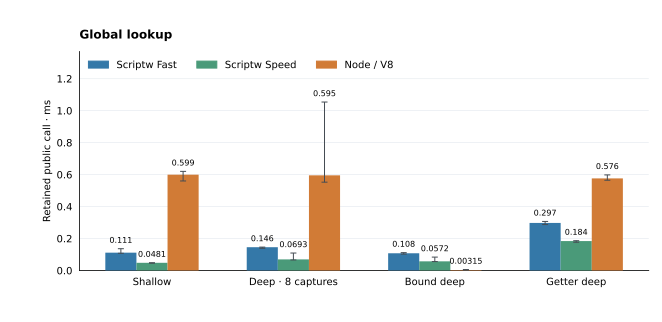

### Native program image sizes

| Retained program | Fast native P · KiB | Speed native P · KiB | Portable Wasm P · KiB |
| --- | ---: | ---: | ---: |
| `frame-compact.js` | 1554.1 | 662.0 | 169.4 |
| `frame-branches32.js` | 1561.2 | 693.1 | 185.3 |
| `frame-branches128.js` | 2031.5 | 931.4 | 285.2 |
| `frame-branches512.js` | 3916.8 | 1900.2 | 690.4 |

Native serialized sizes include code metadata and data; they do not measure peak RSS or runtime heap.

### Global lookup

Six constructor values are read over 1,024 passes. Deep lookup retains eight
padding captures; bound aliases sit beside the worker. Shallow/deep also differ
in padding arithmetic, and V8 may hoist aliases or global reads. Getter controls
include calls and counter increments. These differences are not isolated lookup costs.

### Control-flow and call-site scaling

These programs execute 8,192 logical source applications across selected sites with matching checksums. Fast and Speed may fuse admitted calls into the loop body, so logical applications are not a direct-call count. Compact dispatch uses one polymorphic site and a dynamic key; switch arms use constant keys and separate sites. This does not isolate stack-probe cost.
The current 512-site native P image is **3.83 MiB Fast / 1.86 MiB Speed**; portable P is **0.67 MiB**. Native serialized sizes include metadata and data.

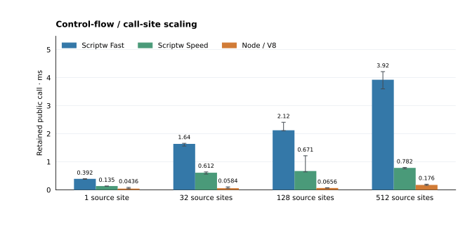

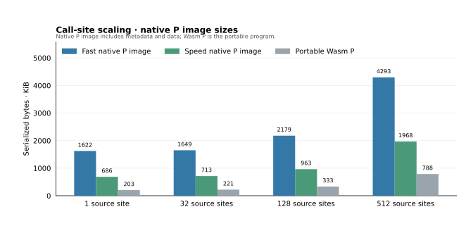

### Arguments observation

Both programs evaluate 1,024 logical strict calls, reassign a formal and compute the same
result. The observed case additionally reads the original arguments and length.
Admitted calls may be fused. The difference includes the observed case's timed work and is not an allocation count.

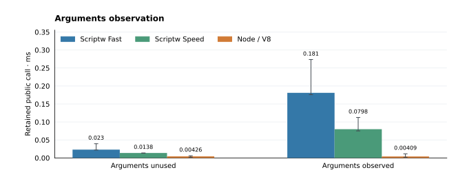

### Property mutation history

Both programs make 8,192 variable-key reads over 64 records. Untimed mutation
adds an accessor, deletes properties and restores values. Reads retain live
storage guards and complete conversion/accessor/prototype/Proxy fallback.
Indexing, key production and record reads all contribute to the score.

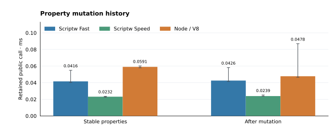

### Packed-array descriptor reads

An additional three-program diagnostic times one indexed descriptor snapshot,
its value read and checksum output. Fresh array construction is untimed. These
recorded packed-array results (compiler `92d17baf84cb`) use eight processes per
engine, 100 warmups and 21 samples:

| Array elements | Scriptw Speed · µs | V8 · µs |
| --- | ---: | ---: |
| 64 | 10.78 | 0.706 |
| 1,024 | 11.77 | 0.692 |
| 4,096 | 12.43 | 0.721 |

All 5,808 calls in that cohort passed. Raw programs, timings and the separate
prior-build control are in the [evidence archive](situations-evidence-2026-11-05.tar.xz).
This descriptor cohort was not rerun for caller-thread entry; its original
source and producer identities remain in that archive.

### Function property reads

Each program reads own length, own name and the name string's length over 8,192
passes and eight targets. Ordinary records, JavaScript functions and native
constructors have matching values/checksums. Array indexing, object-kind dispatch,
string reads and V8 feedback remain part of these scores.

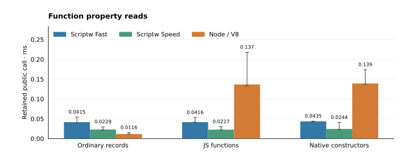

### Type classification

The typeof program performs 18,432 literal comparisons across 4,096 mixed-value
passes. The strict singleton program performs 16,384 null/undefined comparisons.
Inputs cover primitive and object values, bound functions and revoked callable
Proxies. Array access, branches and loop arithmetic remain timed. All earlier
program sources and checksums are unchanged. Independent semantic controls also
cover operand Throws/TDZ and HTMLDDA, outside these timed programs.

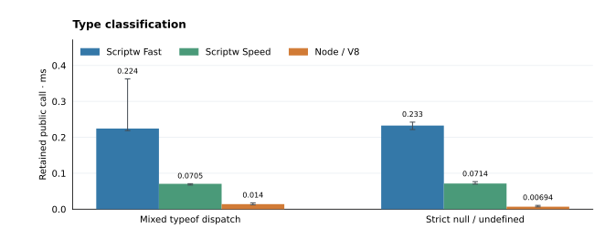

### Dynamic strict equality

Both programs execute 8,192 strict comparisons over prepared pairs. Number pairs
include NaN, signed zero and infinities. Mixed pairs cover String/BigInt content,
Symbol and object identity, boxed values, functions and revoked Proxies. Operand
coercion must not run. Preparation precedes timing; pair indexing, branches and
checksum arithmetic remain timed. Independent models check every input.

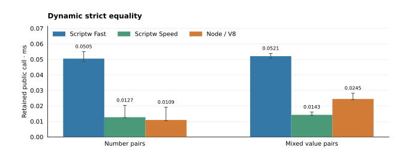

### Enumeration

Sixteen for-in loops visit 64 own enumerable properties, checking 1,024
yielded keys and numeric value reads. Private hashed String Set storage removes
visited-prefix copying. Live descriptor checks, nonenumerable shadowing,
deleted-key prototype behavior, Proxy ordering and suspended cursors retain
the compiled Wasm object model. Ordinary scalar reads observe existence and
enumerability without a full descriptor clone; other descriptor-query paths
retain their own work.
Hash collisions still require exact String equality.

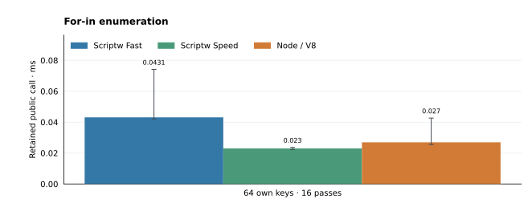

The **historical, unscored width diagnostic** fixes 1,024 yields per call over
null-prototype records: counting keys and summing values are separate programs.
It retains compiler `0ca455c47636`, its original evidence archive and its
original SVG assets; its table and charts do not describe the current source.

| Own keys | Body | Scriptw Fast · ms | Scriptw Speed · ms | V8 · ms |
| ---: | --- | ---: | ---: | ---: |
| 8 | count | 0.471 | 0.438 | 0.0358 |
| 8 | value | 0.624 | 0.523 | 0.0478 |
| 32 | count | 0.442 | 0.42 | 0.0293 |
| 32 | value | 0.591 | 0.509 | 0.0387 |
| 64 | count | 0.46 | 0.427 | 0.0272 |
| 64 | value | 0.629 | 0.55 | 0.0411 |
| 256 | count | 0.447 | 0.423 | 0.0285 |
| 256 | value | 0.583 | 0.51 | 0.0416 |

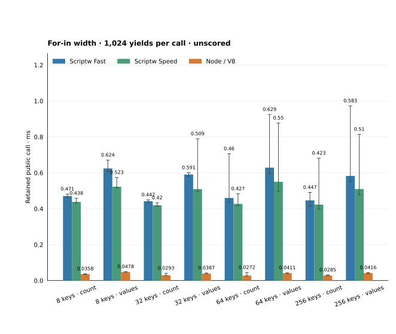

All 360 balanced width processes and 43,560 calls
pass exact checks. [Width data and paired image receipts](for-in-width-current.json).
This diagnostic does not isolate OwnKeys, hashing, property reads or GC costs.
Its baseline is the separately qualified set-only build. One wide-value Speed
block is 2% slower, despite an improved overall median; block variation remains
part of the result.

### Public-call control and verification

The 2026-11-17 situation cohort has 504 process observations and 60,984 exact calls.

All 21 programs compile and pass their exact-output checks under both policies on this source; the last full engine suite ran on `2957071d1` (2026-11-17), and each later change ran its affected suites and Test262 subtrees.

<!-- runtime-comparison-details:start -->
## Performance batch 2026-11-23

Local A/B of the deep dive's waves 1 to 3 ([plan](performance-deep-dive-20261122.md)) against main
`89792689a`. This is not a publication; the README panels above are unchanged until a quiet-machine
republish.

**RSC request:** Callgrind instructions (Speed, 20 requests after 30 warmups, 3 discarded), with exact
Flight output on all 53 observations of each mode.

| Mode | Main | Batch | Change |
| --- | ---: | ---: | ---: |
| Sync | 2,693,758.5 | 2,340,240.5 | −13.1% |
| Async | 2,919,280.5 | 2,541,363.5 | −13.0% |

**Focused situations:** medians of three alternating rounds of 21 retained calls (100 warmups) per
host. Both hosts are Speed images built from main and from the batch, and both ran on the same CPU of
the shared four-vCPU machine while a Test262 run loaded the other three. The figures are relative only.
The frame situations come from the batch build that limits inline indexed-callee probes to 32 per body;
without that limit `frame-branches512` was 21% slower than main.

| Program · retained call | Main · ms | Batch · ms | Change |
| --- | ---: | ---: | ---: |
| `control-empty.js` | 0.0042 | 0.0017 | -59.5% |
| `args-unused.js` | 0.0171 | 0.0144 | -15.8% |
| `args-observed.js` | 0.0172 | 0.0131 | -23.8% |
| `global-shallow.js` | 0.0542 | 0.0541 | -0.2% |
| `global-deep8.js` | 0.0805 | 0.0642 | -20.2% |
| `global-bound-deep.js` | 0.0640 | 0.0480 | -25.0% |
| `global-getter-deep.js` | 0.2204 | 0.2167 | -1.7% |
| `frame-compact.js` | 0.1810 | 0.1732 | -4.3% |
| `frame-branches32.js` | 0.7319 | 0.6717 | -8.2% |
| `frame-branches128.js` | 0.7926 | 0.7495 | -5.4% |
| `frame-branches512.js` | 0.9174 | 0.8405 | -8.4% |
| `property-stable.js` | 0.0282 | 0.0253 | -10.3% |
| `property-mutated.js` | 0.0288 | 0.0253 | -12.2% |
| `metadata-ordinary.js` | 0.0341 | 0.0267 | -21.7% |
| `metadata-function.js` | 0.0345 | 0.0257 | -25.5% |
| `metadata-intrinsic.js` | 0.0338 | 0.0270 | -20.1% |
| `typeof-dispatch.js` | 0.0887 | 0.0641 | -27.7% |
| `singleton-dispatch.js` | 0.0844 | 0.0777 | -7.9% |
| `strict-equality-numbers.js` | 0.0156 | 0.0120 | -23.1% |
| `strict-equality-mixed.js` | 0.0187 | 0.0137 | -26.7% |
| `for-in-wide.js` | 0.0301 | 0.0232 | -22.9% |

## Runtime comparison

**Measured 2026-11-17**, compiler fingerprint `697c47c22eb0`.
V8 **13.6.233.17-node.58**, Node **24.22.1**.
Scriptw is faster than Scriptc in **15/17 workloads** in both blocks; block execution geometric means are **0.465–0.471× Scriptc**. Scriptw is faster than V8 in **7/17 workloads** in both blocks; block execution geometric means are **0.778–0.787× V8**.

This compares Wasm public entry with V8 `runInContext`. Scriptw and Scriptc compile
Wasm before the measured processes and share a Wasmtime host with compilation disabled.
Wasmtime 47.0.0 uses size-optimized/backtracking
native code and a generic target.
Timed Wasm entry includes Scriptw Realm/intrinsic bootstrap. V8 parses one `vm.Script`
per process and creates a fresh `vm.Context` before each invocation outside entry timing;
lazy compilation, JIT tiering and natural GC may occur inside. Every entry checks output.

Each bar shows the median of eight process medians: four processes per balanced
block, each with 21 measured entries after ten checked warmups. Memory bars show
median GNU-time whole-child **peak RSS** for all three runtimes, including host,
code, runtime and warmup history. Warmups do not establish optimized steady state.
Each panel uses its own zero-based scale. Chart data also retains V8 context-creation
time as a supplemental measurement, excluded from bars and ratios.

<table>
<tr>
<td>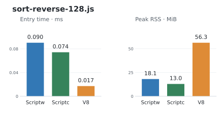</td>
<td></td>
</tr>
<tr>
<td>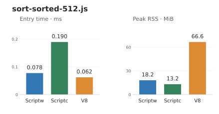</td>
<td>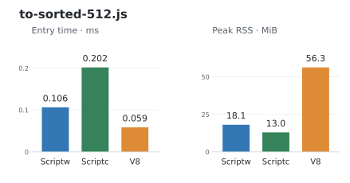</td>
</tr>
<tr>
<td>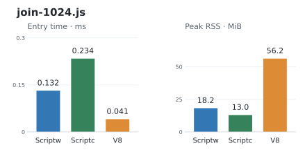</td>
<td>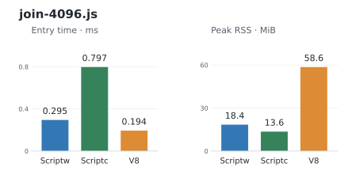</td>
</tr>
<tr>
<td>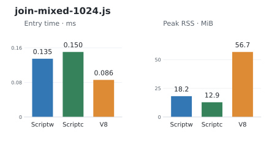</td>
<td>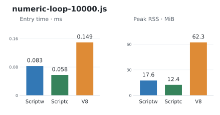</td>
</tr>
<tr>
<td>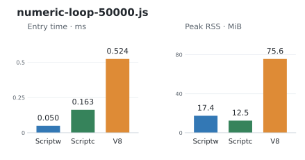</td>
<td>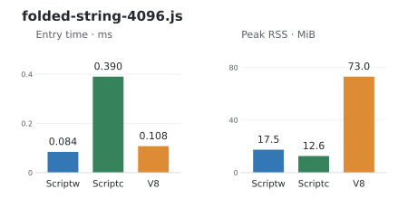</td>
</tr>
<tr>
<td>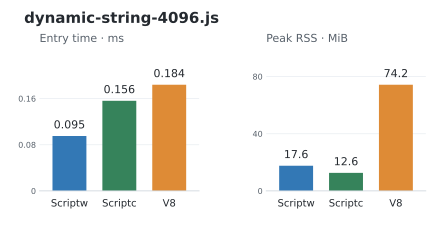</td>
<td>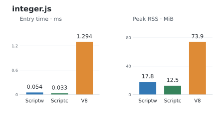</td>
</tr>
<tr>
<td>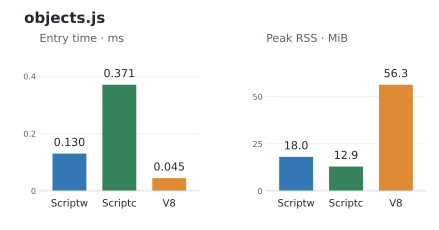</td>
<td>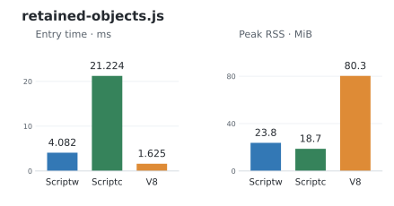</td>
</tr>
<tr>
<td>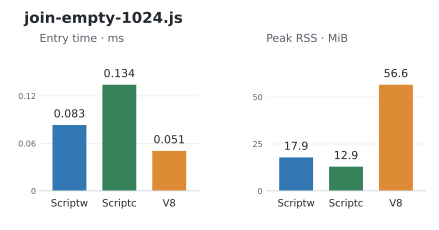</td>
<td>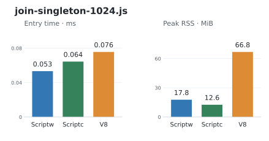</td>
</tr>
<tr>
<td>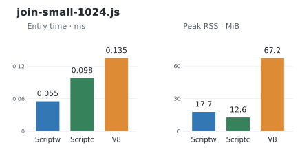</td>
<td></td>
</tr>
</table>

[Chart data and runtime identities](execution-current.json) ·
[Complete evidence](performance-gaps-20261101.json) ·
[Workflow](../../CONTRIBUTING.md#benchmark-charts).
<!-- runtime-comparison-details:end -->

<!-- application-benchmarks-details:start -->
## Application workloads

Measured **2026-11-17**, compiler `697c47c22eb0`, on
Intel(R) Xeon(R) Processor @ 2.30GHz (4 vCPUs), two pinned CPUs for every actor, inherited 13.4 GiB cloud memory cap; Node 24.22.1 (V8 13.6.233.17-node.58),
Chromium 153.0.8010.12.
Six synchronous request/response kernels use plain records, without networking or
Web APIs. The seventh case bundles real React 19.3.1
legacy `renderToString` with hooks/context and 32 escaped rows.
Times cover complete batches: 64 requests for JSON/routing/query/middleware,
32 HTML requests, 48 nested-result requests, or one 32-row SSR render.

Two balanced blocks, eight fresh processes per available actor/case; each process
has seven measured entries after three checked warmups. Cards show the median of
process entry medians and median whole-child peak RSS. Wasm compilation/loading
and V8 source/context setup stay outside entry timing; Scriptw Realm bootstrap
stays inside. Failed actors have no timing or memory bar.

Across the **5 completed Scriptc comparisons**, Scriptw batch medians
are **0.9–2.6× Scriptc**. Failed cases receive no speed score.

<table>
<tr>
<td>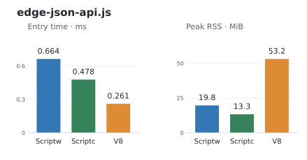</td>
<td>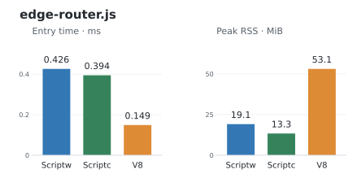</td>
</tr>
<tr>
<td>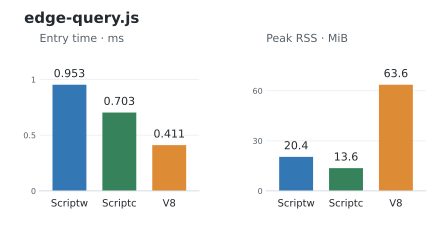</td>
<td>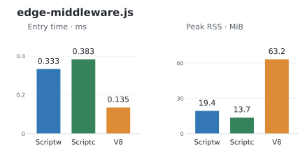</td>
</tr>
<tr>
<td>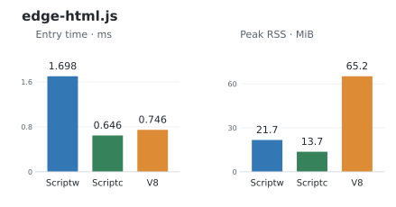</td>
<td>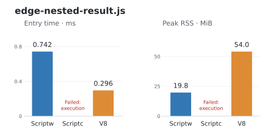</td>
</tr>
<tr>
<td>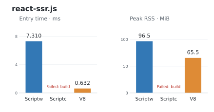</td>
<td></td>
</tr>
</table>

Real Server Components separately serialize and consume Flight streams in Node,
including an async component. Web references use Node's Request/Response/URL APIs.
The browser cases use real React DOM in Chromium: mount, state update and hydration,
with commit plus forced layout timed in the page. RSC renders 32 rows, Web API
cases process 32 requests, and client cases render 64 rows. Setup and golden-output comparisons are
outside these timers. These host references have different timing boundaries;
they establish no engine parity. Browser RSS covers all three cases in one process
and is not assigned to individual cases.

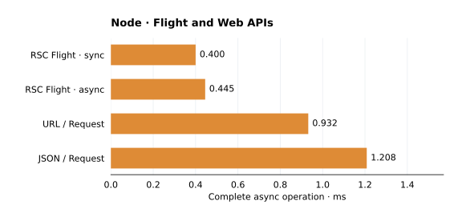
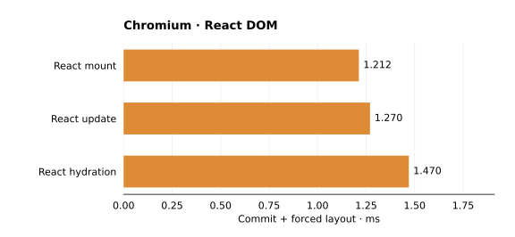

| Reference | Entry median · ms |
| --- | ---: |
| RSC Flight · sync | 0.400 |
| RSC Flight · async | 0.445 |
| URL / Request | 0.932 |
| JSON / Request | 1.208 |
| React mount | 1.212 |
| React update | 1.270 |
| React hydration | 1.470 |

Actual standalone build/execution attempts remain visible, including failures:

| Capability attempt | Scriptw | Scriptc | V8 host reference |
| --- | --- | --- | --- |
| RSC Flight · sync | Checked | Build failed | Node checked |
| RSC Flight · async | Checked | Build failed | Node checked |
| URL / Request | Execution failed | Build failed | Node checked |
| JSON / Request | Execution failed | Build failed | Node checked |
| React client mount | Execution failed | Build failed | Chromium checked |

Standalone run timeouts include compilation and startup; they do not isolate
rendering time. Scriptw's portable build and ordinary NativeHost run are
separate probes; the run recompiles source instead of loading the dumped pair.
Current-source RSC measurements are reported in the [README](../../README.md#benchmarks).

Every failure keeps its stage and one line of its retained raw log (the first
coded compiler error, otherwise the last line); the complete logs are in the
evidence archive:

| Scope | Case | Actor | Stage | Retained diagnostic |
| --- | --- | --- | --- | --- |
| portable | edge-nested-result.js | scriptc | execution | `exit 1: 1:    0x95b - <unknown>!<wasm function 11>: Exited with i32 exit status 1` |
| portable | react-ssr.js | scriptc | source-to-wasm | `exit 1: error SC0001: The left-hand side of a 'for...in' statement must be of type 'string' or 'any'.` |
| standalone | rsc-sync | scriptc | source-to-wasm | `exit 1: error SC0001: The left-hand side of a 'for...in' statement must be of type 'string' or 'any'.` |
| standalone | rsc-async | scriptc | source-to-wasm | `exit 1: error SC0001: The left-hand side of a 'for...in' statement must be of type 'string' or 'any'.` |
| standalone | web-url | scriptw | execution | `exit 1: uncaught throw: ReferenceError: wasm-aot completion: object: Request is not defined` |
| standalone | web-url | scriptc | source-to-wasm | `exit 1: error SC3002: wasm32-wasi target does not support network-backed fetch (WASI Preview 1 has no socket API)` |
| standalone | web-json | scriptw | execution | `exit 1: uncaught throw: ReferenceError: wasm-aot completion: object: Request is not defined` |
| standalone | web-json | scriptc | source-to-wasm | `exit 1: error SC3002: wasm32-wasi target does not support network-backed fetch (WASI Preview 1 has no socket API)` |
| standalone | client-mount | scriptw | execution | `exit 1: uncaught throw: ReferenceError: wasm-aot completion: object: document is not defined` |
| standalone | client-mount | scriptc | source-to-wasm | `exit 1: error SC0001: The left-hand side of a 'for...in' statement must be of type 'string' or 'any'.` |

[Data, identities and diagnostics](applications-current.json) ·
[Inert raw evidence](application-benchmarks-20261117-inert.tar.xz) ·
[Workflow](../../CONTRIBUTING.md#react-and-edge-benchmarks).
<!-- application-benchmarks-details:end -->

### Pooled GC heaps (2026-11-19)

From this change the precompiled panel consumers (`compiler_precompiled_baseline
execute-scriptw`, `runtime_precompiled`, `scriptw-precompiled-consumer`) take each
fresh Store's GC heap from a one-slot pool that keeps its dirty pages resident
(`PooledStores::sequential()`, `PAGEMAP_SCAN` reset). Panels above, measured
2026-11-17, mapped a fresh heap per Store; the reports now carry
`store_allocation`, and `SCRIPTW_PRECOMPILED_STORE_ALLOCATION=on-demand` restores
the old allocation for comparison. RSS after a Store drop no longer falls back to
its value before the Store: up to 16 MiB of heap stays resident.

The Scriptc actor runs through the same host's WASI adapter, which takes its
program's linear memory from the same one-slot, kept-resident pool (it has no GC
heap); `SCRIPTW_PRECOMPILED_STORE_ALLOCATION` switches both adapters, both record
`store_allocation`, and the application, runtime-comparison and precompiled
publishers refuse a campaign whose Scriptw and Scriptc processes differ in it. V8
keeps its own process heap across fresh contexts. Application and kernel panels
dated before 2026-11-19 mapped Stores on demand for both Wasm actors.

One host build, pooled against on-demand, alternating fresh processes on CPU 3 of
a shared 4-vCPU VM (two blocks of eight processes each; third warm entry of each
process, after three warmups; minor faults inside the timed entry from the
host's phase barriers):

| Fixture | Faults on-demand → pooled | Entry ms on-demand → pooled, block 1 / block 2 (median, q1–q3) | Saved |
| --- | ---: | --- | ---: |
| edge-router | 123 → 3 | 0.419 (0.404–0.444) → 0.258 (0.253–0.462) / 0.407 → 0.270 (0.258–0.312) | 34–38% |
| edge-html | 553 → 7 | 2.080 (2.023–2.214) → 1.376 (1.220–1.464) / 2.067 → 1.192 (1.161–1.273) | 34–42% |
| react-ssr | 997 → 6 | 3.238 (3.168–3.348) → 2.029 (2.012–2.112) / 3.343 → 2.096 (2.061–2.276) | 37% |
| retained-objects | 1,383 → 1 | 4.007 (3.772–4.798) → 2.856 (2.552–3.105) / 4.782 → 3.192 (3.174–3.538) | 29–33% |
| objects (kernel) | 33 → 1 | 0.123 (0.106–0.181) → 0.091 (0.078–0.117) / 0.167 → 0.087 (0.082–0.094) | 26–48% |
| integer (kernel) | 16 → 1 | 0.066 (0.056–0.079) → 0.047 (0.047–0.052) / 0.069 → 0.050 (0.048–0.056) | 27–28% |

Thread CPU agrees within three points. The saving is larger than the faults'
estimated in-situ cost of 1.0–1.4 µs each; the rest is not attributed. Store setup outside the timer is 0.01–0.04 ms
shorter; Engine creation takes 0.03 ms longer to reserve the pool. Raising
every Engine's linear-memory reservation from 1 to 4 GiB, which the pool
requires, changed on-demand entries by +1–6% medians with overlapping quartiles
(eight processes each, edge-router, edge-html, react-ssr, retained-objects).
React SSR's private-linear-memory faults (2,247 on 2026-11-17) are gone since the
runtime RegExp compiler was removed, so its remaining faults were all GC heap.

Scriptc 0.4.5 programs (Zig 0.16 WASI build, 267-page initial memory), same
method and host build, `execute-wasi`:

| Fixture | Faults on-demand → pooled | Entry ms on-demand → pooled, block 1 / block 2 (median, q1–q3) | Saved |
| --- | ---: | --- | ---: |
| edge-router | 67 → 4–5 | 0.419 (0.395–0.516) → 0.326 (0.305–0.381) / 0.419 (0.409–0.491) → 0.329 (0.314–0.335) | 21–22% |
| edge-html | 70 → 4–5 | 0.697 (0.631–0.838) → 0.474 (0.456–0.585) / 0.622 (0.571–0.668) → 0.555 (0.548–0.571) | 11–32% |
| objects (kernel) | 68 → 2 | 0.371 (0.322–0.389) → 0.265 (0.254–0.343) / 0.403 (0.331–0.543) → 0.313 (0.299–0.345) | 22–29% |
| integer (kernel) | 20 → 2 | 0.052 (0.051–0.058) → 0.028 (0.027–0.031) / 0.056 (0.051–0.080) → 0.026 (0.023–0.029) | 46–53% |

Thread CPU agrees within one point. Pooling one actor and not the other would
have credited Scriptw with 11–53% that belongs to allocation, not compiled code.

### Pretenure window (2026-11-24)

Two vendored runtime changes for fresh entries
([patch notes](../../vendor/wasmtime-47.0.0/PATCHES.md): "Funcref code
addresses" and the pretenure window under "Young generation"). Neither
changes compiled code, the module compatibility check or the runtime image.

- A defined function's `VMFuncRef` takes its code addresses from a
  per-module offset table and the instance's cached text base, not from two
  registry and two function-table searches (about 760 instructions each).
- A heap's first full nursery does not collect: the Store goes on allocating
  in about 3 MiB of the empty old space, and its first collection, if it
  lives that long, is a full one. React SSR allocates between 2 and 5 MiB per
  entry, so its one minor collection (4.1M of 14.1M instructions) is gone.

Callgrind instructions of one fresh entry's evaluation (the third entry of a
process; `compiler_precompiled_baseline execute-scriptw`, Speed policy,
pooled Store, images prepared by each host; `HEAD` is `88239b2b0`):

| Fixture | `HEAD` | funcref addresses | and pretenure window | Change |
| --- | ---: | ---: | ---: | ---: |
| react-ssr | 14,101,366 | 13,687,469 | 9,290,995 | −34.1% |
| edge-html | 10,170,149 | | 10,155,877 | −0.1% |
| edge-json-api | 3,100,712 | | 3,073,634 | −0.9% |
| print-only | 162,897 | 155,148 | 155,148 | −4.8% |

Wall clock of the same entries, the two hosts alternating for 21 processes
each on CPU 3 of a 4-vCPU VM that was running a Test262 campaign on the other
three (per process the median of 20 entries after 5 warmups; median and range
of those 21, µs):

| Fixture | Execution `HEAD` | Execution now | Whole entry `HEAD` | Whole entry now |
| --- | ---: | ---: | ---: | ---: |
| react-ssr | 1,985 (1,930–2,761) | 1,495 (1,424–1,694) | 3,004 (2,891–4,274) | 2,499 (2,409–2,944) |
| edge-html | 1,060 (1,012–1,637) | 1,058 (1,005–1,752) | 1,732 (1,670–2,533) | 1,744 (1,676–2,802) |
| edge-json-api | 415 (395–594) | 411 (389–443) | 1,038 (995–1,512) | 1,066 (1,001–1,114) |
| print-only | 36.9 (33.5–57.2) | 35.9 (32.6–52.8) | 577 (546–949) | 577 (553–882) |

React SSR's execution is 25% shorter (one unpooled process each: 3.24 →
2.59 ms). The other three are within the noise of this machine; the
registration phase read 3–6 µs longer in every pair although its instruction
count fell, which is not explained. React SSR's private dirty memory after
the entry fell from 27,064 to 26,420 KiB (no promoted copies). A Store that
allocates up to the window's end without collecting keeps up to about 3 MiB
more than before until its first collection.

The retained RSC request is unchanged at the median (sync 2,359,626 →
2,359,677 instructions, async 2,562,129 → 2,561,970; 97 requests). Its means
moved with where the collection cycle falls in the measured requests (sync
2,419,435 → 2,442,019, async 2,651,751 → 2,648,345): the Store's first
collection is now a full one after about 5 MiB instead of a minor one after
2 MiB, and later ones follow the same pattern as before.

The window was first tried in front of the nursery (a fresh Store's first
3 MiB allocated old). React SSR measured the same, but entries that never
filled a nursery got slower: every reference store into a window object runs
the write barrier's out-of-line old-slot test, which cost edge-json-api
+0.5% instructions, +4.2% instruction-cache misses (Callgrind's simulation)
and +4.6% execution time. Opening the window only when the first nursery is
full leaves those entries on the path they had.

## 2026-11-25 comparison with Porffor

[Porffor](https://porffor.dev) 0.61.13 is another JavaScript-to-Wasm AOT compiler. It ran
on the original17 runtime kernels against a local release build of `5ed84a21a` (main; source
fingerprint `408c45ed3e29`, not the requalified cohort of the panels above), with Node 24.22.1
(V8 13.6.233.17-node.58). This is a separate panel, not a republication of the runtime comparison.

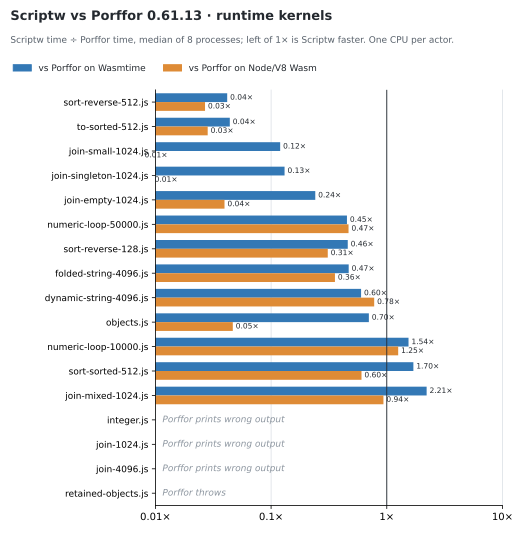

**Engines.** Each actor's engine is part of the comparison:

| Actor | Program | Engine |
| --- | --- | --- |
| Scriptw | Scriptw P + R, precompiled native image | Wasmtime 47.0.0 / Cranelift, shared precompiled host, compiler disabled |
| Porffor on Wasmtime | Porffor's Wasm | Wasmtime 47.0.1 / Cranelift through wasmtime-py, compiled in-process before timing |
| Porffor on Node/V8 Wasm | the same Wasm | Node's WebAssembly: lazy Liftoff, dynamic tier-up to TurboFan |
| Node/V8 JavaScript | the original source | Node `vm`: Ignition, Sparkplug, Maglev, TurboFan |

Porffor's Wasm imports its own `print`, `printChar` and clock functions, so neither the shared
host nor WASI can run it. Its own runner instantiates it in Node; `scripts/wasm_peer_node.cjs`
does the same per entry. For an engine-matched number, `scripts/wasm_peer_wasmtime.py` runs it
on Wasmtime with the host's native tier: SpeedAndSize, backtracking allocation, explicit
`x86_64-unknown-linux-gnu` target without host CPU features, and a one-Store pool keeping
16 MiB per memory slot resident. Wasmtime implements only exnref exceptions, so this works only
where Porffor emits no legacy `try`; all 17 kernels qualify. Its output import is a Wasm adapter
function in the same Store, so entries make no host call. The Python `ctypes` entry call is
inside the timer, and its empty-call floor (1.8–2.5 µs median) is retained per entry, not
subtracted.

**Method.** The runtime panel's sampling is reused: per actor and kernel, eight fresh processes
in two reversed blocks (Williams order), each with 21 measured entries after ten checked warmups.
Every entry gets a fresh instance (Store, Realm or `vm` context) outside the timer, and every
entry's output is checked. Times are medians of process medians. Porffor gets Scriptc's
`print` adapter and its default `-O1`.

**CPU.** Every actor ran on **CPUs 2–3** of the shared four-vCPU cloud machine (Intel Xeon @
2.30 GHz) with no other heavy work running. V8's JIT and GC helper threads, and V8's Wasm
tier-up, share those two CPUs with the measured thread, as in the 2026-11-17 panels
(`integer.js` on Node/V8: 1.31 ms here against 1.29 ms there). The previous run, on 2026-11-23
against `6d6e0c5d4`, had every actor on one loaded CPU; its Node/V8 column (2.73 ms for
`integer.js`) is not comparable with this one.

| Kernel | Scriptw (ms) | Porffor on Wasmtime (ms) | Porffor on Node/V8 Wasm (ms) | Node/V8 JavaScript (ms) | Scriptw ÷ Porffor on Wasmtime |
| --- | ---: | ---: | ---: | ---: | ---: |
| `sort-reverse-128.js` | 0.039 | 0.084 | 0.125 | 0.019 | 0.46× |
| `sort-reverse-512.js` | 0.047 | 1.129 | 1.756 | 0.068 | 0.04× |
| `sort-sorted-512.js` | 0.041 | 0.024 | 0.068 | 0.073 | 1.70× |
| `to-sorted-512.js` | 0.050 | 1.143 | 1.775 | 0.066 | 0.04× |
| `join-1024.js` | 0.069 | wrong output | wrong output | 0.043 | — |
| `join-4096.js` | 0.158 | wrong output | wrong output | 0.212 | — |
| `join-mixed-1024.js` | 0.072 | 0.032 | 0.077 | 0.082 | 2.21× |
| `numeric-loop-10000.js` | 0.025 | 0.016 | 0.020 | 0.141 | 1.54× |
| `numeric-loop-50000.js` | 0.022 | 0.050 | 0.048 | 0.464 | 0.45× |
| `folded-string-4096.js` | 0.047 | 0.100 | 0.131 | 0.103 | 0.47× |
| `dynamic-string-4096.js` | 0.055 | 0.092 | 0.071 | 0.164 | 0.60× |
| `integer.js` | 0.026 | wrong output | wrong output | 1.308 | — |
| `objects.js` | 0.064 | 0.091 | 1.364 | 0.047 | 0.70× |
| `retained-objects.js` | 2.062 | runtime failed | runtime failed | 1.859 | — |
| `join-empty-1024.js` | 0.030 | 0.125 | 0.759 | 0.060 | 0.24× |
| `join-singleton-1024.js` | 0.029 | 0.223 | 3.137 | 0.087 | 0.13× |
| `join-small-1024.js` | 0.025 | 0.205 | 3.224 | 0.129 | 0.12× |

| Comparison | Kernels | Scriptw faster in both blocks | Scriptw time ÷ other, geomean | Range |
| --- | ---: | ---: | ---: | --- |
| Scriptw vs Porffor on Wasmtime | 13 | 10 | 0.359× | 0.04–2.21× |
| Scriptw vs Porffor on Node/V8 Wasm | 13 | 12 | 0.129× | 0.01–1.25× |
| Scriptw vs Node/V8 JavaScript | 17 | 13 | 0.437× | 0.02–2.00× |

Porffor on Node/V8 Wasm is slow on `objects.js` and the small-join kernels. That is not
warmup: in a 2026-11-23 probe `objects.js` stayed at 1.49 ms after 100 warmups, against 0.10 ms
for the same Wasm on Wasmtime. The cause was not profiled.

**Failed attempts.** Porffor fails 4 of 17 kernels. The result is the same on both engines and
in the package's own CLI runner on the same adapted source, which rules out the harnesses.
The two join kernels, whose strings contain NUL and lone surrogates, give wrong checksums; the cause was not isolated. `integer.js` prints
2147483647 (2^31 − 1) where its `Math.imul`/`>>> 0` recurrence should wrap. In
`retained-objects.js`, the runner reports `TypeError: Cannot read property of undefined`.

| Kernel | Actor | Failed attempt | Detail |
| --- | --- | --- | --- |
| `join-1024.js` | Porffor on Wasmtime | wrong-output | printed "5217\n", expected "60415\n" |
| `join-1024.js` | Porffor on Node/V8 Wasm | wrong-output | printed "5217\n", expected "60415\n" |
| `join-4096.js` | Porffor on Wasmtime | wrong-output | printed "54209\n", expected "75775\n" |
| `join-4096.js` | Porffor on Node/V8 Wasm | wrong-output | printed "54209\n", expected "75775\n" |
| `integer.js` | Porffor on Wasmtime | wrong-output | printed "2147483647\n", expected "730532261\n" |
| `integer.js` | Porffor on Node/V8 Wasm | wrong-output | printed "2147483647\n", expected "730532261\n" |
| `retained-objects.js` | Porffor on Wasmtime | runtime-failed | throw: thrown Wasm exception |
| `retained-objects.js` | Porffor on Node/V8 Wasm | runtime-failed | throw: uncaught Porffor exception (type tag 38) |

**Compilation.** Four fresh compiler processes per kernel (136 in all) ran on one CPU, in
ABBA order across two reversed blocks. Scriptw `build wasm` writes P plus the shared 38 MB R
sidecar. Porffor runs its JavaScript compiler on Node and writes standalone Wasm. Startup and
output I/O are included. Scriptw is faster on **17/17** kernels, at **0.580×** Porffor's time
by geometric mean. Median peak RSS is 74 MiB for Scriptw and 81 MiB for Porffor. Porffor
compiles even the kernels it then runs wrongly.

| Kernel | Scriptw build (ms) | Porffor build (ms) | Scriptw P Wasm (bytes) | Porffor Wasm (bytes) |
| --- | ---: | ---: | ---: | ---: |
| `sort-reverse-128.js` | 97.8 | 162.7 | 70,293 | 35,373 |
| `sort-reverse-512.js` | 93.3 | 158.3 | 70,293 | 35,373 |
| `sort-sorted-512.js` | 92.0 | 160.8 | 70,311 | 35,373 |
| `to-sorted-512.js` | 94.2 | 164.2 | 71,593 | 35,522 |
| `join-1024.js` | 96.0 | 165.8 | 67,692 | 35,287 |
| `join-4096.js` | 95.6 | 168.3 | 67,692 | 35,287 |
| `join-mixed-1024.js` | 96.4 | 166.5 | 62,739 | 34,116 |
| `numeric-loop-10000.js` | 92.9 | 165.0 | 67,943 | 32,730 |
| `numeric-loop-50000.js` | 94.0 | 167.1 | 67,943 | 32,730 |
| `folded-string-4096.js` | 95.0 | 167.6 | 72,139 | 33,598 |
| `dynamic-string-4096.js` | 96.3 | 166.0 | 71,246 | 32,993 |
| `integer.js` | 96.0 | 163.0 | 86,330 | 32,788 |
| `objects.js` | 94.4 | 165.3 | 74,270 | 34,506 |
| `retained-objects.js` | 98.1 | 157.1 | 76,069 | 34,599 |
| `join-empty-1024.js` | 95.1 | 165.6 | 63,952 | 33,884 |
| `join-singleton-1024.js` | 94.1 | 158.9 | 64,349 | 33,926 |
| `join-small-1024.js` | 97.1 | 170.1 | 64,718 | 34,019 |

**Other panels (untimed probe, 2026-11-23, not rerun).** Porffor completes none of the six edge kernels:

- `edge-router.js`, `edge-query.js` and `edge-html.js` print wrong output.
- `edge-json-api.js`, `edge-middleware.js` and `edge-nested-result.js` throw a
  `ReferenceError` for a closure variable (`prices`, `now`, `projects`).
- Wasmtime rejects three of the six modules (`edge-json-api.js`, `edge-query.js` and
  `edge-nested-result.js`) because they use legacy `try`.

This was an untimed probe, so no application panel is published. The focused situations use
retained Modules with an untimed `prepare(input)` and a timed `run()`. Porffor's Wasm exports
only its `main`, so it has no matched consumer there. React SSR and RSC were not attempted.

[Data, identities and failures](wasm-peer-current.json) ·
[Workflow](../../CONTRIBUTING.md#comparison-with-porffor).

## Process density

**2026-11-25**, a separate panel: how many processes of one small JavaScript program fit in a
machine's memory, in the shape of [Porffor's site](https://porffor.dev), plus process wall time and
per-entry runtime. Porffor's page reports "apps per GB under load" (28 for Node containers, 45 for
self-hosted workerd, 1,144 for Porffor processes) without workload, hardware or method; this panel
publishes all three. Scriptw is a local release build of `5ed84a21a` (main; source fingerprint
`408c45ed3e29`). Node is 24.22.1 (V8 13.6.233.17-node.58) and 22.23.4 (V8 12.4.254.21-node.57).
Porffor is 0.61.13, compiled `native` through its C backend with gcc 13.3 at its default `-O3`.

| Actor | Program | How it runs |
| --- | --- | --- |
| Scriptw | precompiled native image (P + R), built untimed | shared precompiled host (`compiler_precompiled_baseline execute-scriptw`), Wasmtime 47.0.0, compiler disabled, default pooled Store |
| Scriptw run | the source, with a warm program cache | the product CLI `scriptw run` (wall time only) |
| Node 24 / Node 22 | the source with the `print` adapter | `node program.js`, defaults |
| Node 24 lean | the same | `--v8-pool-size=0 --single-threaded-gc --max-semi-space-size=1` |
| Porffor native | the source with the `print` adapter, built untimed | the native executable |

**Density.** For each actor and program, N = 1, 8 and 32 processes start together, two groups each.
Every process is held after its program has run, with its runtime still live, and
`/proc/<pid>/smaps_rollup` is read while all N are alive; then all are released and every output is
checked. Scriptw is held at the host's phase barrier inside its second execution (one warmup is the
host's minimum), with the Store live. Node is held at `beforeExit` by a `--require` preload
(`scripts/density_node_hold.cjs`), with the isolate and heap live. Porffor native is held at a ptrace
exit stop, before the kernel releases its address space; its generated C frees nothing before exit.

Summed PSS of N held processes is the memory they use together: every resident page counts once,
split between the processes that map it. It is linear in N, total(N) = fixed + N × marginal, so

- marginal = (total(32) − total(1)) / 31, the cost of one more process;
- fixed = total(1) − marginal, the shared executable, runtime and library pages;
- processes in M bytes = ⌊(M − fixed) / marginal⌋, with M = 1 GiB and 16 GiB.

The 16 GiB figure gives the whole 16 GiB to these processes: no kernel, page cache or OS reserve.
It is an upper bound. The N = 8 marginal agrees with the N = 32 one within 0.04–0.81 MiB for every
pair. RSS is not used: a 13.8 MiB Scriptw process and a 46.0 MiB Node process would suggest 1,186 and
356 processes in 16 GiB, because RSS counts the shared executable once per process. USS (private
clean + dirty) at N = 32 is shown beside the marginal as a check.

**Process wall.** Ten fresh processes per actor and program, one after another, spawn to exit under
GNU time, actor order rotated per round, every output checked. The Scriptw host reports a
build-source identity, so it no longer hashes its own 261 MiB executable (the driver hashes it
before and after the run); it runs the program four times (3 samples + 1 warmup, its minimum), and
its report splits image load, first entry and the three extra entries. The host's `identity`
command, which does hash the executable, is timed separately.

**Steady state.** Per-entry wall in a fresh Store or `vm` context, through the Porffor panel's
harnesses: 21 measured entries after 10 checked warmups, four processes per actor and program in
two blocks (the second reversed), median of process medians. Porffor native has no per-entry
harness; its Wasm per-entry times are in the [Porffor panel](#2026-11-25-comparison-with-porffor).

**Machine and load.** The shared four-vCPU cloud machine (Intel Xeon @ 2.30 GHz, 15.7 GiB) ran every
actor on CPUs 2–3 under `limited_verification.py --cloud`, with no other heavy work running. The
memory readings do not depend on CPU time; the wall and steady-state times do. No density group
was skipped by the 6 GiB `MemAvailable` reserve.

The tables below are the unedited `tables` output: startup-program capacity; marginal PSS and
processes in 16 GiB per program; process wall medians; the Scriptw host's wall split; per-entry
steady state; failed attempts.

| Runtime, `startup.js` | PSS alone (MiB) | Marginal PSS per process (MiB) | USS at N=32 (MiB) | Processes per GiB | Processes in 16 GiB |
| --- | ---: | ---: | ---: | ---: | ---: |
| Scriptw (precompiled image, shared host) | 12.1 | 1.7 | 1.6 | 606 | 9,796 |
| Node 24.22.1 | 44.4 | 8.6 | 8.6 | 114 | 1,895 |
| Node 24.22.1 lean flags | 44.3 | 8.6 | 8.5 | 115 | 1,903 |
| Node 22.23.4 | 47.9 | 6.7 | 6.6 | 147 | 2,444 |
| Porffor 0.61.13 native (gcc -O3) | 0.7 | 0.3 | 0.2 | 3,685 | 58,996 |

| Program | Scriptw | Node 24 | Node 24 lean | Node 22 | Porffor native |
| --- | ---: | ---: | ---: | ---: | ---: |
| `startup.js` | 1.7 MiB · 9,796 | 8.6 MiB · 1,895 | 8.6 MiB · 1,903 | 6.7 MiB · 2,444 | 0.3 MiB · 58,996 |
| `numeric-loop-50000.js` | 1.8 MiB · 9,328 | 9.0 MiB · 1,824 | 8.9 MiB · 1,831 | 7.2 MiB · 2,279 | 1.4 MiB · 11,653 |
| `sort-reverse-512.js` | 1.8 MiB · 9,197 | 8.7 MiB · 1,871 | 8.7 MiB · 1,880 | 6.7 MiB · 2,433 | wrong output |
| `dynamic-string-4096.js` | 1.8 MiB · 9,287 | 8.9 MiB · 1,843 | 8.9 MiB · 1,832 | 6.8 MiB · 2,406 | 1.4 MiB · 11,651 |
| `objects.js` | 1.9 MiB · 8,846 | 8.7 MiB · 1,885 | 8.6 MiB · 1,894 | 6.7 MiB · 2,426 | wrong output |
| `retained-objects.js` | 6.1 MiB · 2,681 | 11.6 MiB · 1,408 | 11.6 MiB · 1,406 | 10.0 MiB · 1,637 | runtime failed |

| Program | Scriptw (ms) | Node 24 (ms) | Node 24 lean (ms) | Node 22 (ms) | Porffor native (ms) | Scriptw run (ms) |
| --- | ---: | ---: | ---: | ---: | ---: | ---: |
| `startup.js` | 10.3 | 27.3 | 27.0 | 27.4 | 2.6 | 7.3 |
| `numeric-loop-50000.js` | 10.7 | 28.1 | 25.3 | 25.5 | 2.9 | 7.5 |
| `sort-reverse-512.js` | 10.4 | 24.4 | 25.5 | 24.3 | wrong output | 7.1 |
| `dynamic-string-4096.js` | 10.3 | 25.5 | 26.0 | 23.7 | 3.0 | 7.4 |
| `objects.js` | 10.9 | 25.1 | 24.7 | 25.7 | wrong output | 8.2 |
| `retained-objects.js` | 22.7 | 29.3 | 34.3 | 30.1 | runtime failed | 12.2 |

| Program | Scriptw host wall (ms) | of which: image load (ms) | first entry (ms) | 3 extra entries (ms) |
| --- | ---: | ---: | ---: | ---: |
| `startup.js` | 10.3 | 3.8 | 0.72 | 1.09 |
| `numeric-loop-50000.js` | 10.7 | 4.0 | 0.73 | 1.08 |
| `sort-reverse-512.js` | 10.4 | 3.7 | 0.78 | 1.29 |
| `dynamic-string-4096.js` | 10.3 | 3.8 | 0.70 | 1.14 |
| `objects.js` | 10.9 | 4.1 | 0.82 | 1.32 |
| `retained-objects.js` | 22.7 | 3.8 | 4.49 | 7.87 |

Host `identity` command alone (executable hash, no program): 193.8 ms median over 10 processes.

| Program | Scriptw (µs) | Node 24 (µs) | Node 24 lean (µs) | Scriptw ÷ Node 24 |
| --- | ---: | ---: | ---: | ---: |
| `startup.js` | 21.9 | 6.0 | 6.2 | 3.63× |
| `numeric-loop-50000.js` | 25.3 | 516.3 | 528.9 | 0.05× |
| `sort-reverse-512.js` | 53.6 | 68.2 | 71.4 | 0.79× |
| `dynamic-string-4096.js` | 58.1 | 242.1 | 161.3 | 0.24× |
| `objects.js` | 74.8 | 45.4 | 54.2 | 1.65× |
| `retained-objects.js` | 1393.6 | 1671.3 | 3012.4 | 0.83× |

| Program | Actor | Failed attempt | Detail |
| --- | --- | --- | --- |
| `sort-reverse-512.js` | Porffor 0.61.13 native (gcc -O3) | wrong-output | printed "22500864\n", expected "44870400\n" |
| `objects.js` | Porffor 0.61.13 native (gcc -O3) | wrong-output | printed "0\n", expected "149600\n" |
| `retained-objects.js` | Porffor 0.61.13 native (gcc -O3) | runtime-failed | exit status 1:  printed "Uncaught ", expected "134250496\n" |

**Findings.**

- On the startup program, one more Scriptw process costs **1.7 MiB** against **8.6 MiB** for Node 24
  and **6.7 MiB** for Node 22: 9,796 processes in 16 GiB against 1,895 and 2,444, so 5.2× and 4.0×
  as many. The shared part is 10.5 MiB for Scriptw and 36–41 MiB for Node, so a lone process is
  12.1 MiB of PSS against 44.4 MiB. The 2026-11-23 run of `1edd6d329` measured 4.9 MiB and 3,372
  processes, before the runtime image was mapped from the executable instead of decoded into
  private memory in every process.
- The kernels keep that order, 1.8–1.9 MiB against 8.7–9.0 MiB for Node 24. On
  `retained-objects.js`, which keeps 8,192 objects live, Scriptw takes 6.1 MiB against 11.6 MiB
  for Node 24 and 10.0 MiB for Node 22, so it fits more processes than either Node on every program.
- Porffor native is far smaller than both: **0.3 MiB** marginal on the startup program and 1.4 MiB
  on the two kernels it runs correctly, 11,651–58,996 processes in 16 GiB. Each is a 75–79 KB
  executable with no garbage collector, runtime image or JIT. Its C backend prints wrong output for
  `sort-reverse-512.js` and `objects.js`, which its Wasm output computes correctly in the Porffor
  panel, and throws on `retained-objects.js` as its Wasm does.
- Node's lean flags change nothing that matters: 7 threads become 4, marginal PSS moves by about 1%.
- **Startup.** A Scriptw host process takes 10.3 ms for the startup program against 27.3 ms for
  Node 24 and 2.6 ms for Porffor native; 3.8 ms of it is loading the native image and 0.7 ms the
  program's first entry. The product CLI on a warm program cache takes 7.1–8.2 ms, and 12.2 ms for
  `retained-objects.js`. On 2026-11-23 these were 306 ms and 180–214 ms, mostly hashing the
  executable and decoding the runtime image; neither is on either path now. The host's `identity`
  command still hashes the executable and takes 194 ms; nothing else measured here runs it.
- Once running, Scriptw takes 0.02–0.07 ms per entry on the small kernels, close to the Porffor
  panel, and 1.4 ms on `retained-objects.js` (2.1 ms there), ahead of Node 24 on four of six programs. Node is
  ahead on `objects.js` and on the startup program, 6 µs against 22 µs, most of which is the
  Realm bootstrap inside Scriptw's timer. The lean flags make `retained-objects.js` 1.8× slower
  and `dynamic-string-4096.js` 1.5× faster on Node 24; the cause was not profiled.

**Boundaries.**

- Measured: resident memory of processes that have just run one program, held after execution.
  Not a server under sustained load, not a peak, and not kernel memory (page tables, task structures)
  that PSS leaves out.
- Compilation is ahead of time and untimed for Scriptw (precompiled image) and Porffor (native
  executable). Node parses and JIT-compiles inside the measured process, and that memory is
  part of its result.
- Shared pages are charged once, to the fixed part: for Scriptw the touched pages of the 261 MiB
  host executable (which also contains the compiler, never run here) and of the runtime image;
  for Node the `node` executable with its built-in snapshot. Page cache for the image and binary
  files on disk is not counted.
- One program per process. Scriptw's embedding API can run many Stores, one per request, inside
  one process sharing one loaded image; that, Node's `vm` contexts or workers, forked Node servers
  sharing a heap snapshot, workerd isolates and containers were not measured.
- The Scriptw host is a benchmark host, not a shipped runtime: its four executions inflate its
  wall time and are reported separately. No product command runs a
  precompiled image yet; `scriptw run` is the product path for source.
- The hold points differ by runtime as described above. Scriptw's held process has run the program
  twice in fresh Stores; Node's and Porffor's once.

[Data, identities and raw samples](process-density-current.json) ·
[Workflow](../../CONTRIBUTING.md#process-density).

## Compilation time

**JavaScript → portable Wasm**, measured 2026-11-17 with the same compiler
fingerprint as the runtime charts, on one CPU of the same cloud machine for both
compilers. Scriptw is faster in **17/17 workloads**,
taking **0.516x Scriptc's time** by geometric mean of workload medians.

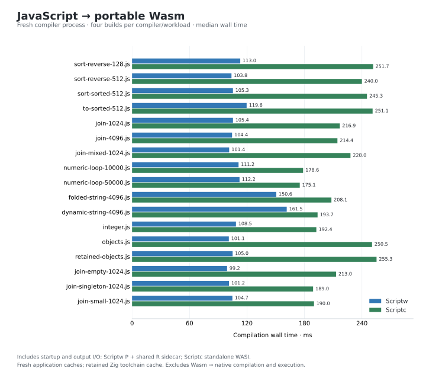

Four fresh CLI builds per compiler/workload across two balanced blocks
(**136 processes**). Includes startup and output I/O: Scriptw P plus its shared R
sidecar; Scriptc standalone WASI. Application caches are fresh; OS and Zig toolchain
caches remain. Runtime production, Wasm-to-native compilation and execution are
excluded. [Data and tool identities](compilation-current.json) ·
[Reproduce](../../CONTRIBUTING.md#benchmark-charts).

### Compiler binary build (2026-11-20)

The panel above, the RSC compile and Test262 runs all time the `scriptw` binary
itself, so how that binary is built matters too. [CONTRIBUTING](../../CONTRIBUTING.md#dist-compiler-binary)
has the recipe: `scripts/build-dist.sh` (fat LTO, one codegen unit, jemalloc) and its
`pgo` mode (Rust PGO). These are local benchmark binaries; CI and Test262
publication still use release builds.

Source state. All four binaries below were built from one uncommitted state,
S1: `a49682ada` plus `[profile.dist]`, the tikv-jemallocator dependency and an
optional, unused mimalloc 0.1.52 entry in the root `Cargo.toml` and `Cargo.lock`
(source fingerprint `e18762413c39`). The mimalloc entry was dropped before the
commit, so no commit reproduces that fingerprint, and binaries built from the
committed tree embed a different one. The PGO binary did not come from the
committed `build-dist.sh pgo` either, but from an equivalent hand-resumed
sequence of uncommitted scripts: a tmpfs target directory, `-j 4`, a final link
resumed by hand and a looser warning grep. Those runs skipped the committed
script's LLVM version, profile-count and warning checks, and the committed
`pgo` mode has not yet completed end to end. The training ran without
`--snapshot-dir`, so it wrote into the shared `test262/snapshots`, and it set
the application fixtures variable, so RSC and the edge programs were in the
training set.

Method. The binaries were measured in interleaved rounds: five for
compilation, three for Test262. Every child ran pinned to CPUs 0 and 1 with
`SCRIPTW_JOBS=1` and a fresh disk-backed `SCRIPTW_CACHE_DIR`; the binaries
themselves ran from tmpfs (`/dev/shm`), which takes page-cache misses out of
the startup that dominates `build wasm`. Another worker ran Callgrind or builds
on CPUs 2 and 3 for part of the time, and its unpinned `node` (wasm-opt)
process could also run on CPUs 0 and 1, so walls carry that contention; user
CPU is steadier. Values are medians [min–max].

| Binary | RSC precompile (Speed) | Panel `build wasm`, 17 kernels | Panel precompile, 17 kernels | `client.js` precompile (held out) | Test262 `built-ins/Array/prototype/find` | Peak RSS: RSC / build / Test262 | Size |
| --- | ---: | ---: | ---: | ---: | ---: | ---: | ---: |
| release, glibc malloc | 9.70 s [9.36–10.69], user 9.30 s | 2.59 s [2.48–2.66], user 1.76 s | 7.66 s | 64.97 s [63.42–67.88] | 74.8 s [68.8–75.9], user 56.1 s | 292 / 85 / 157 MiB | 218.2 MB |
| release + jemalloc | 9.09 s [8.95–9.63], user 8.60 s | 2.42 s [2.31–2.53], user 1.58 s | 7.42 s | 58.15 s [55.65–58.91] | 72.8 s [65.3–75.8], user 53.7 s | 240 / 75 / 169 MiB | 218.7 MB |
| dist (fat LTO) + jemalloc | 8.42 s [8.27–8.72], user 7.99 s | 2.30 s [2.28–2.45], user 1.49 s | 7.15 s | 53.00 s [51.97–56.52] | 65.2 s [63.1–66.4], user 48.3 s | 230 / 69 / 158 MiB | 180.5 MB |
| dist + jemalloc + PGO | **7.26 s** [6.95–7.78], user 6.72 s | **2.15 s** [2.08–2.24], user 1.34 s | **6.58 s** | **50.74 s** [48.02–51.63] | **63.5 s** [63.1–63.6], user 45.3 s | 227 / 63 / 149 MiB | 197.8 MB with BOLT relocations (178.4 MB without, now the default) |

Against release, the PGO dist binary takes 25% less wall time on the RSC
compile (28% less user CPU), but RSC was in its training set. On the held-out
`client.js` it takes 22% less, 17% less on the panel's builds and 15% less on the
Test262 directory. The panel's per-kernel `build wasm` median falls from 0.145
to 0.123 s. Most of that is CLI startup on a 200 MB binary: 17 builds take 1.76 s
of user CPU against 2.59 s of wall time.

Variance between campaigns is as large as several of these effects. An earlier
campaign on the same S1 binaries (release glibc, release jemalloc, dist
jemalloc; five compilation and three Test262 rounds) measured the RSC compile at
9.29, 9.32 and 8.68 s wall (user 8.94, 8.86 and 8.16 s) and the Test262 directory
at 64.6, 61.7 and 57.6 s wall (user 53.2, 50.5 and 47.4 s). The same release
binary thus took 64.6 s there and 74.8 s in the final campaign, and the earlier
dist median beats the final PGO median. A third, allocator-only campaign put
release at 73.7 s on that directory. Across the three campaigns, jemalloc saved
1–8% of RSC user CPU, 3–10% of `build wasm` user CPU and 4–6% of Test262 user
CPU, but its RSC wall change ranged from −6% to +0.4%; read the jemalloc and
Test262 rows by user CPU. The speed of a PGO binary on a full pinned Test262
sweep is unmeasured.

On these inputs, every compared artifact was byte-identical across all four
binaries and all rounds: P of the 17 kernels, their `scriptw precompile`
images, the RSC and `client.js` images, and the `scriptw run` output of the
17 kernels (each matches its manifest). R was identical too, but the build-time
runtime-image producer makes it, a host unit that gets neither LTO nor PGO, so
it proves nothing about the dist code. The 44 Test262 cases passed in every
run by each run's stdout summary; the per-case JSON came from the shared
snapshot directory, which other workers' runs overwrote in three of the twelve
final rounds. This is a fixed set, not a proof that output never depends on how
the compiler binary was built. The images carry the source fingerprint, which
covers `Cargo.toml` and `Cargo.lock`, so only binaries from one source state can
be compared byte for byte.

PGO trained on nine of the kernels, the RSC program, the six edge programs and
`built-ins/JSON/stringify`. On the eight held-out kernels, `build wasm` user CPU
falls 24% (0.85 to 0.65 s) against 23% on the trained ones, and precompile falls
19% against 17%. `client.js` (325 KB React client) and the Test262 directory are
also outside the training set. All of these exercise mostly the same compiler
paths as the training. With `-Cprofile-use`, LLVM optimizes functions the
training never ran as cold, so lowering and codegen of features it never
compiles (generators, classes and private fields, RegExp, Intl, Temporal,
BigInt and others) may be slower than in release.

Allocators: mimalloc 0.1.52 matched jemalloc's CPU savings in a separate
three-way A/B: RSC user 8.70 s against 8.71 s (glibc 9.08 s), and Test262 user
54.4 s against 55.1 s (58.4 s). It raised peak RSS, though, to 305 MiB on the RSC
compile and 249 MiB on Test262, against 241 and 171 MiB for jemalloc and 291 and
160 MiB for glibc. jemalloc was kept.

Build cost: a cold dist build takes about 25 minutes on four contended vCPUs, and
its fat-LTO link peaks at 3.8 GB RSS, more than the 4 GiB local verification
cap allows. PGO adds an instrumented build, about four
minutes of training and a second dist build. The instrumented target units
take 1.8 GB and the profile-use ones about 1.7 GB, plus 1.4 GB of host units. Release and
development builds are unchanged.

Not done:

- BOLT. LLVM 18 BOLT is installable here (`bolt-18`), but this VM has no PMU, so
  no perf LBR profile. Its instrumentation mode grew to 8.3 GB RSS on the 198 MB
  PGO binary (38,722 functions, relocation mode) before it wrote anything. It
  was stopped so that it would not crowd out concurrent builds on a 16 GB
  machine. With `SCRIPTW_DIST_BOLT_PREP=1` the PGO build links with
  `--emit-relocs` and `-z keep-text-section-prefix`, so a machine with about
  12 GB of free RAM can retry with `llvm-bolt -instrument`, the same training and
  `-reorder-blocks=ext-tsp -reorder-functions=hfsort+ -split-functions`.
- Linker identical-code folding (`--icf`) and a static or non-PIE link. Each needs
  another full fat-LTO build with different link flags. Neither was measured.
- The benchmark examples `rsc_baseline` and `compiler_precompiled_baseline` name
  `scriptw_cli`, so `--features jemalloc` gives their whole process, execution
  phases included, the allocator; the other examples and
  `scriptw-precompiled-consumer` keep glibc. The examples have no dist/PGO recipe
  of their own. Their native-preparation phase above comes from
  `scriptw precompile`.
- An identity gate: the comparison above lives in uncommitted tooling, and no
  committed command compares a dist binary's artifacts with release.
- A broad held-out Test262 slice with the PGO binary, outside `built-ins`.
- The published compilation panel above still uses its frozen release CLI; a
  new campaign should freeze a dist binary.
- Two diagnostics are outside the set: RSC Fast policy and `scriptw build wasm`
  of the whole RSC bundle. The latter grew past 12 GB RSS in a trial and was stopped.

## 2026-11-27 local benchmarks: edge, cold start, and Porffor

Measured **2026-11-27** on an idle local **AMD Ryzen 7 7800X3D** Linux host (`0–1%` CPU busy), pinned to **CPUs 6–7** under a **4 GiB / 0 swap** systemd cgroup scope, comparing a local `--release` build (Runtime ABI 95, `CONFIGURATION_SCHEMA = 8`, compiler fingerprint `7ad9cb3d1577`, executable SHA-256 `b80fdb372b05…`) against **Node 24.19.0** (`V8 13.6.233.17-node.51`) and **Porffor 0.61.13** (`wasmtime-py 47.0.1` and Node 24.19.0 Wasm) in one paired interleaved cohort (`NODE_DISABLE_COMPILE_CACHE=1`, `SCRIPTW_JOBS=1`). Exact stdout or Flight SHA-256 was checked on every run, and warmup observations were excluded from every median. Compare actors strictly within this paired cohort rather than across separate dates or cloud cohorts above.

### Cold-start CLI (`scriptw run` warm cache vs Node 24)

Medians of 15 interleaved warm runs after 3 warmups on final binary `7ad9cb3d1577` (narrow standalone `print(...)` proof skipping the 42 MiB runtime link on `startup.js`, prepared `InstancePre` late-bound `SharedMemory` and positional P-to-R linkage, single-pass source admission, deferred ambient loader, bounded zero-copy raw P cache reads, and lazy `GlobalBuiltinBacking`):

| Fixture | ABI 93 (`3ac71dbb5761`) | ABI 95 (`7ad9cb3d1577`) | Node 24.19.0 | Scriptw ÷ Node |
| --- | ---: | ---: | ---: | ---: |
| `startup.js` | 2.64 ms | **1.20 ms** (min 1.04) | 15.70 ms | **0.077× (13.04× faster)** |
| `numeric-loop-50000.js` | 3.06 ms | **2.58 ms** (min 2.30) | 16.85 ms | **0.153× (6.53× faster)** |
| `edge-router.js` | 3.92 ms | **2.94 ms** (min 2.90) | 15.65 ms | **0.188× (5.32× faster)** |
| `edge-json-api.js` | 3.96 ms | **3.38 ms** (min 3.03) | 15.69 ms | **0.216× (4.64× faster)** |
| `edge-html.js` | 4.31 ms | **3.46 ms** (min 3.31) | 16.60 ms | **0.209× (4.79× faster)** |
| **Geomean** | 0.207× (4.83×) | — | — | **0.158× (6.32× faster, 5/5)** |

### Edge workloads and fresh-Realm floor (precompiled fresh Realm vs V8)

Replacing eager global builtin publication with lazy `GlobalBuiltinBacking` (zero eager builtin property entries, descriptors or key strings at Realm birth), prepared R-to-P linkage, empty `TypeRegistry` fast-probing and a `32 MiB` initial copying-GC heap (`4 MiB` nursery) cut the `startup.js` fresh-Realm execution floor from `7.32 µs` (`207.1 µs` total in ABI 93) to **`2.42 µs`** (min **`2.33 µs`**, instantiation `1.27 µs`, **`95.8 µs` total** — **3.0× faster** than ABI 93, faster than V8 5w `3.20 µs` and V8 80w `2.52 µs`) and lowered total fresh-Store edge request latency by `50–60 µs`. Medians of 5 interleaved processes × 21 fresh-Realm runs (5 excluded warmups for Scriptw/V8 5w; 80 for V8 80w):

| Edge fixture | ABI 95 exec | ABI 95 total | V8 5w exec (Ratio) | V8 80w exec (Ratio) |
| --- | ---: | ---: | ---: | ---: |
| `startup.js` (floor) | **2.42 µs** | 95.82 µs | 3.20 µs (**0.76×**) | 2.52 µs (**0.96×**) |
| `edge-json-api.js` | **139.72 µs** | 319.24 µs | 193.88 µs (**0.72×**) | 168.55 µs (**0.83×**) |
| `edge-router.js` | **83.71 µs** | 257.65 µs | 112.00 µs (**0.75×**) | 99.54 µs (**0.84×**) |
| `edge-query.js` | **192.67 µs** | 376.48 µs | 331.11 µs (**0.58×**) | 349.00 µs (**0.55×**) |
| `edge-middleware.js` | **80.42 µs** | 257.34 µs | 95.48 µs (**0.84×**) | 84.00 µs (**0.96×**) |
| `edge-html.js` | **237.80 µs** | 421.07 µs | 562.36 µs (**0.42×**) | 471.49 µs (**0.50×**) |
| `edge-nested-result.js` | **197.39 µs** | 387.60 µs | 240.80 µs (**0.82×**) | 208.91 µs (**0.94×**) |
| **Edge Geomean (6/6)** | — | — | **0.671× (1.49× faster, 6/6)** | **0.748× (1.34× faster, 6/6)** |

### Live 17-kernel comparison with Porffor 0.61.13 and Node 24.19.0 / V8

Unified paired precompiled fresh-Realm execution medians (5 interleaved processes × 21 measured runs per actor after 10 excluded warmups for Scriptw and Porffor, 5/80 excluded warmups for V8; exact stdout verified) using `compiler_precompiled_baseline`, `scripts/wasm_peer_wasmtime.py`, `scripts/wasm_peer_node.cjs`, and Node 24.19.0 `vm.Script`, plus 4 ABBA fresh runs per kernel for `scriptw build wasm` vs `porf wasm` compilation (where restoring the Portable `StringPool` prefix from the built-in runtime receipt eliminated the 50 ms Unicode RegExp catalog rebuild on every fresh build):

| Kernel | Scriptw (µs) | V8 5w / 80w (µs) | Scriptw ÷ V8 80w | Porffor WT (µs) | Porffor V8 Wasm (µs) | Scriptw ÷ Porf (WT) | Build: Scriptw / Porffor (ms) |
| --- | ---: | ---: | ---: | ---: | ---: | ---: | ---: |
| `sort-reverse-128.js` | **8.57** | 13.91 / 12.59 | **0.68×** | 88.11 | 99.61 | **0.10×** | 19.0 / 100.8 |
| `sort-reverse-512.js` | **13.88** | 41.82 / 48.42 | **0.29×** | 1,198.16 | 1,462.04 | **0.012×** | 17.3 / 93.2 |
| `sort-sorted-512.js` | **14.16** | 42.64 / 46.40 | **0.31×** | 24.22 | 35.94 | **0.58×** | 16.8 / 93.2 |
| `to-sorted-512.js` | **18.73** | 41.83 / 47.64 | **0.39×** | 1,215.45 | 1,471.44 | **0.015×** | 17.6 / 93.1 |
| `join-1024.js` | **22.21** | 44.29 / 45.45 | **0.49×** | wrong output | wrong output | — | 17.1 / 92.0 |
| `join-4096.js` | **67.78** | 115.28 / 119.73 | **0.57×** | wrong output | wrong output | — | 16.7 / 92.0 |
| `join-mixed-1024.js` | **22.62** | 58.50 / 64.40 | **0.35×** | 34.06 | 55.64 | **0.66×** | 18.1 / 90.5 |
| `numeric-loop-10000.js` | **5.01** | 103.01 / 115.21 | **0.043×** | 19.33 | 19.73 | **0.26×** | 15.1 / 91.1 |
| `numeric-loop-50000.js` | **4.95** | 278.58 / 274.62 | **0.018×** | 53.84 | 47.31 | **0.092×** | 15.0 / 90.1 |
| `folded-string-4096.js` | **25.94** | 70.01 / 83.89 | **0.31×** | 92.81 | 119.71 | **0.28×** | 15.5 / 88.7 |
| `dynamic-string-4096.js` | **27.99** | 116.26 / 116.23 | **0.24×** | 96.09 | 67.74 | **0.29×** | 15.5 / 89.8 |
| `integer.js` | **5.98** | 1,168.27 / 1,170.34 | **0.005×** | wrong output | wrong output | — | 16.8 / 88.8 |
| `objects.js` | **22.48** | 44.55 / 41.67 | **0.54×** | 103.03 | 1,000.54 | **0.22×** | 17.5 / 92.3 |
| `retained-objects.js` | **717.90** | 1,063.63 / 915.80 | **0.78×** | runtime failed | runtime failed | — | 17.8 / 90.5 |
| `join-empty-1024.js` | **6.08** | 30.85 / 37.10 | **0.16×** | 166.09 | 582.10 | **0.037×** | 16.9 / 93.1 |
| `join-singleton-1024.js` | **6.07** | 54.97 / 56.74 | **0.11×** | 206.00 | 1,913.21 | **0.029×** | 16.6 / 90.8 |
| `join-small-1024.js` | **6.24** | 108.82 / 130.00 | **0.048×** | 241.96 | 1,978.61 | **0.026×** | 16.4 / 91.6 |

| Comparison (2026-11-27 local cohort, ABI 95) | Kernels | Scriptw faster | Scriptw ÷ other (geomean) | Range |
| --- | ---: | ---: | ---: | ---: |
| Scriptw vs Porffor on Wasmtime 47.0.1 | 13 | **13 / 13** | **0.098× (10.18× faster)** | 0.012×–0.664× |
| Scriptw vs Porffor on Node 24 / V8 Wasm | 13 | **13 / 13** | **0.049× (20.42× faster)** | 0.003×–0.413× |
| Scriptw vs Node 24 / V8 JavaScript (5w) | 17 | **17 / 17** | **0.191× (5.24× faster)** | 0.005×–0.675× |
| Scriptw vs Node 24 / V8 JavaScript (80w) | 17 | **17 / 17** | **0.181× (5.52× faster)** | 0.005×–0.784× |
| JS → Wasm compile: Scriptw vs Porffor | 17 | **17 / 17** | **0.183× (5.47× faster)** | 0.166×–0.200× |

### React 19.3.1 Server Components (retained Flight vs Node 24.19.0)

Same-source `rsc.js` bundle (`SHA-256 2d272dda1c759db2daeab5a9ce08506621db98084cc1738cebfcc52ed47c9334`, React / React DOM / `react-server-dom-webpack` 19.3.1) run in a balanced 2-block reversed schedule of **8 fresh processes per actor and case**, **100 checked warmups** and **101 timed retained Flight requests** each (`rsc_baseline` vs `react-driver.cjs retained-module`, `SCRIPTW_JOBS=1`, `NODE_DISABLE_COMPILE_CACHE=1`, exact Flight SHA-256 verified on every call, idle CPUs 6–7, 4 GiB / 0 swap cap):

| Case | Actor | Median [min–max] | Mean | p95 | Scriptw ÷ V8 | Steady RSS (warm / cold) |
| --- | --- | ---: | ---: | ---: | ---: | ---: |
| **Sync Flight** (`rsc-sync`) | **Scriptw Speed (ABI 95)** | **0.187 ms** [0.185–0.190] | **0.195 ms** | **0.236 ms** | **1.18×** | **130.0 MiB** / 293.2 MiB |
| **Sync Flight** (`rsc-sync`) | Scriptw Fast (ABI 95) | 0.543 ms [0.534–0.544] | 0.552 ms | 0.607 ms | 3.42× | 136.7 MiB / 239.3 MiB |
| **Sync Flight** (`rsc-sync`) | Node 24.19.0 / V8 (JIT) | 0.159 ms [0.156–0.163] | 0.172 ms | 0.192 ms | 1.00× | — |
| **Async Flight** (`rsc-async`) | **Scriptw Speed (ABI 95)** | **0.207 ms** [0.206–0.210] | **0.215 ms** | **0.263 ms** | **1.21×** | **130.5 MiB** |
| **Async Flight** (`rsc-async`) | Scriptw Fast (ABI 95) | 0.580 ms [0.578–0.586] | 0.592 ms | 0.651 ms | 3.38× | 137.7 MiB |
| **Async Flight** (`rsc-async`) | Node 24.19.0 / V8 (JIT) | 0.172 ms [0.168–0.180] | 0.188 ms | 0.213 ms | 1.00× | — |

On idle CPUs (`< 2%` process-to-process spread across all 8 processes), Scriptw Speed ran React 19.3.1 Sync Flight at **0.187 ms** (`1.18×` Node 24 / V8 JIT) and Async Flight at **0.207 ms** (`1.21×` V8 JIT, closing the async gap from `1.34×` in ABI 93), with steady warm-cache RSS at **130.0–130.5 MiB** (`293.2 MiB` cold compile vs `302.1 MiB` in ABI 93 and `339.2 MiB` in ABI 92).

## 2026-11-27 local benchmarks (Runtime ABI 96): process density, warm RSC, and `../wtime`

Measured **2026-11-27** on a local **AMD Ryzen 7 7800X3D** Linux host, pinned to **CPUs 6–7** under a **4 GiB / 0 swap** systemd cgroup scope (`NODE_DISABLE_COMPILE_CACHE=1`, `SCRIPTW_JOBS=1`), comparing a local `--release` build (**Runtime ABI 96**, `CONFIGURATION_SCHEMA = 9`, `SCRWEP04` file-backed precompiled images, compiler fingerprint `6612a6755754`, executable SHA-256 `dd0b9b1266cc…`) against **Node 24.19.0** (`V8 13.6.233.17-node.51`), **Porffor 0.61.13** (`wasmtime-py 47.0.1`, Node 24.19.0 Wasm, and native `gcc -O3`), and **`../wtime` (`wtime-runtime v0.1.8`, commit `95c854c`, `Decoded` and `Register` policies)** through the standalone benchmark-only peer `scripts/wasm_peer_wtime/`. Exact stdout or Flight SHA-256 was verified on every run and warmups were excluded from every median. Compare actors strictly within this paired cohort.

### Process density (`SCRWEP04`, `N = 1, 8, 32`)

Concurrent held processes (`2` groups × `N = 1, 8, 32`) measured via `/proc/<pid>/smaps_rollup` using `scripts/benchmark-density.py`'s exact hold mechanisms (`compiler_precompiled_baseline` `SCRWEP04` phase barrier, Node `beforeExit` preload, and Porffor native `ptrace` exit stop). Linear marginal PSS per added process `(sumPSS(32) - sumPSS(1)) / 31` and 16 GiB capacity (`floor((16 GiB - fixed) / marginal)`):

| Workload | Scriptw `SCRWEP04` marginal PSS (`16 GiB` procs) | Scriptw `N=32` `Private_Dirty` | Porffor 0.61.13 native marginal PSS | Node 24.19.0 default (lean) marginal PSS | Scriptw density vs Node 24 |
| --- | ---: | ---: | ---: | ---: | ---: |
| `startup.js` (standalone) | **297.4 KiB / 0.29 MiB** (`56,382`) | **288 KiB** | 144.7 KiB / 0.14 MiB (`115,962`) | 12.51 MiB (13.02 MiB) | **43.1× denser** |
| `numeric-loop-50000.js` | **994.4 KiB / 0.97 MiB** (`16,860`) | **984 KiB** | 1,173.7 KiB / 1.15 MiB (`14,294`) | 13.07 MiB (12.84 MiB) | **13.5× denser** (beats Porffor) |
| `dynamic-string-4096.js` | **995.1 KiB / 0.97 MiB** (`16,848`) | **984 KiB** | 1,174.4 KiB / 1.15 MiB (`14,286`) | 12.90 MiB (13.22 MiB) | **13.3× denser** (beats Porffor) |
| `sort-reverse-512.js` | **1,010.8 KiB / 0.99 MiB** (`16,585`) | **1,000 KiB** | wrong output | 12.58 MiB (12.52 MiB) | **12.7× denser** |
| `objects.js` | **1,086.9 KiB / 1.06 MiB** (`15,425`) | **1,068 KiB** | wrong output | 12.54 MiB (12.78 MiB) | **11.8× denser** |
| `retained-objects.js` | **5,066.9 KiB / 4.95 MiB** (`3,308`) | **5,048 KiB** | compile/runtime fail | 15.66 MiB (15.61 MiB) | **3.2× denser** |

With native-first `SCRWEP04` file-backed `mmap` deserialization, selective host-import registration, lazy copying-GC remembered-slot allocation, and slimmer Wasmtime module/WeakMap state, Scriptw's marginal `startup.js` cost fell **5.8×** from `1.7 MiB` (ABI 92) to **`0.29 MiB`** (`56,382` processes in 16 GiB), while full linked Wasm-GC programs dropped below `1.0 MiB` (`0.97–0.99 MiB`) and beat Porffor native C (`1.15 MiB`) on both passing non-trivial workloads.

### React 19.3.1 Server Components (warm retained and `SCRWEP04` precompiled)

Balanced 2-block reversed schedule of **8 fresh processes per actor and case**, **100 checked warmups** and **101 timed retained Flight requests** each on idle CPUs 6–7 (`< 1.8%` process-to-process spread across all 8 processes, exact Flight SHA-256 verified on every call):

| Case | Actor | Median [min–max] | Mean | p95 | Scriptw ÷ V8 | Steady RSS / PSS / `Private_Dirty` |
| --- | --- | ---: | ---: | ---: | ---: | ---: |
| **Sync Flight** (`rsc-sync`) | **Scriptw `SCRWEP04` Speed** (`17.45 MB`, host target) | **0.168 ms** [0.166–0.169] | **0.177 ms** | **0.229 ms** | **1.02×** | **40.6 / 37.8 / 9.3 MiB** |
| **Sync Flight** (`rsc-sync`) | **Scriptw Speed** (source compile, baseline target) | **0.170 ms** [0.169–0.171] | **0.177 ms** | **0.224 ms** | **1.03×** | 128.5 / 125.9 / 47.5 MiB |
| **Sync Flight** (`rsc-sync`) | Scriptw Fast (source compile) | 0.538 ms [0.536–0.556] | 0.553 ms | 0.615 ms | 3.27× | 136.8 / 134.2 / 47.5 MiB |
| **Sync Flight** (`rsc-sync`) | Node 24.19.0 / V8 (JIT) | 0.164 ms [0.158–0.197] | 0.176 ms | 0.200 ms | 1.00× | — |
| **Async Flight** (`rsc-async`) | **Scriptw `SCRWEP04` Speed** (`17.45 MB`, host target) | **0.189 ms** [0.186–0.192] | **0.197 ms** | **0.249 ms** | **1.09×** | **40.7 / 38.0 / 9.5 MiB** |
| **Async Flight** (`rsc-async`) | **Scriptw Speed** (source compile, baseline target) | **0.192 ms** [0.190–0.196] | **0.199 ms** | **0.253 ms** | **1.11×** | 128.8 / 126.2 / 47.7 MiB |
| **Async Flight** (`rsc-async`) | Scriptw Fast (source compile) | 0.584 ms [0.581–0.587] | 0.596 ms | 0.653 ms | 3.37× | 137.2 / 134.7 / 47.7 MiB |
| **Async Flight** (`rsc-async`) | Node 24.19.0 / V8 (JIT) | 0.173 ms [0.170–0.176] | 0.187 ms | 0.204 ms | 1.00× | — |

Cold load to first Flight response (5 interleaved fresh processes, `samples=1, warmups=0`): `SCRWEP04` completed image admission (`8.46 ms`), engine setup (`0.09 ms`), native `mmap` preparation (`1.74 ms`), Realm instantiation (`0.41 ms`), module initialization (`0.78 ms`), and the first Flight response (**`0.65 ms`** sync / **`0.88 ms`** async) in **`13.32 ms`** sync / **`13.20 ms`** async internal time (versus Node 24's `16.00 ms` / `22.20 ms` internal time, `37.4 ms` / `54.4 ms` whole-process wall, and **`1.83 ms` / `1.96 ms`** first Flight call — **2.2–2.8× faster** first call). After `from_precompiled` admission, `SCRWEP04` held only **`1.1 MiB` `Private_Dirty`** (`21.3 MiB` VmHWM), settling at **`40.6 MiB` RSS / `9.3 MiB` `Private_Dirty`** after 201 RSC requests. (Note: `rsc_baseline` hashes its own 260 MB benchmark binary for report provenance before `load_started`, which adds ~150 ms to whole-process wall in the benchmark harness only.)

### Cold-start CLI and edge workloads (ABI 96)

Warm-cache `scriptw run` vs Node 24.19.0 (15 interleaved runs after 3 warmups): **`5/5` faster, `0.173×` (`5.79×` faster geomean)** — `startup.js` **`1.39 ms`** (min `1.11 ms`) vs `15.92 ms` (**`11.4×`**), `numeric-loop-50000.js` **`2.72 ms`** vs `16.35 ms` (**`6.0×`**), `edge-json-api.js` **`3.26 ms`** vs `15.51 ms` (**`4.8×`**), `edge-router.js` **`3.53 ms`** vs `16.36 ms` (**`4.6×`**), `edge-html.js` **`4.33 ms`** vs `18.60 ms` (**`4.3×`**).

Precompiled fresh-Realm edge workloads (`5 procs × 21 runs`, 5w for Scriptw/V8-5w, 80w for V8-80w) plus `../wtime` (`wtime-runtime v0.1.8`, `Decoded` / `Register`, 3 samples / 1 warmup) qualification on Scriptw Portable Wasm-GC:

| Edge fixture | Scriptw ABI 96 exec (total) | V8 5w / 80w exec | Scriptw ÷ V8 80w | Scriptw Portable on `../wtime` Decoded / Register |
| --- | ---: | ---: | ---: | ---: |
| `startup.js` (floor) | **2.41 µs** (94.04 µs) | 4.98 / 3.89 µs | **0.62×** | **0.82 µs** / 2.21 µs (pass) |
| `edge-html.js` | **240.42 µs** (435.09 µs) | 494.84 / 563.04 µs | **0.43× (2.34× faster)** | 43.3 ms / 47.4 ms (pass) |
| `edge-query.js` | **187.14 µs** (385.61 µs) | 346.84 / 358.47 µs | **0.52× (1.92× faster)** | 35.6 ms / 41.5 ms (pass) |
| `edge-router.js` | **78.52 µs** (265.13 µs) | 117.99 / 118.84 µs | **0.66× (1.51× faster)** | 13.2 ms / 16.4 ms (pass) |
| `edge-json-api.js` | **143.52 µs** (333.16 µs) | 200.43 / 207.01 µs | **0.69× (1.44× faster)** | 21.7 ms / 24.7 ms (pass) |
| `edge-middleware.js` | **74.56 µs** (260.44 µs) | 94.29 / 86.35 µs | **0.86× (1.16× faster)** | 12.4 ms / 13.6 ms (pass) |
| `edge-nested-result.js` | **185.16 µs** (380.20 µs) | 247.00 / 206.01 µs | **0.90× (1.11× faster)** | 29.9 ms / 33.2 ms (pass) |
| **Edge Geomean (6/6)** | — | **0.648× (1.54× faster vs 5w)** | **0.655× (1.53× faster vs 80w)** | **6/6 pass** (Porffor fails 6/6) |

### 17-kernel + `startup.js` comparison across Wasmtime 47, V8, Porffor, and `../wtime`

Unified paired medians (`5 procs × 21 runs` after `10` warmups for Wasm engines; `5/80` warmups for V8 JS; exact stdout checked on every entry; plus `4` ABBA fresh CLI compile runs per `original17` kernel):

| Workload | Scriptw WT (µs) | V8 5w / 80w (µs) | Porffor WT / V8 (µs) | Scriptw `wtime` Dec / Reg (µs) | Porffor `wtime` Dec / Reg (µs) | Compile: SW / Porf (ms) |
| --- | ---: | ---: | ---: | ---: | ---: | ---: |
| `startup.js` | **2.53** | 4.53 / 3.98 | 0.99 / 1.60 | **0.42** / **1.90** | 5.98 / 76.22 | — |
| `sort-reverse-128.js` | **9.01** | 15.65 / 14.78 | 92.90 / 103.39 | **1,029.8** / **1,119.7** | 6,779.4 / 7,176.5 | 24.1 / 103.5 |
| `sort-reverse-512.js` | **23.67** | 68.36 / 76.36 | 1,192.0 / 1,497.1 | **4,355.8** / **4,605.8** | 108,006 / 112,191 | 25.9 / 108.5 |
| `sort-sorted-512.js` | **14.18** | 42.41 / 47.15 | 23.43 / 34.62 | 2,635.8 / 2,799.1 | 951.5 / 858.7 | 23.5 / 101.7 |
| `to-sorted-512.js` | **19.12** | 42.93 / 50.61 | 1,154.4 / 1,480.2 | **3,317.1** / **3,669.7** | 105,793 / 110,457 | 23.5 / 101.0 |
| `join-1024.js` | **22.35** | 38.51 / 32.57 | wrong output | **5,470.6** / **5,796.1** | wrong output | 22.3 / 98.4 |
| `join-4096.js` | **67.32** | 119.89 / 122.48 | wrong output | **20,346** / **21,305** | wrong output | 53.0 / 226.8 |
| `join-mixed-1024.js` | **23.30** | 58.82 / 59.84 | 32.95 / 36.14 | 5,563.2 / 5,987.4 | 1,774.8 / 1,300.1 | 34.4 / 173.3 |
| `numeric-loop-10000.js` | **7.05** | 128.89 / 131.56 | 19.90 / 20.76 | 271.2 / 310.7 | 587.6 / 233.5 | 34.5 / 168.2 |
| `numeric-loop-50000.js` | **5.33** | 276.49 / 274.84 | 54.19 / 47.05 | **247.1** / **299.5** | 2,665.8 / 873.2 | 25.7 / 114.0 |
| `folded-string-4096.js` | **26.21** | 78.44 / 84.92 | 87.79 / 124.40 | 7,280.7 / 7,608.3 | 5,213.9 / 2,584.7 | 21.8 / 97.4 |
| `dynamic-string-4096.js` | **31.37** | 106.84 / 114.87 | 93.39 / 67.43 | 7,077.7 / 7,424.9 | 4,283.4 / 3,094.2 | 23.2 / 106.8 |
| `integer.js` | **6.21** | 1,160.4 / 1,189.1 | wrong output | **372.2** / **445.3** | wrong output | 23.6 / 103.0 |
| `objects.js` | **23.12** | 44.42 / 38.78 | 102.59 / 964.27 | 4,733.0 / 4,951.1 | 2,069.9 / 1,621.5 | 23.3 / 97.6 |
| `retained-objects.js` | **709.14** | 1,094.7 / 906.35 | runtime failed | **179,665** / **189,096** | runtime failed | 22.9 / 93.4 |
| `join-empty-1024.js` | **6.10** | 33.60 / 38.40 | 167.29 / 680.44 | **328.4** / **370.9** | 730.8 / 1,085.1 | 21.2 / 92.2 |
| `join-singleton-1024.js` | **6.22** | 55.55 / 60.76 | 204.82 / 2,007.8 | **337.1** / **384.0** | 2,075.1 / 2,002.8 | 23.2 / 94.9 |
| `join-small-1024.js` | **6.27** | 96.60 / 117.86 | 241.11 / 1,979.9 | **348.7** / **403.7** | 5,266.7 / 4,437.5 | 21.4 / 96.4 |

| Comparison (2026-11-27 local cohort, ABI 96) | Kernels | Winner | Ratio (geomean) |
| --- | ---: | ---: | ---: |
| Scriptw (Wasmtime 47) vs Node 24 / V8 JS (80w) | 17 | **Scriptw 17 / 17** | **0.191× (5.24× faster)** (`5.10×` vs 5w) |
| Scriptw (Wasmtime 47) vs Porffor on Wasmtime 47.0.1 | 13 | **Scriptw 13 / 13** | **0.109× (9.17× faster)** (Porffor fails 4/17) |
| Scriptw (Wasmtime 47) vs Porffor on Node 24 / V8 Wasm | 13 | **Scriptw 13 / 13** | **0.054× (18.35× faster)** |
| Scriptw (Wasmtime 47) vs Porffor on `../wtime` (`Register` / `Decoded`) | 13 | **Scriptw 13 / 13** | **244× / 317× faster** |
| **Scriptw Portable vs Porffor on `../wtime` (`Register`)** | 13 (+`startup`) | **Scriptw 8/13 (+`startup`)** | **0.517× (1.94× faster)** (`40×` on `startup`) |
| `../wtime` (`Register`) vs Wasmtime 47 AOT — Porffor linear Wasm | 13 | Wasmtime AOT | `26.7×` slower (`Register` `1.30×` faster than `Decoded`) |
| `../wtime` (`Decoded` / `Register`) vs Wasmtime 47 AOT — Scriptw Wasm-GC | 17 | Wasmtime AOT | `128×` / `141×` slower (`Decoded` `1.10×` faster than `Register`) |
| JS → Wasm compile: `scriptw build wasm` vs `porf wasm` | 17 | **Scriptw 17 / 17** | **0.228× (4.39× faster)** |

**`../wtime` notes:** `wtime-runtime v0.1.8` passed **18/18** (`startup.js` + all 17 `original17`) and **6/6** Edge workloads on Scriptw's full 38.4 MiB Portable Wasm-GC runtime (`scriptw-linked` and `scriptw-standalone`) with exact stdout, and **14/18** on Porffor Wasm. `../wtime`'s `wtime-aot` compiler is not benchmarked here because it does not yet cover the Wasm GC, exception-handling, and tail-call proposals required by Scriptw. `../wtime` is strictly a benchmark peer via standalone `scripts/wasm_peer_wtime/` (rebuilt with `CARGO_TARGET_DIR=/var/tmp/wtime-peer-target cargo +1.99.0 build --release --features register-executor --manifest-path scripts/wasm_peer_wtime/Cargo.toml`); vendored Wasmtime 47 remains Scriptw's sole product backend.
