# Compiler-free Scriptw / Scriptc comparison

Measured 2026-10-30T09:38:53.819086+00:00 through 2026-10-30T09:40:05.715817+00:00; source `64cf187d62a3322b781c910d5fd033c5bad10777`.

Both runtimes use the same executable and shared Wasmtime configuration with its compiler disabled. Both application modules use size-optimized native compilation with backtracking register allocation and the same generic target/backtrace policy. Separate producer processes compile the original JavaScript to Wasm and serialize native images. Scriptc receives only the recorded print adapter; the original checksums and every workload remain unchanged.

Each of two rounds has ten checked warmups and seven measured fresh-Store invocations per runtime. Round two reverses workload order and the first runtime alternates. Execution times the compiled entry and output capture, excluding image loading, Store/instance setup and post-timer checksum validation. Adapter-specific completion representations differ. Phase totals include the process-memory probes and represent instrumented wall time, not pure Store-to-entry latency. Complete timings and memory endpoints remain in the raw evidence. This cohort is separate from the ordinary three-runtime comparison.

RSS, PSS and private-dirty values below are pooled medians of 14 post-execution process endpoints while each Store remains alive. They include native code, host/setup and retained warmup history; they are not live JavaScript bytes, synchronized physical ownership measurements or whole-child high-water memory. Loading has its own 10 ms sampled RSS maximum, which can miss shorter transients. No direct causal subtraction is claimed.

<table>
<tr>
<td></td>
<td>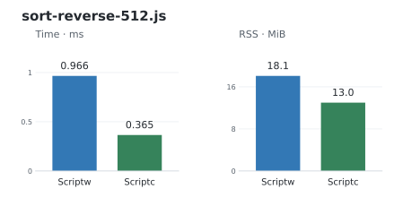</td>
</tr>
<tr>
<td>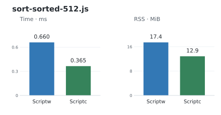</td>
<td></td>
</tr>
<tr>
<td>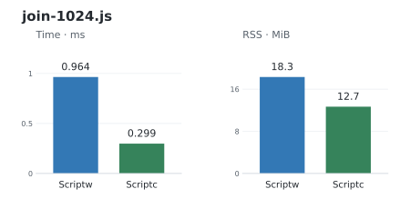</td>
<td>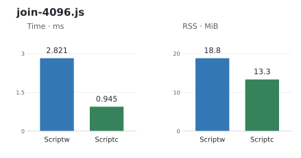</td>
</tr>
<tr>
<td>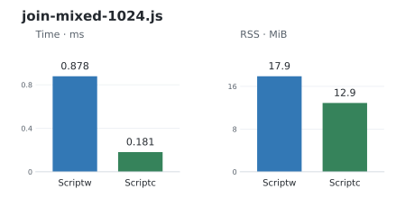</td>
<td>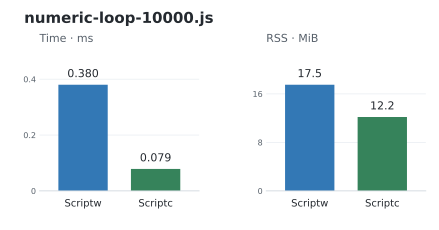</td>
</tr>
<tr>
<td>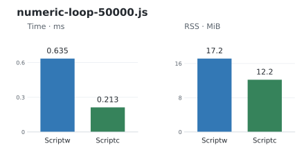</td>
<td>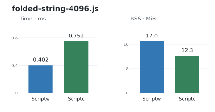</td>
</tr>
<tr>
<td></td>
<td>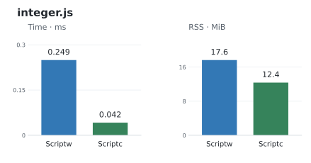</td>
</tr>
<tr>
<td>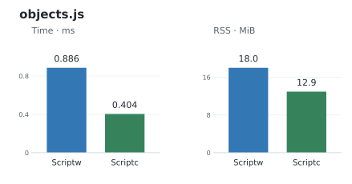</td>
<td>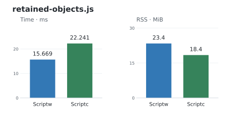</td>
</tr>
<tr>
<td>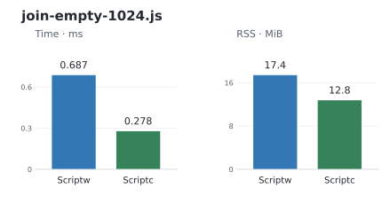</td>
<td>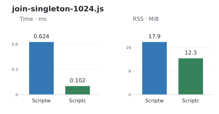</td>
</tr>
<tr>
<td>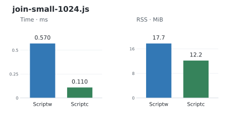</td>
<td></td>
</tr>
</table>

| Workload | Scriptw ms | Scriptc ms | Scriptw RSS / PSS / private dirty MiB | Scriptc RSS / PSS / private dirty MiB |
| --- | ---: | ---: | ---: | ---: |
| sort-reverse-128.js | 0.306 | 0.087 | 17.797 / 15.605 / 7.094 | 12.975 / 10.766 / 5.926 |
| sort-reverse-512.js | 0.569 | 0.211 | 17.826 / 15.621 / 7.070 | 12.998 / 10.806 / 5.990 |
| sort-sorted-512.js | 0.517 | 0.213 | 17.252 / 15.042 / 7.045 | 12.725 / 10.513 / 5.736 |
| to-sorted-512.js | 0.576 | 0.232 | 18.086 / 15.871 / 7.188 | 12.750 / 10.562 / 5.975 |
| join-1024.js | 0.769 | 0.291 | 18.357 / 16.148 / 7.152 | 12.963 / 10.754 / 5.945 |
| join-4096.js | 2.447 | 0.939 | 18.795 / 16.607 / 7.672 | 13.430 / 11.229 / 6.484 |
| join-mixed-1024.js | 0.878 | 0.181 | 17.889 / 15.701 / 7.160 | 12.889 / 10.702 / 5.908 |
| numeric-loop-10000.js | 0.255 | 0.064 | 16.660 / 14.468 / 7.039 | 12.258 / 10.070 / 5.250 |
| numeric-loop-50000.js | 0.391 | 0.152 | 17.127 / 14.943 / 6.979 | 12.248 / 10.037 / 5.219 |
| folded-string-4096.js | 0.288 | 0.421 | 17.277 / 15.072 / 6.990 | 12.312 / 10.101 / 5.289 |
| dynamic-string-4096.js | 0.347 | 0.161 | 16.961 / 14.779 / 6.943 | 12.299 / 10.115 / 5.248 |
| integer.js | 0.249 | 0.042 | 17.646 / 15.435 / 6.975 | 12.365 / 10.149 / 5.340 |
| objects.js | 0.644 | 0.413 | 17.900 / 15.691 / 6.812 | 13.039 / 10.835 / 3.250 |
| retained-objects.js | 12.131 | 22.758 | 23.404 / 21.229 / 8.490 | 18.543 / 16.361 / 8.822 |
| join-empty-1024.js | 0.406 | 0.157 | 17.688 / 15.492 / 2.984 | 12.898 / 10.717 / 2.869 |
| join-singleton-1024.js | 0.408 | 0.080 | 17.627 / 15.417 / 2.988 | 12.293 / 10.111 / 2.289 |
| join-small-1024.js | 0.570 | 0.110 | 17.732 / 15.553 / 3.070 | 12.166 / 9.952 / 2.297 |

A failure in either round removes that runtime’s bars for the case; all original failure streams remain. Checksums, warmup order, shared executable/configuration, raw Wasm and producer/consumer image identities are readmitted before rendering. Checksums do not grant native-code trust: externally supplied native images retain the Rust API’s explicit unsafe provenance requirement.

[Checked report](precompiled-comparison.json) · [Raw evidence](precompiled-comparison.tar.gz). The archive excludes executables, serialized native images and caches, retaining their identities, inert framing metadata, sources, raw Wasm, complete command streams, tool versions and Cargo producer log.

Validate or regenerate without running native code:

```sh
python3 scripts/precompiled_comparison.py check docs/rust-rewrite/precompiled-comparison.json
python3 scripts/precompiled_comparison.py render docs/rust-rewrite/precompiled-comparison.json
```
